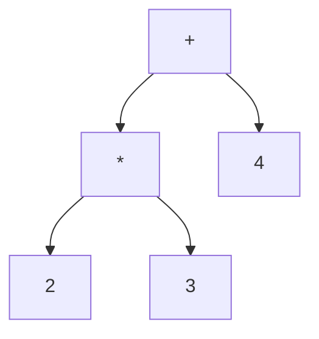

# 00 总览：你究竟在实现什么

## 本章要回答的问题

一段文本 `let x = 2 * 3;` 只是一串字节。让机器"执行"它，意味着要在若干个表示形式之间做转换，每次转换都让结构更明确、离机器更近。这一章给出全局地图：有哪些层、每层的输入输出是什么、为什么这样切分，以及你在哪里。

## 1. 从一个表达式看穿所有层

拿 `2 * 3 + 4` 走一遍。

**字符流**——没有任何结构，`*` 和 `+` 只是两个字节：

```text
'2' ' ' '*' ' ' '3' ' ' '+' ' ' '4' ';'
```

**Token 流**——有了"词"的概念，空白消失了，但**结构仍然是线性的**：

```text
INT(2)  MULTI(*)  INT(3)  PLUS(+)  INT(4)  SEMICOLON(;)
```

注意这里还看不出 `2 * 3` 比 `3 + 4` 结合得更紧。线性序列无法表达优先级。

**AST**——结构出现了，优先级变成了树的形状：



`*` 在 `+` 的下层，意味着它先求值。**优先级信息已经被消化掉了**——树本身就编码了运算顺序，后面所有阶段都不需要再知道 `*` 比 `+` 优先。这是分层的核心收益。

**执行**——两条路：

```text
                      ┌──→ Evaluator ──────────────→ Object(10)
AST ─────────────────┤
                      └──→ Compiler → Bytecode → VM → Object(10)
```

两条路必须给出**同一个结果**。这个约束贯穿整个项目。

## 2. 完整管线

```text
源代码
  │
  │  Lexer（词法分析）        01 章
  ↓
Token 流
  │
  │  Parser（语法分析）       03 章，节点定义见 02 章
  ↓
AST
  │
  ├──→ Evaluator（树遍历求值）        04-05 章
  │      └→ Object + Environment
  │
  └──→ Compiler（编译）               06-07 章
         └→ Bytecode + 常量池
              │
              │  VM（虚拟机）          08-09 章
              ↓
            Object
```

每层只依赖上一层的输出格式，不关心它是怎么产生的：

| 层 | 输入 | 输出 | 不需要知道 |
| --- | --- | --- | --- |
| Lexer | `string` | `token.Token` 序列 | 什么是表达式、什么是语句 |
| Parser | Token 序列 | `*ast.Program` | 字符、空白、注释 |
| Evaluator | AST | `Object` | 源码文本、优先级 |
| Compiler | AST | 指令 + 常量池 | 如何执行指令 |
| VM | 指令 + 常量池 | `Object` | 源码、AST、优先级 |

**这张表是你判断代码是否放错位置的依据。** 如果 VM 里出现了"判断 `*` 优先于 `+`"的逻辑，说明 parser 没做完自己的工作。如果 parser 里出现了"计算 2*3 等于 6"的逻辑，说明它越界了（那叫常量折叠，属于优化，应该在 compiler 里，而且是可选的——[13 章](13-optimization.md) 有完整展开，包括这类优化在 evaluator/compiler/VM 之外的第四个位置："什么时候在字节码层面做、什么时候在运行期做"）。

## 3. 为什么要两种执行模型

一个自然的疑问：既然 evaluator 已经能跑，为什么还要 compiler + VM？

**性能。** Evaluator 每次求值 `2 * 3` 都要：递归进入 InfixExpression 节点、类型断言判断节点种类、递归左子树、递归右子树、判断操作符字符串、分派到整数乘法。其中「判断节点种类」和「判断操作符」这两步，**每次执行都重做一遍，尽管答案永远不变**。

编译把这些"每次都一样"的判断提前做掉一次，结果固化成指令：

```text
OpConstant 0    // 压入 2
OpConstant 1    // 压入 3
OpMul           // 乘
```

VM 执行时只剩一个 opcode 分派，没有类型断言、没有字符串比较、没有递归。循环体内的代码尤其受益——`while` 循环里的表达式，evaluator 每轮都重新分析 AST，VM 只是重新执行几条指令。

**但这不是唯一理由。** 更重要的是：

- **AST 是树，机器执行是线性的。** 编译强迫你把 `if`、`while` 这些树形结构降低成"跳转到某个地址"，这是理解真实编译器的关键一步。
- **evaluator 是你的参照实现。** 有了它，VM 的每个行为都有可对比的正确答案。差分测试（同一份输入喂给两条路径，断言结果相同）是你后面最有力的调试手段。

所以顺序是先 evaluator 再 VM，不是因为 evaluator 更简单（虽然它确实更简单），而是因为**你需要一个已知正确的语义定义**，才能验证编译的结果。

## 4. 语义契约：两条路径必须一致的地方

"两条路径结果相同"听起来显然，实践中却是最容易破的约束。原因是这些决定散落在几十处代码里，很容易在一条路上改了忘了另一条。

把它们集中写下来，这就是你的语言规范：

| 决定 | 必须明确回答 | 影响位置 |
| --- | --- | --- |
| **truthy** | 哪些值在 `if`/`while`/`&&` 条件里算真？只有 `false` 和 `null` 假，还是 `0`、`""`、`[]` 也假？ | evaluator 的条件判断、VM 的 `OpJumpNotTruthy` |
| **相等性** | `1 == 1.0` 吗？`[1] == [1]` 吗（值相等还是引用相等）？`"a" == "a"` 吗？ | evaluator 的 `==`、VM 的 `OpEqual` |
| **数字混算** | `1 + 2.5` 是什么类型？int 自动提升为 float 吗？`1 / 2` 是 0 还是 0.5？ | 两条路的算术分派 |
| **越界** | `[1,2][5]` 返回 null 还是报错？负索引呢？ | 两条路的索引实现 |
| **未定义变量** | 读取未绑定的名字：报错还是返回 null？ | Environment.Lookup、符号表解析 |
| **赋值未绑定** | `x = 1` 而 `x` 从未 `let`：报错还是隐式创建？ | Environment.Assign、compiler 符号解析 |
| **隐式返回** | 函数体最后一个表达式的值自动返回吗？块的值是什么？ | evaluator 的 return 传播、compiler 的 `OpReturnValue` |
| **`while` 的值** | 循环是语句（无值）还是表达式（值是什么）？ | 两条路 |
| **函数比较** | 两个函数对象能比较吗？ | 两条路的 `==` |
| **求值顺序** | `f() < g()` 先执行哪个？带副作用时两条路径必须一致 | evaluator 的中缀求值、compiler 的操作数交换 |
| **闭包捕获语义** | 闭包捕获的是变量的**值**还是**绑定**？捕获后修改原变量，闭包看得见吗？ | evaluator 的 `Function.Env`、VM 的 `Closure.Free` |

### 两处已知的偏差

上表最后两行需要单独说明，因为它们是整套实现里**两条路径会给出不同结果**的地方。原版 Monkey 都不存在这两个问题——偏差一源自指令集的精简取舍，偏差二直接源自你的赋值语句扩展。

#### 偏差一：比较运算符的操作数求值顺序

字节码指令集里没有 `OpLessThan`：compiler 编译 `a < b` 时**交换操作数**，发出 `b > a` 的指令（`<=` 同理变成 `>=`）。这省掉两条 opcode，是标准做法，[06 章 4.1 节](06-bytecode.md) 有完整推导。

代价是**求值顺序反了**：

```monkey
let log = 0;
let f = fn() { log = log * 10 + 1; 1 };
let g = fn() { log = log * 10 + 2; 2 };
f() < g();
log;        // evaluator: 12（f 先）   VM: 21（g 先）
```

evaluator 按 AST 顺序先求 `f()`；VM 执行的是 `g() > f()`，`g` 先跑。**差分测试会抓到这个**，所以你需要提前知道它不是 bug。

三种处理，按推荐顺序：

1. **先接受，记录在案**（本文档的选择）。C 和 C++ 几十年来就把比较运算符的操作数求值顺序规定为未定义。差分测试时排除"比较运算符两侧都有副作用"的用例。
2. **实现完 VM、有了差分测试框架之后，回来加 `OpLessThan` / `OpLessEqual`。** 那时你有测试保护，改指令集是安全的。这是最干净的修法。
3. compiler 保持源码顺序，额外发一条 `OpSwap` 指令。多一条指令换语义对齐。

选 1 的理由不是"这样更对"，而是**现在改指令集要连带改 06 章、`code` 包、反汇编测试，而你还没有能验证修改的测试**。先让两条路径跑起来、差分测试建好，再回头收拾这个偏差——这个顺序本身就是工程判断的一个例子。

#### 偏差二：闭包捕获的是值还是绑定

这一条比上一条更根本，而且**是你的赋值语句扩展直接导致的**。

两条路径捕获自由变量的机制不同：

| | evaluator | VM |
| --- | --- | --- |
| 载体 | `Function.Env` —— 整条环境链的**引用** | `Closure.Free` —— 用到的变量的**值拷贝** |
| 捕获时机 | 保存引用，此后的修改可见 | 创建闭包那一刻的快照 |

原版 Monkey 里这个区别观察不到，因为没有赋值语句——变量绑定后不能改，"引用一个不变的绑定"和"拷贝它的值"结果永远相同。**你加了 `ast.AssignmentStatement`（ast.go:143），变量可变了，区别就暴露出来**：

```monkey
let make = fn() {
    let fns = [];
    let i = 0;
    while (i < 3) { fns = push(fns, fn() { i }); i = i + 1; }
    fns
};
make()[0]();      // evaluator: 3     VM: 0
```

evaluator 里三个闭包共享同一个环境，`i = i + 1` 改的就是它们看到的那个绑定，所以都返回循环结束后的 `3`。VM 里每个 `OpClosure` 把 `i` 的**当时值**复制进 `Free[0]`，三个闭包分别捕获 0、1、2。

（注意上例必须把 `i` 放进函数内使它成为 local。如果 `i` 是全局变量，两条路径都返回 `3`——全局变量走 `OpGetGlobal` 读同一个槽位，不经过捕获机制。这个区别本身就值得手算一遍。）

三种处理：

1. **接受并记录**：契约里写明"捕获局部变量按值"，差分测试排除这类程序。**建议同时让"给自由变量赋值"变成编译错误**——静默给出不同结果比直接拒绝糟糕得多。
2. **让 evaluator 也按值捕获**：创建 `Function` 时对用到的自由变量做快照。需要在 evaluator 侧做一次自由变量分析，而那本是编译期的活。
3. **让 VM 按引用捕获**：`Closure.Free []*Cell`，加一条 `OpSetFree`。这是 Lua 的 upvalue 和 JS 引擎的做法，**语义上最正确**，代价是多一层间接和一个新的对象类型。

**最省事的是 1，最正确的是 3。** 选 1 就必须配上那个编译错误，否则这不是"记录在案的技术债"，而是一颗埋着的雷。[09 章 ⑦](09-closures.md) 有完整的推导和 VM 侧的实现细节。

**两处偏差的共同点：它们都被写下来了。** 未被记录的不一致是 bug；被记录、有复现用例、有修复计划的不一致是技术债。两者性质不同——而区别只在于你是否花了十分钟把它写清楚。

对你的扩展语言，另有两处需要格外注意，因为原版 Monkey 没有：

**`while` 是语句。** 你的 `ast.WhileStatement`（ast.go:160）实现了 `statementNode()`，所以它不产生值。这个选择让 `let x = while(...)  {}` 语法上就非法，简化了实现。但要在 compiler 里决定：`while` 编译完之后栈上留不留东西？（不留——语句不产生值。而 evaluator 里 `Eval` 返回什么？需要一个约定，通常返回 `NULL` 但调用方忽略它。）

**赋值是语句，不是表达式。** `ast.AssignmentStatement`（ast.go:143）同样是语句。所以 `x = y = 1` 和 `if (x = 1)` 都非法。这避免了 C 语言里 `if (x = 1)` 那类经典错误，代价是不能写 `while ((line = next()) != null)` 这种惯用法。

**`float` 与 `int` 并存。** 这是你最大的扩展，也是最容易出现两条路不一致的地方。必须先回答：

- `1 + 2.5` → float 3.5（int 提升）还是类型错误？
- `1 == 1.0` → true 还是 false？
- `2 / 4` → int 0（截断）还是 float 0.5？
- `1.5 < 2` → 允许混合比较吗？
- 哈希的键可以是 float 吗？（`0.1 + 0.2` 作键会怎样？）

**现在就回答，写进本文档，两条路都照它实现。** 后补的规则一定会导致不一致。

## 5. 各层的不变量

不变量比函数名重要。写代码前先写下来，出 bug 时逐条检查。

**Lexer**

- 每次 `NextToken()` 要么消费至少一个字符，要么已在 EOF（否则死循环）
- `position` 指向"已消费区域之后"，切片 `Input[start:position]` 是完整 token
- EOF 后反复调用稳定返回 EOF token，不越界、不 panic
- 最长匹配：`==` 优先于 `=`，`>=` 优先于 `>`

第二条曾经在实现里是破的（11 章缺陷 1，EOF 分支没推进 `position`），现在 `lexer.go` 已经修复，四条不变量都成立——第一条仍然值得单独测。

**Parser**

- 游标契约：每个 `parseXxx` 函数返回时，`curToken` 指向它所消费结构的**下一个** token（03 章详述——这是你的实现与书上最大的差异，也是最容易搞混的地方）
- 解析失败时至少消费一个 token 或到达 EOF（防死循环）
- 输出的 AST 满足语法约束：`IfExpression.Branches` 非空、第一个分支必有 condition、`LetStatement.Name` 非 nil
- 不做语义判断：不检查变量是否定义、不检查类型、不算术

**Environment**

- 查找从当前层向外，第一次命中即返回（内层遮蔽外层）
- `Define` 只作用于当前层，`Assign` 只修改已存在的绑定
- 闭包持有的是**定义时**环境的引用，不是调用时环境

**Compiler**

- 栈平衡：编译完一个表达式，栈净增 1；编译完一个语句，栈净增 0
- 跳转目标落在合法指令边界（不是指令中间的操作数字节）
- 符号表的作用域栈与运行时 frame 栈是**两套东西**，不要混

**VM**

- 每条指令执行前后，`sp` 的变化等于该 opcode 声明的栈效果
- `ip` 始终指向合法指令起始位置
- frame 弹出后，栈顶恰好是返回值，调用者的局部变量区完好

## 6. 你在哪里

已完成（代码在仓库里）：

```text
token/token.go     ✓  token 类型与关键字表
lexer/lexer.go     ✓  词法分析
ast/ast.go         ✓  AST 节点
parser/parser.go   ✓  Pratt parser
repl/repl.go       △  只打印 token，且当前编译失败
```

未开始：

```text
object/            ✗  运行时对象与 Environment      → 04 章
evaluator/         ✗  树遍历求值                    → 05 章
code/              ✗  opcode 定义与编码             → 06 章
compiler/          ✗  AST → 字节码                  → 07 章
vm/                ✗  栈式虚拟机                    → 08-09 章
```

**在往下走之前，读一遍 11 章。** 已完成的三个包曾经有 12 个已实测确认的缺陷，其中 6 个是致命的（EOF 截断、`true`/`false` 无法解析、复合字面量不能嵌套、索引不参与 postfix、零参调用 panic、括号分组缺失）——现在全部已经修复（`go build && go vet && go test` 全绿），11 章从"当前问题清单"变成了"回顾式勘误"：**它的价值不会因为 bug 修完而消失**，展示这些错误长什么样、根因在哪一行、怎么定位、怎么修，本身就是词法/语法分析里最典型的一批案例。读一遍能帮你在自己继续往下写 04 章之后的代码时，提前认出同一类错误的影子。

## 7. 如何使用这套文档

每章的结构一致：

1. **本章要回答的问题**——一句话锚定
2. **设计推导**——从需求推出数据结构，而不是先给结构再解释。这部分最重要，因为独立实现时你需要的是推导能力，不是记忆力
3. **关键代码**——数据结构给完整定义，函数给骨架和契约
4. **手算 trace**——具体输入逐步走状态
5. **边界与陷阱**
6. **验收测试清单**——可以直接落成 `_test.go`
7. **练习**——递进式

01–03 章对照你已有的代码讲，重点是**为什么这样设计**以及**你的扩展带来了什么后果**。04 章之后是你要写的部分，给数据结构、函数签名、栈效果契约和测试用例，**不给完整实现**——中间的推导留给你。

用法建议：读完一章的推导部分，**先自己写**，卡住了再看关键代码那节。如果直接照抄，这套文档对你的价值会减半。

## 8. 推荐路线

```text
第 0 步   确认 go build && go vet && go test 全绿（11 章的 12 条缺陷已修复，读一遍当回顾）
第 0b 步  可选支线：03b 章的 RPN 表达式引擎——只需要 03 章，不必等 04 章
第 1 步   04 章 object 包：Object 接口 + Environment（含嵌套、Assign）
第 2 步   05 章 evaluator：整数 → 布尔 → 前缀/中缀 → 条件 → 变量绑定
第 3 步   05 章续：函数与调用 → 闭包 → return 传播 → 错误传播
第 4 步   05 章续：你的扩展——while、赋值、float 混算、短路 && ||
第 5 步   05 章续：字符串、数组、哈希、索引、内置函数
第 6 步   06 章 code 包：opcode、编码、反汇编（先把工具做好）
第 7 步   07-08 章：整数算术 → 布尔比较 → 跳转（if）→ 全局变量
第 8 步   07-08 章续：字符串/数组/哈希 → 索引
第 9 步   07-08 章续：函数（局部变量、frame、调用返回）
第 10 步  09 章：闭包（free 变量）→ 递归 → while
第 11 步  10 章：差分测试，两条路径全部对齐
第 12 步  12 章：静态类型探索（可选）
第 13 步  13 章：编译期/运行期优化——常量折叠、窥孔优化、内联缓存（可选）
第 14 步  14 章：JIT 探索——观察热点、guard、去优化（可选，难度较高）
第 15 步  15 章：原生代码生成探索——直写机器码/LLVM/transpile 三条路线（可选，工程量最大）
```

每加一个特性，回答同样的四个问题：

1. **语法是什么？** 更新 `README.md` 的 BNF
2. **AST 怎么表示？** 新节点还是复用现有节点
3. **运行时语义是什么？** 写进第 4 节的契约表
4. **编译后值和控制流怎么表示？** 栈效果、需不需要新 opcode

第 3 问和第 4 问必须给出一致的答案。这是整个项目唯一真正困难的地方——不是任何单个算法，而是**保持两个实现说同一种语言**。
