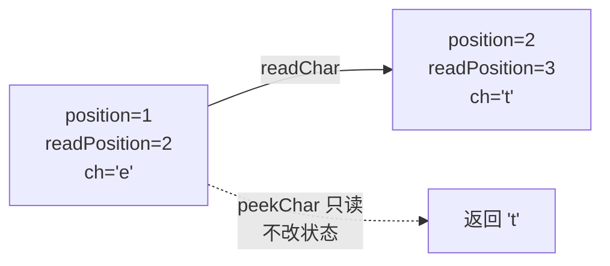
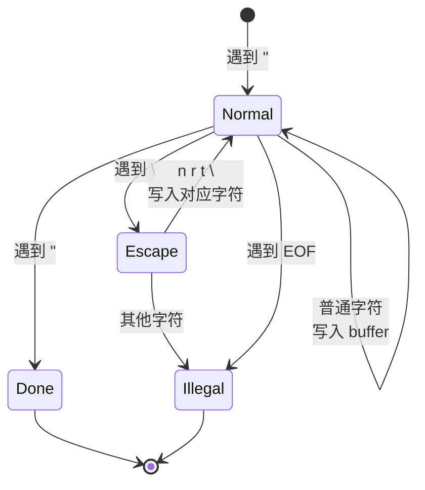

# 01 Lexer：从字符流到 token

## 本章要回答的问题

给一个 `string`，怎么把它切成"词"？切分的边界由什么决定？为什么 `==` 不能切成两个 `=`，而 `x=y` 里的 `=` 又必须是单个？

## 1. 为什么需要这一层

理论上 parser 可以直接读字符。实践中没人这么做，原因是**两类决策的性质完全不同**。

判断 `>=` 是一个运算符还是两个，只需要看**紧邻的两个字符**，不需要知道它出现在什么表达式里。判断 `-` 是二元减法还是一元取负，需要知道**它前面是不是一个完整的表达式**——这是语法问题。

前者是**局部的、有限的**：看固定长度的窗口就能决定。后者是**全局的、递归的**。把它们混在一起写，你会得到一个既要处理字节又要处理递归结构的函数。

所以切分：lexer 只做局部决策，输出一串扁平的 token；parser 只做结构决策，不再关心字节。

分层的第二个收益是**空白和格式彻底消失**。lexer 之后，`1+2`、`1 + 2`、`1  +\n  2` 产生完全相同的 token 序列。parser 不需要处理缩进、换行、多余空格——这些在源码里占了大量字符，却对语义毫无贡献。

## 2. 状态机：从需求推出字段

lexer 要反复回答一个问题："从当前位置开始，最长的合法 token 是什么？"

要回答它，需要什么状态？

**需要输入本身**——切出的 token 字面量是输入的子串，必须持有它：

```go
Input string
```

**需要知道扫到哪了**——一个游标。但一个不够：判断 `=` 是 `ASSIGN` 还是 `EQUAL` 的一部分，必须能看下一个字符**而不移动游标**。所以要两个位置：

```go
position     int   // 当前字符的位置
readPosition int   // 下一个待读字符的位置
```

**需要当前字符本身**——可以每次 `Input[position]` 取，但那样 EOF 判断要散落到各处。缓存成字段，用 `0` 表示 EOF，判断就统一了：

```go
ch byte
```

四个字段推导完毕，这就是 [lexer.go:10-16](../lexer/lexer.go#L10-L16)：

```go
type Lexer struct {
	Input        string
	InputRowsPos []int
	position     int  // current read positon
	readPosition int  // next read positon
	ch           byte // current character
}
```

（`Input` 首字母大写是你的扩展——导出它让调用方能拿原始输入做错误上下文（`GetLine` 方法用到了它）。原版是小写的 `input`。`InputRowsPos` 是后来加的第五个字段，记录每一行起始位置，专门为第 9 节的 `Line`/`Column` 服务，这里先不展开。）

### 三个字段的关系

这三者必须始终满足一个关系，否则切出的字面量就是错的：

```text
Input:         l   e   t       a
索引:          0   1   2   3   4
                   ↑   ↑
              position readPosition
              ch = 'e'
```

**不变量：`readPosition == position + 1`，`ch == Input[position]`。**

`readChar()` 的职责就是让这个关系向前推进一格。`peekChar()` 读 `Input[readPosition]` 而**不推进**——这就是 lookahead。



### EOF 的处理

到达输入末尾时，`ch` 设为 `0`。因为 `0` 不是任何合法 Monkey 源码字符，用它当哨兵可以让"是否结束"和"当前是什么字符"用同一个判断表达。

但**`position` 在 EOF 时也必须继续满足不变量**——它应该指向 `len(Input)`，这样 `Input[start:position]` 才能取到最后一个字符。这是词法分析器最经典的 off-by-one，几乎每个人写第一版时都会踩：早期版本的 `readChar` 在 EOF 分支里只设了 `l.ch = 0`，没有推进 `l.position`，导致所有紧贴 EOF 的 token 少一个字符（[11 章缺陷 1](11-errata.md) 有完整的根因分析和 trace）。现在的 [lexer.go:164-175](../lexer/lexer.go#L164-L175) 在 EOF 分支里补上了 `l.position = len(l.Input)`，不变量在 EOF 时也成立了：

```go
func (l *Lexer) readChar() byte {
	if l.readPosition >= len(l.Input) {
		l.ch = 0
		l.position = len(l.Input)
		return l.ch
	}

	l.ch = l.Input[l.readPosition]
	l.position = l.readPosition
	l.readPosition += 1
	return l.ch
}
```

## 3. NextToken 的骨架

`NextToken()` 是一次完整的状态转换。四步：

```text
1. 跳过空白                        skipWhiteChar
2. 按当前字符分派                  switch l.ch
3. 需要 lookahead 的做最长匹配     peekChar
4. 推进游标，返回 token
```

分派表按"需要看几个字符"分组：

| 类别 | 判断依据 | 例子 |
| --- | --- | --- |
| 单字符确定 | 只看 `ch` | `+ - * / , : ; { } [ ] ( )` |
| 双字符候选 | 看 `ch` + `peekChar` | `= ==`、`! !=`、`> >=`、`< <=` |
| 双字符强制 | 看 `ch` + `peekChar`，单字符非法 | `&&`、`\|\|` |
| 需要循环扫描 | 看 `ch` 判类别，然后循环 | 标识符、数字、字符串 |
| 终止 | `ch == 0` | EOF |
| 兜底 | 都不匹配 | ILLEGAL |

前三类在你的实现里是 [lexer.go:31-101](../lexer/lexer.go#L31-L101) 的 switch，第四类落在 `default`（lexer.go:104-138）。

## 4. 最长匹配

**规则：能匹配更长的 token 时，必须匹配更长的。**

考虑 `x == y`。如果 lexer 见到 `=` 就返回 `ASSIGN`，结果是 `IDENT(x) ASSIGN ASSIGN IDENT(y)`——parser 完全无法从这个序列恢复出"相等比较"。

实现方式是 lookahead 一位：

```go
case '=':
	if l.peekChar() == '=' {
		l.readChar()                                              // 多消费一个
		tok = token.Token{Type: token.EQUAL, Literal: "=="}
	} else {
		tok = token.Token{Type: token.ASSIGN, Literal: "="}
	}
```

`l.readChar()` 那一行是关键：进入 case 时 `ch` 是第一个 `=`，多调一次 `readChar` 让 `ch` 变成第二个 `=`，然后函数末尾统一的 `l.readChar()`（lexer.go:144，在 `if !advanced` 里）把它也消费掉。**两个字符，两次推进。**

### 你的扩展：`&&` 和 `||`

原版 Monkey 没有逻辑运算符。你加了它们，而它们的匹配规则与 `==` 不同——**单字符形式是非法的**：

```go
case '&':
	if l.peekChar() == '&' {
		l.readChar()
		tok = token.Token{Type: token.AND, Literal: "&&"}
	} else {
		tok = token.Token{Type: token.ILLEGAL, Literal: "expected '&'"}       // 没有按位与
	}
```

这是一个语言设计决定：Monkey 不提供按位运算，所以孤立的 `&` 是错误。对比 C，`&` 既是按位与又是取地址，`&&` 是逻辑与——三个含义靠上下文区分，lexer 只能给出 token，歧义留给 parser。

**你的选择更简单，而且错误发现得更早**：写 `a & b` 会在词法阶段就报错，而不是产生一个 parser 看不懂的 token 序列。

ILLEGAL 分支现在带了 `Literal: "expected '&'"`（`|` 对应 `"expected '|'"`），和 `default` 分支（lexer.go:137）的 `fmt.Sprintf("Unexpected token %c", l.ch)` 一样都说明了"哪里错了"——这处不一致（此前 `&`/`|` 分支的 `Literal` 是空字符串）已经补上。

### 优先级顺序不需要显式管理

有些 lexer 实现（尤其是用正则的）需要显式声明规则的优先顺序。手写 switch 不需要——因为**每个 case 内部自己处理了最长匹配**，不存在两个 case 竞争同一个输入的情况。这是手写 lexer 相对正则表格法的一个实际优势。

## 5. 循环扫描：标识符

标识符的边界不是固定长度，需要循环：

```go
func (l *Lexer) readIdentifier() string {
	position := l.position                 // 记住起点
	for isLetter(l.ch) {                   // 循环条件定义了边界
		l.readChar()
	}
	return l.Input[position:l.position]    // 切片
}
```

三个要点：

**循环条件就是 token 的定义。** `isLetter`（lexer.go:235-237）包含 `_`，所以 `_foo` 和 `my_var` 是合法标识符。但它**不包含数字**，所以 `x1` 会被切成 `IDENT(x)` 和 `INT(1)` 两个 token——`README.md` 的 BNF 写的是 `<identifier> ::= <letter> { <letter> | <digit> }`，允许数字。**实现比 BNF 严格**，这是一处仍然存在的不一致（`README.md` 里也明确标注了这一点）：修法是循环条件改成 `isLetter(l.ch) || isDigit(l.ch)`，但首字符仍只能是 letter，这个区分由调用点保证。

**循环退出时 `ch` 已经在 token 之外。** 所以调用方**不能再推进游标**：

```go
if isLetter(l.ch) {
	ident := l.readIdentifier()
	advanced = true       // ← 标记"已经越过自己"，而不是提前 return
	// ...
}
```

`advanced` 是一个显式标志，而不是靠函数提前 `return` 来跳过后处理。当前实现（lexer.go:141-145）把游标推进和位置赋值都挪到了函数末尾统一处理：

```go
tok.Line = line
tok.Column = column
if !advanced {
	l.readChar()
}
return tok
```

标识符、数字扫描（`readIdentifier` 内部的循环）已经把 `ch` 推到了 token 之外，所以它们把 `advanced` 设成 `true`，末尾的 `l.readChar()` 就不会再多吃一个字符；`line`/`column` 在函数开头（`skipWhiteChar` 之后）就已经算好，不依赖扫描路径是否提前返回。这解决了 [11 章附加观察 B](11-errata.md) 记录的旧问题——早期实现把位置赋值放在函数末尾但标识符/数字/字符串路径都提前 `return tok` 跳过了它，导致这三类 token 的位置信息恒为 0。现在无论走哪条路径，`Line`/`Column` 都会被正确设置。

### 关键字：不是词法问题

`let` 和 `myvar` 在词法上完全一样——都是字母序列。区分它们靠查表：

```go
ident := l.readIdentifier()
if token.IsKeyword(ident) {
	tok = token.Token{Type: token.KeywardsType[ident], Literal: ident}
} else {
	tok = token.Token{Type: token.IDENT, Literal: ident}
}
```

**先按最宽的规则扫描，再查表细分。** 这个模式比在 switch 里逐个匹配关键字前缀（`case 'l': if peek is 'e'...`）要好得多：加关键字只需改表，而且不会出现 `letx` 被误认为 `let` + `x` 的问题。

`IsKeyword`（token.go:80-82）的实现有个隐患：

```go
func IsKeyword(token string) bool {
	return KeywardsType[token] != ""
}
```

它靠"零值不等于空字符串"判断存在。因为 `TokenType` 的底层类型是 `string`，任何 token 类型的值都不能是 `""`，否则这个判断就错了。用 `_, ok := KeywardsType[token]` 更直接，也不依赖这个隐含约束。

### 你的扩展：TokenType 用字面量做值

```go
const (
	LET   = "let"      // 你的写法
	EQUAL = "=="
)
```

原版是 `LET = "LET"`、`EQ = "=="`。差别看着微小，但有实际影响：

**好处**：调试输出直接可读。`fmt.Printf("%s", tok.Type)` 打印 `let` 而不是 `LET`，token 流一眼能对上源码。

**代价**：`TokenType` 和 `Literal` 对关键字/运算符来说是重复的。而且 `KeywardsType` 表（token.go:69-78）里 `"let": LET` 展开后是 `"let": "let"`，键和值相同——表本身退化成一个集合。

**注意**：`INT = "int"`、`FLOAT = "float"`、`STRING = "string"`、`IDENT = "ident"` 这些**不是**字面量，它们是类别名。所以 `TokenType` 的值有两种性质混在一起：对关键字和运算符是"字面量本身"，对字面量类别是"类别名"。这不构成 bug（因为 `int` 不是关键字，不会和标识符 `int` 冲突……**除非**用户写 `let int = 5;`——此时 `IsKeyword("int")` 查 `KeywardsType["int"]`，表里没有 `int`，返回 false，所以安全）。

值得记住这个推理过程：命名空间重叠时，要显式检查是否真的会碰撞。这里侥幸安全，但如果你以后加了 `int` 作为类型关键字，就会出问题。

实测确认（`x1y2` 切成四个 token，`let int = 5;` 正常）：

```text
"x1"           -> [ident/"x"  int/"1"]        ← 与 BNF 不符
"x1y2"         -> [ident/"x"  int/"1"  ident/"y"  int/"2"]
"my_var"       -> [ident/"my_var"]            ← 下划线可以
"_foo"         -> [ident/"_foo"]              ← 可以做首字符
"letx"         -> [ident/"letx"]              ← 最长匹配正确，没被切成 let+x
"let int = 5;" -> [let  ident/"int"  =  int/"5"  ;]   ← 类别名不与标识符冲突
```

## 6. 循环扫描：数字与你的 float 扩展

原版 Monkey 只有整数。你加了 float，这让数字扫描需要**同时决定边界和类型**：

```go
} else if isDigit(l.ch) {
	isFloat := false
	position := l.position
	for isDigit(l.ch) || l.ch == '.' {       // 边界：数字或点
		if l.ch == '.' {
			isFloat = true                   // 顺便记录类型
		}
		l.readChar()
	}

	if isFloat {
		tok = token.Token{Type: token.FLOAT, Literal: l.Input[position:l.position]}
	} else {
		tok = token.Token{Type: token.INT, Literal: l.Input[position:l.position]}
	}
	return tok
}
```

**"扫描时顺便记录一个 bool，出循环后据此决定类型"** 是个好模式——只扫一遍输入，不需要回退。

但循环条件 `isDigit(l.ch) || l.ch == '.'` 对点的个数**没有限制**。实测：

```text
"1.2.3"  -> float/"1.2.3"      ← 应该是词法错误
"1."     -> float/"1."          ← BNF 要求点后有数字
"1..2"   -> float/"1..2"        ← 连续两点也接受
".5"     -> illegal             ← 这个对：点前必须有数字
"12"     -> int/"12"
```

前三个都是**非法的数字，却产出了合法的 FLOAT token**。错误被推迟到 parser 的 `strconv.ParseFloat`（parser.go:489）才发现。

**这违反了分层原则。** "`1.2.3` 不是一个数字"是纯粹的词法判断——只看这几个字符就能决定，不需要任何上下文。它应该在 lexer 报错。

让 parser 去处理这个错误有两个具体坏处：

1. **错误信息更差。** parser 只能说"parse float literal failed"，说不出"数字里有两个小数点"，因为它拿到的只是一个字符串，不知道扫描时发生了什么。
2. **契约被破坏。** 后续任何消费 token 流的代码（语法高亮、格式化工具、另一个 parser 实现）都得重新做这个检查。lexer 承诺"我输出的 FLOAT 是合法浮点数"，现在这个承诺是假的。

修法：扫描时数点的个数，`> 1` 直接返回 ILLEGAL；点后必须紧跟数字，否则也是 ILLEGAL。

### float 的精度选择

`ast.FloatLiteral.Value` 是 `float32`（ast.go:209），parser 用 `strconv.ParseFloat(lit, 32)`（parser.go:489）。这是个需要留意的决定：

- `float32` 只有约 7 位十进制有效数字。`0.1 + 0.2` 在 float32 下的误差比 float64 大一个量级
- Go 的 `float64` 是默认浮点类型，用 `float32` 意味着每次和标准库交互都要转换
- 未来实现哈希时，float 作为键的相等性判断会更容易出意外

大多数语言（JS、Python、Lua）的默认浮点是 64 位。如果没有特别的内存考虑，`float64` 是更省心的选择。现在改代价很小，等 evaluator 和 VM 都写完再改就要动很多地方。

## 7. 循环扫描：字符串与你的转义扩展

字符串是三条循环扫描路径里最复杂的，因为它是一个**独立的小状态机**：



你的实现（lexer.go:169-197）用 `strings.Builder` 累积，因为**输出不是输入的子串**——`\n` 是源码里的两个字符，输出是一个换行符。不能像标识符那样切片，必须逐字符构建。

```go
func (l *Lexer) readString() token.Token {
	sb := strings.Builder{}

	for {
		l.readChar()
		if l.ch == '"' {
			break                                     // 正常结束
		} else if l.ch == 0 {
			return token.Token{Type: token.ILLEGAL, Literal: "unterminated string"}
		} else if l.ch == '\\' {
			l.readChar()
			switch l.ch {
			case 'n':
				sb.WriteByte('\n')
			// r, t, \\ 同理
			default:
				return token.Token{Type: token.ILLEGAL, Literal: "illegal escape sequence"}
			}
			continue
		}
		sb.WriteByte(l.ch)
	}
	return token.Token{Type: token.STRING, Literal: sb.String()}
}
```

三条退出路径都被覆盖了：正常闭合、EOF（未闭合）、非法转义。**这是这个函数写得最好的地方**——很多人的第一版会漏掉未闭合的情况，导致 lexer 在 EOF 之后继续读，越界 panic。

### 缺了最必要的一个转义

支持的是 `\n \r \t \\`，**漏了 `\"`**。后果：

```text
let s = "a\"b";      → ILLEGAL
```

而这是转义机制存在的首要理由——没有 `\"`，字符串里根本无法包含引号。修法是加一个 `case '"': sb.WriteByte('"')`。

顺带想一个问题：`\\` 已经支持了，为什么 `\"` 更重要？因为 `\\` 只在字符串以反斜杠结尾时才必需（`"a\\"`），而引号在文本里出现的频率高得多。

### 在词法阶段解码：这个选择的连带后果

你选择了**在 lexer 里就把转义解码**，`Token.Literal` 存最终值。原版 Monkey 也是这样。好处是 parser 和 evaluator 拿到的就是最终字符串，不需要二次处理。

但有一个后果需要意识到：**`Literal` 不再是源码的子串**。这带来两个具体影响：

**AST 打印不可逆。** `ast.StringLiteral.String()`（ast.go:242）返回 `sl.Token.Literal`，也就是解码后的值。所以 `"a\nb"` 打印出来是：

```text
a
b
```

真正的换行，没有引号，没有转义。这个输出**无法重新解析**——如果你想用 `String()` 做格式化工具或宏系统，需要在打印时重新转义并补上引号。作为调试用的规范化打印器，现状够用；作为源码输出，不够。

**位置信息更难算。** token 的字面量长度不再等于它在源码里占的字符数（`"a\nb"` 字面量长 3，源码占 6），所以不能用 `len(Literal)` 推断 token 的结束位置。如果以后要做错误下划线（`^^^^` 标记出错范围），需要单独记录源码跨度。

另一种设计是 `Literal` 存原始文本、解码推迟到 AST 构造时。那样 `String()` 可以完美还原源码，代价是每个消费者都要知道怎么解码。**两种都合理，你选的这种更常见。** 关键是知道自己选了什么、代价在哪。

## 8. 手算一遍

输入 `let x = 1.5;`，逐步走状态。表格里 `pos`/`read` 是 `position`/`readPosition`，箭头标出每次 `NextToken` 的产出。

```text
Input:  l  e  t     x     =     1  .  5  ;
索引:   0  1  2  3  4  5  6  7  8  9 10 11
```

| 步骤 | 动作 | pos | read | ch | 产出 |
| --- | --- | --- | --- | --- | --- |
| New | readChar | 0 | 1 | `l` | — |
| NextToken 1 | skipWhite 无变化 | 0 | 1 | `l` | |
| | isLetter → readIdentifier | | | | |
| | 循环读到 `ch=' '` | 3 | 4 | `' '` | |
| | 切片 `Input[0:3]` = `"let"`，查表命中关键字 | | | | **LET** `"let"` |
| | 提前 return（不推进） | 3 | 4 | `' '` | |
| NextToken 2 | skipWhite 跳过空格 | 4 | 5 | `x` | |
| | isLetter → readIdentifier，读到 `' '` | 5 | 6 | `' '` | |
| | `Input[4:5]` = `"x"`，非关键字 | | | | **IDENT** `"x"` |
| NextToken 3 | skipWhite | 6 | 7 | `=` | |
| | case `'='`，peekChar = `' '` ≠ `'='` | | | | **ASSIGN** `"="` |
| | `tok.Pos = 6`，readChar | 7 | 8 | `' '` | |
| NextToken 4 | skipWhite | 8 | 9 | `1` | |
| | isDigit → 循环，`.` 置 isFloat | | | | |
| | 读到 `ch=';'` | 11 | 12 | `;` | |
| | `Input[8:11]` = `"1.5"`，isFloat | | | | **FLOAT** `"1.5"` |
| NextToken 5 | case `';'` | 11 | 12 | `;` | **SEMICOLON** `";"` |
| | `tok.Pos = 11`，readChar → EOF | 11 | 12 | `0` | |
| NextToken 6 | case `0` | | | | **EOF** |

注意几处：

- 第 1、2、4 步（标识符和数字）**提前 return，`Pos` 保持 0**；第 3、5 步走到函数末尾，`Pos` 正确（6 和 11）
- 第 4 步结束时 `position=11` 指向 `;`，正好是下一个 token 的起点——这就是"`position` 指向已消费区域之后"的不变量在起作用
- 最后一步 `readChar` 撞到 EOF，`position` 停在 11 没有推进到 12。这个输入侥幸没出问题（因为 `;` 是单字符 token，已经切好了），但如果输入是 `let x = 1.5` 没有分号，`1.5` 就会被截断成 `1.` （见 11 章缺陷 1）

**建议你自己手算 `x==y` 和 `"a\nb"` 两个输入**。前者验证最长匹配的双次推进，后者验证 `readString` 的 buffer 累积与源码长度不等。

## 9. 边界与陷阱

按踩到的频率排序。

**① token 紧贴 EOF。** 最常见的 off-by-one。测试输入必须包含 `"ab"`、`"12"`、`"let"` 这类**没有尾部空白**的形式。你的 `lexer_test.go` 用了一整段格式良好的程序（末尾是 `\n`），正好绕过了这个情形——所以缺陷 1 藏了下来。**词法测试的第一批用例应该是最短最脏的输入，不是最漂亮的程序。**

**② 提前 return 跳过后处理。** 只要 switch 里有 `return`，函数末尾的统一逻辑（推进游标、设 `Pos`）就被绕过。这本身是必要的（扫描函数已经推进了游标），但要意识到**每加一条提前返回的路径，就要检查它是否需要补做后处理**。

**③ `readChar` 在 EOF 后被反复调用。** `skipWhiteChar` 的循环、`readIdentifier` 的循环都可能在 EOF 上多转一次。必须保证 `readChar` 幂等（EOF 后再调用不改变状态、不越界）。写一个"连续调 10 次 `NextToken` 都返回 EOF"的测试。

**④ 空白定义遗漏。** `skipWhiteChar`（lexer.go:163-167）处理 `' '`、`\t`、`\n`、`\r`。Windows 换行 `\r\n` 被当成两个空白字符，正确。但如果以后加**注释**，它属于"要跳过的东西"，应该在这里处理（或在 switch 里加 `case '/'` 判断 `//`），而不是让 parser 忽略注释 token。

**⑤ ILLEGAL token 的信息量。** 三处产生 ILLEGAL 的地方信息质量不一致：`default` 分支有 `"Unexpected token %c"`，`&`/`|` 分支的 `Literal` 是**空的**，`readString` 有描述性消息。统一成"总是说明哪里错了什么"，否则错误信息到用户手里就是一片空白。

**⑥ 字节 vs 字符。** `ch` 是 `byte`，所以 lexer 是**按字节**工作的。ASCII 范围内没问题，但源码里出现中文字符串 `"你好"` 时，`readString` 会逐字节写入 buffer——碰巧能正确工作（因为 UTF-8 字节序列被完整复制了），但 `isLetter` 对多字节字符返回 false，所以中文标识符不支持。要支持的话得改用 `rune` 和 `utf8.DecodeRuneInString`，游标推进量变成可变的。**先用 ASCII 跑通，需要时再改**——但要知道这个限制存在。

## 10. 验收测试清单

三类，缺一类都不算测完。

**正常情况**

- 全部关键字：`let fn if else while return true false`
- 全部运算符：`= + - * / ! == != > < >= <= && ||`
- 全部分隔符：`, : ; { } [ ] ( )`
- 整数、浮点、字符串、标识符
- 一段完整程序（现有的 `TestNextToken` 就是这个）

**边界情况**（当前完全缺失）

- token 紧贴 EOF：`"ab"`、`"12"`、`"1.5"`、`"let"`、`"x"`
- 空输入 `""` 立即返回 EOF
- 只有空白的输入 `"   \n\t"` 返回 EOF
- EOF 后反复调用稳定返回 EOF（10 次）
- 双字符运算符紧贴 EOF：`"=="`、`"&&"`
- 单字符与双字符相邻：`"a==b"`、`"a=b"`、`"a>=b"`、`"a>b"`
- 最长匹配不误伤：`"letx"` 是一个标识符，`"iff"` 不是 `if`
- 空字符串字面量 `""""`（源码里的 `""`）
- 转义组合：`"\n"`、`"\\"`、`"\t\r"`

**错误情况**（当前完全缺失）

- 孤立 `&`、`|` → ILLEGAL
- 未知字符 `@`、`#`、`$` → ILLEGAL
- 未闭合字符串 `"abc` → ILLEGAL，且**不 panic**
- 非法转义 `"a\qb"` → ILLEGAL
- 非法数字 `1.2.3`、`1.`、`1..2` → ILLEGAL（曾经是缺陷 C 记录的 FLOAT 误判，现在 lexer 已经拒绝）

**位置断言**

- 每个 token 的 `Line`/`Column` 等于它在源码里的起始行列（曾经只有部分 token 类型的 `Pos` 被正确赋值，见附加观察 B；现在字段已升级为 `Line`/`Column` 且全路径统一赋值）

表驱动的写法：

```go
func TestNextTokenTable(t *testing.T) {
	tests := []struct {
		name  string
		input string
		want  []token.Token          // 期望的完整 token 序列（不含 EOF）
	}{
		{"token at EOF", "ab", []token.Token{
			{Type: token.IDENT, Literal: "ab", Pos: 0},
		}},
		{"longest match", "a==b", []token.Token{
			{Type: token.IDENT, Literal: "a", Pos: 0},
			{Type: token.EQUAL, Literal: "==", Pos: 1},
			{Type: token.IDENT, Literal: "b", Pos: 3},
		}},
		// ...
	}
	for _, tt := range tests {
		t.Run(tt.name, func(t *testing.T) {
			l := New(tt.input)
			for i, want := range tt.want {
				got := l.NextToken()
				if got != want {
					t.Errorf("token %d: got %+v, want %+v", i, got, want)
				}
			}
			if got := l.NextToken(); got.Type != token.EOF {
				t.Errorf("expected EOF, got %+v", got)
			}
		})
	}
}
```

对比现有的 `lexer_test.go`：它用了一个巨大的 input 加一个扁平的期望列表。改成表驱动 + 子测试有三个好处：失败时能立刻看出是哪一类输入坏了（`t.Run` 的名字）；每个用例独立，一个失败不阻塞其他；加边界用例只是加一行。

现有测试还有两处可以改进：用了 `t.Fatalf` 所以第一个失败就停（用 `t.Errorf` 能一次看到全部差异）；里面的 `fmt.Printf`（lexer_test.go:117）会在每次跑测试时打印 70 多行噪音——调试时有用，平时应该删掉或改成 `t.Logf`（只在 `-v` 或失败时显示）。

## 11. 练习

**1. 修缺陷 1，并证明修对了。** 不看 11 章的修法提示，自己定位。修完后回答：为什么 `New("ab ")` 一直是对的，而 `New("ab")` 是错的？你的修法会不会让 EOF token 的 `Pos` 越界？

**2. 补全 `Pos`。** 让所有 token 都有正确的起始偏移。三条提前返回的路径都要处理。做完跑一遍位置断言测试。

**3. 把 `Pos` 升级成 `Line` + `Column`。** 字节偏移对人不友好——报错要说"第 3 行第 12 列"。在 `skipWhiteChar` 遇到 `\n` 时递增行号、重置列号。想清楚：`Token` 里存起始位置就够吗？如果要给出 `^^^^` 下划线，还需要什么？

**4. 让数字扫描严格化。** `1.2.3`、`1.`、`1..2` 都应该是 ILLEGAL，且错误信息说明具体问题。做完想一想：`1e10` 这种科学计数法要支持吗？如果支持，`1e`、`1e+`、`1ee2` 分别该报什么错？

**5. 加 `\"` 转义。** 顺便加 `\0` 和 `\uXXXX`（后者需要 UTF-8 编码，会强迫你面对 byte/rune 的问题）。

**6. 加注释支持。** `// 到行尾` 和 `/* 跨行 */`。三个设计问题：注释算空白（跳过）还是算 token（保留）？如果要写格式化工具，哪种更合适？未闭合的 `/*` 怎么报错？

**7. 加 `%`（取模）和 `**`（幂）。** 前者是单字符，后者要和 `*` 做最长匹配。加完之后，`a ** b * c` 的优先级怎么定？（这题的后半部分属于 03 章，但现在就可以想。）

**8. 写一个 token 流转储工具。** 修 `repl.go` 的编译错误（缺陷 10），让 REPL 能打印每行输入的 token 流，格式 `类型/字面量@位置`。这是你调试后面所有章节的第一个工具，值得做好——加个开关能切换"只打印类型"和"打印完整信息"。

**9.（进阶）改成流式 lexer。** 现在 lexer 持有整个 `Input` 字符串。改成从 `io.Reader` 读，只保留一个小缓冲区。会遇到什么问题？（提示：`readIdentifier` 的切片就没法用了，`peekChar` 需要缓冲区支持回退；而且报错时无法回看源码上下文——parser.go:56 就依赖 `l.Input`。）

**10.（进阶）写一个模糊测试。** Go 1.18+ 支持 `func FuzzLexer(f *testing.F)`。断言：任何输入下 lexer 都不 panic、总能在有限步内到达 EOF、每次 `NextToken` 要么推进游标要么已在 EOF。这个测试会很快找出你没想到的边界。

```go
func FuzzLexer(f *testing.F) {
	f.Add("let x = 1;")
	f.Add(`"a\nb"`)
	f.Add("1.2.3")
	f.Fuzz(func(t *testing.T, input string) {
		l := New(input)
		for i := 0; i < len(input)+10; i++ {      // 上界：token 数不超过字符数
			if l.NextToken().Type == token.EOF {
				return
			}
		}
		t.Errorf("lexer did not reach EOF on %q", input)
	})
}
```

这个测试的断言"token 数不超过字符数 + 常数"直接编码了不变量①（每次调用消费至少一个字符）。**把不变量写成可执行的断言**，比写在注释里有用得多。

## 小结

- lexer 只做**局部**决策，看固定长度的窗口就能定；结构决策全部留给 parser
- 状态由 `(Input, position, readPosition, ch)` 构成，不变量是 `Input[start:position]` 恰为完整 token
- 最长匹配靠 lookahead 一位实现，每个 case 内部自己处理，不需要全局优先级
- 循环扫描的三条路径（标识符、数字、字符串）都必须提前 return，代价是跳过统一后处理
- 关键字不是词法概念——先按标识符扫，再查表细分
- 你的四处扩展各有代价：`&&`/`||` 让单字符非法（更早报错）、float 让数字扫描要判类型（但校验不足）、词法期解码转义让 `String()` 不可逆、`TokenType` 用字面量提升可读性但语义重复

下一章把这串扁平的 token 变成树。

