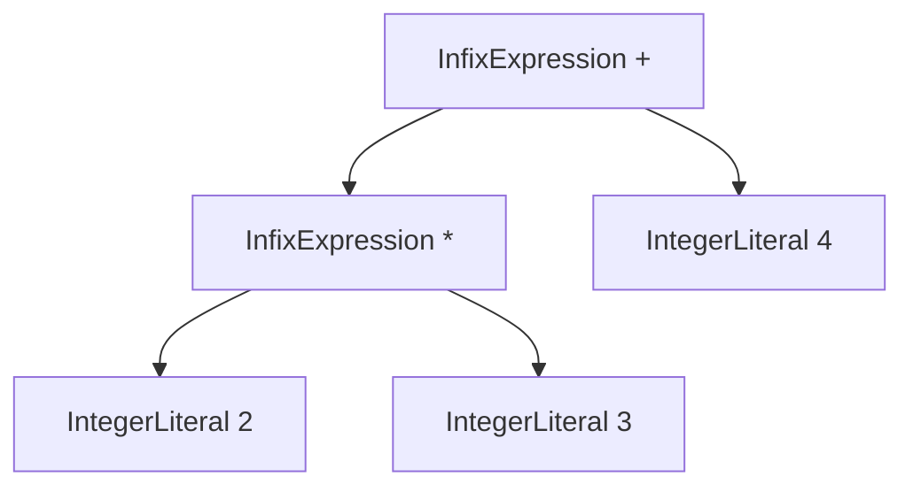
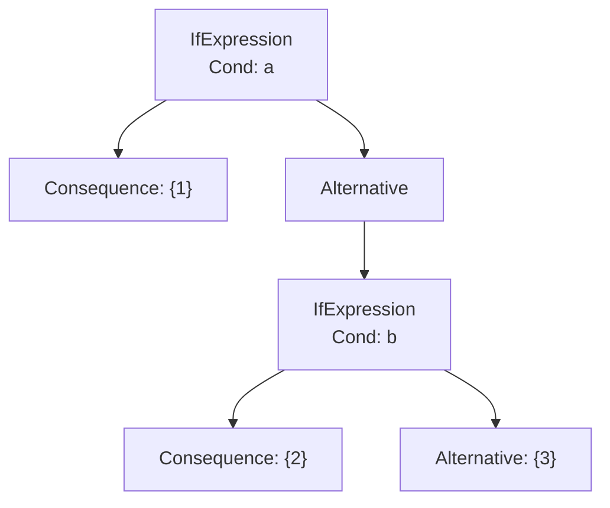
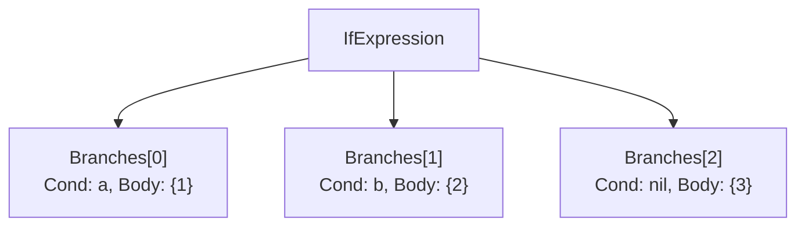

# 02 AST：用类型编码语法结构

## 本章要回答的问题

Token 流是线性的，但 `2 * 3 + 4` 里的运算顺序不是线性的。用什么数据结构保存这个顺序？需要保留多少源码信息？哪些语法差异应该在树上体现，哪些应该被消化掉？

## 1. 为什么是树

`2 * 3 + 4` 的求值顺序是"先乘后加"。表达这种依赖关系，最自然的结构是树：**子节点必须先求值，父节点才能求值**。



树的形状**就是**运算顺序。这带来一个重要结果：**AST 里不需要存优先级，也不需要存括号**。

`(2 * 3) + 4` 和 `2 * 3 + 4` 产生完全相同的树。括号在源码里的作用是指导 parser 怎么建树，建完就没用了。同理 `2 * (3 + 4)` 和 `2 * 3 + 4` 的树不同，这个"不同"已经完整表达了括号的效果。

所以 AST 里**没有** `GroupedExpression` 节点，**没有** `precedence` 字段。如果你发现自己想加，说明有些工作没在 parser 里做完。

## 2. 三个接口：为什么这样分

```go
type Node interface {
	TokenLiteral() string
	String() string
}

type Expression interface {
	Node
	expressionNode()
}

type Statement interface {
	Node
	statementNode()
}
```

### Node：所有节点的共同能力

两个方法各有明确用途：

- `TokenLiteral()` —— 拿到节点对应的源码词。调试和错误信息用
- `String()` —— 把子树打印成规范化文本。**这是你最重要的调试工具**，第 5 节详述

### Expression vs Statement：一个语义区分

**Expression 产生值，Statement 执行动作。**

这个区分不是形式主义，它决定了后面两个阶段的行为：

| | Evaluator | Compiler |
| --- | --- | --- |
| Expression | 返回一个 `Object` | 生成的指令让栈**净增 1** |
| Statement | 返回值被忽略 | 生成的指令让栈**净增 0** |

具体到 `1 + 2;` 这个表达式语句：表达式部分把结果压栈，然后语句层必须发一条 `OpPop` 把它丢掉——否则每执行一个语句栈就长高一格，循环几千次就溢出。

**"表达式语句要 Pop"这条规则，直接来自 Expression/Statement 的区分。** 如果类型系统不做这个区分，你就得在 compiler 里用别的方式判断"这个东西产生值吗"。

### 空方法 `expressionNode()` 的作用

`expressionNode()` 和 `statementNode()` 都是空的，看起来没用。它们的作用是**让编译器帮你检查分类**。

Go 的接口是隐式满足的。如果 `Expression` 和 `Statement` 都只要求 `Node` 的两个方法，那它们就是同一个接口——任何节点都能同时当表达式和语句用，`LetStatement` 可以被塞进 `InfixExpression.Left`。加一个空的 marker 方法，两个接口就不再兼容，放错位置**编译期**就报错。

这是 Go 里表达"封闭的类型集合"（sum type）的惯用手法。代价是每个节点要多写一行，收益是分类错误不会跑到运行时。

**边界情况：`IfExpression` 是表达式。** 它实现的是 `expressionNode()`（ast.go:310），所以：

```monkey
let x = if (c) { 1 } else { 2 };     // 合法，if 产生值
```

对比 `WhileStatement` 实现 `statementNode()`（ast.go:166），所以 `let x = while(...)  {}` 语法上就非法。**这两个选择必须在 evaluator 和 compiler 里一致落实**：`if` 编译后要留一个值在栈上（包括没有 else 分支时要压 `Null`），`while` 编译后栈上不留东西。

## 3. 从 BNF 推导节点

不要凭感觉设计节点，从语法规则推。规则里的每个"信息位"对应一个字段。

以 `README.md` 的 BNF 为例：

```bnf
<let> ::= "let" <identifier> "=" <expression> [ ";" ]
```

拆解：`let` 是固定词（不需要存，但存下 token 便于定位）；`<identifier>` 是变量名（要存）；`=` 是固定词（不存）；`<expression>` 是值（要存）；`;` 是可选分隔符（不存）。

得到三个字段：

```go
type LetStatement struct {
	Token token.Token   // the token.LET token —— 定位用
	Name  *Identifier   // 变量名
	Value Expression    // 右值
}
```

**固定的语法词不进 AST，可变的部分进 AST。** `let`、`=`、`;` 的位置和存在性已经由"这是一个 LetStatement"这个类型本身表达了。

再看中缀：

```bnf
<sum> ::= <product> { ( "+" | "-" ) <product> }
```

三个信息位：左操作数、操作符、右操作数。

```go
type InfixExpression struct {
	Token token.Token   // 操作符 token —— 同时充当"操作符是什么"
	Left  Expression
	Right Expression
}
```

注意这里 `Token` 兼任两个角色：定位信息 + 操作符标识。原版 Monkey 有一个独立的 `Operator string` 字段，你省掉了，靠 `Token.Literal` 取操作符。

**这个省略是合理的**——`Token.Literal` 确实就是 `+`，没有信息丢失。但它有两个小代价：一是读代码时 `ie.Token.Literal` 不如 `ie.Operator` 直白；二是**容易打错字段**，`PrefixExpression.String()`（ast.go:371）就是把 `pe.Token` 当字符串用了，`go vet` 能抓到（见 11 章缺陷 7）。有独立的 `Operator string` 字段时，这类错误不会发生，因为类型就不对。

### 推导练习：你的 while

```bnf
<while> ::= "while" "(" <expression> ")" <block>
```

固定词：`while`、`(`、`)`。可变：条件、循环体。

```go
type WhileStatement struct {
	Token     token.Token   // the token.WHILE token
	Condition Expression
	Body      Statement     // ← 注意这里
}
```

`Body` 的类型是 `Statement`（ast.go:163），不是 `*BlockStatement`。这是一个**放宽**：BNF 说这里必须是 `<block>`，但类型只要求是语句，所以 `WhileStatement{Body: &LetStatement{}}` 在类型上合法。

这类"类型比语法宽松"的地方要意识到：parser 保证了实际构造的一定是 `*BlockStatement`（parser.go:192 调 `parseBlockStatement`），但**类型系统没有保证**，所以 evaluator 和 compiler 处理 `Body` 时要么做类型断言，要么按一般语句处理。

对比 `FunctionExpression.Body` 用的是 `BlockStatement`（值类型，ast.go:338），`IfBranch.Body` 也是 `BlockStatement`（ast.go:301）。**同一个概念用了三种类型**：`Statement`、`BlockStatement`、`BlockStatement`。统一成 `*BlockStatement` 会更一致，也省掉 evaluator 里的断言。

（值类型 vs 指针类型也值得一提：`BlockStatement` 作为值嵌入意味着每次传递都拷贝整个结构体，包括 `Statements` 切片头。切片底层数组共享，所以不会深拷贝，但 `*BlockStatement` 更符合 Go 里 AST 节点的惯例——同文件其他节点都是指针接收者。）

## 4. 两处设计取舍

你的 AST 有两个显著偏离原版的设计。都不是错误，但各有代价，值得完整分析。

### 取舍一：`IfExpression.Branches` 扁平化

**原版 Monkey**：`if/else if/else` 靠嵌套表示。

```go
type IfExpression struct {
	Condition   Expression
	Consequence *BlockStatement
	Alternative *BlockStatement    // else if 时这里嵌一个新的 IfExpression
}
```

`if a {1} else if b {2} else {3}` 的树：



**你的实现**：扁平的分支列表（ast.go:299-308）。

```go
type IfBranch struct {
	Condition Expression       // nil 表示 else 分支
	Body      BlockStatement
}

type IfExpression struct {
	Token    token.Token
	Branches []IfBranch
}
```

同样的代码：



**扁平化的好处：**

- 求值和编译都是一个 `for` 循环，不用递归
- 编译时更自然——`else if` 链在字节码里本来就是"一串条件跳转"，扁平结构和目标形式更接近
- 分支数量直接可见（`len(Branches)`）

**代价：**

- **可以表达非法状态。** `Branches` 可以为空（无分支的 if）；第一个分支的 `Condition` 可以是 nil（以 else 开头）；中间可以出现 `Condition == nil`（else 后面还有分支）。这些在嵌套表示里**类型上就不可能**，在扁平表示里必须靠 parser 的纪律保证。11 章缺陷 8 正是这个代价的体现——`String()` 用索引推断分支类型，而不是用 `Condition == nil`，结果两分支情形出错。
- `nil` 兼作哨兵。`Condition == nil` 表示 else，是个隐式约定，容易忘。更明确的做法是加 `IsElse bool` 字段，或者把 else 单独存成 `Else *BlockStatement`。

**结论：扁平化对编译更友好，但要求你自己维护结构约束。** 建议加一个校验方法：

```go
// Validate 检查 Branches 满足结构约束：非空、首个分支有条件、
// 无条件分支最多一个且必须在末尾。
func (ie *IfExpression) Validate() error
```

parser 构造完调一次，测试里也调。**把类型系统表达不了的约束变成可执行的检查**。

### 取舍二：统一的 `PostfixExpression`

**原版 Monkey**：调用和索引是两个节点。

```go
type CallExpression struct {
	Function  Expression
	Arguments []Expression
}

type IndexExpression struct {
	Left  Expression
	Index Expression      // 单个下标
}
```

**你的实现**：一个节点（ast.go:388-393）。

```go
type PostfixExpression struct {
	Token     token.Token
	Left      Expression
	Operator  token.Token    // LEFT_PAREN = 调用，LEFT_BRACKET = 索引
	ValueList []Expression   // 实参列表 或 下标列表
}
```

**好处：**

- parser 里调用和索引共用一套解析逻辑（parser.go:511-552），确实省了代码
- postfix 链 `f(1)[0](2)` 天然是同构的嵌套，不需要区分节点类型
- 加新的后缀运算符（比如 `.field` 成员访问、`?` 可选链）只需加一个 `Operator` 取值

**代价：**

- **类型不再表达含义。** 拿到一个 `PostfixExpression`，必须先看 `Operator.Type` 才知道它是什么。evaluator 和 compiler 里都要写这个分派，而原版靠 `switch node := node.(type)` 就分开了
- **`ValueList` 的语义随 `Operator` 变化。** 调用时是"实参列表"（任意长度），索引时是"下标列表"（应该恰好 1 个）。类型上都是 `[]Expression`，约束靠约定
- **索引的多下标是个待决问题，而且现在真的可达了。** parser.go:535-546 的循环用逗号分隔收集下标，结构上允许 `xs[1, 2]` 产生两个元素的 `ValueList`。这段代码曾经**不可达**（主循环不判 `[`，见 11 章缺陷 4），但缺陷 4 修复后主循环已经接受 `LEFT_BRACKET`，**实测 `xs[1,2];` 现在能解析成功**，`ValueList` 长度为 2，没有任何报错。而 BNF（`README.md:42`）写的是单个下标 `"[" <expression> "]"`——两者已经不一致，这是一个尚未处理的待决项：拒绝多下标（循环改成只解析一个并在语法层报错），还是支持多维索引 `m[i, j]`（那就更新 BNF 并定义语义）。目前实现倾向于"默默接受但语义未定义"，是最需要补的一块——05 章第 10 节和 07 章都已经指出运行时/编译期必须显式检查 `len(ValueList) != 1`
- `String()` 的实现被迫用 `switch` 判断闭合符号（ast.go:411-416），而且当前逻辑是 `case LEFT_PAREN: ')' / default: ']'`——用 `default` 兜底意味着**任何未来的新 Operator 都会打印成 `]`**

**结论：统一节点省了 parser 代码，但把成本转移到了所有消费者身上。** 消费者有三个（evaluator、compiler，以及 `String()` 自己），parser 只有一个。从"写一遍 vs 写三遍"的角度，原版的分离设计可能更划算。

不过统一设计有个真实的长远好处：如果你以后加 `.field`、`?.`、`[a:b]` 切片，分离设计会变成五个节点五套解析代码，统一设计只是加分支。**取决于你的语言会长成什么样。**

如果保留统一设计，建议至少加两个方法把"看 Operator 判类型"这件事收敛到一处：

```go
func (pf *PostfixExpression) IsCall() bool  { return pf.Operator.Type == token.LEFT_PAREN }
func (pf *PostfixExpression) IsIndex() bool { return pf.Operator.Type == token.LEFT_BRACKET }
```

## 5. `String()`：规范化打印器，不是格式化器

这是 AST 里最容易被低估的方法。它的用途**不是**输出漂亮的源码，而是把树的结构变成可断言的字符串。

### 为什么要显式加括号

```go
func (ie *InfixExpression) String() string {
	return fmt.Sprintf("(%s%s%s)", ie.Left.String(), ie.TokenLiteral(), ie.Right.String())
}
```

每个中缀表达式都用括号包起来。所以：

```text
源码       a + b * c
String()   (a+(b*c))
```

**输出比源码难读，但它无歧义地反映了树的形状。** 这正是测试需要的：

```go
{`a + b * c;`, `(a+(b*c));`},        // 优先级对了
{`a + b + c;`, `((a+b)+c);`},        // 左结合对了
{`a = b = c;`, ...},                 // 右结合会是 (a=(b=c))
```

如果 `String()` 输出 `a + b * c`（不加括号），这些测试就废了——它对任何结合方式都输出同样的文本。

**规范化打印器的价值 = 它能区分多少种不同的树。** 加括号让它能区分全部。

### 你的实现里的三个可改进点

**① 分号的位置。** `ExpressionStatement.String()`（ast.go:115）和 `LetStatement.String()`（ast.go:71）都在末尾加 `;`。所以 `Program.String()` 输出 `let a = 1;a;`——语句之间没有分隔，读起来费劲。加换行会更好，但会让测试字符串变成多行。**折中：语句间加空格，或者提供两个方法**（`String()` 紧凑用于测试，`Pretty()` 带缩进用于人看）。

**② `BlockStatement.String()` 用 `TokenLiteral()` 输出左括号。**

```go
sb.WriteString(bs.TokenLiteral())     // 依赖 Token 恰好是 "{"
// ...
sb.WriteByte('}')                     // 硬编码
```

左括号靠 `TokenLiteral()`，右括号硬编码。不对称，而且如果 `Token` 没被正确设置（比如某处构造 `BlockStatement` 时忘了填 `Token`），左括号就消失了。两边都硬编码 `'{'` / `'}'` 更稳。

**③ 空格和分号不一致。** 实测输出：

```text
"let a = 1; a;"   -> "let a = 1;a;"      ← = 两侧有空格，末尾有分号
"x = 1;"          -> "x=1"               ← 没有空格，也没有分号
"while (a){b;}"   -> "while(a){b;}"      ← 没有空格
"a + b"           -> "(a+b)"             ← 没有空格
```

三处不一致：`LetStatement` 的 `=` 有空格，`AssignmentStatement` 没有；`LetStatement` 末尾有 `;`，`AssignmentStatement` 没有（ast.go:150-157 的 `String()` 确实没写分号）。

**分号的缺失是实际问题**：`x = 1; y = 2;` 会打印成 `x=1y=2`，两个语句糊在一起，无法区分。加上分号，或者在 `Program.String()` 里用换行连接语句。

空格则统一成"一律不加"最省事——反正不是给人读的，测试期望字符串也更好写。

### `String()` 是你的第一个调试工具

后面每一章都会用到它：

- **03 章**：验证 parser 建的树对不对
- **05 章**：evaluator 出错时打印当前节点
- **07 章**：对照 AST 和生成的指令

所以它必须**可信**。当前有两个 bug 让它不可信（11 章缺陷 7 的乱码、缺陷 8 的 `else if` 丢失，以及缺陷 9 的哈希顺序随机）。**修完这三个再往下走**——用一个会输出乱码的打印器去调试 evaluator，你会浪费大量时间怀疑错的地方。

## 6. 节点清单与推导来源

你的 AST 有 18 个节点。按来源分类：

**语句（6 个）**

| 节点 | BNF 规则 | 备注 |
| --- | --- | --- |
| `Program` | `<program>` | 根节点，不是真正的语句 |
| `LetStatement` | `<let>` | |
| `ReturnStatement` | `<return>` | |
| `ExpressionStatement` | `<expr-statement>` | 包装器，让表达式能当语句 |
| `BlockStatement` | `<block>` | |
| `AssignmentStatement` | `<assignment>` | **你的扩展** |
| `WhileStatement` | `<while>` | **你的扩展** |

**表达式（11 个）**

| 节点 | BNF 规则 | 备注 |
| --- | --- | --- |
| `Identifier` | `<identifier>` | |
| `IntegerLiteral` | `<integer>` | |
| `FloatLiteral` | `<float>` | **你的扩展** |
| `BooleanLiteral` | `true` / `false` | 曾经无人构造（11 章缺陷 2），现在 parser 已能正常构造 |
| `StringLiteral` | `<string>` | |
| `Array` | `<array>` | 原版叫 `ArrayLiteral` |
| `HashList` | `<hash>` | 原版叫 `HashLiteral` |
| `IfExpression` | `<if-expression>` | 扁平化 |
| `FunctionExpression` | `<function>` | 原版叫 `FunctionLiteral` |
| `PrefixExpression` | `<prefix>` | |
| `InfixExpression` | 各中缀规则 | |
| `PostfixExpression` | `<postfix>` | 统一了调用和索引 |

**辅助结构（1 个）**：`IfBranch` —— 不是 Node，只是 `IfExpression` 的元素类型。

### `ExpressionStatement` 为什么必须存在

`1 + 2;` 里的 `1 + 2` 是表达式，但它出现在语句位置。`Program.Statements` 的类型是 `[]Statement`，表达式塞不进去。

`ExpressionStatement` 是一个**适配器**：

```go
type ExpressionStatement struct {
	Token      token.Token   // 表达式的第一个 token
	Expression Expression
}
```

它没有新增语义信息，纯粹解决类型问题。**但它承载了一个重要的语义决定**：表达式的值被丢弃。compiler 在处理这个节点时发 `OpPop`，这就是第 2 节说的"栈净增 0"。

如果没有这个包装器，你就得让 `Program.Statements` 的类型变成 `[]Node`，然后在 evaluator 里判断"这个 Node 是表达式吗"——把编译期的分类问题推到了运行时。

### 命名一致性

你的三处改名（`Array`、`HashList`、`FunctionExpression`）本身没问题，但内部有不一致：`Array` 去掉了 `Literal` 后缀，`HashList` 换成了 `List` 后缀，`FunctionExpression` 换成了 `Expression` 后缀。三个同类节点三种命名风格。

字面量类节点建议统一——要么全带 `Literal`（`ArrayLiteral`、`HashLiteral`、`FunctionLiteral`，和 `IntegerLiteral`/`StringLiteral` 一致），要么全不带。当前 `IntegerLiteral` 带、`Array` 不带，读代码时要多想一层。

**改名是零风险重构**（编译器会找出所有引用），趁 evaluator 还没写，现在改最便宜。

## 7. 增加一个节点的完整清单

这是本章最实用的部分。加任何新语法，以下每一项都要动：

```text
1. token/token.go      新 token 类型（如果需要新词）
2. lexer/lexer.go      识别它 + 测试
3. README.md           更新 BNF
4. ast/ast.go          节点结构体
                       + statementNode() / expressionNode() marker
                       + TokenLiteral()
                       + String()
5. parser/parser.go     解析函数 + 注册到分派处（prefix switch / INFIX_BP / 语句 switch）
6. parser/parser_test.go 结构测试 + String() 断言
7. evaluator/           求值分支           ← 04-05 章
8. vm/ + compiler/      栈效果 + 指令      ← 06-08 章
9. docs/                语义契约表更新（00 章第 4 节）
```

漏掉任何一项的典型症状：

| 漏掉 | 症状 |
| --- | --- |
| marker 方法 | 编译错误（放不进 `[]Statement`） |
| `String()` | 打印时输出空或 panic |
| parser 注册 | **节点定义了但没人构造**——`BooleanLiteral` 现在就是这样 |
| evaluator 分支 | 运行时"unknown node type"或静默返回 nil |
| compiler 分支 | 两条执行路径结果不一致 |
| BNF | 文档和实现分叉——你的 `(1+2)*3`、`x1`、多下标都是这种情况 |

**"节点定义了但没人构造"这个症状值得一个专门的检查**。写完 parser 后，用节点清单当 checklist 逐个确认：

```bash
# 对每个节点类型，检查 parser 里是否构造了它
for n in IntegerLiteral FloatLiteral BooleanLiteral StringLiteral Array HashList; do
  printf "%-16s %s\n" "$n" "$(grep -c "ast.$n{" parser/parser.go)"
done
```

任何输出 0 的节点都是死代码或缺失的功能。

## 8. 边界与陷阱

**① 值类型 vs 指针类型不统一。** `IfBranch.Body` 和 `FunctionExpression.Body` 是 `BlockStatement`（值），`WhileStatement.Body` 是 `Statement`（接口），`LetStatement.Name` 是 `*Identifier`（指针），`FunctionExpression.Parameters` 是 `[]Identifier`（值切片）。四种风格。Go 里 AST 节点的惯例是**统一用指针**——避免拷贝、方法集一致、nil 可以表示"缺失"。

**② 接口类型的字段可以是 nil。** `LetStatement.Value`、`ReturnStatement.ReturnValue`、`IfBranch.Condition` 都可能是 nil。`String()` 里有些做了 nil 检查（ast.go:67、91），有些没做（`AssignmentStatement.String()` 在 ast.go:155 直接调 `as.Value.String()`）。**没检查的地方一旦 parser 出错就 panic**，缺陷 5 的 nil 元素就是这样崩的。

**③ `AssignmentStatement` 没有 `Name` 字段。** 它靠 `Token`（首个标识符 token）表示被赋值的变量，而 `LetStatement` 有独立的 `Name *Identifier`。两个平行的绑定语句结构不同。evaluator 里处理起来会不一致——一个取 `stmt.Name.Value`，一个取 `stmt.Token.Literal`。**加一个 `Name *Identifier` 字段会更一致**，也为将来支持 `xs[0] = 1`（赋值目标不是简单标识符）留出空间。

**④ 没有位置范围。** 每个节点只有一个 `Token`（起始位置）。要给出"错误发生在第 3 行第 5 列到第 12 列"这样的诊断，需要起止范围。现在改代价小，等 evaluator 写完再改要动所有节点。

## 9. 验收测试清单

AST 层的测试不多，但都不能省。

**`String()` 往返测试**——每个节点至少一条：

```go
func TestString(t *testing.T) {
	tests := []struct{ input, want string }{
		// 优先级与结合性
		{`a + b * c;`, `(a+(b*c));`},
		{`a + b + c;`, `((a+b)+c);`},
		{`(a + b) * c;`, `((a+b)*c);`},
		{`!-a;`, `(!(-a));`},
		// 逻辑运算符的优先级
		{`a && b || c;`, `((a&&b)||c);`},
		{`1 < 2 && 3 > 4;`, `((1<2)&&(3>4));`},
		// 你的扩展节点
		{`while (a) { b; }`, `while(a){b;}`},
		{`x = 1;`, `x=1`},                       // 注意：没有分号，见下方说明
		{`1.5;`, `1.5;`},
		{`true;`, `true;`},
		// if 的全部分支组合（缺陷 8）
		{`if (a) { 1 };`, `if (a){1;};`},
		{`if (a) { 1 } else if (b) { 2 };`, `if (a){1;}else if (b){2;};`},
		// 集合与后缀
		{`[1, 2];`, `[1,2];`},
		{`xs[0];`, `xs[0];`},
		{`f(1)(2);`, `f(1)(2);`},
	}
	// 断言 ParseProgram().String() == want
}
```

**稳定性测试**——同一输入多次解析，`String()` 必须一致（抓缺陷 9 的 map 随机化）。

**手工构造节点测试**——不经过 parser，直接构造 AST 断言 `String()`。原版的 `ast_test.go` 就是这么做的：

```go
func TestManualAST(t *testing.T) {
	program := &Program{Statements: []Statement{
		&LetStatement{
			Token: token.Token{Type: token.LET, Literal: "let"},
			Name:  &Identifier{Token: token.Token{Type: token.IDENT, Literal: "x"}, Value: "x"},
			Value: &Identifier{Token: token.Token{Type: token.IDENT, Literal: "y"}, Value: "y"},
		},
	}}
	if program.String() != "let x = y;" {
		t.Errorf("got %q", program.String())
	}
}
```

这类测试的价值是**隔离**：它只测 `String()`，parser 有 bug 也不影响。`ast/` 包现在已经有 `ast_test.go`，`go test ./ast/` 全绿。

> **这条提醒仍然值得记住，即使当前已经没有触发它的 bug**：`go test` 默认跑一个 vet 子集，vet 失败会导致 build failed，测试根本不会执行——写完一个测试文件却看到一条和它毫无关系的报错，第一反应很容易是"我的测试写错了"，而不是"vet 挂了"。[11 章缺陷 7](11-errata.md) 记录的正是这种情况：`ast.go:371` 曾经有一处 `fmt.Sprintf` 用错了参数类型（对 `token.Token` 用 `%s`），在测试文件不存在时不会暴露，一旦加了第一个测试文件，vet 就会挡在测试执行之前报错。**遇到"测试报的错和测试内容完全不相关"时，先怀疑 vet，再怀疑自己的测试。**

**nil 安全测试**——构造带 nil 字段的节点，调 `String()` 不应 panic：

```go
&LetStatement{Token: ..., Name: ..., Value: nil}     // 已有 nil 检查
&AssignmentStatement{Token: ..., Value: nil}         // 会 panic
```

## 10. 练习

**1. 给 `ast/` 包补测试。** 从手工构造节点开始，覆盖每个节点的 `String()`。这会立刻暴露缺陷 7、8、9。

**2. 修缺陷 7、8、9。** 顺序：先 7（一行，让打印可信），再 8（重写真值表），再 9（改 `Pairs` 为切片，会波及 parser）。

**3. 给 `IfExpression` 加 `Validate()`。** 检查扁平化设计能表达但语法上非法的三种状态。在 parser 构造完之后调用，让非法状态无法逃出 parser。

**4. 统一命名和类型。** `Array` → `ArrayLiteral`、`HashList` → `HashLiteral`、`FunctionExpression` → `FunctionLiteral`；所有 `Body` 统一成 `*BlockStatement`；`Parameters` 改成 `[]*Identifier`。趁没有下游消费者，现在改最便宜。

**5. 给 `AssignmentStatement` 加 `Name *Identifier`。** 然后想一想：要支持 `xs[0] = 1` 和 `h["k"] = 1`，`Name` 的类型该是什么？（提示：赋值目标是一个受限的表达式子集，通常叫 lvalue。你需要一个 `Target Expression` 字段加上"哪些表达式可以做 target"的校验。）

**6. 加位置范围。** 给 `Node` 接口加 `Start() int` 和 `End() int`。哪些节点的 `End()` 需要额外存储？（提示：`InfixExpression.End()` 可以递归取 `Right.End()`，但 `Array.End()` 需要 `]` 的位置——子节点信息不够。）

**7. 写一个 AST 遍历器。** 实现 visitor 模式：

```go
type Visitor interface {
	Visit(node Node) (w Visitor)      // 返回 nil 表示不进入子节点
}

func Walk(v Visitor, node Node)
```

用它写两个工具：统计各类节点数量；找出所有标识符引用。这个练习会强迫你把"每个节点有哪些子节点"写全一遍，是检查 AST 完整性的好方法。做完之后你会发现 evaluator 和 compiler 本质上都是特殊的 visitor。

**8. 实现 `Pretty()` 带缩进打印。** 和 `String()` 分开——`String()` 保持紧凑给测试用，`Pretty()` 给人看。这时你会遇到一个真实的设计问题：`String()` 的输出无法重新解析（字符串的转义丢了，见 01 章），`Pretty()` 要不要修这个？

**9.（进阶）AST 的 JSON 序列化。** 加 `MarshalJSON`，让 AST 能转成 JSON。这在写 language server 或调试工具时很有用。你会遇到接口类型的序列化问题——反序列化时怎么知道 `Expression` 字段该建哪个具体类型？（提示：需要在 JSON 里存一个类型 tag。这也解释了为什么很多编译器的 IR 用显式的 tag 字段而不是靠语言的类型系统。）

## 小结

- 树的形状**就是**运算顺序，所以 AST 里不存优先级、不存括号
- Expression/Statement 的区分决定了后端行为：表达式栈净增 1，语句栈净增 0
- 空 marker 方法把分类错误提前到编译期，是 Go 里表达 sum type 的手法
- 从 BNF 推导节点：固定语法词不进 AST，可变部分进 AST
- 扁平化 `Branches` 对编译友好，代价是能表达非法状态，需要自己校验
- 统一 `PostfixExpression` 省了 parser 代码，代价是三个消费者都要做 Operator 分派
- `String()` 是规范化打印器不是格式化器，加括号是为了让它能区分不同的树；它必须可信，否则后面每一章的调试都会受害
- 加新语法有一张 9 项清单，最常漏的是"节点定义了但 parser 没构造"

下一章：怎么从线性 token 流建出这些树。

