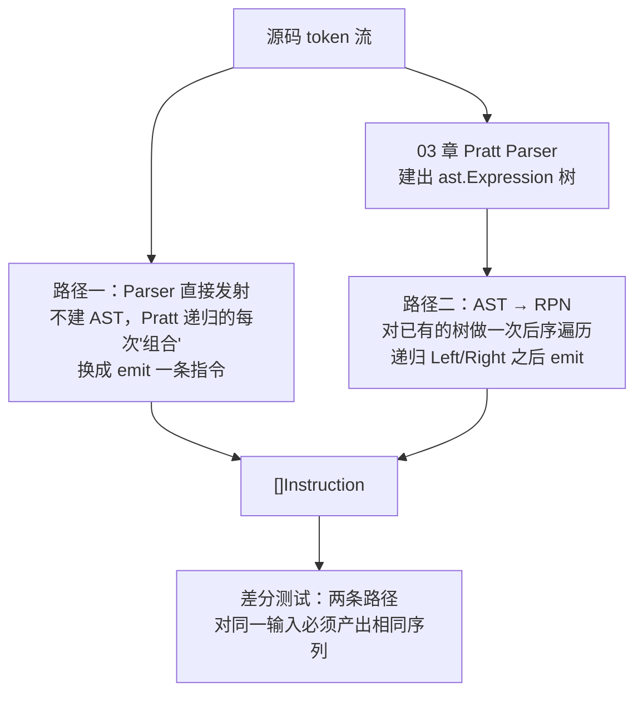
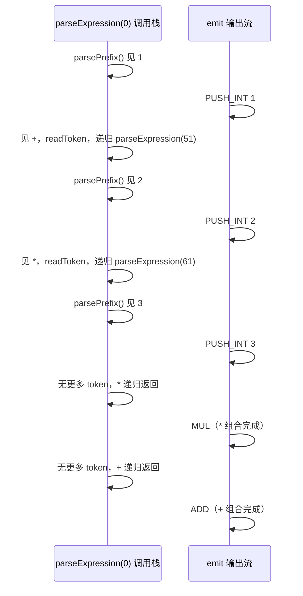

# 03b 支线：基于 RPN 的表达式引擎

## 本章要回答的问题

03 章的 Pratt parser 把表达式变成一棵树。这一章问一个不同的问题：**如果不建树，直接把表达式变成一条线性指令序列，会怎样？** 更具体地说，同一份 Monkey 表达式语法，能不能用两条完全不同的路径产出**同一份**指令序列——一条是 parser 阶段直接发射，不经过 AST；另一条是先建 AST，再把 AST 压平成指令。这两条路径为什么会殊途同归，又在哪些地方各自暴露出对方掩盖的问题？

这是一条**支线**：只覆盖表达式，不含 `if`/`while` 这类需要跳转的控制流——原因会在第 3 节说清楚。看完 03 章就能读这一章，不需要等 04 章之后的任何内容。

## 1. RPN 是什么：顺序本身消除歧义

`1 + 2 * 3` 写成中缀（infix）需要额外规则才能确定运算顺序——优先级表、括号。RPN（Reverse Polish Notation，逆波兰式）把操作符写在操作数**后面**：

```text
中缀：  1 + 2 * 3
RPN：   1 2 3 * +
```

手算一遍：从左到右扫描，遇到数字入栈，遇到操作符弹出栈顶两个数字运算，结果压回栈：

```text
token   栈（从左到右堆叠）
1       [1]
2       [1, 2]
3       [1, 2, 3]
*       [1, 6]        ← 弹出 3,2，算 2*3=6，压回
+       [7]           ← 弹出 6,1，算 1+6=7，压回
```

**没有优先级表，没有括号，没有回溯。** 顺序已经把"先算哪个"编码进了 token 流本身——这正是 03 章 Pratt parser 拼命用 binding power 在**树**上做的事，RPN 把它做在了**线性序列**上。

对比 `(1 + 2) * 3`：

```text
RPN：   1 2 + 3 *
```

同样没有括号。括号在中缀记法里是必需的歧义消除工具，在 RPN 里完全不需要——**这就是本章存在的理由**：括号消除的是"写法"上的歧义，顺序消除的是同一件事的另一种做法，两者是同一个问题的两个解，而 03 章已经用 binding power 解决过一次，这一章换一个更直白的解法重新解一次，借此看清"解析"这件事的本质。

## 2. 两条路径，一个目标

先给全局图，再逐条展开：



两条路径殊途同归的原因不是巧合，是**同一个算法思想在两个不同位置生根**：Pratt parsing 本质上是一次后序遍历（先处理完子表达式，再处理当前运算符），只不过 03 章把"处理"实现成"构造 AST 节点"，这一章把"处理"实现成"发射一条指令"。AST 后序遍历同样是"先处理完子节点，再处理当前节点"。**两条路径共享的是遍历顺序，不是代码。**

## 3. Op 表设计：为什么没有跳转指令

这套指令表比 06 章的字节码指令集更窄，原因要先说清楚：**RPN 是纯线性结构，没有"跳转到某个地址"的概念**。`if`/`while` 需要"根据条件决定要不要跳过一段指令"，这在 RPN 里无法表达——除非你引入地址和跳转指令，那样就不再是"逆波兰式"，而是变成了 06 章那套字节码。所以本章的 op 表刻意留在"纯计算，没有分支"的范围内，`if`/`while` 留给结尾的练习指路到 06-09 章。

| Op | 操作数 | 栈效果 | 说明 |
| --- | --- | --- | --- |
| `PUSH_INT` | int 值 | → 1 | 整数字面量 |
| `PUSH_FLOAT` | float 值 | → 1 | 浮点字面量 |
| `PUSH_BOOL` | bool 值 | → 1 | `true`/`false` |
| `PUSH_STRING` | string 值 | → 1 | 字符串字面量 |
| `LOAD` | 变量名 | → 1 | 读取标识符的值 |
| `ADD` `SUB` `MUL` `DIV` | — | 2 → 1 | 算术 |
| `EQ` `NEQ` | — | 2 → 1 | `==` `!=` |
| `GT` `GE` | — | 2 → 1 | `>` `>=`。**没有 `LT`/`LE`** |
| `AND` `OR` | — | 2 → 1 | `&&` `\|\|`，**非短路**（见第 9 节） |
| `NEG` | — | 1 → 1 | 前缀 `-` |
| `NOT` | — | 1 → 1 | 前缀 `!` |
| `CALL` | 实参个数 n | (n+1) → 1 | 栈上 `[callee, arg1..argn]` |
| `INDEX` | — | 2 → 1 | `left[idx]` |
| `MAKE_ARRAY` | 元素个数 n | n → 1 | 数组字面量 |
| `MAKE_HASH` | 键值对个数 n | 2n → 1 | 哈希字面量,键值交替入栈 |

**为什么没有 `LT`/`LE`：** 这不是随手省略，是直接沿用 06 章字节码指令集已经定死的约定——`a < b` 编译成"交换操作数,发 `GT`"（`b GT a` 即 `swap; GT`，或者更直接地把操作数顺序在发射时就调换）。这个约定的代价（`f() < g()` 求值顺序与直接对 AST 求值不同）已经写在 [00 章契约表"偏差一"](00-overview.md)里，本章沿用同一个决定,不重新讨论。用同一张表意味着**这一章不是在发明一套新规则,是在用另一种呈现方式重放 06 章已经做过的决定**。

数据结构：

```go
type Instruction struct {
    Op      string
    Operand any   // int/float/bool/string 字面值，或整数（CALL 的参数个数等）
}

type RPNProgram []Instruction
```

用字符串当 op 而不是像 06 章那样用 `byte` 编码，是刻意的教学选择——这一章的重点是**顺序**，不是**编码密度**。真正关心指令编码,直接去 06 章。

## 4. 路径一：Parser 直接发射

### 4.1 核心洞察

打开 03 章的 [`parsePrattInfixExpression`](../parser/parser.go#L646)：

```go
func (p *Parser) parsePrattInfixExpression(left ast.Expression, bp int) ast.Expression {
	infixExpr := ast.InfixExpression{Token: p.curToken, Left: left}
	p.readToken()

	rightExpr := p.parsePrattExpression(bp)
	if rightExpr == nil {
		p.logFailure("infix right operand")
		return nil
	}

	infixExpr.Right = rightExpr
	return &infixExpr
}
```

递归调用 `p.parsePrattExpression(bp)` 解析完右操作数**之后**，才构造 `InfixExpression` 并返回。这个"之后"就是关键——`left` 和 `right` 都已经完全处理完，此刻要做的事情只是"组合"。

**把"组合"从"构造一个节点"换成"发射一条指令"**，输出就是 RPN：

```go
func (e *RPNEmitter) parsePrattInfixExpression(bp int) {
	op := e.p.curToken.Type
	e.p.readToken()
	e.parsePrattExpression(bp)   // 递归处理右操作数，递归内部会把它对应的指令 emit 完
	e.emit(infixOpFor(op), nil)  // 此刻 left 和 right 的指令都已经在 e.code 里了，只需追加这一条
}
```

不需要 `left` 这个参数——因为不再需要把它塞进一个节点的字段里，它对应的指令早就已经躺在 `e.code` 里了。**AST 版本需要用参数把 `left` 一路传下来，是因为最终要把它塞进 `InfixExpression.Left`；RPN 版本不需要，是因为 `left` 的指令已经在正确的位置上了。** 这行差异,是这一章想让你亲手体会的核心。

### 4.2 完整骨架

```go
type RPNEmitter struct {
	p    *Parser        // 复用 03 章的 Parser：curToken/nextToken/readToken 逐字不改
	code []Instruction
}

func NewRPNEmitter(p *Parser) *RPNEmitter {
	return &RPNEmitter{p: p}
}

func (e *RPNEmitter) emit(op string, operand any) {
	e.code = append(e.code, Instruction{Op: op, Operand: operand})
}

// 对照 03 章 parsePrattExpression（parser.go:313）,主循环结构逐字不改，
// 只是循环体末尾从"构造节点"换成"发射指令"
func (e *RPNEmitter) parseExpression(minBP int) {
	e.parsePrefix()

	for {
		if e.p.curToken.Type == token.LEFT_PAREN || e.p.curToken.Type == token.LEFT_BRACKET {
			if POSTFIX_BP < minBP {
				break
			}
			e.parsePostfix()
			continue
		}

		bp, ok := INFIX_BP[e.p.curToken.Type]
		if !ok || bp.lbp < minBP {
			break
		}

		op := e.p.curToken.Type
		e.p.readToken()
		e.parseExpression(bp.rbp)
		e.emit(infixOpFor(op), nil)   // TODO: 定义 infixOpFor，把 token.PLUS 等映射到 "ADD" 等
	}
}

// 对照 03 章 parsePrattPrefixExpression（parser.go:347）
func (e *RPNEmitter) parsePrefix() {
	switch e.p.curToken.Type {
	case token.INT:
		// TODO: strconv.Atoi，emit("PUSH_INT", value)，readToken
	case token.FLOAT, token.STRING, token.TRUE, token.FALSE:
		// TODO: 同理，各自 emit 对应的 PUSH_*
	case token.IDENT:
		// TODO: emit("LOAD", literal)
	case token.NOT, token.MINUS:
		// TODO: readToken，递归 e.parseExpression(PREFIX_BP)，再 emit(NOT 或 NEG)
		//       注意顺序：递归必须先做完，NEG/NOT 才能 emit——这就是"后序"
	case token.LEFT_PAREN:
		// TODO: 分组括号——readToken，递归 e.parseExpression(0)，
		//       要求当前是 RIGHT_PAREN，readToken。注意：不 emit 任何指令！
		//       括号本身不产生运算，只影响解析顺序，这一点在 RPN 里比在 AST 里更直观：
		//       分组括号在 AST 版本里也不对应任何节点（03 章已经指出这点），
		//       在这里则是"根本没有对应的 emit 调用"，两者是同一件事的两种说法。
	case token.LEFT_BRACKET:
		// TODO: 数组字面量——parseExpressionList 风格解析元素，每个元素递归 emit 完，
		//       最后 emit("MAKE_ARRAY", 元素个数)
	case token.LEFT_BRACE:
		// TODO: 哈希字面量——键值对交替递归 emit，最后 emit("MAKE_HASH", 对数)
	}
}

// 对照 03 章 parsePrattPostfixExpression（parser.go:585）
func (e *RPNEmitter) parsePostfix() {
	switch e.p.curToken.Type {
	case token.LEFT_PAREN:
		// TODO: 调用——readToken，解析逗号分隔的实参列表（每个递归 emit），
		//       最后 emit("CALL", 实参个数)。
		//       注意 callee 的指令已经在 e.code 里了（LOAD 或者更早的 CALL/INDEX 结果），
		//       不需要额外处理——这正是"left 不需要当参数传"的又一处体现
	case token.LEFT_BRACKET:
		// TODO: 索引——readToken，递归解析下标表达式，要求 RIGHT_BRACKET，emit("INDEX", nil)
	}
}
```

标了 `TODO` 的地方，对照一下 03 章对应函数的完整实现（链接已经给在每个小节标题旁），把"构造节点"替换成"emit 指令"就是答案。**故意不给你抄——这一步的价值就是亲手把"构造"改写成"发射"，感受两者在结构上有多相似。**

## 5. 路径二：AST → RPN 的后处理降低

### 5.1 核心洞察：访问者模式

AST 已经建好了，`LowerToRPN` 只需要做一次**后序遍历**：

```go
func LowerToRPN(expr ast.Expression) []Instruction {
	var code []Instruction
	emit := func(op string, operand any) {
		code = append(code, Instruction{Op: op, Operand: operand})
	}

	var lower func(ast.Expression)
	lower = func(node ast.Expression) {
		switch n := node.(type) {
		case *ast.IntegerLiteral:
			emit("PUSH_INT", n.Value)
		case *ast.FloatLiteral:
			emit("PUSH_FLOAT", n.Value)
		case *ast.BooleanLiteral:
			emit("PUSH_BOOL", n.Value)
		case *ast.StringLiteral:
			emit("PUSH_STRING", n.TokenLiteral())
		case *ast.Identifier:
			emit("LOAD", n.Value)
		case *ast.PrefixExpression:
			lower(n.Right)                       // 先递归
			emit(prefixOpFor(n.TokenLiteral()), nil) // 后 emit
		case *ast.InfixExpression:
			lower(n.Left)                        // 先左
			lower(n.Right)                        // 再右
			emit(infixOpFor(n.TokenLiteral()), nil) // 最后 emit——这就是后序
		case *ast.PostfixExpression:
			// TODO：n.Operator.Type 是 LEFT_PAREN 还是 LEFT_BRACKET，
			// 分别对应 CALL/INDEX——参照 ast.go:393 的 PostfixExpression 定义
		case *ast.Array:
			// TODO：遍历 n.Elements 依次 lower，最后 emit("MAKE_ARRAY", len(n.Elements))
		case *ast.HashList:
			// TODO：遍历 n.Pairs（[]ast.HashPair，ast.go:270），
			// 每个 pair 先 lower(Key) 再 lower(Value)，最后 emit("MAKE_HASH", len(n.Pairs))
		}
	}

	lower(expr)
	return code
}
```

`*ast.InfixExpression` 分支是全章的浓缩：`lower(n.Left); lower(n.Right); emit(...)`——**先左、再右、最后自己**，这正是后序遍历的教科书定义，也正是 RPN 记法本身的定义。路径一里同样的顺序，只是没有一个叫"后序遍历"的函数名字挂在上面，它就藏在 Pratt 循环"先递归、后 emit"的调用顺序里。**两条路径用的是同一个顺序，一条把它叫做 Pratt parsing，一条把它叫做 tree traversal，这只是命名的区别。**

### 5.2 为什么这是"访问者模式"

`switch n := node.(type)` 这种写法，本质是在没有虚方法分派的语言里手工实现"访问者"：**遍历逻辑（要不要递归、递归的顺序）和节点类型强绑定，但输出行为（emit 什么指令）是可插拔的**。如果 06 章的 compiler 也用同样的 `switch` 骨架（它确实是——[07 章](07-compiler.md)的 `Compile(node ast.Node)` 就是这个模式的字节码版本），你会发现**这个 switch 骨架在全套教程里反复出现，只是每次 emit 的目标不同**：这一章 emit RPN 指令，07 章 emit 06 章定义的字节码，05 章的 evaluator 甚至不 emit 什么，直接算出结果。

## 6. 两条路径的对照表与差分验收

两条路径的正确性标准**不是各自内部自洽**，而是**共用同一张映射表**：

| 源 token / AST 节点 | RPN 指令 |
| --- | --- |
| `token.INT` / `*ast.IntegerLiteral` | `PUSH_INT` |
| `token.FLOAT` / `*ast.FloatLiteral` | `PUSH_FLOAT` |
| `token.TRUE`/`token.FALSE` / `*ast.BooleanLiteral` | `PUSH_BOOL` |
| `token.STRING` / `*ast.StringLiteral` | `PUSH_STRING` |
| `token.IDENT` / `*ast.Identifier` | `LOAD` |
| `token.PLUS` / `InfixExpression{Token:"+"}` | `ADD` |
| `token.MINUS`（中缀） | `SUB` |
| `token.MINUS`（前缀） / `PrefixExpression{Token:"-"}` | `NEG` |
| `token.NOT` / `PrefixExpression{Token:"!"}` | `NOT` |
| `token.MULTI` / `token.DIVIDE` | `MUL` / `DIV` |
| `token.EQUAL` / `token.NOT_EQUAL` | `EQ` / `NEQ` |
| `token.GT` / `token.GE` | `GT` / `GE` |
| `token.LT` / `token.LE`（交换操作数后） | `GT` / `GE` |
| `token.AND` / `token.OR` | `AND` / `OR` |
| `PostfixExpression{Operator: LEFT_PAREN}` | `CALL <n>` |
| `PostfixExpression{Operator: LEFT_BRACKET}` | `INDEX` |
| `*ast.Array` | `MAKE_ARRAY <n>` |
| `*ast.HashList` | `MAKE_HASH <n>` |

**如果两条路径各自维护一份映射，迟早会在某个 token 上悄悄分叉。** 正确的做法是把这张表实现成一处共享的函数（`infixOpFor(tokenType) string`），路径一和路径二都调用它——这样表只存在一份，差异只能来自"谁调用得不对"，不可能来自"两份表内容不一致"。

差分测试骨架：

```go
func TestBothPathsAgree(t *testing.T) {
	inputs := []string{
		"1 + 2 * 3;",
		"(1 + 2) * 3;",
		"a && b || c;",
		"1 < 2 && 3 >= 4;",
		"-a * b;",
		"!x;",
		"f(1, 2 + 3);",
		"xs[0] + xs[1];",
		"[1, 2, 3];",
		"{\"a\": 1};",
	}
	for _, in := range inputs {
		t.Run(in, func(t *testing.T) {
			path1 := runEmitter(t, in)     // 路径一：RPNEmitter 直接产出
			path2 := runLowerFromAST(t, in) // 路径二：先 Parse 再 LowerToRPN
			if !reflect.DeepEqual(path1, path2) {
				t.Errorf("路径分叉：\n  emit=%v\n  ast =%v", path1, path2)
			}
		})
	}
}
```

这正是 [10 章](10-debugging.md)差分测试方法论的又一次应用——只是这次两条路径不是"evaluator vs VM"，是"parser 直接发射 vs parser 建树后再降低"。**方法论可以复用，具体的两条路径可以是这套教程里任何一对"殊途同归"的实现。**

## 7. 手算 trace

### 7.1 `1 + 2 * 3`

路径一（emit 顺序）：

```text
curToken=1  → parsePrefix: emit(PUSH_INT, 1)
curToken=+  → lbp=50 >= 0，readToken，递归 parseExpression(51)
  curToken=2 → parsePrefix: emit(PUSH_INT, 2)
  curToken=* → lbp=60 >= 51，readToken，递归 parseExpression(61)
    curToken=3 → parsePrefix: emit(PUSH_INT, 3)
    curToken=; → 无匹配，返回
  emit(MUL)                              ← * 的右操作数递归完，组合
  返回
emit(ADD)                                ← + 的右操作数递归完，组合
```

最终指令流：`PUSH_INT 1, PUSH_INT 2, PUSH_INT 3, MUL, ADD`——正是第 1 节手算的 `1 2 3 * +`。

路径二（对 AST 后序遍历）：03 章的 Pratt parser 对同一输入建出的树是 `(1+(2*3))`，即根节点 `InfixExpression{+}`，`Left=IntegerLiteral(1)`，`Right=InfixExpression{*, Left:2, Right:3}`。`lower` 从根开始：

```text
lower(root: +)
  lower(Left: 1)        → emit(PUSH_INT, 1)
  lower(Right: *)
    lower(Left: 2)      → emit(PUSH_INT, 2)
    lower(Right: 3)     → emit(PUSH_INT, 3)
    emit(MUL)
  emit(ADD)
```

**逐指令对照，两条路径完全一致。**

### 7.2 `f(1, xs[0] + 2)`

路径二更直观地展示访问者的分派过程。AST 大致是 `PostfixExpression{Operator: "(", Left: Identifier("f"), ValueList: [1, InfixExpression{+, Left: PostfixExpression{Operator:"[", Left: xs, ValueList:[0]}, Right: 2}]}`。

```text
lower(root: CALL PostfixExpression)
  lower(Left: f)                          → emit(LOAD, "f")
  lower(ValueList[0]: 1)                  → emit(PUSH_INT, 1)
  lower(ValueList[1]: + InfixExpression)
    lower(Left: [ PostfixExpression)
      lower(Left: xs)                     → emit(LOAD, "xs")
      lower(ValueList[0]: 0)               → emit(PUSH_INT, 0)
      emit(INDEX)
    lower(Right: 2)                       → emit(PUSH_INT, 2)
    emit(ADD)
  emit(CALL, 2)
```

最终：`LOAD f, PUSH_INT 1, LOAD xs, PUSH_INT 0, INDEX, PUSH_INT 2, ADD, CALL 2`。

**读一遍这条指令流本身就是一次栈模拟练习**：`f` 入栈，`1` 入栈，`xs` 入栈，`0` 入栈，`INDEX` 弹出 `0,xs` 压回 `xs[0]`，`2` 入栈，`ADD` 弹出 `2,xs[0]` 压回 `xs[0]+2`，最后 `CALL 2` 弹出 `xs[0]+2, 1, f` 三个（用掉 2 个实参 + 1 个 callee）压回调用结果。栈顶顺序从来没有歧义——这正是第 1 节的论点在真实复杂表达式上的验证。

## 8. 图示：Pratt 递归栈 ↔ RPN 输出顺序



**递归调用栈"退出"的顺序，恰好就是 emit 指令的顺序。** 调用栈越深的（`3` 所在的 `parseExpression(61)`）越早退出，对应的操作符（`MUL`）也越早 emit；最外层的调用（`parseExpression(0)`）最后退出，对应最后 emit 的 `ADD`。**这就是为什么"后序遍历"和"递归调用的返回顺序"是同一件事的两种说法。**

## 9. 边界与陷阱

**① 短路语义丢失——这是最重要的一条,必须写清楚代价。** `&&`/`||` 在 [00 章契约表](00-overview.md)和 [05 章 evaluator](05-evaluator.md)里都是**短路**求值：`false && g()` 不应该调用 `g()`。但 RPN 是纯线性序列，`AND`/`OR` 指令的语义只能是"两个操作数的指令都已经执行完，此刻只是弹栈判断"——**没有办法在 RPN 层面跳过右操作数的指令**。

```text
false && sideEffect();
```

编译成 `PUSH_BOOL false, LOAD sideEffect, CALL 0, AND`——`sideEffect()` **一定会被调用**，因为它对应的指令段（`LOAD`/`CALL`）在 `AND` 之前就已经线性排在那里了，执行引擎没有办法跳过它。

**这不是本章实现疏忽，是 RPN 这种表示法的结构性限制**：跳过一段指令需要"跳转"这个概念，而跳转需要目标地址，而"线性序列 + 地址"已经不再是纯粹的逆波兰式了，那是 06 章的字节码。**如果你的语言真的需要短路语义（Monkey 需要），RPN 只适合用在"确定没有副作用"的子集上，或者干脆接受这个限制,把短路语义的实现完全留给 06 章之后的真字节码。** 这一点必须在任何基于 RPN 的实现旁边写清楚，不能含糊过去——一个悄悄改变语义的"优化"比一个明确声明的限制危险得多。

**② 分组括号不产生任何指令,但两条路径要以不同方式体现这件事。** 路径一里,`LEFT_PAREN` 分支根本没有调用 `emit`；路径二里,AST 上**根本没有对应"括号"的节点**（03 章已经指出，括号只影响树的形状,不产生独立节点）。两者殊途同归的原因是一样的：括号的全部作用在"解析完成"那一刻就已经耗尽了。

**③ 复杂字面量的"个数"操作数容易在两条路径上算错。** `MAKE_ARRAY <n>` 和 `MAKE_HASH <n>` 的 `n` 必须严格等于随后栈上要消耗的元素个数——路径一在解析逗号分隔列表时天然知道"解析了几个"，路径二在 `for range n.Elements` 时用 `len()` 取，两者数值应该一致，但如果 AST 构造阶段（03 章 parser）在某处漏加了一个元素（比如空数组 `[]` 处理不当），两条路径会**同时算错同一个错误的数字**——这时差分测试测不出问题，因为两条路径"一致地错"。这提示一个更深的教训：**差分测试只能抓"两条路径不一致"的 bug，抓不住"两条路径共享的上游错误"**（这里的上游是 03 章的 parser 本身）。

**④ 错误处理必须在两条路径间保持相同的失败点，否则差分测试会产生假阳性。** 路径一在遇到非法 token 时应该在**和 03 章 parser 完全相同的位置**报错并返回；路径二依赖 03 章 parser 先成功建出 AST，如果 AST 构造已经失败（返回 nil），`LowerToRPN` 根本不会被调用。这意味着**"两条路径的错误处理不对称是允许的**——路径二可以直接依赖 03 章已经做好的错误检测，不需要重新做一遍；路径一因为不建 AST，必须自己重新实现一遍 03 章的错误检测逻辑（比如"数组元素解析失败"）。**这是路径一相对路径二的额外成本，值得在实现前就想清楚，而不是发现代码重复了才后悔。**

## 10. 验收测试清单

**正常情况**：字面量单独、每个二元运算符各一条、函数调用（0/1/多个实参）、索引、数组、哈希、嵌套调用 `f(g(1))`、混合优先级 `1 + 2 * 3 - 4 / 2`。

**边界情况**：空数组 `[]`、空哈希 `{}`、零参调用 `f()`、单元素数组 `[1]`、深度嵌套括号 `((((1))))`、`-（-1)` 双重否定。

**两路径差分**：对以上每一条,同时跑路径一和路径二,断言指令序列 `reflect.DeepEqual`。**这一类测试的数量应该覆盖到全部 op 表的每一行至少出现一次**——用一个小脚本核对：

```go
func TestAllOpsCovered(t *testing.T) {
	allOps := []string{"PUSH_INT", "PUSH_FLOAT", "PUSH_BOOL", "PUSH_STRING",
		"LOAD", "ADD", "SUB", "MUL", "DIV", "EQ", "NEQ", "GT", "GE",
		"AND", "OR", "NEG", "NOT", "CALL", "INDEX", "MAKE_ARRAY", "MAKE_HASH"}
	seen := map[string]bool{}
	for _, in := range allTestInputs {
		for _, instr := range runEmitter(t, in) {
			seen[instr.Op] = true
		}
	}
	for _, op := range allOps {
		if !seen[op] {
			t.Errorf("op %q 从未在任何测试用例中出现过", op)
		}
	}
}
```

这个元测试直接把"测试矩阵是否完整"变成一个可执行断言——呼应 [10 章](10-debugging.md)"覆盖形状比覆盖率数字重要"的方法论。

**短路语义的回归测试**（呼应第 9 节①）：显式测试 `false && sideEffectCounter()` 之后 `sideEffectCounter` 确实被调用了——这不是测试"通过"，是测试"记录下这个已知限制,不要在未来的某次重构中意外变成别的行为而没人发现"。

## 11. 练习

**1. 补完两条路径里所有标了 `TODO` 的分支**，用第 10 节的测试矩阵验证两者一致。

**2. 给 RPN 写一个基于栈的求值器。** `func Eval(code []Instruction) object.Object`——这比 [05 章](05-evaluator.md)的 evaluator 简单得多，因为不需要处理 `Environment` 的嵌套作用域（本章不含 `let`），只需要一个变量表和一个操作数栈。写完后，用同一组测试输入，比较"RPN 求值结果"和"05 章 evaluator 对同一 AST 求值的结果"是否一致——这是本章方法论的第三次复用。

**3. 想清楚：如果要给 RPN 加 `let`（引入变量绑定），需要往 op 表里加什么？** 提示：`LOAD` 已经存在，缺的是"写"的对应物。这不难，可以直接实现。

**4. 想清楚：如果要给 RPN 加 `if` 表达式，需要往 op 表里加什么？** 这次不要求实现——答案会发现你需要引入地址和跳转，而那正是 [06 章](06-bytecode.md)字节码指令集存在的理由。写下你的分析：至少需要几条新指令？跳转目标怎么表示（相对偏移还是绝对地址）？这个练习的价值是让你在真正学 06 章之前，自己先撞一遍"为什么线性表示撞到分支就不够用了"这个墙。

**5.（进阶）实现一个 RPN 反汇编器**，把 `[]Instruction` 打印成人可读的形式，类似 06 章要求的反汇编器。对比：这一章的指令是字符串 op + 任意类型操作数，06 章是字节编码 + 固定宽度操作数——反汇编器的实现难度差多少？

**6.（进阶）短路修复。** 尝试给这套纯线性 RPN 设计一种"受限跳转"，只支持"跳过接下来 N 条指令"（不需要标签，不需要地址计算，只需要一个相对偏移的 `SKIP_IF_FALSE <n>`），用它实现 `&&`/`||` 的短路语义。做完后回答：这还算"纯粹的 RPN"吗？你在什么地方越过了"没有跳转"这条线？

## 12. 小结

- RPN 用顺序本身消除了中缀记法需要括号才能消除的歧义——这是 03 章 binding power 解决同一个问题的另一种解法
- **两条路径殊途同归的根本原因是共享同一个遍历顺序**：Pratt parsing 的递归结构和 AST 的后序遍历,本质上是同一个"先处理子结构、再处理当前节点"的算法思想,一次长在 parser 的控制流里,一次长在一个独立的遍历函数里
- 正确性的标准不是"两条路径各自看起来对"，是"两条路径共用同一张映射表"，差分测试是验证这一点的唯一可靠手段
- RPN 天生做不了短路——这是结构性限制，不是可以悄悄修的 bug，必须显式记录
- 这条支线到此为止；一旦需要分支/跳转（`if`/`while`），下一步就是 [06 章](06-bytecode.md)的字节码指令集，那套指令集正是在这条线性表示上加了地址和跳转能力之后的产物
