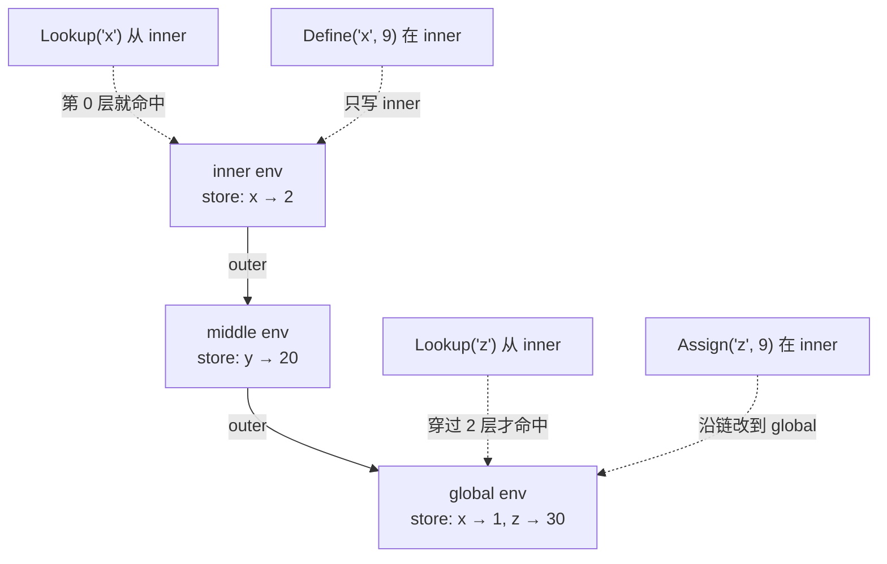
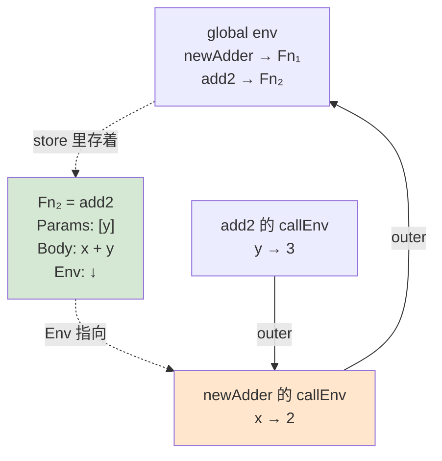

# 04 运行时对象与 Environment：值是什么，名字在哪

## 本章要回答的问题

Parser 交给你一棵树。树上的 `IntegerLiteral{Value: 5}` 是"源码写了 5"这件事的记录，不是运行时的数字 5。这两者的区别是本章的起点。

- 为什么不能直接拿 AST 节点当值用？
- 值用什么 Go 类型表示，为什么是接口而不是 tagged union？
- 名字到值的绑定放在哪，为什么 `let` 和 `=` 必须走两个不同的方法？
- 闭包凭什么能在外层函数返回之后还读到外层的参数？

本章不写 evaluator，只准备它需要的两样东西：`object.Object` 和 `object.Environment`。它们对了，05 章的 `Eval` 会短得出人意料；歪了，evaluator 里会长出一堆补丁。

## 1. 为什么需要独立的 object 层

### AST 节点不能当值

一个诱人的想法：`IntegerLiteral` 已经带着 `Value int`，`Eval` 直接返回它不就行了？

往下推一步就崩了。`1 + 2` 求值得到 3——这个 3 对应源码里哪个 `IntegerLiteral`？没有。它是**计算出来的新值**，没有 token、没有位置。硬要构造 `&ast.IntegerLiteral{Token: ???, Value: 3}`，`Token` 只能填假数据。

| | AST 节点 | 运行时对象 |
| --- | --- | --- |
| 表示 | 源码写了什么 | 计算得到什么 |
| 生命周期 | 解析后只读，不变 | 执行中不断产生 |
| 数量 | 与源码长度成正比 | 与执行次数成正比（循环里可以无限） |
| 携带 | Token、位置 | 值、类型标签 |
| 无对应物 | `WhileStatement` 不产生值 | `Function` 闭包、`Error`、`ReturnValue` 无语法形式 |

最后一行是决定性的。`Function` 对象必须携带**定义时的环境**，AST 里没有这个概念——同一个 `FunctionExpression` 节点执行两次会产生两个不同的闭包。两边形状根本不同，共用类型只会让两边都变形。

### 三种候选表示

**A. `any` + 原生类型。** `5` 就是 Go 的 `int`。零包装，很诱人。代价：`Null` 用什么？用 `nil` 的话，map 里"存了 nil"和"没存"就分不开了。函数值用什么，环境挂在哪？**你的类型系统被 Go 的类型系统绑架了**，以后给整数加个字段就得改所有地方。

**B. tagged union**——一个结构体带 `Type` 标签加所有可能的字段。C 写解释器的经典做法（配真 union 省空间）。优点是值语义，能放栈上、进切片不用指针，缓存友好。但 Go 没有 union，所有字段并存——`Integer` 也要背着 string 头和切片头。而且**编译器不帮你检查**：读 `obj.Int` 时 `obj.Type` 是不是 `INTEGER`，只有你自己保证。

**C. 接口**——`type Object interface { Type() ObjectType; Inspect() string }`。选它。理由不是最快（它最慢），而是**加类型的成本最低**：新增 `Float` 只要写一个结构体加两个方法，已有代码一行不改。你的语言正处在"还要加东西"的阶段（float、hash、builtin 都是加出来的），这个性质此刻比性能重要。

### 装箱代价，以及它为什么是 06 章的动机

代价要看清楚，因为后面的优化全冲着它来。`&Integer{Value: 3}` 意味着：堆上分配 8 字节、接口值本身 16 字节（类型指针 + 数据指针）、`Type()` 是一次动态方法调用。`1 + 2` 的真实开销远大于一条 `add`：两次类型断言、一次堆分配、一次接口构造。`while (i < 10000) { i = i + 1 }` 分配一万个 `Integer`，全是垃圾。

优化有两个方向：**减少分派**（把节点类型判断和操作符判断提前到编译期，运行时只剩 opcode 分派——06-08 章走这条）和**减少分配**（小整数缓存，像 `TRUE`/`FALSE` 那样预造 -128..127；或改成方案 B 的值语义，真实的 JS/Lua 引擎用 NaN boxing 把值塞进 8 字节）。

**现在故意选最慢但最清晰的方案**，因为你需要一个正确的参照实现。

## 2. Object 接口的两个方法

### 为什么还需要 `Type()`

Go 已经有类型断言了，为什么要一个手工类型标签？

**① 错误消息需要语言层的类型名。** `1 + true` 应报 `type mismatch: INTEGER + BOOLEAN`，不是 `*object.Integer + *object.Boolean`。用户不该看见宿主语言。

**② 分派前的快速筛选。** 中缀求值的骨架是 `case left.Type() == INTEGER_OBJ && right.Type() == INTEGER_OBJ:`，比嵌套类型断言可读——尤其你要处理 int/float 混算的四种组合。

**③ 错误传播的哨兵检查。** `obj.Type() == ERROR_OBJ` 会在 evaluator 里出现几十次（05 章封成 `isError`）。这必须是一次廉价的字段读取。

`Inspect()` 是给人看的：REPL 打印、错误消息、测试断言。注意它**不是**序列化格式——`String` 的 `Inspect()` 返回不带引号的内容，所以 `["hi"]` 打印成 `[hi]`。这是原版行为，你可以改（加个带引号的 `Debug()`），但要一次定死，测试会依赖它。

### `ObjectType` 用 string 还是 int

`string` 调试时 `%s` 直接可读，但 16 字节、比较要 memcmp；`uint8` 一字节、一条整数比较，代价是打印需要一张名字表。

用 string——**因为你会读几百遍错误消息，但只跑几千次比较**。等 VM 阶段发现 `Type()` 在热路径上，再换 `uint8` + 名字表，改动是机械的。

**但有一件事现在就要做对**：常量必须显式标注类型，写 `INTEGER_OBJ ObjectType = "INTEGER"`，不要写 `INTEGER_OBJ = "INTEGER"`——后者是无类型常量，任何 string 都能传进来。参考实现 `example/03/src/monkey/object/object.go` 里少了这个标注，和你 parser 里 `Pratt = iota` 少标注是同一类问题（03 章第 1 节）。

## 3. 对象清单

每个类型给结构定义和存在理由。方法留给你——`Type()` 全是一行返回常量，`Inspect()` 除了 `Function`/`Array`/`Hash` 之外也都是一行。

### 数字：`Integer` 与 `Float`

你的 AST 有两种数字字面量（[ast.go:194](../ast/ast.go#L194)、[ast.go:207](../ast/ast.go#L207)），object 层也要两种：

```go
type Integer struct { Value int64 }
type Float   struct { Value float64 }
```

**这里故意加宽了。** 你的 AST 用 `int` 和 `float32`，运行时应该用 `int64` 和 `float64`。`int64` 保证跨平台一致——`int` 在 32 位平台是 32 位，同一份程序在两个平台溢出点不同，这是 bug 不是特性。`float64` 是因为 `float32` 只有约 7 位十进制有效数字，`0.1 + 0.2` 在 float32 下打印成 `0.3`（假象），float64 下是 `0.30000000000000004`（真相）。**你要真相**，否则第 13 节 hash 键的陷阱你根本看不见。代价是 evaluator 里一行 `float64(node.Value)` 转换（更彻底的做法是让 lexer/parser 也用 `float64`，见练习 8）。

**混算规则**（00 章契约表的落实）：`int op int → Integer`，只要有一边是 float 就 → `Float`（int 提升为 `float64`）。`int / int` 是截断除法，`7 / 2 == 3`（和 C、Go 一致，和 Python 3 不一致）。`==` 跨类型可比，`1 == 1.0` 为 true——这条让整数分支不能独占 `==`，`1 == 1.0` 必须落到 float 分支，两边转 `float64` 再比。

除零呢？`1 / 0` 报错。`1.0 / 0.0` 按 IEEE 754 是 `+Inf`，**建议也报错**：语言里没有 `Inf` 字面量，产生一个用户写不出来的值会很怪，而且 `Inspect()` 还要处理 `NaN`。

### `Boolean` 与 `Null`

`type Boolean struct { Value bool }`、`type Null struct{}`。`Null` 是空结构体，零字节。它存在的理由是**"没有值"也必须是一个值**：`Eval` 返回 Go 的 `nil` 会让每个调用点都要判空，而 `if (false) { 1 }` 确实需要返回点什么。用 `NULL` 对象，调用点就不用防御。

truthy 规则（00 章契约）：**只有 `false` 和 `null` 为假**，`0`、`0.0`、`""`、`[]`、`{}` 全为真。这条规则同时管 `if`、`while`、`&&`、`||`、`!`——集中实现成一个 `isTruthy(Object) bool`，不要在四个地方各写一遍。

### `String` 与 `Array`

```go
type String struct { Value string }
type Array  struct { Elements []Object }
```

Go 的 string 不可变，正好——Monkey 的字符串也不可变，`+` 产生新串。注意 Go string 是字节序列，`len("héllo")` 是 6 不是 5。你的 `len` builtin 要选：按字节还是按 rune？按 rune 更符合直觉（`utf8.RuneCountInString`），但那样索引取字符就是 O(n) 了。

`Array` 对应 [ast.go:246](../ast/ast.go#L246)，**引用语义**：`let a = [1]; let b = a;` 之后两者指向同一个 `*Array`。这影响 `==` 的定义。

**建议：数组和哈希的 `==` 按指针比，`[1] == [1]` 为 false。** 理由是结构比较要递归，而递归会碰到循环引用（`let a = [1]; push(a, a);`）。原版 Monkey 干脆不支持数组比较。

索引越界返回 `NULL`（契约）。负索引呢？`[1,2][-1]` 也返回 null，和越界一致——Python 风格的负索引是额外特性，做成练习。

### `Hash`：为什么需要 `HashKey`

这是本章最有技术含量的一处。

先看为什么不能写 `map[Object]Object`。Go 允许接口做 map 键，比较规则是"动态类型相同且动态值相等"。而你的 Object 全是**指针**，指针相等就是地址相等。于是 `let h = {"name": "monkey"}; h["name"]` **查不到**——字面量里的 `*String{"name"}` 和索引时求值出的 `*String{"name"}` 是两个对象，地址不同。（更糟：如果 Object 是值类型，把含切片的 `Array` 当键会在比较时 panic。）

所以需要一个**可比较、由值决定**的键：

```go
type HashKey struct {
    Type  ObjectType    // 区分 1 和 true：光有哈希值不够
    Value uint64        // 内容的哈希
}

type Hashable interface { HashKey() HashKey }
```

`HashKey` 是纯值结构体，Go 能直接比较、能做 map 键。`Hashable` 是**能力接口**——只有 `Integer`、`Float`、`Boolean`、`String` 实现它，`Array`、`Hash`、`Function` 不实现。于是"能不能当键"变成一次断言：`key, ok := index.(Hashable)`，`!ok` 就报 `unusable as hash key: %s`。

**为什么 `Type` 字段不能省**：`Boolean{true}` 的哈希值如果是 1，`Integer{1}` 也是 1，那 `{true: "a", 1: "b"}` 会互相覆盖。

各类型的实现方向：

```text
Boolean  → Value = 1 / 0
Integer  → Value = uint64(i.Value)              // 数值本身，天然无碰撞
Float    → Value = math.Float64bits(f.Value)    // 位模式，见第 13 节的陷阱
String   → Value = fnv.New64a() 写入字节后 Sum64()
```

`String` 用 FNV 会碰撞（两个不同串算出同一个 uint64）。概率极低但非零，一旦发生就是**静默的错误值**。原版接受了这个风险；要消除它，`Hash` 得存桶（`map[HashKey][]HashPair`）并在桶内做真实值比较——练习题。

然后是保留原始键：

```go
type HashPair struct { Key, Value Object }      // Key 是原始键对象
type Hash     struct { Pairs map[HashKey]HashPair }
```

**为什么 value 要包一层而不是直接 `Object`**：`HashKey` 是单向的，从 `HashKey{STRING, 0x1a2b}` 无法还原 `"name"`。而 `Inspect()` 要打印 `{name: monkey}`，`keys(h)` builtin 要返回键数组。所以原始键必须留着。

`Hash.Pairs` 用 map 是对的——运行时要 O(1) 查找。这和 11 章缺陷 9 说 **AST** 的 `HashList.Pairs` 不该用 map 并不矛盾：AST 要保序、要忠实记录源码；运行时要查得快。**同名不同责，两层需求不同，数据结构就不同。**

顺带一个历史后果：缺陷 9 未修时，`{"a": 1, "a": 2}` 在 AST 里是两个不同的键（指针不同），求值时它们的 `HashKey` 相同，于是后写入的赢——而"谁后写入"取决于 Go map 的随机迭代顺序，同一份源码会随机得到 1 或 2。**现在 `ast.HashList.Pairs` 已经是有序切片**（[ast.go:275](../ast/ast.go#L275)），求值顺序固定为源码顺序，"后者覆盖前者"是确定的。

### `Error`：为什么是值而不是 Go 的 error

```go
type Error struct { Message string }
```

选择是：运行时错误走 `Object` 通道，还是走 `(Object, error)` 双返回？**走 Object 通道**，因为 `Eval` 是深度递归的，双返回值意味着几十个递归调用点都要写 `if err != nil { return nil, err }`；而且错误要**冒泡到顶层并中止执行**，语义上和 `return` 一模一样，既然 `ReturnValue` 已经走这条通道，一致更好。以后加 `try`/`catch` 时，错误是一个可被捕获的**值**，路也已经铺好。

代价：**每个可能产生值的地方都必须检查 Error 并立即返回**，忘一处就会出现"错误被当成正常值参与运算"，得到 `ERROR: xxx + 1` 这种荒谬结果，且原始错误位置丢失。

生产级实现里 `Error` 还要带行号和调用栈。现在只有 Message，但**用结构体而不是裸 string** 就是为了以后加字段不用改调用方。

### `ReturnValue`：内部包装器

```go
type ReturnValue struct { Value Object }
```

**用户永远看不到这个类型**，它只活在 evaluator 内部。先看问题：`fn() { if (true) { if (true) { return 10; } } return 1; }`。

`Eval` 求值 `BlockStatement` 时逐条求值语句，取最后一条的值。内层 `return 10` 求值出 `10`——然后呢？外层块怎么知道这个 `10` 是"块的普通值"还是"要立刻中止一切的返回值"？单靠 `Integer{10}` 区分不了。所以套个信封，规则变成：

- `evalBlockStatement`：拿到 `*ReturnValue` **立刻返回，不解包**——让它继续往上冒
- `evalProgram` 和**函数调用**：拿到 `*ReturnValue` **解包**，返回 `.Value`

解包只在这两个边界发生。于是 `return` 能穿透任意层嵌套块，又不会穿出函数——函数调用那层把信封拆了。

**这就是它必须存在的理由**：控制流信号伪装成值，走在同一条通道上。05 章会看到 `Error` 用完全一样的机制，区别只是 Error 连函数边界也不解包，一路冒到顶。忘记解包的后果见第 13 节。

### `Function`：闭包

```go
type Function struct {
    Parameters []ast.Identifier     // 注意：不是 []*ast.Identifier
    Body       *ast.BlockStatement
    Env        *Environment         // ← 闭包的全部秘密
}
```

**和书上不同的两处，都因为你的 AST。** [ast.go:335](../ast/ast.go#L335) 里 `Parameters` 是 `[]Identifier`（值切片），`Body` 是 `BlockStatement`（值）。所以构造时要写 `&object.Function{Parameters: node.Parameters, Body: &node.Body, Env: env}`。

`&node.Body` 让 Function 持有 AST 节点内部的指针。这**安全**，因为 AST 执行期只读；但它意味着只要闭包活着，那棵 AST 子树就不能回收。这是树遍历解释器的固有特性——**代码和数据混在一起**。（编译器路线把 Body 编译成字节码，从此和 AST 解耦，这是 07 章一个隐含收益。）

### `Builtin`：宿主函数

```go
type BuiltinFunction func(args ...Object) Object
type Builtin         struct { Fn BuiltinFunction }
```

`len`、`puts`、`push` 这些用 Monkey 写不出来的函数。做成 Object 的好处是**调用点不用区分**：`evalCall` 拿到的可能是 `*Function` 也可能是 `*Builtin`，一次 switch 分派，用户看到的语法完全一样。`Inspect()` 返回 `"builtin function"`——它没有可打印的源码。签名里**没有 `env`**，所以 builtin 看不见变量绑定，只能操作参数：这是故意的隔离。

## 4. 单例优化及其代价

`true`、`false`、`null` 只有三个可能值，每次都新建是浪费。做成包级单例 `TRUE = &Boolean{true}`、`FALSE = &Boolean{false}`、`NULL = &Null{}`，并**只通过一个 `nativeBoolToBooleanObject(bool)` 构造布尔**。

**收益**：零分配；`obj == TRUE` 一条指针比较就判了真值；`!` 退化成三分支查表。

**代价才是本节重点**：现在你的语言里有两套相等语义并存。兜底那句 `return boolObj(left == right)` 是接口值比较，实际比指针——它对 `true == false` 完全正确，对 `1 == 1` **完全错误**（两个 `&Integer{1}` 指针不同，得到 false）。所以整数、浮点、字符串必须在它之前拦截：

```go
switch {
case bothInteger(l, r): return evalIntegerInfix(op, l, r)   // 值比较，必须在前
case bothNumeric(l, r): return evalFloatInfix(op, l, r)     // int/float 混算
case bothString(l, r):  return evalStringInfix(op, l, r)    // 值比较
case op == "==":        return boolObj(l == r)              // 兜底，指针比较
}
```

**分支顺序成了语义的一部分。** 把兜底挪到前面，`1 == 1` 立刻变成 false。这类 bug 特别难查，因为它不报错，只是答案错。

兜底对 `Array`/`Hash`/`Function` 也生效——它们走到这里就是指针比较，正好符合前面定的契约。**这不是巧合，是因为契约按实现能力定的。** 但要意识到：哪天你决定 `[1] == [1]` 应为 true，就必须在兜底**之前**加一条结构比较分支，而不是改兜底。用测试把这条钉死：`1 == 1`、`1.0 == 1`、`"a" == "a"`、`true == true` 全为 true，`[1] == [1]`、`{} == {}` 为 false。

## 5. Environment 的推导

从零推。执行 `let x = 10; x + 5;` 需要什么？

**① 需要存起来。** `let x = 10` 求值出 `Integer{10}`，要记住"x 是它"。`x + 5` 里的 `ast.Identifier{Value: "x"}` 只有名字，得靠名字查回来。最小模型：`map[string]Object`。

**② 需要独立类型**，不是裸传一个 map。因为规则马上要变复杂（嵌套、遮蔽、赋值 vs 定义）。把规则集中在一个类型里，evaluator 就只管"什么时候调"，不管"怎么找"。

**③ 需要嵌套。** `let x = 1; let f = fn() { let x = 2; x; }; f(); x;` 里 `f()` 是 2 而最后的 `x` 必须是 1——函数里的 `x` 不能污染外面。一个 map 存不下两个 `x`，所以每个作用域一个自己的 store。但函数里还要读到外层的东西，所以每层要知道外层是谁：

```go
type Environment struct {
    store map[string]Object
    outer *Environment       // nil 表示全局
}

func NewEnvironment() *Environment                              // outer = nil
func NewEnclosedEnvironment(outer *Environment) *Environment    // 新的一层
```

`outer` 不是"父作用域"这么含糊的东西，它精确表达一条规则：**当前层找不到时，接着去哪找。** 这条链就是词法作用域。

**④ 需要三个方法，不是两个。** 参考实现只有 `Get`/`Set`，因为原版 Monkey 没有赋值语句。你有 [ast.go:143](../ast/ast.go#L143) 的 `AssignmentStatement`，所以必须区分：

```go
func (e *Environment) Define(name string, val Object) Object   // let：只在当前层建绑定
func (e *Environment) Lookup(name string) (Object, bool)       // 读：沿链找
func (e *Environment) Assign(name string, val Object) bool     // =：沿链找最近绑定并改
```

为什么不能合并成一个 `Set`？看这两段，函数内部只差一个 `let`：

```monkey
let x = 1; fn() { x = 2; }();     x;   // 应为 2：改的是外层的 x
let x = 1; fn() { let x = 2; }(); x;   // 应为 1：建了个新的局部 x
```

**语义完全不同。** 一个 `Set` 无法同时表达"就在这层建"和"沿链找已有的改"，合并必然丢掉一种：总写当前层 → 赋值意外创建局部变量，第一段错误地输出 1（这正是 Python 不写 `nonlocal` 时的行为，新手困惑的经典来源）；总沿链找 → `let` 没法遮蔽，第二段会改掉外层的 x。**三个方法是你的语言语义直接要求的，不是设计洁癖。**

`Assign` 返回 `bool` 而不是静默创建，对应契约"给未绑定变量赋值是错误"。evaluator 拿到 false 就产生 `Error`。骨架和两个易错点：

```go
func (e *Environment) Lookup(name string) (Object, bool) {
    // 1. 查当前 store，命中即返回（内层优先 → 遮蔽）
    // 2. outer != nil 则递归
    // 3. 返回 nil, false —— 不要返回 NULL，"没找到"和"值是 null" 是两件事
}

func (e *Environment) Assign(name string, val Object) bool {
    // 1. _, ok := e.store[name]；ok 则改掉，返回 true
    //    用 comma-ok 判存在，不要用 v != nil 判 —— 见下
    // 2. outer != nil 则递归
    // 3. 返回 false
}
```

`Assign` 里若写成 `if v := e.store[name]; v != nil`，当某个绑定的值恰好是 Go `nil`（不该发生，但 evaluator 有 bug 时会），会误判成"不存在"，然后跑去改**外层的同名变量**——一个极难定位的串味 bug。

可选的严格化：`Define` 在当前层已有同名绑定时报错（JS 的 `let` 这样，Rust 允许 shadowing）。默认建议允许覆盖，因为 REPL 里反复 `let` 很常见。但要显式选，并写进契约。

## 6. 作用域链与遮蔽

三个方法作用在同一条链上，作用范围不同：



**遮蔽**：inner 和 global 都有 `x`，从 inner 查到 2。global 的 `x → 1` 没被删、没被改，只是**暂时看不见**；inner 消失后它又可见。这就是遮蔽"免费"的原因——不需要任何保存/恢复机制，只需要查找顺序从内往外。**作用域的进入和退出，就是环境对象的创建和被丢弃。**

一个容易错的点：`Assign("x", 9)` 从 inner 出发改的是 **inner 的 x**（沿链第一个命中的），不是 global 的。这必须和 `Lookup` 规则一致，否则 `x = x + 1` 里读和写会指向不同的绑定。

## 7. 闭包：为什么保存定义时环境

`Function.Env` 该是**定义时**的环境还是**调用时**的环境？两种选择都有名字：定义时 → **词法作用域**，调用时 → **动态作用域**。一个能区分它们的例子：

```monkey
let x = "global";
let show = fn() { x };
let test = fn() { let x = "local"; show() };
test();
```

**词法**：`show` 的 Env 是它被定义的地方即全局环境，callEnv 以全局为 outer，链上只有全局的 `x` → `"global"`。**动态**：`show()` 在 `test` 内被调用，callEnv 以调用点环境（有 `x → "local"`）为 outer → `"local"`。

**为什么选词法**：它让函数行为**只由源码位置决定**。看 `show` 的定义就知道它的 `x` 指哪个，不用知道谁会调用它。动态作用域下 `show` 的含义取决于调用栈——任何调用者不小心定义了个叫 `x` 的局部变量都会改变它的行为，基本无法维护。实现上的差别只有一处：调用时用 `NewEnclosedEnvironment(fn.Env)` 还是 `NewEnclosedEnvironment(callerEnv)`。**一个标识符的差别，两种语言。**

### 捕获：环境在函数返回后继续活着

```monkey
let newAdder = fn(x) { fn(y) { x + y } };
let add2 = newAdder(2);
add2(3);        // 5
```

`newAdder(2)` 早已返回，它的参数 `x` 却还在起作用：



`newAdder` 返回后它的 callEnv（橙色）**没有消失**，因为 `Fn₂.Env` 指着它，而 `Fn₂` 被 global 的 `add2` 指着。可达，所以活着。调用 `add2(3)` 时新建的环境以那个橙色环境为 outer，查 `x` 沿链就找到 2。

**"闭包"这个词就是这个意思**：函数不是孤立的代码，是"代码 + 捕获的环境"的闭合。捕获不是复制值，是持有整个环境的**引用**——所以同一次 `newAdder(2)` 产生的多个内部函数会**共享**那个 `x`，一个改了另一个能看见（练习 6）。

## 8. 函数调用的完整环境操作序列

前面几节合起来，一次调用的步骤是固定的：

```text
输入：PostfixExpression{Left, Operator.Type == token.LEFT_PAREN, ValueList}

1. Eval(Left, env)               → 被调用对象；是 Error 立刻返回
2. 逐个 Eval(ValueList[i], env)  → 实参，从左到右
                                   （求值顺序是语义的一部分，写进契约）
                                   任一个是 Error 就立刻返回它，不再求后面的
3. 类型分派：
     *Function → 往下走
     *Builtin  → 直接 fn.Fn(args...)，不创建环境，返回
     其他      → Error("not a function: %s")
4. len(args) != len(fn.Parameters) → Error
   （必须在绑定之前，否则会绑出半个环境）
5. callEnv := NewEnclosedEnvironment(fn.Env)      ← 是 fn.Env，不是 env
6. for i, p := range fn.Parameters:
       callEnv.Define(p.Value, args[i])           ← Define，不是 Assign
7. result := Eval(fn.Body, callEnv)
8. result 是 *ReturnValue → 返回 result.Value
   否则                   → 原样返回（隐式返回：body 最后一个表达式语句的值）
```

三个点值得强调。**第 5 步的 `fn.Env`** 是词法作用域的落点，写成 `env` 就是动态作用域。**第 6 步用 `Define`**：参数是新绑定，属于 callEnv 这一层；用 `Assign` 会去外层找同名变量然后改掉它，灾难。**第 8 步的解包**是 `ReturnValue` 生命的终点。

参数属于 callEnv，捕获的变量来自 `fn.Env`——两者在同一条链上但来源不同。这也解释了参数为什么能遮蔽捕获的变量：参数在更内层。

## 9. 块级作用域是一个选择

`while` 循环体、`if` 分支体都是 `BlockStatement`。进入块要不要创建新环境？两种都是合法设计。

**方案 A：只有函数是作用域边界**（原版 Monkey）。块不创建环境，`let t` 直接写进当前环境。于是 `while (i < 3) { let t = i * 2; i = i + 1; } t;` 里最后那个 `t` **能读到**——它泄漏到了 `while` 外面。循环体里的 `let t` 每轮**重复定义同一个绑定**（后一轮覆盖前一轮）。实现最简单：`evalBlockStatement` 根本不碰环境。

**方案 B：每个块（或每轮迭代）一个环境**。`t` 不再泄漏，`let` 的作用域符合大多数人的直觉；代价是每轮一次 map 分配。和闭包结合时差异放大：`while (i < 3) { let t = i; push(fs, fn(){ t }); i = i + 1; }` 之后，方案 A 里三个函数共享一个环境、都返回 2，方案 B 里各自捕获自己那轮的绑定、分别返回 0、1、2。

这正是 JavaScript 里 `var` 和 `let` 在 `for` 循环中的著名差异。**建议**：先用方案 A（跟原版一致，最少代码，先让 evaluator 跑通），把上面这个例子写成测试**记录当前行为**；做到 09 章闭包时再回头考虑 B，那时你更清楚代价。

不管选哪个，**`while` 的条件必须在循环外层环境里求值**，不能在体环境里。否则体里 `let` 的变量会被条件看见，第二轮条件求值会读到第一轮的残留。

还有：`while` 是语句（[ast.go:160](../ast/ast.go#L160)），不产生值。`Eval` 遇到它返回 `NULL`，并**约定调用方忽略**。这个约定要写下来，因为 07 章编译 `while` 时对应的是"栈净增 0"。赋值语句同理。

## 10. 生命周期：Go 的 GC 替你做了什么

环境什么时候释放？**你不管，GC 管。** 规则是可达性：从全局环境和当前调用栈出发能走到的都活着。普通调用结束、callEnv 没人引用，下次 GC 回收；body 里创建了闭包并返回它，闭包的 `Env` 指着 callEnv，callEnv 活着，**而且它 outer 链上所有环境都活着**。

后一条是**真实的内存泄漏来源**。JS 里"闭包导致泄漏"就是这个机制：你只想捕获一个小整数，却顺带留住了同一环境里的一个大数组。解决方向是编译期分析出真正被引用的变量，只捕获那些——这正是 09 章 free 变量分析要做的事，也是编译器路线在内存上优于树遍历的一点。

**为将来自己实现 GC 埋的伏笔**：把这个解释器移植到没有 GC 的语言，就必须回答"环境何时释放"。而答案**不能是引用计数**，因为环境链会出现循环引用——`let f = fn() { f() };` 里 `f` 的 Function 的 `Env` 是全局环境，全局环境的 store 里有 `f → Function`。**环。** 引用计数永远归不了零，这就是真实运行时用标记-清除或分代 GC 的原因（Python 用引用计数 + 一个专门的循环检测器，正是为了处理这类环）。

顺带说，上面那个递归能成功**依赖一个时序细节**：Function 持有的是环境的**指针**，不是快照。求值 `fn(){ f() }` 时 `f` 还没被 Define，但不影响——真正调用 `f()` 时才 `Lookup("f")`，那时绑定已经建好了。**如果实现成"定义时把环境复制一份"，递归立刻失效。** 这是"捕获引用而非值"一个不太明显的必要性。

## 11. 职责边界

Environment 只管绑定和可见性：**不执行 AST**、不判断类型、不产生 Error（它返回 bool，让 evaluator 决定错误消息）。依赖方向单向：

```text
evaluator → object → ast → token
```

（`object` 依赖 `ast` 只因为 `Function` 要存 `Body`；这条依赖在 VM 路线里会消失。）

evaluator 在哪些节点调用哪个方法：

| AST 节点 | 环境操作 | 备注 |
| --- | --- | --- |
| `LetStatement` | `Eval(Value)` → `Define(Name.Value, v)` | 先求值再绑定 |
| `AssignmentStatement` | `Eval(Value)` → `Assign(Token.Literal, v)` | **变量名在 `Token.Literal`，没有 Name 字段**（[ast.go:143](../ast/ast.go#L143)）；返回 false → Error |
| `Identifier` | `Lookup(Value)` | 失败 → 再查 builtin 表，还没有才 Error |
| `FunctionExpression` | 不改环境，把当前 env 存进 `Function.Env` | 捕获发生在这里 |
| 调用（`PostfixExpression` + `LEFT_PAREN`） | `NewEnclosedEnvironment(fn.Env)` + 逐个 `Define` | 第 8 节的序列 |
| 索引（`PostfixExpression` + `LEFT_BRACKET`） | 不涉及环境 | 靠 `Operator.Type` 和调用区分 |
| `BlockStatement` | 方案 A 不动；方案 B 建 enclosed env | 第 9 节 |
| `WhileStatement` | 条件在外层环境求值；体按 A/B | 值是 NULL |
| `IfExpression` | 遍历 `Branches`，`Condition == nil` 即 else | 不涉及环境（方案 A） |
| `&&` / `\|\|` | 短路：左边定了就**不求值**右边 | 右边不求值意味着它的副作用不发生 |
| 其他 | 只传递 env | |

`Identifier` 那行的"先环境后 builtin"有个后果：用户可以 `let len = 5;` 遮蔽内置的 `len`。通常可以接受，但要知道它是你选的顺序造成的。

## 12. 手算 trace

### Trace A：遮蔽

输入 `let x = 1; let f = fn() { let x = 2; x; }; f(); x;`

```text
步 0  G = NewEnvironment()                          G.store = {}

步 1  let x = 1 → G.Define("x", Integer{1})         G = {x:1}

步 2  let f = fn(){...}
      Eval(FunctionExpression, G) → Fn₁{Params:[], Body:&node.Body, Env:G}
      G.Define("f", Fn₁)                            G = {x:1, f:Fn₁}   ← Fn₁ 捕获了 G

步 3  f()
   3a Lookup("f") → G.store 命中 → Fn₁              【命中第 0 层 = G】
   3b ValueList 空 → args = []；3c 数量匹配 ✓
   3d C = NewEnclosed(Fn₁.Env = G)                  C={}, C.outer=G
   3e 无参数可绑
   3f Eval(Body, C)：
        let x = 2  → C.Define("x", Integer{2})      C={x:2}
                     ← G.store 的 x 仍是 1，完全没被触碰
        x;         → C.Lookup("x") → C 命中 → 2
                     【命中第 0 层 = C，没走到 outer，G 的 x 被遮蔽】
        块的值 = 最后一个表达式语句的值 = Integer{2}   ← 隐式返回
   3g 不是 *ReturnValue，原样返回 → Integer{2}
      C 此后无人引用（无闭包逃逸）→ 可被 GC 回收

步 4  x; → G.Lookup("x") → G 命中 → Integer{1}
      【C 已不在任何链上，它的 x:2 不可能再被看见】
```

关键：**步 3f 的第二个 `Lookup("x")` 一次就命中 C，从来没走到 G。** 遮蔽不是"覆盖"，是"先命中"。C 被丢弃后 G 的 `x` 立刻恢复可见——因为它从头到尾没变过。

### Trace B：闭包捕获

输入 `let newAdder = fn(x) { fn(y) { x + y } }; let add2 = newAdder(2); add2(3);`

```text
步 1  Eval(外层 FunctionExpression, G) → Fn₁{Params:[x], Body:&{fn(y){x+y}}, Env:G}
      G.Define("newAdder", Fn₁)                     G={newAdder:Fn₁}

步 2  newAdder(2)
   2a Lookup("newAdder") → Fn₁【命中 G】；2b args=[Integer{2}]；2c 数量匹配 ✓
   2d E₁ = NewEnclosed(Fn₁.Env = G)                 E₁={}, E₁.outer=G
   2e E₁.Define("x", Integer{2})                    E₁={x:2}
   2f Eval(Body, E₁)：body 只有一条表达式语句 fn(y){x+y}
        → Fn₂{Params:[y], Body:&{x+y}, Env:E₁}      ← 捕获 E₁，不是 G
        块的值 = Fn₂
   2g 返回 Fn₂；G.Define("add2", Fn₂)               G={newAdder:Fn₁, add2:Fn₂}
      ★ newAdder 调用结束，但 E₁ 不能回收：Fn₂.Env 指着它，
        而 Fn₂ 被 G 指着。可达性 G → Fn₂ → E₁ → G（一个环）。E₁ 活着。

步 3  add2(3)
   3a Lookup("add2") → Fn₂【命中 G】；3b args=[Integer{3}]
   3c E₂ = NewEnclosed(Fn₂.Env = E₁)                E₂.outer = E₁  ★不是 G★
   3d E₂.Define("y", Integer{3})                    E₂={y:3}
   3e Eval(x + y, E₂)：
        Lookup("y") → E₂ 命中 → 3                   【第 0 层 = E₂】
        Lookup("x") → E₂ 未命中 → E₁ 命中 → 2       【第 1 层 = E₁】
        both Integer → Integer{5}
   3f 返回 Integer{5}。E₂ 可回收；E₁ 仍活着（add2 还在 G 里）。
```

`Lookup("x")` 在**第 1 层**命中，而那一层属于一个**早已返回的函数调用**。这就是闭包。第 3c 步如果写成 `NewEnclosed(env)`（调用点环境 = G），`Lookup("x")` 会走到 G 找不到，报 `identifier not found: x`。

## 13. 边界与陷阱

**① float 作 hash 键。** `HashKey` 用 `math.Float64bits`，两个键相等 ⟺ 位模式完全相同。于是 `let h = {0.3: "a"}; h[0.1 + 0.2];` 得到 **null**——`0.1+0.2` 是 `0.30000000000000004`。更恶劣的是 `-0.0`：`0.0 == -0.0` 为 true，但两者位模式不同、`HashKey` 不等，**相等语义和哈希语义不一致**，违反了所有哈希表的基本契约。`NaN` 反着来：`NaN != NaN`，但两个 `NaN` 的 HashKey 相等。

三种处法，选一个写进契约：**(a) 禁止 float 作键**（不实现 `Float.HashKey()`，报 `unusable as hash key: FLOAT`——最省事、最诚实）；**(b) 允许但归一化** `-0.0 → 0.0`、`NaN` 报错；**(c) 整值 float 按整数哈希**，让 `1.0` 和 `1` 是同一个键（和 `1 == 1.0` 契约一致，但实现复杂）。**建议 (a)**——顺带把"`1 == 1.0` 为 true 却 HashKey 不等"这个不一致也消掉了。

**② `Assign` 找不到绑定。** 返回 `false`，evaluator 报 `identifier not found: x`（或更明确的 `cannot assign to undeclared variable: x`）。**不要静默创建全局变量**——那是 JS 非严格模式的著名坑。契约已定：`=` 不创建绑定。

**③ `Lookup` 是 O(链深度)。** 每层一次 map 查找。深层嵌套或递归很深时，读全局变量要走完整条链。原版接受这个代价；VM 路线用符号表在**编译期**把名字解析成 `(scope, index)`，运行时是一次数组索引 O(1)。**这是 07 章符号表存在的全部理由**，现在感受一下慢在哪。

**④ 单例 vs 值比较不一致。** 见第 4 节。加一条测试锁死分支顺序。同类陷阱：`Boolean` 的构造必须走 `nativeBoolToBooleanObject`，任何地方写了 `&Boolean{true}` 就破坏了"布尔只有两个实例"的不变量，`true == true` 立刻变 false。**要么全用单例，要么全用值比较，混着用必错。**

**⑤ 忘记解包 `ReturnValue`。** 函数调用第 8 步漏掉，`f()` 的值就是 `*ReturnValue`。它的 `Inspect()` 转发给 `.Value`，所以**打印看起来完全正常**——`return 5` 打印出 `5`。但 `f() + 1` 会报 `type mismatch: RETURN_VALUE + INTEGER`。一个用户能看到 `RETURN_VALUE` 类型名的语言已经漏了实现细节。测试要覆盖 `let a = fn(){ return 5; }(); a + 1;`。

**⑥ 环境的循环引用。** `let f = fn(){ f() };` 造出 `G → Fn → G` 的环。Go GC 处理得了，引用计数处理不了（第 10 节）。副作用：**这类环永远不会被回收，直到整个全局环境不可达**——REPL 里定义的每个递归函数都会永久驻留。可以接受，但要知道。

**⑦ `Lookup` 返回 `(nil, false)` 而不是 `(NULL, false)`。** "没找到"和"找到了，值是 null"必须能区分——`let a = null; a;` 应该正常返回 null，不是报未定义。（前提是你的语言有 `null` 字面量；目前 token 表里没有，只能通过 `if(false){}` 得到 null 值。）

## 14. 验收测试清单

两个文件。**先写测试再写实现**，这一章的测试特别值得先写，因为契约都已经定死了。

### `object/environment_test.go`

```go
func TestDefineAndLookup(t *testing.T) {
    tests := []struct {
        name   string
        setup  func() *Environment    // 构造环境链，返回起点（最内层）
        lookup string
        want   Object                 // nil 表示期望找不到
        wantOK bool
    }{
        // 正常
        {"单层命中", func() *Environment {
            e := NewEnvironment(); e.Define("x", &Integer{1}); return e
        }, "x", &Integer{1}, true},
        {"嵌套向外查", func() *Environment {
            g := NewEnvironment(); g.Define("x", &Integer{1})
            return NewEnclosedEnvironment(g)               // 内层空，应查到外层
        }, "x", &Integer{1}, true},
        {"三层向外查", /* g → m → i，只有 g 有 z */ nil, "z", &Integer{3}, true},
        {"同名遮蔽取内层", func() *Environment {
            g := NewEnvironment(); g.Define("x", &Integer{1})
            i := NewEnclosedEnvironment(g); i.Define("x", &Integer{2})
            return i
        }, "x", &Integer{2}, true},
        // 边界
        {"空环境", func() *Environment { return NewEnvironment() }, "x", nil, false},
        {"未知名字穿透整条链", nil, "nope", nil, false},
        {"值是 NULL 也算找到", func() *Environment {
            e := NewEnvironment(); e.Define("a", NULL); return e
        }, "a", NULL, true},
    }
    // 断言 got, ok := env.Lookup(tt.lookup)；ok == wantOK；
    // 找到时比较 Type() 和 Inspect()（不要比指针，除单例外）
}
```

三个上表覆盖不到、必须单独写的断言：

- **`Define` 不外泄**：`g.Define("x",1)`、`i := NewEnclosed(g)`、`i.Define("x",2)`，断言 **`g.Lookup("x")` 仍是 1**
- **`Assign` 五类**：当前层有绑定 → 改掉返回 true；只有外层有 → 改到外层且**内层没多出绑定**；内外都有同名 → **只改内层，外层保持原值**（最近绑定）；完全没绑定 → 返回 false 且**链上任何一层都没新增绑定**（`Lookup` 后仍 false——不真的断言这条，实现里偷偷写个 `e.store[name]=val` 你也发现不了）；空链上 Assign → false
- **闭包捕获后外层返回仍可读**：手工搭 `g` → `e1{x:2}` → `fn := &Function{Env: e1}`，然后把局部变量 `e1` 置 nil（只剩 `fn.Env` 指着它），`e2 := NewEnclosed(fn.Env)`、`e2.Define("y",3)`。断言 `e2.Lookup("x")` 得 2、`e2.Lookup("y")` 得 3、**`g.Lookup("y")` 找不到**（内层绑定不外泄）

### `object/object_test.go`

```go
func TestStringHashKey(t *testing.T) {
    a1, a2 := &String{"Hello World"}, &String{"Hello World"}
    b1, b2 := &String{"My name is johnny"}, &String{"My name is johnny"}
    // 断言 a1.HashKey() == a2.HashKey()   ← 不同对象，相同值，键必须相等
    // 断言 b1.HashKey() == b2.HashKey()
    // 断言 a1.HashKey() != b1.HashKey()
    // 断言 a1 != a2                       ← 顺便确认它们真是两个对象
}

func TestHashKeyTypeSeparation(t *testing.T) {
    // 断言 (&Boolean{true}).HashKey() != (&Integer{1}).HashKey()
    //   两者 Value 都是 1，靠 Type 字段区分            ← 第 3 节
}

func TestFloatUnusableAsHashKey(t *testing.T) {
    var _ Hashable = &String{}                 // 编译期确认 String 是
    if _, ok := interface{}(&Float{0.3}).(Hashable); ok {
        t.Error("按契约 (a)，Float 不应实现 Hashable")
    }
}

// 若选了契约 (b)（允许 float 作键），换成这个——把陷阱写成断言，
// 让它无法被后来的人"顺手修好"：
//   断言 (&Float{0.3}).HashKey() != (&Float{0.1 + 0.2}).HashKey()
//   断言 (&Float{0.0}).HashKey() vs 负零的 HashKey  ← 记录你的归一化选择

func TestInspect(t *testing.T) {
    tests := []struct{ obj Object; want string }{
        {&Integer{5}, "5"}, {&Float{1.5}, "1.5"},
        {TRUE, "true"}, {NULL, "null"},
        {&String{"hi"}, "hi"},                       // 不带引号——定死它
        {&Error{"boom"}, "ERROR: boom"},
        {&ReturnValue{&Integer{5}}, "5"},            // 转发给 Value
        {&Array{[]Object{&Integer{1}, TRUE}}, "[1, true]"},
        {&Builtin{nil}, "builtin function"},
    }
}
```

`Hash.Inspect()` 单独测——`object.Hash.Pairs` 仍然是 map（O(1) 查找是它的职责），Go 的 map 迭代顺序依然随机，**必须排序后输出**，否则测试会随机失败。这是运行时层自己的坑，和 11 章缺陷 9（AST 层的 `HashList.Pairs` 已改成有序切片）不是同一处代码，别在 object 层重犯同类错误。

## 15. 练习

**1. 写出全部对象类型。** 每个 `Type()` + `Inspect()`，跑 `TestInspect`。加一批 `var _ Object = &Integer{}` 式的编译期断言，忘实现方法时编译就报错。

**2. 实现 Environment 三方法 + 全部测试。** 本章主体。先写测试。

**3. 实现 `HashKey` 与 `Hashable`。** 跑相等性测试。写完回答：把 `HashKey.Type` 删掉，哪个测试会红？

**4. 决定并记录 float 契约。** 三个选项选一个，写进 00 章契约表，配对应测试。

**5. 单例一致性检查。** 写一个测试遍历所有会构造 Boolean 的路径，断言得到的都是 `TRUE`/`FALSE` 那两个指针。（要等 evaluator 才能真跑，先写好放着。）

**6. 闭包共享捕获。** 手搭环境模拟 `let mk = fn(){ let n = 0; [fn(){n}, fn(){ n = n + 1; }] };`，验证两个函数共享同一个 `n`——一个改了另一个能看见。这是**闭包能做状态封装**的原因，也是"捕获引用不是值"最直观的演示。

**7. 加 `Environment.Names() []string`。** 返回**整条链**上所有可见名字（内层遮蔽外层，去重）。REPL 补全和调试器需要它。想清楚：去重时保留哪一层的？

**8. 让 lexer/parser 也用 `float64`。** 改 `ast.FloatLiteral.Value` 和 `strconv.ParseFloat` 的 bitSize，object 层就不用转换，精度问题在解析阶段就是真相。（11 章附加观察 C 记录的 `1.2.3` 被误判为合法 FLOAT 的问题已经修复，lexer 现在会拒绝多个小数点。）

**9.（进阶）消除 String 哈希碰撞。** `Hash.Pairs` 改成 `map[HashKey][]HashPair`，桶内用真实值比较。测试要制造碰撞：临时把哈希函数改成 `Value: uint64(len(s))`，然后断言两个等长不同串都能独立存取。

**10.（进阶）加 `Environment.Depth()` 和一个 Lookup 层数计数器。** 统计跑一段递归程序时 `Lookup` 走过的总层数，再估算换成 07 章符号表（编译期解析成 `(scope, index)`）能省掉多少。**这个数字是你做 VM 的动力来源。**

**11.（进阶）实现方案 B 的块级作用域，两种都留着。** 用一个开关切换，跑第 9 节那个闭包例子，确认能得到 `[2,2,2]` 和 `[0,1,2]` 两种结果。亲手体会"作用域规则是设计选择，不是自然法则"。

**12.（进阶）给 `Error` 加位置信息。** `Error{Message string, Line, Col int}`。这要求 AST 节点能提供位置——`token.Token` 有 `Pos`，但 11 章缺陷 B 说它没被正确填充，先修那个。做完错误消息就能变成 `3:12: type mismatch: INTEGER + BOOLEAN`。

## 小结

- **AST 是语法，Object 是值。** `1 + 2` 的结果没有对应的 AST 节点——这一条就足以要求独立的 object 层
- 用接口不是因为快（它最慢），而是**加类型的成本最低**；装箱开销是 06 章 VM 存在的动机
- `Type()` 的三个用途：错误消息里的类型名、分派前筛选、Error 哨兵检查。`ObjectType` 先用 string（可读性优先），常量记得显式标类型
- `ReturnValue` 是**内部信封**，让 return 穿透嵌套块；只在 `evalProgram` 和函数调用两个边界解包
- `Error` 走 Object 通道而非 Go 的 error，因为它的传播语义和 return 完全一样
- `HashKey` 存在是因为 **Go 的接口 map 键比指针**；`HashPair` 存在是因为 **HashKey 不可逆**
- **运行时 Hash 用 map 是对的，AST 的 HashList 用 map 是错的**——同名不同责
- 单例让布尔比较退化成指针比较，代价是**整数必须在兜底分支之前拦截**。分支顺序成了语义
- **Environment 必须有三个方法**，因为 `let`（当前层创建）和 `=`（沿链改最近绑定）语义不同。这是你的赋值语句扩展直接要求的，不是设计洁癖
- 遮蔽 = 查找从内往外 + 第一次命中即返回。外层绑定没被改，只是暂时不可见
- 闭包 = `Function.Env` 存**定义时**环境。写成调用时环境就是动态作用域，一个标识符的差别
- 环境靠可达性活着；闭包持有的引用会留住整条 outer 链——这是真实的泄漏来源，也是 09 章 free 变量分析的动机
- `Lookup` 是 O(链深度)。感受清楚这个代价，07 章的符号表才有意义

下一章把这两样东西接上 AST：`Eval(node, env)`。
