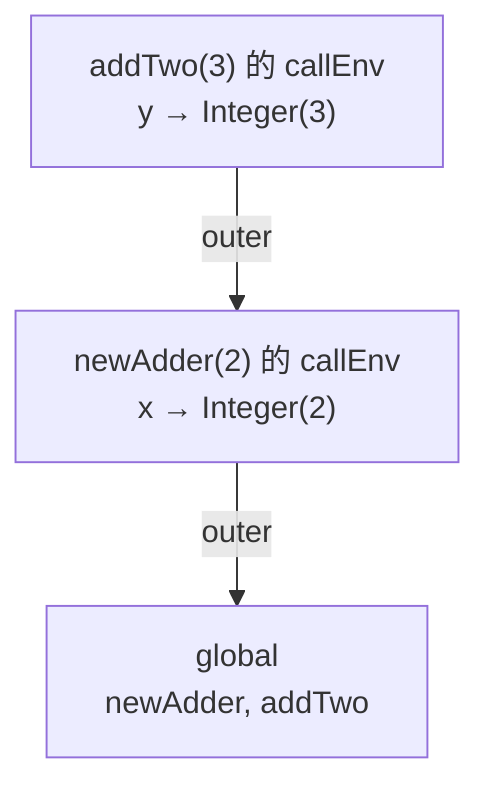
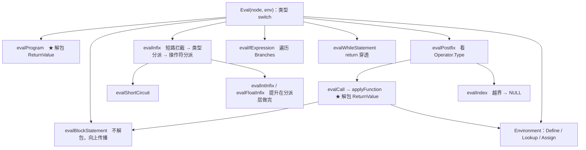

# 05 Evaluator：树遍历求值

## 本章要回答的问题

AST 是一棵描述结构的树，它不"做"任何事。`(1 + (2 * 3))` 怎么变成 7？`return` 藏在两层 `if` 里，怎么让它穿过两层 block 却停在函数边界？错误发生在最深的子表达式里，怎么让它一路冒到顶层，而不是被当成普通值参与后续运算？

还有一个只属于你的问题：原版 Monkey 只有 `int`，你加了 `float`。于是 `1 + 2.5` 这一个表达式就要求运行时做**类型分派**——四种操作数组合乘以十来个操作符。这是本章代码量最大、也最容易"半对"的地方。

本章语义密度最高。**你的扩展（float、`while`、赋值、`&&`/`||` 短路、`>=`/`<=`、扁平化 if、统一后缀节点）在这里第一次获得运行时含义。** 06-09 章的 compiler 和 VM 只是用另一种方式重新表达本章定下的规则——这里定错了，两条路径会一起错。

## 0. parser 现在能交出哪些 AST 形态

探针在当前代码上复核 11 章记录的缺陷，全部已修复：

```text
"true;"           -> 1 stmt   "true;"                ✓ 缺陷 2 已修
"1 == 1.0;"       -> 1 stmt   "(1==1.0);"            ✓
"1 && 2;"         -> 1 stmt   "(1&&2);"              ✓
"while (x) {...}" -> Body 的动态类型是 *ast.BlockStatement  ✓
"(1+2)*3;"        -> 1 stmt   "((1+2)*3);"           ✓ 缺陷 6 已修：分组已实现
"xs[0];"          -> 1 stmt   "xs[0];"               ✓ 缺陷 4 已修：索引进入 postfix 链
"[[1]];"          -> 1 stmt   "[[1]];"               ✓ 缺陷 3 已修：嵌套复合字面量
"a();"            -> 1 stmt   "a();"                 ✓ 缺陷 5 已修：零参调用不再 panic
"[];"  "{};"      -> 1 stmt 各自 "[];" "{};"          ✓ 缺陷 5 已修：空列表
"fn(){};"         -> 1 stmt   "let f = fn (){};"      ✓ 缺陷 12 已修：空块
"-5;"             -> "(-5);"                          ✓ 缺陷 7 已修：String() 不再乱码
```

**这意味着实现顺序上的限制已经解除。** 索引求值、零参调用、空数组、空块函数现在都能正常测试——第 1-15 节全部特性都可以对着真实 parser 输出的 AST 实现和测试，不需要再按 11 章的缺陷清单分批解锁。`String()` 现在可信，可以放心当调试工具用。

## 1. `Eval` 的形状：为什么是一个大 switch

```go
func Eval(node ast.Node, env *object.Environment) object.Object
```

三个决定写在签名里：**输入是任意 `ast.Node`**（要递归子节点）、**环境显式传参**（不用全局变量，否则嵌套调用和并行测试互相污染）、**输出是统一的 `Object`**——错误是值，不是 Go 的 `error`。

最后一点是关键。若签名是 `(Object, error)`，每个递归点都要写 `if err != nil`，而 `Error` 也没法当一等值放进数组、传给函数。把错误做成 `Object` 的实现，代价是**每个递归点必须显式 `isError`**（第 4 节），收益是控制流只有一条路。

### 三种写法

**A：在 AST 节点上加 `Eval()` 方法。** 看似最自然，Go 的接口分派替你做了 switch。**但它编译不过：** `object.Function` 必须持有 `[]ast.Identifier` 和 `ast.BlockStatement`（04 章契约），所以 `object` 导入 `ast`；若 `ast` 的方法返回 `object.Object`，`ast` 就得导入 `object`——**循环导入**，Go 直接拒绝。这不是洁癖，而是编译器强制执行的分层，且分层本身是对的：同一棵 AST 要同时喂给 evaluator 和 compiler，**AST 不该知道运行时存在**。

**B：visitor 模式。** `ast` 只依赖一个返回 `any` 的 `Visitor` 接口，循环导入解除。这是 Java/C++ 的标准解法，因为那些语言没有对外部类型分派的手段。真实收益是**穷尽性检查**——加一个节点，接口多一个方法，所有实现者立刻编译失败。代价是每个节点两处样板加 `any` 的断言噪音。

**C：Go 的类型 switch（选它）。** `evaluator` 单向依赖 `ast` 和 `object`，两个被依赖方互不知情，没有样板。**Go 的类型 switch 就是外部分派的语言级支持**，visitor 在 Go 里基本多余。代价只有一个但要认真：**Go 不检查 switch 是否穷尽**，漏一个节点会静静落进 `default`。所以 `default` 必须报错，**不要 `return nil`**——nil 会被上层当成正常 `Object` 传下去，然后在某个 `result.Type()` 上 panic，而 panic 的栈顶离真正原因很远。

`Eval` 只认类型、转交 helper。**超过三行的语义逻辑都搬出去**——一个同时处理作用域、类型检查和控制流的 switch 会长到没法读。

```go
func Eval(node ast.Node, env *object.Environment) object.Object {
	switch node := node.(type) {
	// ---- 语句 ----
	case *ast.Program:
		return evalProgram(node, env)
	case *ast.BlockStatement:
		return evalBlockStatement(node, env)       // 与 evalProgram 不同！第 3 节
	case *ast.ExpressionStatement:
		return Eval(node.Expression, env)
	case *ast.WhileStatement:
		return evalWhileStatement(node, env)       // 第 8 节
	case *ast.LetStatement:
		// TODO: 求 Value → isError → env.Define(node.Name.Value, v) → 返回 NULL
	case *ast.AssignmentStatement:
		// TODO: 变量名在 node.Token.Literal（没有 Name 字段！）第 9 节
	case *ast.ReturnStatement:
		// TODO: 求 ReturnValue → isError → 包成 &object.ReturnValue{}

	// ---- 字面量 ----
	case *ast.IntegerLiteral:
		return &object.Integer{Value: int64(node.Value)}    // ast 里是 int
	case *ast.FloatLiteral:
		return &object.Float{Value: float64(node.Value)}    // ast 里是 float32，第 6.3 节
	case *ast.BooleanLiteral:
		return nativeBoolToBoolean(node.Value)              // 返回单例，不 new
	case *ast.HashList:
		return evalHashList(node, env)                      // 第 12 节
	case *ast.StringLiteral:
		// TODO: parser 没填 Value 字段，用 node.Token.Literal
	case *ast.Array:
		// TODO: evalExpressions(node.Elements) → &object.Array{}

	// ---- 表达式 ----
	case *ast.PrefixExpression:
		right := Eval(node.Right, env)
		if isError(right) {
			return right
		}
		return evalPrefix(node.Token.Type, right)  // 没有 Operator 字段
	case *ast.InfixExpression:
		return evalInfix(node, env)                // 不先求两边！第 7 节
	case *ast.IfExpression:
		return evalIfExpression(node, env)         // 第 8 节
	case *ast.FunctionExpression:
		return &object.Function{Parameters: node.Parameters, Body: node.Body, Env: env}
	case *ast.PostfixExpression:
		return evalPostfix(node, env)              // 调用 or 索引，第 10/12 节
	case *ast.Identifier:
		// TODO: env.Lookup 失败 → 查 builtins → 再失败才报错

	default:
		return newError("unsupported AST node: %T", node)
	}
}
```

三处细节现在就记住，都来自你的 AST 与书上的差异：

**① `PrefixExpression`/`InfixExpression` 没有 `Operator` 字段**（[ast.go:361](../ast/ast.go#L361)、[ast.go:374](../ast/ast.go#L374)），操作符只在 `Token` 里。用 `Token.Type` 而非 `Token.Literal`——两者在操作符 token 上恰好相等（[token.go:19](../token/token.go#L19) 的常量值就是字面量），但 `case token.PLUS:` 拼错会编译报错，`case "+":` 拼错只会静默走 default。

**② `StringLiteral.Value` 永远是空的**（[parser.go:506](../parser/parser.go#L506) 只填了 `Token`）。用 `node.Token.Literal`，或顺手把 parser 补上——存在却永远为空的字段是陷阱。

**③ `FunctionExpression.Body` 是值类型 `ast.BlockStatement`，不是指针**（[ast.go:338](../ast/ast.go#L338)）。所以调用时 `Eval(fn.Body, env)` 匹配不上 `*ast.BlockStatement` 那个 case，得传 `&fn.Body`。

**需要 `Evaluator` 结构体吗？** 不需要。`Eval` 无状态，运行状态全在 `env` 和 `Object` 里。等你要加调试器、模块系统或执行步数上限时再包（练习 10 是第一个真实理由）。**过早引入的代价是每个 helper 都变成方法**，而它们一个字段都不用。

## 2. 求值顺序：后序遍历

递归结构就是**后序遍历**——子节点先求值，父节点用结果。对 `1 + 2 * 3`，完成顺序是 `Integer(1)` → `Integer(2)*Integer(3)=Integer(6)` → `Integer(1)+Integer(6)=Integer(7)`。

两点值得注意。**优先级已经不存在了**：evaluator 从不比较 `*` 和 `+` 谁优先——parser 把它消化成了树的形状（00 章第 1 节）。如果你在 evaluator 里发现自己判断优先级，说明有东西放错层了。**"沿 AST 游走"不需要额外数据结构**：没有显式栈、游标或 worklist，Go 的调用栈就是遍历栈。这也是它的局限——树多深，Go 栈就压多深（第 20 节陷阱 ⑪）。

三个例外**不是**纯后序，正是 bug 高发区：

| 节点 | 为什么不能先求所有子节点 |
| --- | --- |
| `&&` / `\|\|` | 右操作数**可能不该被求值**（第 8 节） |
| `IfExpression` | 只求中选的那个分支体，未中选的连 condition 都不算 |
| `WhileStatement` | condition 和 body 要求**多次** |

三个都是控制流。**控制流 = 打破"子节点各求值一次"的默认规则**——这是理解求值器（以及 VM 里为什么需要跳转指令）的核心。

## 3. `return` 传播：本章最容易写错的地方

`return 5;` 求值出 `Integer(5)`，`5;` 也求值出 `Integer(5)`。两个结果类型完全一样，可 block 必须区别对待：前者要**立刻停止并向上跳**。值本身携带不了这个信息，所以需要包装器 `ReturnValue{Value Object}`。它是 evaluator 的**内部控制流信号**，用户永远拿不到——它在函数边界被拆掉。

```go
func evalProgram(program *ast.Program, env *object.Environment) object.Object {
	var result object.Object = NULL
	for _, stmt := range program.Statements {
		result = Eval(stmt, env)
		switch result := result.(type) {
		case *object.ReturnValue:
			return result.Value          // ← 解包：程序边界，return 到此为止
		case *object.Error:
			return result                // ← 不解包：错误原样呈现给用户
		}
	}
	return result
}

func evalBlockStatement(block *ast.BlockStatement, env *object.Environment) object.Object {
	var result object.Object = NULL
	for _, stmt := range block.Statements {
		result = Eval(stmt, env)
		if result != nil {
			if t := result.Type(); t == object.RETURN_VALUE_OBJ || t == object.ERROR_OBJ {
				return result            // ← 不解包，原样向上传播
			}
		}
	}
	return result
}
```

**唯一的差别是 `return result.Value` 和 `return result`。** block 不解包（外层还不知道要停，包装器必须活着继续上传），program 解包（return 的使命完成，交出真值）。为什么必须这样，看嵌套例子——`if (true) { if (true) { return 1; } return 2; }` 正确结果是 `1`：

```text
外层 block ← evalBlockStatement
  内层 if
    内层 block ← evalBlockStatement
      return 1  →  ReturnValue(1)
      见 RETURN_VALUE_OBJ → 返回 ReturnValue(1)          不解包
    内层 if 原样返回 ReturnValue(1)
  外层 block 见 RETURN_VALUE_OBJ → 返回它                不解包
  ← 关键：外层 block 因此不会执行 return 2
evalProgram 解包 → Integer(1)                            解包
```

如果内层 block 解了包，它返回 `Integer(1)`；外层 block 看到普通整数，**继续执行 `return 2`**，最终得 `2`。**测 `if (true) { return 1; }` 抓不到这个 bug**——只有一层时解包与否结果相同，必须测两层。

三处边界：`evalProgram` 解包、`applyFunction` 解包（第 10 节），**其他所有地方不解包**。`evalWhileStatement` 属于"其他"——`return` 必须能穿透循环（第 8 节）。（`evalProgram` 用类型 switch 是因为要取 `.Value`；`evalBlockStatement` 用 `Type()` 在多加一种控制流对象时更省事，比如练习 6 的 `BreakValue`。）

## 4. 错误传播：`isError` 放在每个递归返回之后

错误是普通 `Object`，会像普通值一样被传递——**包括被当成操作数**。

```go
func newError(format string, a ...interface{}) *object.Error {
	return &object.Error{Message: fmt.Sprintf(format, a...)}
}

func isError(obj object.Object) bool {
	if obj != nil {                       // ← 这层保护不多余：漏了返回值就是 nil pointer panic
		return obj.Type() == object.ERROR_OBJ
	}
	return false
}
```

**忘记检查的后果。** `1 + undefinedVar`：有检查时返回 `Error("identifier not found: undefinedVar")`；没检查时 `left=Integer, right=Error` 落到兜底分支，变成 `Error("type mismatch: INTEGER + ERROR")`——**原始错误被覆盖，消息完全指不到 `undefinedVar`**。更糟的是在 `evalProgram` 里漏掉：`let a = undefinedVar; puts("still here"); 1 + 2;` 会一路跑完，`a` 绑定到一个 `Error` 对象，最后返回 `3`。**错误被吞了**，比报错难查一百倍。

检查点清单，一处不能漏：

```text
Eval 内部：          PrefixExpression.Right、ReturnStatement.ReturnValue、
                     LetStatement.Value、AssignmentStatement.Value
evalInfix：          Left、Right 各一次
evalIfExpression：   每个 branch 的 Condition
evalWhileStatement： Condition（每轮！）、Body（每轮）
evalPostfix：        callee/left、每个实参或下标
evalExpressions：    每个元素        applyFunction：函数体结果
evalHashList：       每个 key、每个 value
```

`evalExpressions`（求值表达式列表）有个书上的偷懒约定：出错时返回长度 1 的切片、唯一元素是那个 Error，调用方靠 `len(args) == 1 && isError(args[0])` 判断。**能用但不优雅**——单元素的合法列表和错误列表长得一样。更清晰的签名是 `([]object.Object, object.Object)`，第二个非 nil 表示出错。两种都行，选一种保持一致。

它的另一个契约值得写进语言规范：出错时**已求值的元素被丢弃，但它们的副作用已经发生了**——`f(log(), boom())` 里 `log()` 确实执行过。

## 5. truthy 与前缀运算

契约（00 章第 4 节，不要改）：**只有 `false` 和 `null` 为假**，`0`、`0.0`、`""`、`[]`、`{}` 都为真。

```go
func isTruthy(obj object.Object) bool {
	switch obj {                          // ← 指针比较，只有单例能这样写
	case NULL, FALSE:
		return false
	}
	return true
}

func nativeBoolToBoolean(input bool) *object.Boolean {
	if input {
		return TRUE
	}
	return FALSE
}

func evalPrefix(op token.TokenType, right object.Object) object.Object {
	switch op {
	case token.NOT:
		return nativeBoolToBoolean(!isTruthy(right))
	case token.MINUS:
		switch right := right.(type) {
		case *object.Integer:
			return &object.Integer{Value: -right.Value}
		case *object.Float:
			return &object.Float{Value: -right.Value}
		default:
			return newError("unknown operator: -%s", right.Type())
		}
	default:
		return newError("unknown operator: %s%s", op, right.Type())
	}
}
```

`isTruthy` 用指针比较是 04 章要求 `TRUE`/`FALSE`/`NULL` 是单例的原因之一。但单例带来陷阱：**任何路径 new 了一个 `&object.Boolean{Value: false}`，`isTruthy` 会走 `default` 返回 `true`。** 这个 bug 只在 `false` 上出现，测 `if (true)` 抓不到。防御：所有产生 Boolean 的地方（字面量、比较、`!`、`&&`/`||`）**一律走 `nativeBoolToBoolean`**——代码里搜不到 `&object.Boolean{` 才算干净。

`0` 为真是有意的选择：Monkey 有独立的 `Boolean` 类型，`if (x)` 里 `x` 是数字通常意味着写错了（本该是 `x > 0`）。**代价是 `while (n)` 不能用**，必须写 `while (n > 0)`。这条规则要在 VM 的 `OpJumpNotTruthy` 里一字不差地重复。

`!` 复用 `isTruthy`，所以 `!0` 是 `false`、`!!x` 等价于"转成布尔"——**truthy 规则只写在一个函数里，所有用到它的地方自动一致**。`-` 是本章第一次"按操作数类型分派"，它**必须列举类型**：Go 里没有"数字"这个类型，`Integer.Value` 和 `Float.Value` 类型不同，取负的代码无法共用。这份笨拙感会在下一节放大 20 倍。

## 6. 中缀运算的分派：本章最长的一节

12 个操作符乘以至少 5 类操作数。**先按类型分派，再按操作符分派**——反过来会让 `+ - * / < > <= >=` 八个 case 里各写一遍四路提升，重复八次。

```go
func evalInfix(node *ast.InfixExpression, env *object.Environment) object.Object {
	// 短路运算符必须在求值两边【之前】拦截！第 7 节
	if node.Token.Type == token.AND || node.Token.Type == token.OR {
		return evalShortCircuit(node, env)
	}

	left := Eval(node.Left, env)
	if isError(left) {
		return left
	}
	right := Eval(node.Right, env)
	if isError(right) {
		return right
	}
	op := node.Token.Type

	// 数值：四种组合塌缩成两条路。numeric 返回 (float64 值, 是否 float, 是否数值)
	lf, lIsFloat, lNum := numeric(left)
	rf, rIsFloat, rNum := numeric(right)
	if lNum && rNum {
		if lIsFloat || rIsFloat {
			return evalFloatInfix(op, lf, rf)          // ★ 提升就是这一行的条件
		}
		return evalIntInfix(op, int64(lf), int64(rf))
	}
	if l, ok := left.(*object.String); ok {
		if r, ok := right.(*object.String); ok {
			return evalStringInfix(op, l.Value, r.Value)
		}
	}

	// 兜底。注意顺序：数值/字符串已处理掉，所以下面的指针比较才是安全的
	if left.Type() != right.Type() {
		return newError("type mismatch: %s %s %s", left.Type(), op, right.Type())
	}
	switch op {
	case token.EQUAL:
		return nativeBoolToBoolean(left == right)      // 指针相等，见 6.3
	case token.NOT_EQUAL:
		return nativeBoolToBoolean(left != right)
	}
	return newError("unknown operator: %s %s %s", left.Type(), op, right.Type())
}
```

`numeric` 对 `*object.Integer` 返回 `(float64(v), false, true)`，对 `*object.Float` 返回 `(v, true, true)`，其他返回 `(0, false, false)`。**提升就是 `lIsFloat || rIsFloat` 这一个条件**——`evalFloatInfix` 只见两个 `float64`，完全不知道参数原本是 int 还是 float。（也可以写成显式的双层类型 switch，四个 case 各调一次——更啰嗦，但一眼能看到下面那张表的四行。两种都行。）

### 6.1 分派表

写代码前先把表填满。**空格是错误，不是"以后再说"**——每个空格都是一条 `newError` 路径。

| 左 ⊗ 右 | `+ - * /` | `< > <= >=` | `== !=` | 走哪 |
| --- | --- | --- | --- | --- |
| Int ⊗ Int | Integer（`/` 截断） | Boolean | Boolean | `evalIntInfix` |
| Float ⊗ Float | Float | Boolean | Boolean | `evalFloatInfix` |
| Int ⊗ Float | Float（左提升） | Boolean | Boolean | `evalFloatInfix` |
| Float ⊗ Int | Float（右提升） | Boolean | Boolean | `evalFloatInfix` |
| String ⊗ String | 只有 `+` → String | 错误（见下） | Boolean（比值） | `evalStringInfix` |
| Bool ⊗ Bool | 错误 | 错误 | Boolean（指针） | 兜底 |
| Null ⊗ Null | 错误 | 错误 | Boolean（恒 true） | 兜底 |
| Array/Hash/Function 同类 | 错误 | 错误 | Boolean（引用相等） | 兜底 |
| 不同类型（非数值） | `type mismatch` | `type mismatch` | `type mismatch` | 兜底 |

三个决定要在表里定下来，因为 VM 那条路要照抄：**字符串比较**（`"a" < "b"`）建议先不支持，加了就得在 VM 里也加；**不同类型的 `==`** 建议报错而不是返回 `false`，跟原版一致——返回 false 更宽容，但会把类型笔误藏起来，**唯一例外是数值**（`1 == 1.0` 走数值路径得 `true`）；**Array/Hash/Function 的 `==`** 用指针比较，`[1] == [1]` 是 `false`，深比较是练习。

### 6.2 算术

```go
func evalIntInfix(op token.TokenType, l, r int64) object.Object {
	switch op {
	case token.PLUS:
		return &object.Integer{Value: l + r}
	case token.DIVIDE:
		if r == 0 {
			return newError("division by zero")     // ← 必须！否则 Go panic 杀掉整个 REPL
		}
		return &object.Integer{Value: l / r}        // 截断：5/2=2，-5/2=-2
	case token.LT:
		return nativeBoolToBoolean(l < r)
	// TODO: MINUS / MULTI / GT / GE / LE / EQUAL / NOT_EQUAL
	default:
		return newError("unknown operator: INTEGER %s INTEGER", op)
	}
}
```

`evalFloatInfix` 结构相同，四处不同：返回 `Float`；**除零不报错**（IEEE 754 有 `±Inf`，`1.0/0.0` 得 `+Inf`，`0.0/0.0` 得 `NaN`）；没有截断；`NaN == NaN` 是 `false`，破坏了 `==` 的自反性。

除零的不对称是**刻意的**，必须写进规范：`1/0` 报错，`1.0/0.0` 得 `+Inf`。理由是 float 有 Inf 的原生表示而 int 没有，硬编一个返回值都是编造。另一个自洽选择是两者都报错——但 `Inspect()` 仍要能打印 `+Inf`，因为溢出（`1e308 * 10`）也会产生它。截断方向：Go 向零截断（`-5/2 == -2`），Python 的 `//` 向下取整得 `-3`。**两种都常见，选一个写下来**，VM 用同样的 Go 表达式就自动一致。

### 6.3 `==` 的三个陷阱

**① 不能只比 Type。** `1 == 1.0` 要 `true`，但两者 `Type()` 不同。上面的结构天然处理了这个——`Int ⊗ Float` 走 `evalFloatInfix`，两边都成 `float64`。**如果你在函数开头写 `if left.Type() != right.Type() { return 错误 }`，就把这条正确路径掐死了。** 类型检查必须在数值分派**之后**兜底。

**② Boolean 用指针比较，Integer 用值比较，两套规则。** 这是单例设计的代价。危险在于 `left == right` 对 `Integer` **编译通过但结果错误**——两个不同的 `&Integer{5}` 指针不同，得 `false`。所以兜底那句 `left == right` **只有在数值/字符串路径已被先处理掉时才安全**。代码顺序在这里承载正确性，值得写一行注释锁住。彻底消除隐患的办法：给每个对象加 `Equals(Object) bool`，把规则收进对象自己（练习 5）——代价是 `object` 包变大，收益是 VM 那条路能复用同一个方法，两条路自动一致。

**③ float32 → float64 的精度污染。** 你的 `ast.FloatLiteral.Value` 是 `float32`（[ast.go:207](../ast/ast.go#L207)，parser 里 `ParseFloat(lit, 32)`，[parser.go:497](../parser/parser.go#L497)），object 层用 `float64`。实测：

```text
源码 "0.1"  →  float32  →  float64 = 0.10000000149011611938
源码 "0.2"  →  float32  →  float64 = 0.20000000298023223877
源码 "0.3"  →  float32  →  float64 = 0.30000001192092895508
```

`0.1 + 0.2 == 0.3` 在纯 float64 下也是 `false`（IEEE 754 的正常行为），但这里的误差比 float64 应有的**大了约 10^8 倍**——float32 只有 24 位有效位，widening 把它的舍入误差原封不动放到了 float64 的精度位上。打印 `0.1 + 0.2` 会得到 `0.30000000447034836` 之类，纯 float64 是 `0.30000000000000004`。**修法：parser 改 `ParseFloat(lit, 64)`，`ast.FloatLiteral.Value` 改 `float64`。** 一处两行，现在没有下游消费者，越早改越便宜。保留 `float32` 也能跑——VM 从常量池读同一个值，两条路至少是**一致地错**。

## 7. `&&` 和 `||`：中缀语法的控制流

parser 把它们放进了 `INFIX_BP`（[parser.go:241](../parser/parser.go#L241)），所以它们是 `ast.InfixExpression`，和 `+` 一模一样。**但求值规则根本不同**：`false && boom()` 里 `boom()` 不能被调用，而 `evalInfix` 的第一件事就是求值两边。**它是唯一一类"子节点不都求值"的中缀节点**，语义上属于控制流，只是恰好用中缀语法书写。拦截必须在求值之前：

```go
func evalShortCircuit(node *ast.InfixExpression, env *object.Environment) object.Object {
	left := Eval(node.Left, env)
	if isError(left) {
		return left
	}
	leftTruthy := isTruthy(left)

	// 短路：结果已定，右侧一次都不碰
	if node.Token.Type == token.AND && !leftTruthy {
		return FALSE
	}
	if node.Token.Type == token.OR && leftTruthy {
		return TRUE
	}

	right := Eval(node.Right, env)      // 结果由右侧决定
	if isError(right) {
		return right
	}
	return nativeBoolToBoolean(isTruthy(right))
}
```

**返回什么值？** 两种设计，必须选一个：

| | 返回操作数本身（JS/Python/Lua） | 返回 Boolean（选它） |
| --- | --- | --- |
| `1 && 2` | `2` | `TRUE` |
| `0 \|\| "x"` | `0`（因为 `0` truthy！） | `TRUE` |
| 惯用法 | `let n = arg \|\| "d"` 可用 | 不可用 |
| VM 实现 | 要保留栈上的操作数 | `OpJumpNotTruthy` + `OpTrue`/`OpFalse` |
| 类型 | 取决于运行时 | 恒为 Boolean |

**建议返回 Boolean。** Monkey 有独立的 `Boolean` 类型；truthy 规则简单，"返回操作数"能省的事很少；而 `0` 是 truthy 让 `x || default` 这个惯用法**本来就不好用**（`0 || 5` 得 `0`，跟直觉相反）。

**一个容易漏的测试。** 短路的正确性**不能靠返回值验证**——`false && boom()` 返回 `FALSE`，就算 `boom()` 被调用了也可能返回 `FALSE`。必须测**副作用没发生**：

```monkey
let called = 0;
let boom = fn() { called = 1; true };
false && boom();
called;                  // 必须是 0
```

这个测试依赖赋值（第 9 节）和闭包（第 11 节），要等它们能用了才写。**先在待办里记下来。**

## 8. `if` 表达式与 `while` 语句

你的 `IfExpression` 是扁平分支列表（[ast.go:299-308](../ast/ast.go#L299)），不是原版的 `Consequence`/`Alternative` 嵌套，`IfBranch.Condition == nil` 表示 else。求值因此是一个 for 循环，比原版的递归更简单：

```go
func evalIfExpression(node *ast.IfExpression, env *object.Environment) object.Object {
	for i := range node.Branches {
		branch := &node.Branches[i]        // 取地址，避免拷贝整个 BlockStatement

		if branch.Condition == nil {       // else：无条件命中
			return Eval(&branch.Body, env)
		}
		cond := Eval(branch.Condition, env)
		if isError(cond) {
			return cond
		}
		if isTruthy(cond) {
			return Eval(&branch.Body, env)
		}
	}
	return NULL                            // 全不匹配且无 else
}

func evalWhileStatement(node *ast.WhileStatement, env *object.Environment) object.Object {
	for {
		cond := Eval(node.Condition, env)      // 每轮重新求值！
		if isError(cond) {
			return cond
		}
		if !isTruthy(cond) {
			return NULL                        // 正常结束：语句不产生值
		}
		result := Eval(node.Body, env)         // Body 是 ast.Statement 接口，直接传
		if result != nil {
			if t := result.Type(); t == object.ERROR_OBJ || t == object.RETURN_VALUE_OBJ {
				return result                  // ← 穿透：不解包，向上传播
			}
		}
	}                                          // 普通值：丢弃，下一轮
}
```

**`&branch.Body` 要加 `&`，`node.Body` 不加。** `IfBranch.Body` 是值类型 `BlockStatement`（[ast.go:301](../ast/ast.go#L301)），而 `Eval` 的 case 匹配 `*ast.BlockStatement`——传值会落进 `default` 报 "unsupported AST node: ast.BlockStatement"，**注意消息里没有 `*`，这是识别这个 bug 的线索**。而 `WhileStatement.Body` 的类型是 `ast.Statement` 接口（[ast.go:163](../ast/ast.go#L163)），里面装的是 `*ast.BlockStatement`（实测确认，[parser.go:192](../parser/parser.go#L192)），直接传就对。**同一个概念在你的 AST 里有三种类型**（02 章第 445 行讨论过），这就是代价。接口类型反而有个意外好处：哪天 parser 支持 `while (c) x = 1;`（无大括号单语句体），代码照样工作。

**if 的三个要点：** 未命中的分支体一次都不求值，连 condition 都不算；全不匹配返回 `NULL`，所以 `let x = if (false) { 1 };` 里 `x` 是 `null`（`if` 是表达式，每条路径必须有值）；扁平化带来一个"类型合法但语义非法"的状态——`Branches[0].Condition == nil`，parser 保证不产生它（[parser.go:385](../parser/parser.go#L385)）但类型系统不阻止，上面的代码把它当无条件分支执行，**写成注释说明你想过这件事**。

**return 穿透为什么关键。** 考虑一个 `find(xs, target)`：函数体是 `let i = 0; while (i < len(xs)) { if (xs[i] == target) { return i; } i = i + 1; } return 0 - 1;`。`return i` 产生 `ReturnValue(i)`，从 if 的 block 传到 while 的 body，再到 `evalWhileStatement`。**如果这里不检查 `RETURN_VALUE_OBJ`，它会被当普通结果丢弃、循环继续跑**——函数最终返回 `-1`，而且没有任何报错。这类 bug 的表现（"返回了错的值"）离真正的原因（漏了一个 `if`）非常远。

**condition 每轮重新求值**，这是循环的定义，也是 evaluator 慢的原因（00 章第 3 节）：`i < len(xs)` 这棵子树每轮都重做类型断言、重新分派 `<`、重新查 `len`；VM 那边只是重跑几条指令。**没有 `break`/`continue`**，所以 `while (true) { }` 会挂住 REPL，只能 Ctrl-C。加上它们的方法和 `return` 完全同构（练习 6）：定义 `object.BreakValue`/`ContinueValue` 单例照样传播，而 `evalWhileStatement` **消费**（不上传）`BreakValue`——这一点就保证了 `break` 只跳出最内层循环。

## 9. 变量绑定：三个操作对应三个节点

| 节点 | Environment 操作 | 失败时 |
| --- | --- | --- |
| `LetStatement` | `Define`（只在当前层） | 不会失败（同层重复 `let` 直接覆盖） |
| `Identifier` | `Lookup`（沿链向外） | 查 builtins，再失败报 `identifier not found: x` |
| `AssignmentStatement` | `Assign`（沿链找已有绑定） | 错误 `undefined variable: x` |

```go
// LetStatement
val := Eval(node.Value, env)
if isError(val) {
	return val
}
env.Define(node.Name.Value, val)
return NULL

// AssignmentStatement —— 注意变量名的位置！
val := Eval(node.Value, env)
if isError(val) {
	return val
}
if !env.Assign(node.Token.Literal, val) {        // ← 不是 node.Name.Value
	return newError("undefined variable: %s", node.Token.Literal)
}
return NULL
```

**`AssignmentStatement` 没有 `Name` 字段。** [ast.go:143](../ast/ast.go#L143) 只有 `Token` 和 `Value`，变量名在 `Token.Literal`（parser 用赋值目标的标识符 token 构造它，[parser.go:203](../parser/parser.go#L203)）。写错编译器会告诉你，所以风险不大——真正的风险是**你以为该有 `Name` 于是去改 AST**，那要连带改 parser。现在这样能用。

**`let` 必须先求右值再 Define。** `let x = 1; let x = x + 1;` 求 `x+1` 时读到旧的 `x`，得 2。如果先 Define 占位，`x + 1` 里的 `x` 就可能读到未初始化的东西；同理 `let x = x;`（x 未定义）应报 `identifier not found`。**同层重复 `let` 直接覆盖**（Rust 叫 shadowing），REPL 场景下这更方便——改一个函数定义时不必换名字。

**赋值不创建新绑定 + 读未定义变量报错**，这两条一起把"拼错变量名"变成运行时错误而不是静默的 null。代价是写 `count = 0` 之前必须先 `let count = 0`。**这是好的默契**——JS 的 `var` 提升和 Python 的隐式全局都是 bug 温床。

## 10. 函数与调用：先付统一后缀节点的账

`PostfixExpression`（[ast.go:388](../ast/ast.go#L388)）同时表示调用和索引，`Operator.Type` 区分。原版的 `CallExpression`/`IndexExpression` 靠 `Eval` 的类型 switch 就分开了；你的设计**把这个分派推给了每个消费者**（evaluator、compiler、`String()` 各一次）：

```go
func evalPostfix(node *ast.PostfixExpression, env *object.Environment) object.Object {
	switch node.Operator.Type {
	case token.LEFT_PAREN:
		return evalCall(node, env)
	case token.LEFT_BRACKET:
		return evalIndex(node, env)
	default:
		return newError("unknown postfix operator: %s", node.Operator.Literal)
	}
}
```

更麻烦的是 **`ValueList` 的元数约束丢失了**——调用可以 0..n 个实参，索引只能 1 个，类型系统不表达，所以必须运行时检查 `len(node.ValueList) != 1`。**这个检查必须写**：parser 的索引循环接受逗号（[parser.go:543](../parser/parser.go#L543)），`xs[1,2]` 能解析成长度 2（实测确认，parser 不报错），不检查就静默忽略第二个下标——又一个"没报错但结果不对"。11 章缺陷 5（nil 元素塞进 `ValueList`）已经修复，parser 不会再产生 nil 元素，所以这里不需要再防御 `ValueList[i] == nil`。02 章建议加 `IsCall()`/`IsIndex()` 把 `token.LEFT_PAREN` 这个魔法值收进 ast 包——值得做。

**函数对象的创建**（`&object.Function{Parameters: node.Parameters, Body: node.Body, Env: env}`）**没有递归、没有求值、没有类型检查**——就是把 AST 打包加一个环境指针，函数体一个字都不看。`Env: env` 那一行就是闭包。后果：`fn() { undefinedVar }` 求值成功，只有调用时才报错。这是动态语言的定义性质，也是 12 章静态类型探索要解决的问题。

```go
func evalCall(node *ast.PostfixExpression, env *object.Environment) object.Object {
	callee := Eval(node.Left, env)                  // 1. 求被调用者
	if isError(callee) {
		return callee
	}
	args := evalExpressions(node.ValueList, env)    // 2. 求实参：【调用者】环境，从左到右
	if len(args) == 1 && isError(args[0]) {
		return args[0]
	}
	return applyFunction(callee, args)
}

func applyFunction(fn object.Object, args []object.Object) object.Object {   // 3-6 步
	switch fn := fn.(type) {
	case *object.Function:
		if len(args) != len(fn.Parameters) {        // 3. 参数数量（否则 args[i] 直接 panic）
			return newError("wrong number of arguments: want=%d, got=%d",
				len(fn.Parameters), len(args))
		}
		callEnv := object.NewEnclosedEnvironment(fn.Env)   // 4. outer 是【定义时】环境
		for i, param := range fn.Parameters {              // 5. 绑定形参
			callEnv.Define(param.Value, args[i])
		}
		evaluated := Eval(&fn.Body, callEnv)               // 6. 执行（&：Body 是值类型）
		if rv, ok := evaluated.(*object.ReturnValue); ok {
			return rv.Value                                //    函数边界：解包
		}
		return evaluated                                   //    隐式返回：块的最后一个值
	case *object.Builtin:
		return fn.Fn(args...)                              // 内置函数自己检查参数
	default:
		return newError("not a function: %s", fn.Type())
	}
}
```

**第 2 步用 `env`（调用者的），第 4 步的 outer 用 `fn.Env`（定义时的）。** 两个环境在同一个函数里出现，用错任何一个都得到"大部分情况能跑"的实现：实参误用 `fn.Env` 时，`let x = 1; f(x)` 通常也能找到 `x`（如果 f 定义在全局），简单测试全绿；`NewEnclosedEnvironment(env)` 则是**动态作用域**，闭包全错。

**第 6 步的解包是 return 传播的终点**（第 3 节三处边界的第二处），同时实现了隐式返回：函数体是 block，`evalBlockStatement` 返回最后一条语句的值，所以 `fn(x) { x * 2 }` 不写 `return` 也工作。**参数数量严格检查**，多传少传都报错——另一种设计是缺的补 `null`、多的忽略（JS 那样），**不要**，那会把调用错误藏起来（可选参数是练习 8）。

## 11. 闭包与递归

```monkey
let newAdder = fn(x) { fn(y) { x + y } };
let addTwo = newAdder(2);
addTwo(3);                 // 5
```

`addTwo(3)` 执行时 `newAdder` 早已返回。`x` 不在任何活着的调用里——它只存在于 `addTwo` 持有的 `Env` 指针指向的那个环境里。内层 `fn(y){...}` 求值时，当前环境正是 `newAdder(2)` 的 callEnv，它被存进了 `Function.Env`；`newAdder` 返回后 GC 不回收它，因为 `addTwo` 还引用着。**"闭包" = 函数代码 + 定义时环境指针**，仅此而已。



区分词法与动态作用域的最小例子——`let x = 1; let f = fn() { x }; let g = fn() { let x = 2; f() }; g();`

| | 结果 | 为什么 |
| --- | --- | --- |
| **词法作用域**（正确） | `1` | `f.Env` 是全局环境，`x` 查到全局的 1 |
| **动态作用域**（bug） | `2` | `f` 的 callEnv 套在 `g` 的 callEnv 外，先查到 2 |

**这个测试必须写。** 用调用者环境的错误实现在 `fn(x){x}`、`fn(x,y){x+y}`、`newAdder` 单层调用上全部通过，只有"函数在 A 处定义、在 B 处调用、A 和 B 有同名变量"时才暴露。**变量的含义由代码写在哪里决定，不由从哪里被调用决定**——早期 Lisp 和 bash 用动态作用域，公认是设计失误。

**递归为什么能工作。** `let fact = fn(n) { if (n < 2) { 1 } else { n * fact(n-1) } };` 里 `fn(...)` 求值时 `fact` 还不在环境里（`let` 先求右值再 Define），函数体却引用了它：

```text
t1  Eval(fn(n){...})  →  Function{Env: 全局环境}      函数体一个字都没看
t2  env.Define("fact", 那个 Function)                 全局环境里现在有 fact
t3  Eval(fact(5)) → Lookup "fact" → 命中（t2 建的）
t4  callEnv{n:5}, outer = Function.Env = 全局环境
t5  函数体里遇到 "fact" → callEnv 没有 → outer → 命中
```

关键在 t5：`Function.Env` 存的是**全局环境这个对象的指针**，不是 t1 时刻的快照；t2 的 `Define` 直接改那个对象。**所以递归靠的是"环境是可变对象"+"查找延迟到调用时"，而不是 Define 的先后。** 同理**相互递归**也工作（`isEven`/`isOdd` 互相调用），只要**调用之前**两个 `let` 都已执行；把调用挪到两个 `let` 之间就报 `identifier not found`。**这个特性既灵活又危险**——错误从"定义时"推迟到了"运行到那一行时"。

（compiler 那条路麻烦得多：编译期要给 `fact` 分配符号表槽位，而编译函数体时 `fact` 还没定义完——这就是 09 章 `OpCurrentClosure` 存在的原因。**evaluator 这里的"免费"，在 VM 那边要花一条指令买。**）

## 12. 字符串、集合与索引

**字符串**：`evalStringInfix` 里 `+` 拼接，`==`/`!=` 比值（String 不是单例），其他操作符报 `unknown operator: STRING <op> STRING`。**数组字面量**：`evalExpressions(node.Elements)` 从左到右，任一元素出错立即中止。

```go
func evalHashList(node *ast.HashList, env *object.Environment) object.Object {
	pairs := make(map[object.HashKey]object.HashPair)
	for keyNode, valueNode := range node.Pairs {         // ← map 遍历，顺序随机！
		key := Eval(keyNode, env)
		if isError(key) {
			return key
		}
		hashable, ok := key.(object.Hashable)
		if !ok {
			return newError("unusable as hash key: %s", key.Type())
		}
		value := Eval(valueNode, env)
		if isError(value) {
			return value
		}
		pairs[hashable.HashKey()] = object.HashPair{Key: key, Value: value}
	}
	return &object.Hash{Pairs: pairs}
}
```

`ast.HashList.Pairs`（[ast.go:275](../ast/ast.go#L275)）已经按 11 章缺陷 9 的修法改成了有序切片 `[]HashPair`，所以**键值对的求值顺序就是源码顺序**，不再随机。`{"a":1,"a":2}` 仍然会保留两个 pair（AST 层不去重，忠实记录源码），但现在顺序固定，`let n = 0; let next = fn(){ n = n + 1; n }; {next(): next()};` 每次都得到同样的结果——重复键留下哪个值，是 evaluator 需要明确决定并写进规范的语义问题（报错，或后者覆盖前者），不再是"随机哪个赢"的问题。

```go
func evalIndex(node *ast.PostfixExpression, env *object.Environment) object.Object {
	// TODO: 检查 len(node.ValueList) == 1；求 left、求 index，各自 isError
	switch left.Type() {
	case object.ARRAY_OBJ:
		idx, ok := index.(*object.Integer)         // 只接受整数
		if !ok {
			return newError("array index must be INTEGER, got %s", index.Type())
		}
		arr := left.(*object.Array)
		if idx.Value < 0 || idx.Value > int64(len(arr.Elements)-1) {
			return NULL                            // 越界 → null，不报错
		}
		return arr.Elements[idx.Value]
	case object.HASH_OBJ:
		// TODO: index 断言 object.Hashable，失败报错；Pairs 查不到 → NULL
	default:
		return newError("index operator not supported: %s", left.Type())
	}
}
```

三个契约决定：**越界返回 `NULL` 而不是报错**（循环里越界一次不该终止程序，代价是拼错的索引不会报警）；**负索引也返回 `NULL`**（不支持 `xs[-1]`，加它是练习 7）；**`xs[1.0]` 报错**而不是截断——float 索引通常意味着算错了。哈希键要求实现 `object.Hashable`；Integer/String/Boolean 安全，**Float 建议禁止**（`0.1+0.2` 和 `0.3` 是不同的键，而 `1` 和 `1.0` 该不该是同一个键无论怎么答都会有人踩坑），Array/Hash/Function 也禁止（可变或引用语义）。

## 13. 内置函数与 REPL

`len`、`first`、`rest`、`push`、`puts`。两种放置方式：

| | 单独的 `builtins` map（选它） | 预先 Define 到全局环境 |
| --- | --- | --- |
| 查找 | `Lookup` 失败后再查 map | 统一走 `Lookup` |
| 用户遮蔽 `let len = fn(x){...}` | 生效（局部优先） | 生效，但会**覆盖**全局那份 |
| 误覆盖风险 | 无——map 只读 | `len = 5` 就把它废了 |
| 与 compiler 对应 | 对齐 `OpGetBuiltin`（按索引取） | 需要预填全局槽位 |

选 map。第 9 节的 `Identifier` 求值顺序是 `Lookup` → `builtins` → 报错，所以用户定义天然遮蔽内置。

```go
var builtins = map[string]*object.Builtin{
	"len": {Fn: func(args ...object.Object) object.Object {
		if len(args) != 1 {          // 内置函数自己检查元数，见下
			return newError("wrong number of arguments to `len`: got=%d, want=1", len(args))
		}
		switch arg := args[0].(type) {
		case *object.String:
			return &object.Integer{Value: int64(len(arg.Value))}
		case *object.Array:
			return &object.Integer{Value: int64(len(arg.Elements))}
		default:
			return newError("argument to `len` not supported, got %s", args[0].Type())
		}
	}},
	// TODO: first / rest / push / puts
}
```

**元数检查落在内置函数自己身上**，因为 `applyFunction` 不知道它们要几个参数（`Builtin` 只有一个 `Fn` 字段）。这是重复劳动——可以给 `Builtin` 加 `Arity int` 让 `applyFunction` 统一检查（`puts` 的可变参数用 `-1`）。

**`push` 和 `rest` 返回新数组，不修改原数组。** `Array.Elements` 是切片，`append` 可能原地改底层数组，所以必须先 `make` + `copy` 再 `append`。**不拷贝的后果**：`let a = [1,2,3]; let b = push(a, 4);` 可能让 `a` 也变了——取决于切片容量，所以是**间歇性的**，这类 bug 极难查。持久化风格是原版的选择，配合 `first`/`rest` 就能写递归的 map/filter/reduce，不需要循环。

**REPL**（`repl.go` 曾经编译失败，缺陷 10：`lexer.EOF` 应为 `token.EOF`，现已修复，`go build ./...` 全绿；但当前 `repl.go` 仍只打印 token 流，还没接上 parser/evaluator，下面是接入后的目标形态）：

```go
func Start(in io.Reader, out io.Writer) {
	scanner := bufio.NewScanner(in)
	env := object.NewEnvironment()          // ← 循环【外】：跨行保持
	for {
		fmt.Fprint(out, PROMPT)
		if !scanner.Scan() {
			return
		}
		p := parser.New(lexer.New(scanner.Text()), parser.Pratt)
		program := p.ParseProgram()
		if program == nil || len(p.Errors()) != 0 {
			continue                        // 打印全部 parser 错误后继续，不要 panic
		}
		if evaluated := evaluator.Eval(program, env); evaluated != nil {
			fmt.Fprintln(out, evaluated.Inspect())
		}
	}
}
```

**`env` 必须在循环外**——放进循环里每行都是新的全局环境，`let x = 1` 下一行就查不到了，REPL 的意义就没了。需要 `p.Errors()` 访问器（11 章附加观察 A：`errors` 字段未导出，REPL 在包外拿不到）。`let x = 1` 求值出 `NULL`，打印 `null` 有点吵，但**惯例是照打**——它明确告诉你"这条语句不产生值"。

## 14. 手算 trace

### Trace A：`let f = fn(x) { if (x > 1) { return x * 2; } return 0; }; f(3);`

`G` = 全局环境，`C` = 本次调用的 callEnv。缩进 = Go 调用栈深度。

```text
Eval(Program, G) → evalProgram
 │ 语句 1: LetStatement
 ├─ Eval(FunctionExpression, G) → Function{params:[x], body:{...}, Env: G}
 ├─ G.Define("f", Function)                    G = {f: Function}
 └─ NULL（不是 ReturnValue/Error，继续）
 │ 语句 2: ExpressionStatement → PostfixExpression(LEFT_PAREN)
 ├─ Eval(Identifier "f", G) → G.Lookup 命中 → Function
 ├─ evalExpressions([3], G) → [Integer(3)]     ← 实参在【调用者】环境 G 里求值
 └─ applyFunction(Function, [Integer(3)])
     ├─ len(args)==1 == len(params) ✓
     ├─ C = NewEnclosedEnvironment(G)          C.outer = Function.Env = G ← 定义时环境
     ├─ C.Define("x", Integer(3))              C = {x:3} → outer → G
     └─ Eval(&Body, C) → evalBlockStatement（函数体）
         │ 语句 1: ExpressionStatement → IfExpression
         ├─ Branches[0].Condition = (x > 1)
         │   ├─ Eval(Identifier "x", C) → C 本层命中 → Integer(3)
         │   └─ evalIntInfix(GT, 3, 1) → TRUE（单例）
         ├─ isTruthy(TRUE) → Eval(&Branches[0].Body, C)
         │   └─ evalBlockStatement（if 的 block）
         │       ├─ ReturnStatement: Eval(x*2, C) → Integer(6)
         │       ├─ 包装 → ReturnValue(Integer(6))               ★ 包装
         │       └─ 见 RETURN_VALUE_OBJ → 返回 ReturnValue(6)     ★ 不解包
         ├─ evalIfExpression 原样返回 ReturnValue(6)
         └─ 函数体的 block 见 RETURN_VALUE_OBJ → 返回它            ★ 不解包
             ← 关键：因此 `return 0;` 这条语句根本没执行
     └─ applyFunction 断言成功 → 解包 → Integer(6)               ★ 解包，函数边界
返回 Integer(6)
```

三个观察：`ReturnValue` 只活了三层（if 的 block → if → 函数体的 block），在 `applyFunction` 被拆掉，**用户从来看不到它**；`C.outer` 是 `Function.Env` 而不是"调用发生的环境"——本例两者恰好都是 `G`，所以这个 trace **区分不出词法/动态作用域**，要区分必须用第 11 节那个四行例子；如果函数体的 block 解了包，它返回 `Integer(6)`，然后**继续执行 `return 0;`**，最终得 `0`。

### Trace B：`1 + 2 * 3.5` —— 提升发生在哪一步

parser 已建成 `(1 + (2 * 3.5))`（`*` 优先级 60 > `+` 的 50）。

```text
Eval(InfixExpression +)
 ├─ Eval(IntegerLiteral 1)
 │    ast{Value: int(1)} → &object.Integer{int64(1)}
 │    ▸ 返回 *object.Integer                                    ← 还是 int
 ├─ Eval(InfixExpression *)
 │   ├─ Eval(IntegerLiteral 2) → *object.Integer{2}
 │   ├─ Eval(FloatLiteral 3.5)
 │   │    ast{Value: float32(3.5)} → &object.Float{float64(3.5)}
 │   │    ▸ 返回 *object.Float     （3.5 在 float32 里精确，无误差）
 │   └─ evalInfix: lNum && rNum，rIsFloat 为真
 │        → evalFloatInfix(MULTI, float64(2), 3.5)   ★ 第一次提升
 │    ▸ 返回 *object.Float{7.0}                                 ← 变成 float 了
 └─ evalInfix: left=*Integer(1), right=*Float(7.0)
      → evalFloatInfix(PLUS, float64(1), 7.0)        ★ 第二次提升
返回 *object.Float{Value: 8}
```

**提升不是全局的一次转换，而是每个中缀节点各自发生一次**——`1` 直到最后一步才被 `float64(...)` 包住，之前一直是 `*object.Integer`；提升只发生在**分派层**，`evalFloatInfix` 只见两个 `float64`。注意 `fmt.Sprintf("%v", 8.0)` 给 `"8"`，**所以 `Float(8)` 和 `Integer(8)` 的 `Inspect()` 完全一样**——测试要断言对象类型 + 值，不是 `Inspect()`。换成 `0.1` 试试：`Float(0.1).Value` 是 `0.10000000149011612`（第 6.3 节），`Inspect()` 会把它全打出来。

## 15. 整体调用图



两个 ★ 是 return 传播的两处解包边界。除它们之外，所有节点对 `ReturnValue` 和 `Error` 都只做一件事：原样上传。

## 16. 边界与陷阱

**① `evalBlockStatement` 解了包。** 症状：`if (true) { if (true) { return 1; } return 2; }` 得 `2`。一层嵌套测不出来。

**② 漏 `isError`。** 两种症状：错误消息被覆盖成 `type mismatch: INTEGER + ERROR`（原始原因丢失），或错误被完全吞掉、程序继续跑。按第 4 节清单逐条核对。

**③ 短路运算符被当普通中缀处理。** `false && boom()` 里 `boom()` 被调用了。返回值看不出来，必须测副作用。

**④ `1 == 1.0` 返回 false。** 根因通常是在 `evalInfix` 开头就写了 `if left.Type() != right.Type()`。类型检查必须在数值分派**之后**。

**⑤ Boolean 单例 vs Integer 值比较。** `left == right` 对 Boolean 对、对 Integer 错。**代码顺序承载正确性**：数值分支必须在兜底的指针比较之前。同理任何 `&object.Boolean{...}` 字面量都会破坏 `isTruthy`。

**⑥ float 精度。** `0.1 + 0.2 != 0.3`；你的实现因 float32→float64 widening，误差比纯 float64 大 10^8 倍。**测试断言浮点必须用容差**，不能用 `==`。

**⑦ 哈希字面量求值顺序。** 曾经（缺陷 9）`Pairs` 是 map，Go 随机化遍历顺序，元素有副作用时结果不可复现。现在 `Pairs` 是有序切片，求值顺序等于源码顺序，这个坑已经不存在——但重复键最终留下哪个值仍是 evaluator 需要显式决定的语义问题。

**⑧ `while` 里 return 不穿透。** 函数返回了循环结束后的值而不是 `return` 的值，**且没有任何报错**。

**⑨ 参数数量不匹配。** 少传时不检查就是 `args[i]` index out of range panic。必须在绑定形参之前检查。

**⑩ 除零。** `int / 0` 不检查就是 Go 的 `integer divide by zero` panic——**panic 杀掉整个 REPL**，而报错只是打印一行。float 除零得 `±Inf`/`NaN`，不 panic，但 `NaN == NaN` 为 false 会让 `==` 失去自反性。

**⑪ 深递归爆栈。** `fact(100000)` 会溢出。Go 的 goroutine 栈自动增长但有上限（默认 1GB），超了是 fatal error，`recover()` 抓不到。没有便宜的修法——真正的解法是尾调用优化或显式执行栈（练习 12）。可行的折中是加"最大递归深度"计数器返回 `Error`（练习 9）。

**⑫ `Eval` 返回 nil。** 任何 case 忘了 `return` 都让上层的 `result.Type()` panic。`default` 返回 `Error` 而非 nil，且 `isError` 里保留 `obj != nil`。

## 17. 验收测试清单

```go
func testEval(t *testing.T, input string) object.Object {
	t.Helper()
	p := parser.New(lexer.New(input), parser.Pratt)
	program := p.ParseProgram()
	if program == nil {
		t.Fatalf("ParseProgram(%q) = nil, errors: %v", input, p.Errors())
	}
	return Eval(program, object.NewEnvironment())     // 每个用例独立环境
}

func testFloatObject(t *testing.T, obj object.Object, want float64) {
	t.Helper()
	result, ok := obj.(*object.Float)                 // ★ 断言类型，不看 Inspect()
	if !ok {
		t.Fatalf("object is %T (%v), want *object.Float", obj, obj)
	}
	if math.Abs(result.Value-want) > 1e-6 {           // ★ 容差，不能用 ==（陷阱 ⑥）
		t.Errorf("value = %v, want %v", result.Value, want)
	}
}
```

覆盖矩阵，每一行至少一个用例：

```go
// 整数算术与截断
{`2 + 3 * 4;`, 14}, {`(2 + 3) * 4;`, 20}, {`5 / 2;`, 2}, {`-5 / 2;`, -2}, {`-5;`, -5},
// 浮点、混合提升、float 除零（★ 断言对象类型是 Float，且用容差）
{`1.5 + 1.5;`, 3.0}, {`1 + 2.5;`, 3.5}, {`2.5 + 1;`, 3.5}, {`1 + 2 * 3.5;`, 8.0},
{`5.0 / 2.0;`, 2.5}, {`1.0 / 0.0;`, math.Inf(1)},
// 布尔、比较、跨类型数值相等
{`1 >= 1;`, true}, {`2 <= 1;`, false}, {`1 != 2;`, true}, {`1.5 < 2;`, true},
{`1 == 1.0;`, true}, {`true == true;`, true}, {`(1 < 2) == true;`, true},
// truthy：0 和 "" 为真 —— ★ if (0) 走 then！
{`if (0) { 1 } else { 2 };`, 1}, {`if ("") { 1 } else { 2 };`, 1},
{`!0;`, false}, {`!!5;`, true},
// 短路：右侧不求值，所以不报除零错；第三条测【副作用】★
{`false && 1/0;`, false}, {`true || 1/0;`, true},
{`let c=0; let f=fn(){ c=1; true }; false && f(); c;`, 0},
// if 全分支组合（无 else 且全不匹配 → NULL）
{`if (true) { 10 };`, 10}, {`if (false) { 10 };`, NULL},
{`if (false) { 1 } else { 2 };`, 2},
{`if (false) { 1 } else if (true) { 2 } else { 3 };`, 2},
{`if (false) { 1 } else if (false) { 2 };`, NULL},
// while：累加 + return 从循环里穿透
{`let s=0; let i=0; while (i < 5) { s = s + i; i = i + 1; } s;`, 10},
{`let f=fn(){ let i=0; while (true) { i=i+1; if (i>3) { return i; } } }; f();`, 4},
// let / 赋值 / 未绑定错误
{`let a = 5; let b = a; b;`, 5}, {`let a=1; a=2; a;`, 2}, {`let a=1; let a=2; a;`, 2},
{`x;`, "identifier not found: x"}, {`x = 1;`, "undefined variable: x"},
// return 嵌套穿透 —— ★ 第一条是本章最关键的用例
{`if (true) { if (true) { return 1; } return 2; }`, 1}, {`return 10; 9;`, 10},
{`let f=fn(x){ if (x>1) { return x*2; } return 0; }; f(3);`, 6},
// 函数（隐式返回）/ 闭包 / 词法作用域 ★ / 递归 / 参数数量
{`let id = fn(x) { x }; id(5);`, 5}, {`let add=fn(a,b){a+b}; add(1, add(2,3));`, 6},
{`let n=fn(x){ fn(y){ x+y } }; n(2)(3);`, 5},
{`let x=1; let f=fn(){x}; let g=fn(){ let x=2; f() }; g();`, 1},
{`let fact=fn(n){ if (n<2) {1} else { n*fact(n-1) } }; fact(5);`, 120},
{`let f=fn(x){x}; f(1,2);`, "wrong number of arguments: want=1, got=2"},
{`let a = 5; a();`, "not a function: INTEGER"},
// 错误传播与错误消息（最后两条验证错误从深处冒上来且不被覆盖）
{`5 + true;`, "type mismatch: INTEGER + BOOLEAN"},
{`true + false;`, "unknown operator: BOOLEAN + BOOLEAN"},
{`-"abc";`, "unknown operator: -STRING"}, {`1 / 0;`, "division by zero"},
{`if (5 + true) { 1 };`, "type mismatch: INTEGER + BOOLEAN"},
{`let a = 1 + undefined; a;`, "identifier not found: undefined"},
// 字符串
{`"a" + "b";`, "ab"}, {`"a" == "a";`, true}, {`len("hello");`, 5},
// 数组 / 哈希 / 索引 / 越界
{`[1, 2*2, 3+3];`, []int64{1, 4, 6}}, {`[1,2,3][1];`, 2},
{`[1,2,3][3];`, NULL}, {`[1,2,3][-1];`, NULL},
{`[1,2,3][1.0];`, "array index must be INTEGER, got FLOAT"},
{`{"a":1}["a"];`, 1}, {`{"a":1}["b"];`, NULL}, {`{true:1}[true];`, 1}, {`{1:1}[1];`, 1},
{`{[1]: 1};`, "unusable as hash key: ARRAY"},
// 内置函数 —— ★ 倒数第三条验证 push 不改原数组
{`len([1,2,3]);`, 3}, {`first([1,2]);`, 1}, {`rest([1,2,3]);`, []int64{2,3}},
{`push([1], 2);`, []int64{1,2}}, {`let a = [1]; push(a, 2); len(a);`, 1},
{`len(1);`, "argument to `len` not supported, got INTEGER"},
{`len();`, "wrong number of arguments to `len`: got=0, want=1"},
```

五处 ★ 对应五个"简单测试全绿但实现是错的"陷阱：**浮点容差、`if (0)` 的 truthy、短路的副作用、return 嵌套穿透、词法作用域、push 的切片别名**。`{`if (false) { 10 };`, NULL}` 这类要断言 `obj == NULL`（指针相等，单例）。

## 18. 练习

**1. 按顺序实现。** Integer → Boolean → 前缀 → 中缀（先只做 int/int）→ Program/Block/return → 错误传播 → Environment/let/Identifier → if → 函数/调用/闭包。**这九步就是原版 Monkey 的全部**，你的扩展在此之后。每步跑通对应测试再往下。

**2. 加 float。** 补 `evalFloatInfix` 和四路提升。同时把 parser 的 `ParseFloat(lit, 32)` 改 64、`ast.FloatLiteral.Value` 改 `float64`。做完对比 `0.1 + 0.2` 的输出，理解为什么误差小了 8 个数量级。

**3. 加 `while` 和赋值。** 重点测 return 穿透，写第 8 节那个 `find` 验证。

**4. 加短路 `&&`/`||`。** 必须写副作用测试。做完想一想：如果改成"返回操作数本身"，第 17 节哪几条用例的期望值要改？

**5. 把 `==` 收进对象。** 给每个 `Object` 加 `Equals(Object) bool`，把第 6.3 节那两套比较规则收进各自的类型。做完 `evalInfix` 的兜底分支只剩一行，而且 08 章的 VM 能直接复用。

**6. 加 `break` 和 `continue`。** 定义 `object.BreakValue`/`ContinueValue` 单例，照 `ReturnValue` 的模式传播。关键测试：嵌套循环里的 `break` 只跳出内层；`while` 里的 `return` 仍能穿透到函数外。

**7. 支持负索引。** `xs[-1]` 取最后一个。想清楚：`xs[-4]` 在长度 3 的数组上返回什么？和"越界返回 null"怎么统一？

**8. 可选参数。** `fn(a, b) { }` 只传一个时 `b` 绑定 `null`。做完**再想想值不值得**——你失去了什么诊断能力？

**9. 递归深度上限。** 给 `applyFunction` 加深度计数器，超过（比如）10000 返回 `Error("maximum recursion depth exceeded")`，把陷阱 ⑪ 的 fatal error 变成可恢复错误。注意计数器不能是包级全局变量——想想为什么，以及该放哪。

**10. `puts` 的输出目标。** 当前 `puts` 直接写 stdout，测试没法断言它输出了什么。改成让 evaluator 持有一个 `io.Writer`——这是第 1 节说的"什么时候该引入 `Evaluator` 结构体"的第一个真实理由。

**11.（进阶）差分测试的准备。** 把第 17 节的用例表抽成独立的、不依赖 evaluator 的包级变量。07-09 章写完 VM 后，同一张表喂给两条路径断言结果相同——这是 10 章最有力的调试手段。**现在就把表的形状设计好**，比事后重构便宜。

**12.（进阶）尾调用优化。** `let loop = fn(n) { if (n == 0) { 0 } else { loop(n-1) } };` 数学上不需要栈增长。识别"函数体最后一个动作是调用自己"，把递归改成循环，做完 `loop(1000000)` 不该爆栈。**这是本章最难的练习**，也是理解"为什么 VM 那条路更容易做优化"的入口。

## 小结

- `Eval` 是一个大类型 switch，不是 AST 节点上的方法——**`object` 导入 `ast`，所以 `ast` 不能导入 `object`**，循环导入由编译器强制。Go 的类型 switch 让 visitor 模式变得多余，代价是 `default` 必须报错而不是返回 nil
- 求值是后序遍历，三个例外全是控制流：短路、`if`、`while`
- **`evalProgram` 解包 `ReturnValue`，`evalBlockStatement` 不解包**——只有这一处字段访问的差别，测两层嵌套才能抓住
- 错误是值，所以**每个递归返回之后都要 `isError`**。漏了要么覆盖原始错误，要么彻底吞掉它
- truthy 只有一个函数：`false`/`null` 假，`0` 真。所有 Boolean 走 `nativeBoolToBoolean`——单例被 new 出来就破坏了 `isTruthy`
- 中缀**先按类型分派再按操作符分派**：四种数值组合在分派层塌缩成两个函数，提升就发生在那一层。`1 == 1.0` 要求类型检查放在数值分派之后
- **`&&`/`||` 是中缀语法的控制流**，必须在求值两边之前拦截；正确性只能靠副作用测试
- 闭包 = 函数代码 + **定义时**环境指针。递归能工作靠"环境是可变对象"+"查找延迟到调用时"
- 统一的 `PostfixExpression` 把调用/索引的分派推给了每个消费者，并丢掉了 `ValueList` 的元数约束——索引必须运行时检查长度
- 越界返回 `null`、读未定义变量报错、赋值未绑定报错、int 除零报错而 float 除零得 `Inf`——这四条契约 VM 那边要一字不差地重复
- **本章定的每条规则，06-09 章都要用另一种方式再说一遍。** 现在写下来的规范就是将来差分测试的判据

下一章开始第二条路径：把 AST 编译成字节码。
