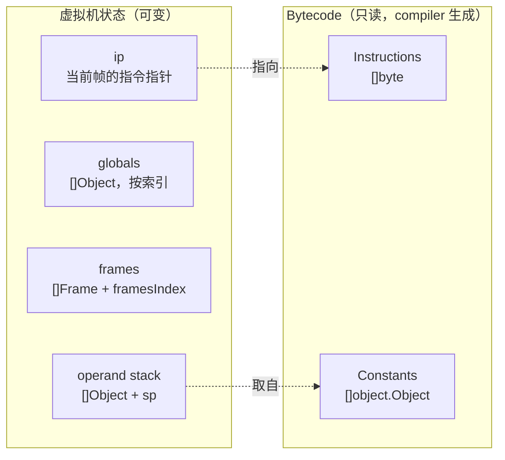

# 06 字节码：为执行设计中间表示

## 本章要回答的问题

Evaluator 已经能跑了，为什么还要把 AST 翻译成一串字节？这串字节应该长什么样——多少种指令、每种指令带几个操作数、操作数几个字节、字节序怎么排？为什么 `a < b` 不需要 `OpLessThan` 指令，而 `a && b` 却**不能**有 `OpAnd` 指令？

这一章不写 compiler，也不写 VM，只做一件事：**定义两者之间的那份契约**。契约写歪了，07 章和 08 章会各自按自己的理解实现，然后你会花几天调一个 off-by-one。

## 1. 为什么不直接执行 AST

Evaluator 每次求值 `2 * 3` 都要走完这一串：

```text
Eval(node)
  ├─ 类型分派：node 是 *ast.InfixExpression 吗？    ← 一串类型断言
  ├─ Eval(node.Left)  → 递归 → object.Integer{2}
  ├─ Eval(node.Right) → 递归 → object.Integer{3}
  ├─ 操作符分派：TokenLiteral() == "*" 吗？         ← 字符串比较
  ├─ 操作数类型分派：两边都是 INTEGER_OBJ 吗？
  └─ 真正的工作：2 * 3
```

真正干活的只有最后一行。前面全是**每次执行答案都一样**的问题：这个节点是中缀表达式吗（永远是）、操作符是 `*` 吗（永远是）。VM 执行同一段代码：

```text
ip=0  取字节 → OpConstant → 读 2 字节索引 → constants[0] 压栈
ip=3  取字节 → OpConstant → 读 2 字节索引 → constants[1] 压栈
ip=6  取字节 → OpMul      → 弹两个，类型分派，相乘，压回
```

消失的是：节点类型断言、操作符字符串比较、递归与 Go 栈帧、跨堆指针跳转（AST 节点散落在堆上，`OpConstant` 的操作数是连续数组里的两个字节）。

**没消失的是操作数类型分派**——`OpMul` 仍要判断 int 还是 float，这是动态类型的固有代价（见 4.4 节）。收益在循环里最明显：`while (i < 1000) { s = s + i; }` 里 evaluator 每轮重新分析 `s + i` 这棵树，VM 只是把 ip 拨回同一批字节。**分析工作从"每次执行一次"变成"编译时一次"。**

### 但性能不是唯一理由

只为性能的话，给 AST 节点加缓存字段也能拿到不小的收益。真正让这一步值得走的是另外两件事：

**编译强迫你把树形控制流降低成地址。** `if` 在 AST 里是一个带 `Branches` 数组的节点（[ast.go:304](../ast/ast.go#L304)），"条件为假就跳过这个分支"是 Go 代码里一个 `if` 隐含表达的。到了字节码里你必须写出**一个具体的字节偏移量**：不满足就跳到 47。这个降低（lowering）是理解真实编译器的关键一步——LLVM IR、JVM 字节码、机器码全都只有跳转，没有嵌套。做完你才真正明白"结构化控制流只是语法糖"。

**指令集是一份能一眼看全的规范。** AST 的语义藏在 evaluator 几百行 Go 代码里；指令集只有 29 条，每条的栈效果能写进一张表。那张表就是你语言的执行语义规范。

## 2. 从抽象机器推导指令集

不要从"列 30 条 opcode"开始。**先定义机器，再问哪些最小操作能改变它的状态。** 指令集是机器状态的函数。

### 第一步：机器有哪些状态



指令能做的事只有四种：改变栈、改变 globals、改变 frames、改变 ip。**没有第五种。** 所以指令集的规模是有限的，可以系统枚举。

### 第二步：逐条需求推出指令

一次只加一个需求，每次只问"现有指令够不够"。

- **字面量 `5`。** 要把值放上栈。值存哪？编进指令的话，`5` 要几字节、`3.14159` 要几字节？变长会让"下一条指令在哪"变难算（第 5 节）。所以值进常量池，指令只带索引。→ `OpConstant <索引>`
- **`2 * 3`。** 两个操作数已在栈上（先编译左、再编译右，左在下），乘法不需要操作数。→ `OpAdd` `OpSub` `OpMul` `OpDiv`。隐含约定：**左操作数先压栈**，所以弹栈时先弹到的是右操作数。`OpSub` 必须算 `left - right`，弹反了 `5 - 3` 会得到 `-2`。
- **`1 + 2;` 作为表达式语句。** 求完值栈上多了一个没人要的结果，不清掉循环一万次就压一万个垃圾。→ `OpPop`。由此得到 compiler 端最重要的不变量：**每条表达式语句末尾追加 `OpPop`；语句净栈效果 0，表达式净栈效果 +1。**
- **`true`。** 只有两个值，进常量池是浪费。专用指令在 VM 里对应全局单例——`==` 能退化成指针比较。同理 `null`。→ `OpTrue` `OpFalse` `OpNull`
- **`1 == 2`、`1 > 2`。** 和算术同构，2 → 1。→ `OpEqual` `OpNotEqual` `OpGreaterThan` `OpGreaterEqual`。为什么没有 `OpLessThan`？见 4.1 节。
- **`-5`、`!true`。** 一元，1 → 1。→ `OpMinus` `OpBang`
- **`if (c) { a } else { b }`。** 现在必须改 ip：需要一条"看栈顶决定要不要改 ip"的，和一条"无条件改 ip"的（then 执行完要跳过 else）。→ `OpJumpNotTruthy <目标>` `OpJump <目标>`。只要"为假才跳"，不要"为真才跳"——compiler 总能靠安排分支顺序适配。少一条指令，少一处出错。
- **`let x = 5; x;`。** 值要活过它所在的语句，栈不行。全局变量放一个按索引寻址的数组，索引由符号表编译期分配，**运行时不查名字——字符串查找变成数组下标，这是编译的又一个收益**。→ `OpSetGlobal <索引>` `OpGetGlobal <索引>`
- **`[1, 2]`、`{"a": 1}`、`xs[0]`。** 元素各自求值压栈，一条指令把栈上 n 个（哈希 2n 个）打包。个数编译期已知，做操作数。→ `OpArray <n>` `OpHash <2n>` `OpIndex`
- **函数调用。** 函数体是独立指令流，编译后作为对象进常量池。调用要新建 frame、ip 指向函数指令、执行、返回时恢复。有/无返回值分开（后者压 null，保证"表达式净栈效果 +1"不破）。→ `OpCall <实参个数>` `OpReturnValue` `OpReturn`
- **局部变量。** 不能用 globals（递归会互相踩），存在当前 frame 的栈区间按槽位寻址。→ `OpSetLocal <槽位>` `OpGetLocal <槽位>`
- **`len(xs)`。** 内置函数不是 Monkey 代码，没有指令流，单独一张表按索引取。→ `OpGetBuiltin <索引>`
- **闭包。** 函数值 = 代码 + 捕获的外层变量。捕获个数编译期已知，值在栈上。递归时函数还要能引用自己，而那时它还没绑定到任何名字。→ `OpClosure <常量索引> <free 个数>` `OpGetFree <索引>` `OpCurrentClosure`
- **`while`。** 停一下——需要新指令吗？"求条件、假则跳出、执行体、跳回条件"用 `OpJumpNotTruthy` + `OpJump` 就够。**不加指令。**

推导结束，29 条，每条都能追溯到一个具体需求。**过程比结果重要**：以后加 `for`、`switch`、模块，第一个问题永远是"现有指令够不够"。

## 3. 栈效果：compiler 与 VM 的契约

这张表是本章的产出物，**07 章和 08 章都必须严格照它实现**，不要改动。栈效果列的写法：`2 → 1` 表示消耗栈顶 2 个值、产出 1 个，净 -1。

| Opcode | 操作数（字节宽度） | 栈效果 | 说明 |
| --- | --- | --- | --- |
| `OpConstant` | 1×2 | → 1 | 压入 `constants[idx]` |
| `OpPop` | — | 1 → 0 | 丢弃栈顶（表达式语句用） |
| `OpAdd` `OpSub` `OpMul` `OpDiv` | — | 2 → 1 | 算术，int/float 运行时分派；`left op right`，先弹到的是 right |
| `OpTrue` `OpFalse` | — | → 1 | 压入布尔单例 |
| `OpNull` | — | → 1 | 压入 null 单例 |
| `OpEqual` `OpNotEqual` | — | 2 → 1 | 相等比较 |
| `OpGreaterThan` `OpGreaterEqual` | — | 2 → 1 | **只有大于/大于等于**，见第 4 节 |
| `OpMinus` `OpBang` | — | 1 → 1 | 前缀运算 |
| `OpJump` | 1×2 | — | 无条件跳到绝对字节偏移 |
| `OpJumpNotTruthy` | 1×2 | 1 → 0 | 弹栈，falsy 则跳转 |
| `OpGetGlobal` | 1×2 | → 1 | 读全局槽位 |
| `OpSetGlobal` | 1×2 | 1 → 0 | 弹栈写入全局槽位 |
| `OpGetLocal` | 1×1 | → 1 | 读当前帧局部槽位 |
| `OpSetLocal` | 1×1 | 1 → 0 | 弹栈写入局部槽位 |
| `OpGetBuiltin` | 1×1 | → 1 | 压入内置函数对象 |
| `OpArray` | 1×2 | n → 1 | 用栈上 n 个元素建数组 |
| `OpHash` | 1×2 | 2n → 1 | 用栈上 2n 个元素建哈希 |
| `OpIndex` | — | 2 → 1 | `[容器, 下标] → 元素` |
| `OpCall` | 1×1 | 见下 | 操作数是实参个数 n；`n+1 → ...` |
| `OpReturnValue` | — | 见下 | 返回栈顶值 |
| `OpReturn` | — | 见下 | 返回 null（无显式返回值） |
| `OpClosure` | 2 个：2 字节常量索引 + 1 字节 free 个数 | m → 1 | 见 09 章 |
| `OpGetFree` | 1×1 | → 1 | 读当前闭包的 free 变量 |
| `OpCurrentClosure` | — | → 1 | 压入当前闭包（递归用） |

三条跨帧指令的栈效果不能只用一个数字描述，单独说明：

- `OpCall n`：调用前栈布局是 `[..., callee, arg1, ..., argn]`（callee 在下）。调用后新建 frame，`basePointer` 指向 arg1 的位置。返回时这 `n+1` 个槽位全部弹出，换成 1 个返回值。**净效果 `n+1 → 1`**，但这个变化跨越了多条指令。
- `OpReturnValue` / `OpReturn`：弹出当前 frame，把调用者的 sp 恢复到 `basePointer - 1`（丢掉 callee 和所有实参），然后压入返回值。**返回后调用者视角净 +1**，和"表达式净栈效果 +1"一致。

### 为什么必须写下来并测试

栈效果不写下来，compiler 和 VM 会分叉，而症状极难读。真实例子：compiler 作者认为 `OpSetGlobal` 弹栈，编译 `let x = 5;` 只生成 `OpConstant 0` `OpSetGlobal 0`；VM 作者认为它读栈顶但保留，于是每条 `let` 都在栈上留一个垃圾。单条语句看不出问题，跑一万次循环之后栈溢出，而**报错位置在完全无关的另一条指令上**——你去查那条指令，bug 在两百行之外。

防御方法：把栈效果做成可执行断言。08 章的 VM 主循环加一个 debug 开关，每条指令前记 `sp`，执行后对照声明的栈效果检查。这需要 Definition 里多存栈效果信息，是否值得看取舍，但**至少把这张表写进 `code` 包的注释**。

## 4. 四个"不加指令"的决定

指令集设计里最能体现功力的不是加什么，是不加什么。

### 4.1 没有 OpLessThan：编译期操作数交换

`a < b` 和 `b > a` 是同一件事。compiler 遇到 `<` 时**先编译右子树、再编译左子树**，然后发 `OpGreaterThan`：`c.Compile(node.Right)`、`c.Compile(node.Left)`、`c.emit(code.OpGreaterThan)`。同理 `<=` → `OpGreaterEqual`。省下两条指令，以及 VM 里两个 case 和两份类型分派代码。

这是"用编译期变换减少指令集"的经典例子。真实编译器里这类变换到处都是：`x * 2` → 左移、`x + 0` → `x`、`!(a == b)` → `a != b`。**编译期能做的判断，不要留到运行时。**

### 4.2 但这个变换有代价：求值顺序变了

`f() < g()` 变成 `g()` 先求值。两个函数都有副作用时结果就不一样：`let log = fn(x) { puts(x); x };` 之后，`log(1) < log(2)` 在 evaluator 里打印 `1` 然后 `2`（左到右），在 VM 里打印 `2` 然后 `1`。**两条路径给出了不同的可观察行为**，直接违反 00 章第 4 节的语义契约。

这是真坑，不是理论问题。三个选择：

1. **接受它**，在语言规范里写明"比较运算符的求值顺序未定义"（C++ 长期如此）。
2. **只在两侧都无副作用时交换**，需要副作用分析（字面量、标识符安全；调用、索引不安全）。真编译器的做法，复杂度高。
3. **保留 `OpLessThan` / `OpLessEqual`**，多两条指令换语义精确。

**本套文档选 1**，因为指令集要固定给 07/08/09 章用。但把这条写进 README 的语义契约表，并在 10 章差分测试里排除带副作用的比较——**知道自己在哪里偷懒，和不知道，是两回事。**

### 4.3 不能有 OpAnd / OpOr：短路语义要求跳转

`&&` 看起来和 `==` 同构：两个操作数，一个结果。为什么不能有 `OpAnd`？

因为指令执行时**两个操作数都已经在栈上了**——要压上栈，右侧必须已经求过值。而 `&&` 的语义是"左侧为假就不求右侧"。看 `xs != null && xs[0] > 0`：`OpAnd` 存在的话，`xs` 是 null 时 `xs[0]` 也会被求值，直接崩。**短路不是优化，是语义。**

所以 `&&` 必须编译成控制流。这里有个额外问题：`OpJumpNotTruthy` **弹栈**（1 → 0），跳过去之后栈上没有值了，但 `&&` 是表达式，必须留一个值。用现有指令集的一种写法（07 章详述，这里只给形状）：

```text
a && b   →       编译 a
                 OpJumpNotTruthy → FALSE
                 编译 b
                 OpJump → END
          FALSE: OpFalse
            END:
```

代价是**规范化不对称**：真分支原样返回 b 的值（`1 && 2` 得到 `2`），但假分支永远压 `false`，丢掉了 a 的原值。所以 `null && 2` 得到 `false` 而不是 `null`——而 JavaScript 的 `&&` 会返回 `null` 本身。**这是要写进语义契约的决定**，evaluator 必须照同样规则实现，否则差分测试会红。

注意这个例子依赖你的 truthy 约定：标准 Monkey 里只有 `false` 和 `null` 为假，**`0` 是真**，所以 `0 && 2` 走真分支得到 `2`；如果你选了"`0` 也算假"（00 章第 4 节的开放问题），`0 && 2` 就会变成 `false`。**先定下 truthy 表，再推导这一节的行为**，顺序反了会得出错误结论。（另一条路是加 `OpDup` 复制栈顶来保留原值。指令集固定不改，但这是个好练习，见第 14 节。）

### 4.4 没有 OpAddFloat：运行时分派与它的代价

用户的语言有 `float`（[ast.go:207](../ast/ast.go#L207)），所以 `OpAdd` 要处理 int+int、float+float、int+float、float+int，加上字符串拼接。**不要为此增加指令**——保持一条 `OpAdd`，VM 里弹两个值后 `switch` 分派：int+int 走整数路径、至少一边 float 就提升为 float、两边 string 就拼接（只有 `OpAdd` 支持）、其余返回类型错误。

理由：为每个类型组合造专用指令，`OpAdd` 会膨胀成 `OpAddII` `OpAddFF` `OpAddIF` `OpAddFI` `OpAddSS` 五条，乘以四种算术 = 20 条。更根本的是**compiler 无法选择正确的那一条**——它不知道 `a + b` 里 `a` 是什么类型，这就是动态语言的定义。

**但要看清这是动态类型的代价。** 每次 `OpAdd` 都要两次 `Type()` 调用和一串比较，而这是 VM 里最热的路径之一。12 章的静态版有类型检查器，编译期就知道 `a + b` 是 int 加法，直接发 `OpAddInt`——运行时零分派。这是静态类型最直接的性能来源，比任何微优化都实在。

## 5. 指令编码格式

### 核心类型

`code` 包只需要四个类型，全部给完整定义：

```go
package code

type Instructions []byte
type Opcode byte

type Definition struct {
    Name          string   // 反汇编显示的名字，如 "OpConstant"
    OperandWidths []int    // 每个操作数占几字节；空表示无操作数
}

const (
    OpConstant Opcode = iota
    OpPop
    OpAdd
    // ... TODO：按第 3 节的表补齐
)

var definitions = map[Opcode]*Definition{
    OpConstant: {"OpConstant", []int{2}},
    OpAdd:      {"OpAdd", []int{}},
    OpGetLocal: {"OpGetLocal", []int{1}},
    OpClosure:  {"OpClosure", []int{2, 1}},   // 唯一的两操作数指令
    // ... 其余 25 条，TODO
}

func Lookup(op byte) (*Definition, error) {
    def, ok := definitions[Opcode(op)]
    if !ok {
        return nil, fmt.Errorf("opcode %d undefined", op)
    }
    return def, nil
}
```

**用 `iota` 而不是手写数字。** 手写会出现两条指令撞同一个值，症状是"某条指令执行成了另一条"，极难定位；`iota` 从结构上排除它。代价是**数值不稳定**：中间插一条，后面全部位移，已生成的字节码文件失效。Monkey 不持久化字节码所以无所谓；将来要写 `.mbc` 文件就得在头部加版本号。

### 为什么 opcode 用 1 字节

256 个值。当前用了 29 个，就算把 12 章的静态专用指令全加上也不到 100。JVM 用 1 字节（约 200 条已定义），CPython 和 WebAssembly 也是 1 字节。好处不只是省空间，更是**取指令简单**：`op := ins[ip]`，一次数组访问。opcode 变长的话，每次取指令都要先判断长度——而这段代码会执行几十亿次。

### 为什么操作数用固定宽度

本节最重要的一点。VM 主循环必须能回答"下一条指令从哪个字节开始"，固定宽度让答案是一个加法：

```text
下一条指令 = 当前位置 + 1 + Σ(OperandWidths)
```

`OpConstant` 是 `1+2=3` 字节，`OpAdd` 是 `1+0=1`，`OpClosure` 是 `1+2+1=4`。**只看 opcode 就知道整条指令多长，不用读操作数内容。**

变长编码（如 LEB128）能让字节码更紧凑，但每次都要**解码操作数才知道指令边界**，而且反汇编、跳转目标计算、回填全部变复杂。省下的空间换不来这些复杂度。

### 大端序还是小端序

用大端（`binary.BigEndian`），理由是**可读性**——hexdump 里字节顺序和数值的书写顺序一致：

```text
索引 258 = 0x0102
大端：  [0x01, 0x02]     高位在前，和人读数的顺序一样
小端：  [0x02, 0x01]     每次读 dump 都要在脑子里反转
```

真实 CPU 大多小端（x86、ARM 默认），因为硬件上有低位对齐和类型截断的好处。我们的操作数是从字节数组一个个读的，不涉及对齐，所以选可读的那个；网络协议也普遍用大端。**关键是一致**：`Make` 用大端写，`ReadOperands` 必须用大端读。不一致的症状是索引变成另一个数（`258` 读成 `513`），然后常量池越界 panic。

### 1 字节还是 2 字节：怎么定

| 操作数 | 宽度 | 上限 | 理由 |
| --- | --- | --- | --- |
| 常量池索引 | 2 | 65535 | 每个字面量、每个函数都占一个槽，大程序容易过 256 |
| 跳转目标 | 2 | 65535 字节 | 是**字节偏移**不是指令数，256 字节只够几十条指令 |
| 全局变量槽位 | 2 | 65535 | 全局是整个程序共享的，可能很多 |
| 局部变量槽位 | 1 | 255 | 单个函数内的量，超过 255 个局部变量的函数不该存在 |
| 实参个数 / free 变量个数 | 1 | 255 | 同上，超了说明设计有问题 |
| builtin 索引 | 1 | 255 | 内置函数是固定的一小张表 |

**超限会发生什么？** `binary.BigEndian.PutUint16` 收到 65536 会**静默截断成 0**（Go 里 `uint16(65536) == 0`）。指令看起来合法，但指向了错误的常量——最坏的一类 bug：不 panic、不报错，只是算错。**所以 compiler 必须在 emit 时检查上限并报编译错误**，不能依赖 `Make`。契约在这里定下：`Make` 保持简单（不返回 error），由调用方保证范围；07 章的 `addConstant` / `defineSymbol` 做上限检查。

真实 VM 怎么处理超限？**宽指令前缀。** JVM 的 `wide` 把紧随其后那条指令的操作数从 1 字节扩成 2 字节；CPython 的 `EXTENDED_ARG` 可以叠加多次把参数扩到 32 位。代价是取指令多一次分支。Monkey 不做，但要知道这是标准解法——**遇到上限时，正确答案通常不是"把所有操作数都改成 4 字节"。**

## 6. Make：编码

这个函数短，且是一切的基础，给完整实现（`Instructions` 就是它的输出拼起来的）：

```go
func Make(op Opcode, operands ...int) []byte {
    def, ok := definitions[op]
    if !ok {
        return []byte{}          // 未定义的 opcode 返回空切片，见下方说明
    }

    instructionLen := 1
    for _, w := range def.OperandWidths {
        instructionLen += w
    }

    instruction := make([]byte, instructionLen)
    instruction[0] = byte(op)

    offset := 1
    for i, o := range operands {
        width := def.OperandWidths[i]
        switch width {
        case 2:
            binary.BigEndian.PutUint16(instruction[offset:], uint16(o))
        case 1:
            instruction[offset] = byte(o)
        }
        offset += width
    }

    return instruction
}
```

契约：**前置条件**是 `op` 已注册、`len(operands) == len(def.OperandWidths)`、每个操作数在对应宽度范围内；**返回**一条完整指令，长度恰好 `1 + Σwidths`。

两处值得注意。**`op` 未注册时返回空切片**，不是 panic 也不是 error——这是书上的选择，让 `Make` 在测试里用起来简单，**代价是忘填 Definition 时静默生成 0 字节指令**：一条指令凭空消失，跳转偏移全错。第 13 节的"遍历所有 Definition"测试就是为了在这之前抓住它。而**操作数个数不匹配会 panic**（`def.OperandWidths[i]` 越界），这反而是好事：立刻炸，位置准确。

`switch width` 里最好补一条 `default: panic(...)`。将来有人写了 `[]int{4}` 却忘了加 case，操作数会被**静默跳过**（`offset += 4` 但一个字节没写），留下 4 个零字节。这类"少一个 case"的 bug 测试很难覆盖全，用 panic 兜住更实际。

## 7. ReadOperands：解码

```go
func ReadOperands(def *Definition, ins Instructions) ([]int, int) {
    operands := make([]int, len(def.OperandWidths))
    offset := 0

    for i, width := range def.OperandWidths {
        switch width {
        case 2:
            operands[i] = int(ReadUint16(ins[offset:]))
        case 1:
            operands[i] = int(ReadUint8(ins[offset:]))
        }
        offset += width
    }

    return operands, offset
}

func ReadUint16(ins Instructions) uint16 { return binary.BigEndian.Uint16(ins) }
func ReadUint8(ins Instructions) uint8   { return uint8(ins[0]) }
```

三点契约。**`ins` 是"opcode 之后"的切片**，不含 opcode 本身，调用方要写 `ReadOperands(def, ins[ip+1:])`——这个约定容易记错，症状是所有操作数都偏移一个字节。**返回读取的字节数**是给调用方推进位置用的（`i += 1 + read`），让它不必再算一遍 `Σwidths`，**同一个数字只在一个地方计算**。

**为什么 `ReadUint16` 单独导出？** VM 主循环要用它，而且它是性能热点。08 章的 VM 直接调 `code.ReadUint16(ins[ip+1:])` 而**不调 `ReadOperands`**——后者每条指令分配一个 slice，GC 压力大。这是有意的重复：`ReadOperands` 给反汇编器（求通用），`ReadUint16` 给 VM（求快）。

## 8. 常量池

```go
type Bytecode struct {
    Instructions code.Instructions
    Constants    []object.Object
}
```

### 为什么不把值内联进指令

四个理由，从弱到强：**变长**（`5` 一字节够，`3.14159` 要 8 字节，`"hello world"` 要 11 字节还得带长度前缀，内联就是变长指令，毁掉"只看 opcode 就知道长度"）；**共享**（同一字符串出现十次只存一份）；**对象是引用类型**（`object.CompiledFunction` 里还套着另一段 `Instructions`，根本没法内联）；**统一的引用机制**（整数、浮点、字符串、编译后的函数、闭包模板全用"一个 2 字节索引"，VM 里 `OpConstant` 只有一行代码）。`OpTrue`/`OpFalse`/`OpNull` 是例外：只有三个值，专用指令省一个常量槽和一次数组访问，而且 VM 里能用**单例**，`==` 比较布尔时可以直接比指针。

### float 作常量的注意点

用户的 `FloatLiteral.Value` 是 `float32`（[ast.go:209](../ast/ast.go#L209)），这会传导到 `object.Float`。三点注意：**精度**——`float32` 只有约 7 位十进制有效数字，`0.1 + 0.2` 的误差比 `float64` 大一个数量级，如果 evaluator 用 `float64` 而这边走 `float32`，两条路结果不同，**差分测试会红且看起来像随机失败**（建议统一改成 `float64`，也是 `strconv.ParseFloat` 的自然输出）；**`1.0` 和 `1` 是不同常量**，类型不同不能合并；**NaN 不等于自己**，做 map 键是个雷，建议**禁止 float 做哈希键**（00 章第 4 节的开放问题之一）。

### 去重：要不要做

`let a = 1; let b = 1;` 两个 `1`，一个常量槽还是两个？**不去重**（书上的做法）：`addConstant` 直接 append 返回索引，简单，但一个大程序里 `0` 和 `1` 可能各出现上百次。**去重**则先查 `map[string]int`（键是 `Type()+Inspect()`），代价是：

- 编译变慢，且**键必须带类型**——`1` 和 `1.0` 的 `Inspect()` 可能都是 `"1"`。
- **可变对象绝对不能去重**。`object.CompiledFunction` 不能合并（指令相同但闭包捕获的变量不同）。将来若有可变常量（预分配数组），去重会让两处代码共享同一对象，改一个动全部。
- 编译输出依赖"是否已见过这个常量"，测试里的期望常量池顺序变难写。

**建议先不去重**，只在实测接近 65535 时再加，且**只对不可变标量去重**。典型的不成熟优化——先跑通，profile 之后再说。

## 9. 反汇编器：不是可选的调试附属品

`Instructions.String()` 把字节数组打印成人能读的指令列表。**这是你验证 compiler 输出的主要工具，不是锦上添花。** 没有它，compiler 测试的期望值只能写成 `[]byte{0x00, 0x00, 0x00, 0x00, 0x00, 0x01, 0x02, 0x01}`——你写不对，写错了也看不出错在哪，失败信息是两串十六进制的 diff。有了反汇编器，期望值是：

```text
0000 OpConstant 0
0003 OpConstant 1
0006 OpAdd
0007 OpPop
```

diff 直接告诉你哪条指令错了。**先写反汇编器，再写 compiler**——这就是 00 章路线"第 6 步：先把工具做好"的意思。格式是四位十进制的**字节偏移**、空格、指令名、空格分隔的操作数。**偏移必须是字节偏移，不是指令序号**：上例里 `OpAdd` 在 6 而不是 2。原因是跳转目标就是字节偏移，反汇编里的偏移必须能和 `OpJump 12` 的操作数直接对上。打印指令序号的话，你每次看到 `OpJump 12` 都得手工换算——而手工换算是所有跳转 bug 的温床。

### 骨架

```go
func (ins Instructions) String() string {
    var out bytes.Buffer
    i := 0
    for i < len(ins) {
        def, err := Lookup(ins[i])
        if err != nil {
            fmt.Fprintf(&out, "ERROR: %s\n", err)
            i++                    // ← 必须推进，否则死循环
            continue
        }
        operands, read := ReadOperands(def, ins[i+1:])
        fmt.Fprintf(&out, "%04d %s\n", i, ins.fmtInstruction(def, operands))
        i += 1 + read
    }
    return out.String()
}

// fmtInstruction 按操作数个数格式化，TODO：
//   0 个 → def.Name          1 个 → "OpConstant 0"      2 个 → "OpClosure 3 2"
//   个数与 def.OperandWidths 不符 → 返回 "ERROR: ..." 而不是 panic
func (ins Instructions) fmtInstruction(def *Definition, operands []int) string
```

三个细节：

- **`Lookup` 失败时必须 `i++`。** 不推进就死循环——和 03 章 parser"漏 `readToken()` 导致死循环"是同一个错误的另一副面孔（[03-parser.md](03-parser.md) 第 9 节）。任何"遇错继续"的循环，第一步必须是无条件推进。
- **`fmtInstruction` 操作数个数不符时返回错误字符串，不 panic。** 反汇编器是调试工具，必须能打印**坏的**字节码。它在坏数据上崩了，你就失去了看清坏数据的唯一手段。
- **`OpClosure` 有两个操作数**，所以必须有 2 操作数分支。这条最容易漏——加完 `OpClosure` 反汇编突然全是 `ERROR: unhandled operandCount`，而你会以为是 compiler 错了。

## 10. 跳转目标：绝对字节偏移

`OpJump` 和 `OpJumpNotTruthy` 的操作数是**当前函数指令流内的绝对字节偏移**。三个"不是"：**不是**相对偏移（`ip + 5`）、**不是**指令序号（第 3 条指令）、**不是**全局偏移（每个 `CompiledFunction` 有独立指令流，偏移从 0 开始）。

### 为什么用绝对偏移

**简单。** 回填时（07 章的 `changeOperand`）直接写目标位置，不需要知道跳转指令自己在哪。相对偏移的好处是**代码可重定位**，也允许更紧凑的编码（多数跳转距离很短，1 字节够），真实 CPU 和 JVM 都用它，因为要支持代码搬迁和位置无关代码。Monkey 不需要：每个函数编译完就固定在一个 `CompiledFunction` 里，永远不搬。**为不存在的需求付复杂度是最常见的过度设计。**

### 绝对偏移带来的 ip 约定问题

绝对偏移有一个连带后果，是 08 章最常见的 bug 来源，这里先把问题讲清楚。

VM 主循环通常写成"取指令、执行、推进 ip"，推进放在循环末尾（`for ip := 0; ip < len(ins); ip++`）。此时跳转 case 里如果直接写 `ip = target`，末尾的 `ip++` 会让它变成 `target + 1`——**落在目标指令的第二个字节上**，那个字节是操作数，被当成 opcode 解码，然后一切都错了，而且是安静地错。

两种解法：

- **方案 A**：跳转写 `ip = target - 1`，靠末尾的 `ip++` 抵消。顺序指令的 case 只推进操作数宽度。
- **方案 B**：取指令时立刻推进 ip，跳转直接写 `ip = target`。代价是每个带操作数的 case 都要自己写 `ip += width`。

**这是纯粹的 VM 内部约定，compiler 完全看不到**——compiler 只负责在操作数里写绝对目标地址，怎么解释那个地址是 VM 的事。所以这个决定留给 08 章，[08 章第 4 节](08-vm.md)有两种方案的完整对比和取舍表。

**本套文档统一采用方案 A**（`ip = target - 1`，保留末尾 `ip++`），理由是与《Writing a Compiler in Go》一致，查阅原书时不需要做心算转换。08 章的所有 trace 都按这个约定。

你需要从本章带走的只有一条：

> **绝对偏移 + 末尾统一推进 ip ⇒ 跳转必须写 `target - 1`。选哪个方案都行，但必须选一个并在整个 VM 里无例外地贯彻。** 混着写就是 off-by-one 的来源，症状是"跳转后第一条指令被跳过"或 `while` 变成死循环。

## 11. 手算 trace

### Trace 1：`1 + 2;` 全流程

假设 opcode 按第 5 节的 `iota` 顺序：`OpConstant=0`、`OpPop=1`、`OpAdd=2`。

**① AST 与 compiler 遍历顺序**（后序：先子节点，再自己）：

```text
Compile(ExpressionStatement)
  Compile(InfixExpression "+")
    Compile(IntegerLiteral 1)  → addConstant = 0 → emit OpConstant 0
    Compile(IntegerLiteral 2)  → addConstant = 1 → emit OpConstant 1
    emit OpAdd                                   ← 操作符在子节点之后
  emit OpPop                                     ← 表达式语句的收尾
```

**这就是后缀表达式 `1 2 +`。** 栈式机器的指令流天然是后序遍历的结果——不是巧合，是栈的性质。

**② 常量池**：`Constants[0] = Integer{1}`，`Constants[1] = Integer{2}`。**③ 字节序列**（8 字节）：

```text
偏移  字节      解读
0000  00        OpConstant
0001  00 00     操作数 = 0       （大端 0x0000）
0003  00        OpConstant
0004  00 01     操作数 = 1       （大端 0x0001）
0006  02        OpAdd
0007  01        OpPop

十六进制：00 00 00 | 00 00 01 | 02 | 01
```

**④ 反汇编输出**就是第 9 节那四行。偏移 0→3→6→7 的跳跃是 3、3、1 字节——**这个不均匀的序列就是"字节偏移不是指令序号"的直观证据。**

**⑤ VM 逐指令栈变化**（栈底在左）：

```text
ip    指令            栈（执行后）  sp     说明
0000  OpConstant 0    [1]           0→1
0003  OpConstant 1    [1, 2]        1→2
0006  OpAdd           [3]           2→1    弹 2(right)、弹 1(left)，int+int，压 3
0007  OpPop           []            1→0
      循环结束        []            0      栈平衡 ✓
```

**最后栈是空的**，这就是语句净栈效果为 0 的验证。但 REPL 要打印结果，所以 VM 提供 `LastPoppedStackElem()` 返回 `stack[sp]`——Go 切片不清零，刚弹出的值还在那个位置，**既保持栈平衡又能拿到结果**。

### Trace 2：`OpConstant 65534` 的字节级编解码

**编码** `Make(OpConstant, 65534)`：

```text
def = {"OpConstant", []int{2}}  →  instructionLen = 1 + 2 = 3
instruction[0] = byte(OpConstant) = 0x00
offset=1, width=2, 65534 = 0xFFFE:
    PutUint16(instruction[1:], 0xFFFE)   高位 0xFF → [1]，低位 0xFE → [2]
结果：[0x00, 0xFF, 0xFE]

大端的直观效果          数值：0xFFFE
                              ┌──┴──┐
                        字节： FF    FE
                        索引： [1]   [2]
    hexdump:  00 FF FE      ← 和 "FFFE" 的书写顺序一致
    小端会是: 00 FE FF      ← 要在脑子里反转才能读出 FFFE
```

**解码** `ReadOperands(def, ins[1:])`（切片跳过 opcode）：

```text
ins[1:] = [0xFF, 0xFE]
width=2 → ReadUint16 = uint16(0xFF)<<8 | uint16(0xFE) = 0xFFFE = 65534
operands = [65534], offset = 2
```

反汇编输出 `0000 OpConstant 65534`，整条 3 字节，下一条在 0003。**往返一致**——正是第 13 节要测的性质。

**再走一格就出事**：`Make(OpConstant, 65536)` 里 `uint16(65536) == 0`，编码成 `[0x00, 0x00, 0x00]`，反汇编显示 `OpConstant 0`。**不 panic、不报错，只是指向了错误的常量。**

## 12. 边界与陷阱

- **① 操作数宽度写错，VM 读到指令中间。** Definition 里把 `OpGetLocal` 写成 `[]int{2}`，`Make` 生成 4 字节而 VM 按 3 字节推进——第 4 个字节被当成 opcode 解释。症状是"莫名执行了一条完全无关的指令"或 `opcode 217 undefined`。**这是本章最难查的一类 bug**，因为报错点和原因之间隔着任意条指令。防御：往返测试（第 13 节 ②）。
- **② 跳转目标落在指令中间。** `OpJump 4`，而 4 是某条 `OpConstant` 的操作数字节。VM 从 4 开始取指令，把 `0x00` 当 `OpConstant`、后面的字节当操作数——完全乱掉，07 章回填算错时就会这样。防御：写个校验函数，从 0 按 Definition 步进收集所有**合法指令起始偏移**，断言每个跳转操作数都在集合里。20 行代码抓住整整一类 bug。
- **③ 常量池索引超 65535** / **④ 局部变量超 255。** 都是静默截断。后者的效果是两个不同变量共用一个槽位、值互相覆盖，看起来像"变量莫名被改了"。防御：`addConstant` 和符号表分配槽位处各检查一次。
- **⑤ 忘记为新 opcode 加 Definition。** `Lookup` 返回 error，`Make` 返回**空切片**——append 空切片什么都不留下，那条指令凭空消失，后续所有偏移错位。防御：第 13 节 ⑤。
- **⑥ 反汇编器和 `Make` 对宽度理解不一致。** 只要两边都从 `def.OperandWidths` 读就不可能不一致。**绝对不要在反汇编器里硬编码宽度**（`i += 3`）——那是同一个知识的第二个副本，改一处忘一处。和 03 章"五处列表解析重复导致同一 bug 的五个副本"是同一条教训。
- **⑦ `OpGetLocal` 1 字节但 `OpGetGlobal` 2 字节。** 这个不对称容易记错，尤其 07 章两个分支写得很像时。记法是"global 全程序共享所以宽，local 只在一个函数内所以窄"，但真正的防御是别去记——**始终从 `def.OperandWidths` 拿宽度，永不写字面量。**

## 13. 验收测试清单

可以直接落成 `code/code_test.go`。

**① `Make` 覆盖每种宽度组合**

```go
func TestMake(t *testing.T) {
    tests := []struct{ op Opcode; operands []int; expected []byte }{
        {OpConstant, []int{65534}, []byte{byte(OpConstant), 255, 254}},
        {OpConstant, []int{0}, []byte{byte(OpConstant), 0, 0}},
        {OpAdd, []int{}, []byte{byte(OpAdd)}},                       // 无操作数
        {OpGetLocal, []int{255}, []byte{byte(OpGetLocal), 255}},     // 1 字节
        {OpClosure, []int{65534, 255}, []byte{byte(OpClosure), 255, 254, 255}},
    }
    // 断言 Make(tt.op, tt.operands...) 逐字节等于 tt.expected，且长度相同
}
```

**② `ReadOperands` 往返**——`Make` 之后 `ReadOperands` 必须还原：

```go
func TestReadOperands(t *testing.T) {
    tests := []struct{ op Opcode; operands []int; bytesRead int }{
        {OpConstant, []int{65535}, 2},
        {OpGetLocal, []int{255}, 1},
        {OpClosure, []int{65535, 255}, 3},
    }
    for _, tt := range tests {
        ins := Make(tt.op, tt.operands...)
        def, err := Lookup(byte(tt.op))          // 断言 err == nil
        got, n := ReadOperands(def, ins[1:])     // ← [1:] 跳过 opcode
        // 断言 n == tt.bytesRead，got 逐个等于 tt.operands
    }
}
```

**这是宽度写错的唯一防线。** 更进一步：遍历 `definitions` 全表，对每条指令按宽度自动生成最大值操作数做往返，而不是手写用例。这样新增 opcode 时不需要补测试用例。

**③ `Lookup` 未知 opcode 返回 error**：`Lookup(255)` 必须返回非 nil error（前提是 255 未被占用；更稳的是取 `len(definitions)` 之后的第一个值）。

**④ 反汇编输出格式**——把 `Make(OpConstant,0)`、`Make(OpConstant,1)`、`Make(OpAdd)`、`Make(OpPop)` 拼成一条 `Instructions`，断言 `String()` 等于：

```text
0000 OpConstant 0
0003 OpConstant 1
0006 OpAdd
0007 OpPop
```

再加一个 `OpClosure` 用例（`0000 OpClosure 2 1`）——两操作数分支很容易漏。

**⑤ 遍历所有 Definition 断言合法**——这个测试能自动抓住"加了 opcode 忘了填表"：

```go
func TestDefinitionsComplete(t *testing.T) {
    // 约定：OpCurrentClosure 是最后一条 opcode
    for op := OpConstant; op <= OpCurrentClosure; op++ {
        def, err := Lookup(byte(op))
        if err != nil {
            t.Errorf("opcode %d has no Definition", op)
            continue
        }
        if !strings.HasPrefix(def.Name, "Op") {
            t.Errorf("opcode %d: bad name %q", op, def.Name)
        }
        for _, w := range def.OperandWidths {
            if w != 1 && w != 2 {
                t.Errorf("%s: illegal operand width %d", def.Name, w)
            }
        }
        if len(def.OperandWidths) > 2 {
            t.Errorf("%s: %d operands, Make/fmtInstruction 只支持 2",
                def.Name, len(def.OperandWidths))
        }
    }
}
```

**这是本章最有价值的测试**，理由和 03 章的 `TestAllInfixOperatorsParse` 一样：把"加东西时忘了注册"从"以后某天炸在别处"变成"现在就红"。最后那条 `len > 2` 断言把 `Make` 和 `fmtInstruction` 的实现限制变成了显式契约。再加一条：断言 `Name` 和 opcode 常量名一致——手工维护的表里，复制粘贴出 `OpSub: {"OpAdd", ...}` 很常见，症状是反汇编输出看起来对但其实错了。

**⑥ 边界值**：2 字节测 `0、1、255、256、65534、65535`；1 字节测 `0、1、255`；再测 `65536` 确实被截断成 0（把这个已知行为钉住，防止有人以为它会报错）。其中**`255` 和 `256` 这一对必测**——它跨越单字节边界，`Make` 里 2 字节路径误写成 1 字节时，只有 `>= 256` 的用例会失败。

## 14. 练习

1. **补全 `definitions` 表。** 按第 3 节把 29 条全填上，跑测试 ⑤。本章的主要工作量。
2. **实现 `Make` 和 `ReadOperands`，跑往返测试。** 然后**故意**把 `OpGetLocal` 宽度改成 2，确认往返测试变红——**验证你的测试真能抓这个 bug**。再改回来。
3. **实现 `Instructions.String()`。** 含 `OpClosure` 的两操作数分支和 `Lookup` 失败时的 ERROR 输出。用手工拼的坏字节码（末尾截断一半的 `OpConstant`）测它不 panic。
4. **写指令边界校验器。** `func (ins Instructions) ValidOffsets() map[int]bool` 从 0 按 Definition 步进收集合法起始偏移；再写 `CheckJumps() []error` 用它验证所有跳转目标。07 章会天天用到。
5. **加 `OpDup`（复制栈顶，`1 → 2`）。** 走完整流程：加常量、填 Definition、跑测试 ⑤。然后想清楚它怎么让 `&&` 保留操作数原值（4.3 节）——"新指令如何简化 compiler"的完整案例。
6. **手工构造带跳转的字节码并反汇编。** 不写 compiler，直接用 `Make` 拼出 `if (true) { 10 } else { 20 }` 的指令序列，跑 `String()` 检查跳转目标。**这个练习会让你在写 compiler 之前就理解回填要解决什么问题。**
7. **常量池去重。** 实现带 `map[string]int` 缓存的 `addConstant`，键带类型。测：`1` 和 `1.0` 不合并、两个 `CompiledFunction` 不合并（即使指令相同）。
8. **（进阶）给 Definition 加栈效果字段。** `StackEffect struct{ Pops, Pushes int }`，`OpArray`/`OpCall` 这类可变的用特殊值标记，然后在 08 章 VM 里加 debug 断言。做完你会发现第 3 节那张表的价值取决于它能不能被机器检查。
9. **（进阶）实现 `wide` 前缀。** 加一条 `OpWide` 让紧随其后的指令操作数宽度加倍。想清楚它对"只看 opcode 就知道指令长度"的影响，以及反汇编器和跳转校验器要怎么改。
10. **（进阶）字节码序列化。** 把 `Bytecode` 写成文件再读回来：magic number、版本号、常量池的类型标签编码、嵌套 `CompiledFunction` 的递归编码。做完你就理解了 `.pyc` 和 `.class` 为什么长那样。

## 小结

- 编译的收益不只是性能，更是**把树形控制流降低成地址**——真实编译器全都只有跳转，没有嵌套
- **先定义机器状态（栈、常量池、globals、frames、ip），再问哪些最小操作能改变它**；指令能做的只有四类事，所以指令集是可枚举的
- **栈效果表是 compiler 与 VM 的唯一契约**，不写下来两边一定分叉，而症状会出现在无关的指令上
- 没有 `OpLessThan`：编译期交换操作数，代价是**求值顺序变了**（`f() < g()` 先求 g）；**不能有 `OpAnd`/`OpOr`**：短路是语义不是优化。两条都必须写进语义契约
- `OpAdd` 不拆成按类型的专用指令，运行时分派是动态类型的代价——12 章的静态版能消除它
- opcode 1 字节（256 够用），操作数**固定宽度**（`ip += 1 + Σwidths` 才成立），**大端序**（hexdump 可读）
- 2 字节给常量索引/跳转目标/全局槽位，1 字节给局部槽位/实参个数——**超限会静默截断，必须由 compiler 检查**
- **所有宽度只从 `def.OperandWidths` 读**，永不硬编码——`Make` 和反汇编器共用同一张表
- 跳转目标是**绝对字节偏移**（不是相对偏移、不是指令序号）；由此带来的 ip 约定问题留给 08 章，本套文档统一用 `ip = target - 1` 配末尾 `ip++`
- **反汇编器先写，它是验证 compiler 的主要工具**，不是调试附属品；遍历所有 Definition 的测试能自动抓住"加了 opcode 忘了填表"，和 03 章遍历中缀运算符的测试同源

指令集定下来了，下一章开始遍历 AST 生成它。


