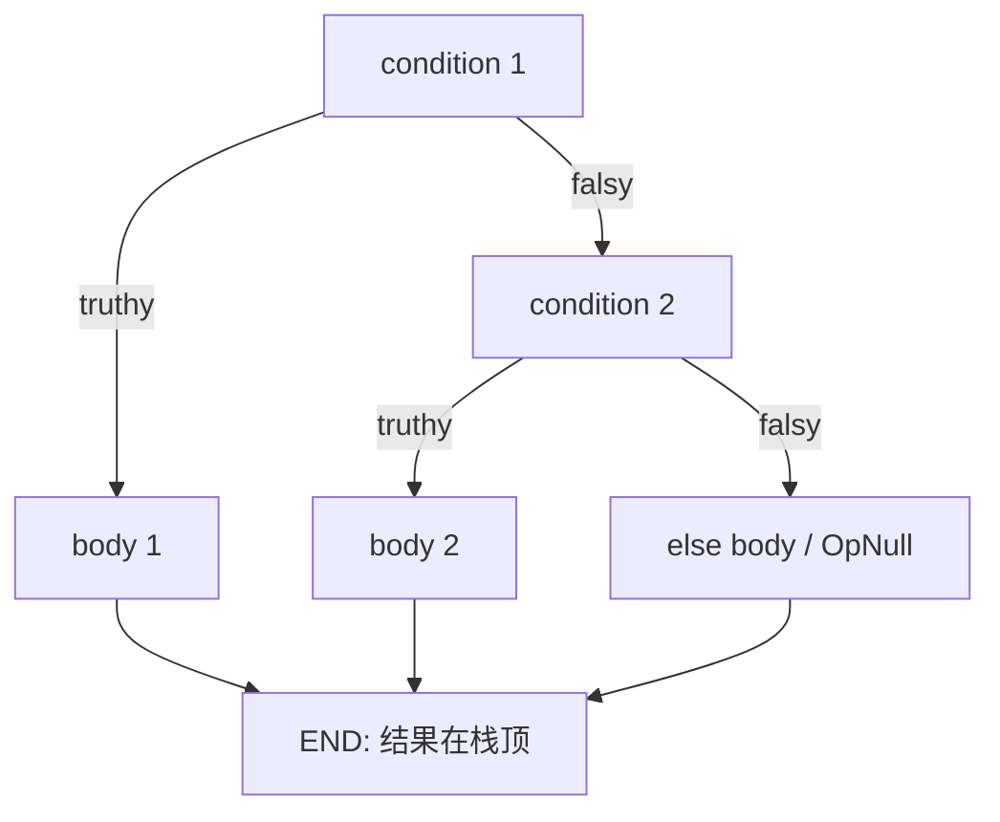
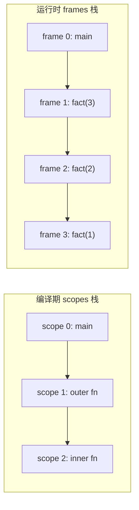

# 07 Compiler：从 AST 生成字节码

## 本章要回答的问题

AST 是树，字节码是一条线。树上的 `if` 有两个子节点，线上的 `if` 只有"跳到某个地址"。**这个转换怎么做？** 更具体地：

- 编译 condition 的时候还不知道 consequence 有多长，那 `OpJumpNotTruthy` 的目标地址从哪来？
- 为什么 `1 + 2;` 编译出来最后要多一条 `OpPop`，少了会怎样？
- `let x = 5;` 里的名字 `x` 去哪了？字节码里为什么找不到字符串 `"x"`？
- 编译期的"作用域"和运行时的 frame，为什么不是一回事？

这一章只做一件事：**给每个 AST 节点定义一份"栈效果 + 指令序列"的契约**，然后把这些契约拼起来。指令集在 06 章已经定死了，不再增删（除了本章会讨论的一个可选项）。

## 1. 编译的本质：降低（lowering）

Evaluator 的做法是"进入节点，算出值，返回值"。Compiler 的做法是"进入节点，**发出若干条指令**，指令执行后值会出现在栈上"。

```text
Evaluator:  Eval(1+2)     → 递归 Eval(1)=1、Eval(2)=2、判断操作符、返回 3
Compiler:   Compile(1+2)  → 发出 [OpConstant 0, OpConstant 1, OpAdd]
```

Compiler 自己**不算 1+2**。它把"怎么算"编码成指令，把"什么时候算"交给 VM。编译是一次纯粹的结构变换：**从嵌套（nested）降低到线性（linear）**。

代价是丢失结构。树上的 `if` 有明确边界，线上的 `if` 只剩几个字节偏移，越界一个字节就跳到指令的操作数中间去了。**本章大半篇幅在处理这个代价。**

每个 AST 节点的编译逻辑都在回答同一个问题：**执行完我发出的这串指令，栈上应该多出什么？** 答案只有两种，这就是下一节。

## 2. 核心不变量：栈平衡

**表达式编译后，栈净增 1。语句编译后，栈净增 0。**

这条不变量是 07 章和 08 章之间的全部契约。VM 不需要知道 AST 长什么样，它只需要相信：编译器交给它的指令序列不会让栈无界增长。

**推论一：`ExpressionStatement` 必须在末尾补一条 `OpPop`。** `表达式语句 = 表达式(+1) + OpPop(-1) = 0` ✓。`1 + 2;` 里表达式把 3 留在栈上，`OpPop` 把它扔掉。值被算出来又被丢弃**不是浪费**——语句的语义就是"为副作用求值"。

**推论二：违反它的后果是栈溢出，而且症状离原因很远。**

```monkey
let i = 0;
while (i < 100000) { i + 1; i = i + 1; }
```

忘了给 `i + 1;` 补 `OpPop`，每轮循环栈就多一个值，跑十万轮栈满。**VM 报的错是 "stack overflow"，但真正的 bug 在 compiler 里，而且不在 while 的编译逻辑里，在 ExpressionStatement 的编译逻辑里。** 这类 bug 靠读 VM 代码找不到。

**推论三：一个表达式的所有执行路径必须有相同的栈效果。** `if` 是表达式，不管走哪个分支都必须恰好留一个值。没有 `else` 时，"条件为假"那条路径栈上什么都没多，**必须补一条 `OpNull`**。这是第 6 节的重点。

**推论四：语句序列（`BlockStatement`、`Program`）的栈效果自动为 0**，因为每个成员都是 0。块不需要额外处理——但函数体是例外，见第 11 节。

后面所有编译逻辑都是这四条推论的直接展开。

## 3. `Compiler` 结构的三次演化

不要一步写出最终形态。每次演化都由一个具体的需求逼出来，理解这个过程比记住结果重要。

### 第一版：只有指令和常量

编译 `1 + 2` 需要什么？一个存指令的字节切片，一个存对象的常量池。

```go
type Compiler struct {
	instructions code.Instructions
	constants    []object.Object
}

type Bytecode struct {          // Compile 完成后交给 VM 的全部内容
	Instructions code.Instructions
	Constants    []object.Object
}

func (c *Compiler) Compile(node ast.Node) error       // 产出是累积在 c 里的副作用，
func (c *Compiler) Bytecode() *Bytecode               // 返回值只用来报错
```

### 第二版：加符号表和"最近两条指令"

编译 `let x = 5;` 要知道 `x` 分配到第几个槽位 → 符号表。编译函数体末尾要"把最后一条 `OpPop` 改成 `OpReturnValue`" → 得记住最后发出的是什么指令、发在哪个位置。

```go
type EmittedInstruction struct {
	Opcode   code.Opcode
	Position int
}

type Compiler struct {
	instructions        code.Instructions
	constants           []object.Object
	lastInstruction     EmittedInstruction   // 最后一条
	previousInstruction EmittedInstruction   // 倒数第二条
	symbolTable         *SymbolTable
}
```

为什么记**两条**？因为"删掉最后一条指令"之后，倒数第二条变成最后一条，得能恢复。够用但不优雅——更干净的方案见练习 9。

### 第三版：作用域栈

编译 `fn() { fn() { 1 } }` 时，内层函数的指令**不能**追加到外层的 `instructions` 里，它要单独攒成一个 `CompiledFunction`。一个函数一套 `instructions` + 一套"最近两条指令"，嵌套函数就是嵌套的这套东西 → **栈**。

```go
type CompilationScope struct {
	instructions        code.Instructions
	lastInstruction     EmittedInstruction
	previousInstruction EmittedInstruction
}

type Compiler struct {
	constants   []object.Object    // 全局唯一，不入栈
	symbolTable *SymbolTable       // 自己带 Outer 链，等价于栈
	scopes      []CompilationScope
	scopeIndex  int
}

func (c *Compiler) currentScope() *CompilationScope {
	return &c.scopes[c.scopeIndex]
}
```

**常量池不入栈**：所有函数共享一个常量池，因为常量索引在整个 `Bytecode` 里是全局的。**符号表不入栈**，因为它自己的 `Outer` 指针已经是一条链了，再套一层栈是重复。

### 四个基础工具

这四个函数是整章的地基，值得先写完并测好：

```go
// 把对象放进常量池，返回索引
func (c *Compiler) addConstant(obj object.Object) int {
	c.constants = append(c.constants, obj)
	return len(c.constants) - 1
}

// 编码一条指令、追加到当前 scope、返回这条指令的起始位置。
// 返回值是回填的关键 —— 没有它就没法改写跳转地址
func (c *Compiler) emit(op code.Opcode, operands ...int) int {
	pos := c.addInstruction(code.Make(op, operands...))
	c.setLastInstruction(op, pos)
	return pos
}

// 原地覆写。前提：新旧指令等长
func (c *Compiler) replaceInstruction(pos int, newInstruction []byte) {
	copy(c.currentScope().instructions[pos:], newInstruction)
}

// 重新编码同一个 opcode 的操作数，然后覆写
func (c *Compiler) changeOperand(opPos int, operand int) {
	op := code.Opcode(c.currentScope().instructions[opPos])
	c.replaceInstruction(opPos, code.Make(op, operand))
}
```

`emit` 返回位置，这是本章最重要的一个设计决定，第 6 节会看到为什么。

`replaceInstruction` 有个隐含前提：**新旧指令必须等长**。`OpJump 9999` 和 `OpJump 42` 都是 3 字节，安全。但把 `OpConstant`（3 字节）换成 `OpTrue`（1 字节），`copy` 只覆盖前 1 字节，后面 2 字节变成垃圾指令。**这个前提要写在注释里**，它不会自己报错。

## 4. 分派骨架

`Compile` 是一个大 type switch。给出骨架，常规分支留 TODO：

```go
func (c *Compiler) Compile(node ast.Node) error {
	switch node := node.(type) {

	// ---- 容器：栈效果 0 ----
	case *ast.Program:
		for _, s := range node.Statements {
			if err := c.Compile(s); err != nil { return err }
		}

	case *ast.BlockStatement:
		// TODO 同上

	// ---- 语句：栈效果 0 ----
	case *ast.ExpressionStatement:
		if err := c.Compile(node.Expression); err != nil { return err }
		c.emit(code.OpPop)          // ← 不变量的兑现处，别漏

	case *ast.LetStatement:        // TODO 第 10 节
	case *ast.AssignmentStatement: // TODO 第 10 节
	case *ast.WhileStatement:      // TODO 第 7 节
	case *ast.ReturnStatement:     // TODO 编译 ReturnValue，发 OpReturnValue

	// ---- 表达式：栈效果 +1 ----
	case *ast.IntegerLiteral:
		c.emit(code.OpConstant, c.addConstant(&object.Integer{Value: node.Value}))

	case *ast.FloatLiteral:      // TODO 注意 Value 是 float32
	case *ast.StringLiteral:     // TODO 同 Integer
	case *ast.BooleanLiteral:    // TODO true → OpTrue，false → OpFalse，不进常量池
	case *ast.Identifier:        // TODO 第 10 节
	case *ast.PrefixExpression:  // TODO 第 5 节
	case *ast.InfixExpression:   // TODO 第 5、8 节
	case *ast.IfExpression:      // TODO 第 6 节
	case *ast.FunctionExpression:// TODO 第 11 节
	case *ast.PostfixExpression: // TODO 第 12 节
	case *ast.Array:             // TODO 第 12 节
	case *ast.HashList:          // TODO 第 12 节
	}
	return nil
}
```

注意 switch 的**分组方式**：容器、语句、表达式。这个分组不是排版偏好，它对应栈效果 0/0/+1。**新加一个 case 之前，先决定它属于哪一组**，属于哪一组就决定了它要不要补 `OpPop`、要不要保证每条路径都留值。

## 5. 中缀、前缀，以及 `<` 的操作数交换

### 顺序即约定

`a + b` 的编译顺序是：编译 `a` → 编译 `b` → 发 `OpAdd`。执行后栈是 `[..., a, b]`，栈顶是 `b`。所以 VM 执行 `OpAdd` 时**先弹出的是右操作数**（`right := vm.pop(); left := vm.pop()`）。对 `+` 无所谓，对 `-` 和 `/` 弹反了就得到 `b - a`。这个顺序是 compiler 和 VM 之间的隐式约定，两边都要写在注释里。

你的 `ast.InfixExpression`（[ast.go:374](../ast/ast.go#L374)）**没有 `Operator` 字段**，操作符藏在 `Token` 里。所以分派要用 `node.Token.Type`：

```go
case *ast.InfixExpression:
	// 短路运算符必须先拦掉——它们不能"先编译两边再发指令"
	if node.Token.Type == token.AND || node.Token.Type == token.OR {
		return c.compileShortCircuit(node)      // 第 8 节
	}
	// 比较运算符里 < 和 <= 要交换操作数
	if node.Token.Type == token.LT || node.Token.Type == token.LE {
		if err := c.Compile(node.Right); err != nil { return err }   // ← 先右
		if err := c.Compile(node.Left);  err != nil { return err }   // ← 后左
		if node.Token.Type == token.LT {
			c.emit(code.OpGreaterThan)
		} else {
			c.emit(code.OpGreaterEqual)
		}
		return nil
	}
	// 常规路径
	if err := c.Compile(node.Left);  err != nil { return err }
	if err := c.Compile(node.Right); err != nil { return err }
	switch node.Token.Type {
	case token.PLUS:  c.emit(code.OpAdd)
	// TODO MINUS/MULTI/DIVIDE/EQUAL/NOT_EQUAL/GT/GE
	default:
		return fmt.Errorf("unknown operator %s", node.Token.Literal)
	}
```

**前缀**同理，操作符在 `node.Token`（[ast.go:361](../ast/ast.go#L361)）：编译 `node.Right`，然后 `-` 发 `OpMinus`，`!` 发 `OpBang`。栈效果是弹一个压一个，整体净增 1。

### 为什么没有 `OpLessThan`

`a < b` 和 `b > a` 是同一个判断，**编译期交换操作数就能省掉两条 opcode**。这是编译器的典型收益：同样的语义有多种表示，选一种**规范形式（canonical form）**，把差异在编译期消掉。VM 的算术分派本来就要处理 int/float 四种组合，少两条指令是实打实的省事。

### 但它引入了一个真实的语义 bug

交换的不只是操作数的**位置**，还有它们的**求值顺序**。

```monkey
let f = fn() { puts("f"); 1 };
let g = fn() { puts("g"); 2 };
f() < g();
```

Evaluator 从左到右求值，打印 `f` `g`。VM 编译成 `编译g(); 编译f(); OpGreaterThan`，打印 `g` `f`。**两条执行路径的可观察行为不一致**，违反了 00 章第 4 节的约束。表达式有副作用（打印、赋值、修改数组）时这就是 bug，不是理论问题。

三个解决方案，各有代价：

| 方案 | 代价 |
| --- | --- |
| **接受它**，写进文档"`<` 的操作数求值顺序未定义" | C++ 长期这么干过。但你的语言里 `puts` 是内置函数，副作用很容易碰到 |
| **加 `OpLessThan`/`OpLessEqual`**，不交换，VM 多两个 case | 违反 06 章定死的指令集；但这是最干净的修法 |
| **让 evaluator 也先算右边** | 两条路一致了，但"从左到右求值"这个直觉规则被破坏，且 `<` 和 `+` 行为不一致 |

**推荐：先按交换实现（保持指令集不变），把这个不一致写进 00 章契约表作为已知偏差。** 实现完 VM、有了差分测试框架之后再回来加 `OpLessThan`——那时你有测试来验证修复。现在改指令集会连带改 06 章、code 包、反汇编测试，收益不值得。

**这个取舍本身是本章最有价值的一课**：编译期的优化（省两条指令）可能改变可观察语义（求值顺序）。做优化之前必须先问"什么是可观察的"。

## 6. 跳转回填：本章最重要的技术

### 问题

编译 `if (a) { 1 } else { 2 }` 必须先编译 condition，然后发一条"条件为假就跳走"的指令：

```text
0000  OpGetGlobal 0         // a
0003  OpJumpNotTruthy ?     ← 跳到哪？
```

跳到 alternative 的开头。**但 alternative 在哪？取决于 consequence 有多长，而 consequence 还没编译。** 鸡生蛋：要知道地址就得先编译，要编译就得先填地址。

### 解法

先填一个明显错误的占位值，记住这条指令的位置，编译完之后回来改写。

```go
// 1. 发占位跳转，记下位置
jumpNotTruthyPos := c.emit(code.OpJumpNotTruthy, 9999)

// 2. 编译 consequence（长度未知，无所谓）
if err := c.Compile(&branch.Body); err != nil { return err }

// 3. 现在的位置就是真实目标
afterConsequencePos := len(c.currentScope().instructions)

// 4. 回填
c.changeOperand(jumpNotTruthyPos, afterConsequencePos)
```

这就叫 **backpatching**。占位用 `9999` 这种显眼的假值，不用 `0`——漏了回填，跳 9999 会立刻越界报错，跳 0 会静默地从头执行，症状变成无限循环或莫名其妙的结果。**让错误尽早、尽响地失败。**

三个要点：**`emit` 必须返回位置**（第 3 节那个设计决定的兑现处）；**地址是绝对字节偏移**，不是相对偏移也不是"第几条指令"，`len(instructions)` 直接就是下一条指令的起始地址；**占位值的宽度必须和真实值一致**——`OpJump` 的操作数 2 字节，`9999` 和 `42` 都占 2 字节，所以 `changeOperand` 安全。

### 编译扁平化的 if/else-if 链

你的 `ast.IfExpression`（[ast.go:304](../ast/ast.go#L304)）不是书上的 `{Condition, Consequence, Alternative}` 嵌套结构，而是一个**扁平的分支列表**，`IfBranch.Condition == nil` 表示 else（[ast.go:299](../ast/ast.go#L299)）。

书上的结构编译 `else if` 要靠递归：`Alternative` 里再嵌一个 `IfExpression`，每层递归产生一对跳转。**你的扁平结构编译起来更自然——它就是一串条件跳转，一个循环写完。** 这是扩展带来的实质好处，不只是"另一种写法"。

地址布局，`N` 个带 condition 的分支加可选的 else：

```text
    分支 1 condition
    OpJumpNotTruthy → 分支 2 的 condition 起始
    分支 1 body
    OpJump → END                    ← 待回填 #1

    分支 2 condition
    OpJumpNotTruthy → 分支 3 的 condition 起始
    分支 2 body
    OpJump → END                    ← 待回填 #2

    ...

    else body  或  OpNull           ← 没有 else 时必须发 OpNull
END:
```

关键观察：每个带 condition 的分支需要**一对**跳转（`OpJumpNotTruthy` 去下一个分支 + `OpJump` 去 END）；`OpJumpNotTruthy` 可以**在编译完自己的 body 之后立即回填**，目标就是"当前位置"；所有 `OpJump` 的目标是**同一个 END**，而 END 要等最后一个分支编译完才知道 → 必须**收集一个待回填位置的列表**；else 分支不需要 `OpJump`，它天然落到 END；**没有 else 分支时必须补 `OpNull`**。



### 完整实现

这是本章唯一给完整代码的编译分支，因为回填的每个细节都容易错。规则统一成一句话：**每个带 condition 的分支都发 `OpJump`；没有 else 分支时在链尾追加 `OpNull`。**

```go
case *ast.IfExpression:
	var jumpsToEnd []int              // ← 待回填的 OpJump 位置列表
	hasElse := false

	for _, branch := range node.Branches {
		if branch.Condition == nil {          // else 分支，一定是最后一个
			hasElse = true
			if err := c.Compile(&branch.Body); err != nil { return err }
			c.ensureBlockLeavesValue()        // 见下方"块的栈效果"
			break                             // 不发 OpJump，天然落到 END
		}

		if err := c.Compile(branch.Condition); err != nil { return err }
		jumpNotTruthyPos := c.emit(code.OpJumpNotTruthy, 9999)

		if err := c.Compile(&branch.Body); err != nil { return err }
		c.ensureBlockLeavesValue()
		jumpsToEnd = append(jumpsToEnd, c.emit(code.OpJump, 9999))

		// 立即回填：条件为假就跳到这里，即下一个分支的 condition
		c.changeOperand(jumpNotTruthyPos, len(c.currentScope().instructions))
	}

	if !hasElse {
		c.emit(code.OpNull)      // ← 漏了这条，假路径栈效果是 0，和真路径不一致
	}

	end := len(c.currentScope().instructions)
	for _, pos := range jumpsToEnd {         // 统一回填所有 OpJump 到同一个 END
		c.changeOperand(pos, end)
	}
```

代价是最后一个分支多一条"跳到紧邻下一条指令"的 `OpJump`（3 字节）。换来循环体里不需要判断 `isLast`，逻辑少一个分支。消除这条冗余跳转留给练习 8 的窥孔优化。

### 块的栈效果：一个真实的麻烦

`if` 的 body 是 `BlockStatement`，块的栈效果是 **0**（每个语句都是 0）。但 `if` 是表达式，需要 **+1**。矛盾。

解法是编译完块之后，如果最后一条指令是 `OpPop`，**就把它删掉**——块里最后一个表达式语句的值就留在栈上了，这实现了"隐式返回"。

```go
func (c *Compiler) lastInstructionIs(op code.Opcode) bool
func (c *Compiler) removeLastPop()      // 截断 instructions，恢复 lastInstruction
```

`ensureBlockLeavesValue()` 就是"若最后是 `OpPop` 则删掉，否则发 `OpNull`"。后半句处理空块 `if (a) {}` 和以 `let` 结尾的块 `if (a) { let x = 1; }`——这两种情况块里没有留值。

**这就是为什么 `Compiler` 要记住 `lastInstruction`。** 需求不是凭空来的。

## 7. 编译 while

`while` 是**语句**（[ast.go:160](../ast/ast.go#L160)），栈净增 0，**不留值**。这是它和 `if` 最大的区别，也是最容易搞错的地方。

地址布局：

```text
CONDITION_START:            ← 必须记住这个位置
    编译 condition
    OpJumpNotTruthy → EXIT       ← 待回填
    编译 body                    （栈效果 0）
    OpJump → CONDITION_START     ← 回跳，目标已知，不需要回填
EXIT:
```

代码骨架：

```go
case *ast.WhileStatement:
	conditionStart := len(c.currentScope().instructions)   // ← 先记位置

	if err := c.Compile(node.Condition); err != nil { return err }
	exitJumpPos := c.emit(code.OpJumpNotTruthy, 9999)

	if err := c.Compile(node.Body); err != nil { return err }
	// Body 的类型是 ast.Statement（ast.go:163），实际是 *BlockStatement。
	// 直接 c.Compile(node.Body) 就行，type switch 会分派到 BlockStatement。
	// 注意：这里绝对不要调 ensureBlockLeavesValue —— while 不产生值

	c.emit(code.OpJump, conditionStart)                    // 回跳，目标已知
	c.changeOperand(exitJumpPos, len(c.currentScope().instructions))
```

四个必须注意的点：

**① 回跳目标是 condition 的起始地址，不是 body 的起始地址。** 跳到 body 就变成"条件只检查一次然后无限循环"，症状是死循环，很容易和别的死循环混淆。**记 `conditionStart` 那行代码必须在编译 condition 之前**——写在后面就成了 body 的地址。

**② 回跳不需要回填。** 向后跳（backward jump）的目标在过去，编译时就有值；**只有向前跳（forward jump）才需要回填**。这个区分很实用：看到 `emit(op, 9999)` 就知道后面必须有对应的 `changeOperand`。

**③ body 里的每个语句自己带 `OpPop`。** `i + 1;` 编译成 `...OpAdd, OpPop`。漏了它，循环跑几万轮就栈溢出——**循环是这个 bug 唯一会暴露的地方**，直线代码里多留几个值没有可见后果。

**④ `while` 整体栈净增 0**：condition 的 +1 被 `OpJumpNotTruthy` 的弹栈抵消，body 是 0。不需要额外 `OpPop`，也**不能**加——`while` 是语句，外层不会给它补。

## 8. 编译短路 `&&` `||`

`a && b` **不能**编译成"编译 a、编译 b、发某条指令"。那样 `b` 一定会执行，短路语义就没了：

```monkey
xs[0] != null && xs[0] > 5      // 如果 b 无条件求值，xs 为空时会崩
```

短路必须用**条件跳转**实现。有两个方案。

### 方案 a：加 `OpDup`

`OpJumpNotTruthy` 会**弹掉**它检查的值。若 `a && b` 在 `a` 为假时要返回 `a` 本身（Python/JS 的语义），就得先复制栈顶：

```text
    编译 a
    OpDup                   ← 新指令
    OpJumpNotTruthy → END   （弹掉副本，留下原值作为结果）
    OpPop                   （a 为真，扔掉 a）
    编译 b
END:
```

代价是加一条 `OpDup`，违反 06 章定死的指令集。收益是支持 `x || "default"` 这类惯用法。

### 方案 b：结果强制转 Boolean（推荐）

00 章的契约里 `&&` 返回 Boolean。既然结果只可能是 `true`/`false`，就不需要保留操作数，直接用 `OpTrue`/`OpFalse` 生成结果：

```text
a && b 的布局：
    编译 a
    OpJumpNotTruthy → FALSE      ← 待回填
    编译 b
    OpJumpNotTruthy → FALSE      ← 待回填（和上一条同一个目标）
    OpTrue
    OpJump → END                 ← 待回填
FALSE:
    OpFalse
END:
```

`a || b` 是对偶的，但 `OpJumpNotTruthy` 只有"假则跳"，没有"真则跳"。用一个双重否定的布局解决：

```text
a || b 的布局：
    编译 a
    OpJumpNotTruthy → TRY_B      ← a 假，去试 b
    OpTrue                       ← a 真，结果 true
    OpJump → END
TRY_B:
    编译 b
    OpJumpNotTruthy → FALSE
    OpTrue
    OpJump → END
FALSE:
    OpFalse
END:
```

具体字节偏移（`a`、`b` 是 global 0 和 1）：

```text
0000  OpGetGlobal 0          0010  OpGetGlobal 1        ← TRY_B
0003  OpJumpNotTruthy 0010   0013  OpJumpNotTruthy 0020
0006  OpTrue                 0016  OpTrue
0007  OpJump 0021            0017  OpJump 0021
                             0020  OpFalse              ← FALSE
                             0021  （END）
```

**注意 0006 的下一条是 0007（`OpTrue` 占 1 字节），而 0007 的下一条是 0010（`OpJump` 占 3 字节）。这类手算就是回填地址算错的来源，务必用反汇编器验证，不要靠眼睛数。**

**推荐方案 b**：不引入新指令，符合已定的语义契约，且三条路径（`OpTrue` 两处、`OpFalse` 一处）的栈效果显然都是 +1。代价是丢弃了 a 的值本身，实现不了 `x || default`；想要那个语义就得改语言契约（00 章第 4 节），evaluator 也要同步改。

两个方案都必须保证"所有路径栈净增 1"。**画出布局图数一遍每条路径的栈效果，这是唯一可靠的检查方法。**

## 9. 符号表：名字 → 位置的编译期映射

### 它不是 Environment

这是本节唯一需要真正想清楚的事。`object.Environment`（04 章）是**运行时**的东西，把名字映射到**值**，每次函数调用创建一个新的。`SymbolTable` 是**编译期**的东西，把名字映射到**存储位置**（"第 3 个全局槽"），编译完就扔。**编译产物里没有名字，只有索引。**

```text
源码:      let x = 5;  let y = 10;  x + y;

Environment（运行时）:  {"x": Integer(5), "y": Integer(10)}    ← 字符串键，哈希查找
SymbolTable（编译期）:  {"x": {Global,0}, "y": {Global,1}}     ← 编译完就扔

字节码:    OpConstant 0 / OpSetGlobal 0 / OpConstant 1 / OpSetGlobal 1
           OpGetGlobal 0 / OpGetGlobal 1 / OpAdd / OpPop
           ↑ 一个字符串都没有。VM 里的变量访问是 globals[0]，数组下标
```

**这是编译带来的主要性能收益之一**：evaluator 每次读变量都要哈希查找 + 沿 Outer 链遍历，VM 读变量是一次数组下标访问。名字解析从"每次执行都做"变成"编译时做一次"。

### 数据结构

```go
type SymbolScope string

const (
	GlobalScope   SymbolScope = "GLOBAL"
	LocalScope    SymbolScope = "LOCAL"
	BuiltinScope  SymbolScope = "BUILTIN"
	FreeScope     SymbolScope = "FREE"
	FunctionScope SymbolScope = "FUNCTION"   // 当前函数自身，用于递归
)

type Symbol struct {
	Name  string
	Scope SymbolScope
	Index int
}

type SymbolTable struct {
	Outer          *SymbolTable
	FreeSymbols    []Symbol            // 09 章闭包用
	store          map[string]Symbol
	numDefinitions int                 // ← 决定 CompiledFunction.NumLocals
}

func NewSymbolTable() *SymbolTable
func NewEnclosedSymbolTable(outer *SymbolTable) *SymbolTable
```

`Define` 根据有没有 `Outer` 决定 scope（`Outer == nil` → `GlobalScope`，否则 `LocalScope`），索引取当前 `numDefinitions` 然后自增，最后 `s.store[name] = symbol`。

**注意 `store[name] = symbol` 是无条件覆盖：`let x = 1; let x = 2;` 不报错，第二个 `x` 拿到新槽位，第一个槽位永久泄漏（占着但无法访问）。** 要不要报"重复定义"错误是个语义决定，写进契约表。

`Resolve` 沿 `Outer` 链递归：

```go
func (s *SymbolTable) Resolve(name string) (Symbol, bool) {
	sym, ok := s.store[name]
	if !ok && s.Outer != nil {
		sym, ok = s.Outer.Resolve(name)
		if !ok { return sym, false }
		if sym.Scope == GlobalScope || sym.Scope == BuiltinScope {
			return sym, true            // 全局和内置可以直接访问
		}
		// 外层的 local → 对我来说是 free 变量，09 章处理
		return s.defineFree(sym), true
	}
	return sym, ok
}
```

递归方向和 Environment 的查找方向一样（内层遮蔽外层），但**返回的是位置不是值**，而且中间那个 `if` 是 Environment 里不存在的：**运行时环境沿链找到值就直接用，编译期找到的 local 符号必须转成 free 符号**，因为运行时那个栈帧可能已经不在了。这是闭包的本质，09 章展开。

### 编译作用域栈 vs 运行时 frame 栈

两个栈长得像，含义完全不同。混用是这一章最常见的概念错误。



| | 编译作用域栈 | 运行时 frame 栈 |
| --- | --- | --- |
| 何时存在 | 编译期，`Bytecode()` 返回后消失 | 运行时 |
| 深度取决于 | **源码里函数定义的嵌套层数** | **调用的嵌套层数** |
| 元素内容 | 正在生成的指令、最近两条指令 | 返回地址（ip）、base pointer、闭包 |
| 递归的影响 | 无，递归函数只编译一次 | 每次调用压一层，1000 层递归压 1000 帧 |

**一个函数定义只对应一个编译 scope，但可能对应任意多个 frame。** 递归函数 `fact` 编译出**一份**指令，运行时可以有 100 层 frame 同时执行这同一份指令。

进出作用域：

```go
func (c *Compiler) enterScope() {
	c.scopes = append(c.scopes, CompilationScope{instructions: code.Instructions{}})
	c.scopeIndex++
	c.symbolTable = NewEnclosedSymbolTable(c.symbolTable)     // ← 别忘这行
}

func (c *Compiler) leaveScope() code.Instructions {
	ins := c.currentScope().instructions
	c.scopes = c.scopes[:len(c.scopes)-1]
	c.scopeIndex--
	c.symbolTable = c.symbolTable.Outer                        // ← 也别忘这行
	return ins
}
```

**两个 `symbolTable` 那行是最容易漏的。** 漏了 `enterScope` 里的，函数参数会被定义成 global；漏了 `leaveScope` 里的，函数外面的代码会继续用函数内部的符号表，于是外层的 global 变量突然被解析成 local。这两个 bug 都不会在编译时报错，只会让 VM 读到错误的槽位——**症状是"变量值莫名其妙"，而不是"编译失败"**。

## 10. 编译 let、赋值、标识符

### let

```go
case *ast.LetStatement:
	symbol := c.symbolTable.Define(node.Name.Value)     // ← 时机见下
	if err := c.Compile(node.Value); err != nil { return err }
	if symbol.Scope == GlobalScope {
		c.emit(code.OpSetGlobal, symbol.Index)
	} else {
		c.emit(code.OpSetLocal, symbol.Index)
	}
```

栈效果：右值 +1，`OpSet*` 弹栈 -1，净增 0 ✓。

**`Define` 在编译右值之前还是之后？** 真实的取舍：**先 `Define`** 让 `let f = fn() { f() };` 能工作（编译函数体时 `f` 已在符号表里，递归可解析），代价是 `let x = x;` 里的 `x` 解析到自己那个**还没赋值**的槽位，读到垃圾而不是报"未定义"。**后 `Define`** 则 `let x = x;` 正确报错，但递归函数编译不了。

书上选**先 `Define`**，因为递归比 `let x = x;` 重要得多。这也是 `FunctionScope` 存在的原因——09 章用 `OpCurrentClosure` 更彻底地解决递归，让"先 Define"这个 hack 不再必要。

### 赋值

`ast.AssignmentStatement`（[ast.go:143](../ast/ast.go#L143)）**没有 `Name` 字段**，变量名在 `Token.Literal`：

```go
case *ast.AssignmentStatement:
	symbol, ok := c.symbolTable.Resolve(node.Token.Literal)
	if !ok {
		return fmt.Errorf("undefined variable %s", node.Token.Literal)   // ← 编译期错误
	}
	if err := c.Compile(node.Value); err != nil { return err }
	// TODO 按 symbol.Scope 发 OpSetGlobal / OpSetLocal
	// 注意：赋给 BuiltinScope 或 FreeScope 的符号应该报错
```

**这里有一个 evaluator 拿不到的好处：赋值给未定义变量是编译期错误，不是运行期错误。** 对 `if (false) { undefined_var = 1; }`，evaluator 永远不进这个分支，永远不报错，bug 一直藏着；compiler 编译**所有**代码路径，立刻报错。**这就是静态检查的价值**——错误的发现时机从"执行到那一行"提前到"编译那一行"。12 章的静态类型探索是同一思路推到极致。

顺序上**先 `Resolve` 再编译右值**：右值编译成功但名字未定义，你已经白发了一堆指令。先检查，快速失败。

### 标识符

```go
case *ast.Identifier:
	symbol, ok := c.symbolTable.Resolve(node.Value)
	if !ok {
		return fmt.Errorf("undefined variable %s", node.Value)
	}
	c.loadSymbol(symbol)

func (c *Compiler) loadSymbol(s Symbol) {
	switch s.Scope {
	case GlobalScope:   c.emit(code.OpGetGlobal, s.Index)
	case LocalScope:    c.emit(code.OpGetLocal, s.Index)
	case BuiltinScope:  c.emit(code.OpGetBuiltin, s.Index)
	case FreeScope:     c.emit(code.OpGetFree, s.Index)
	case FunctionScope: c.emit(code.OpCurrentClosure)
	}
}
```

抽出 `loadSymbol` 是必要的：编译标识符和编译闭包的 free 变量都要用，重复写两遍必然有一遍漏 case。

注意 `OpGetGlobal` 的操作数 2 字节（65536 个全局变量），`OpGetLocal` 是 1 字节（256 个局部变量）。**局部变量超过 256 个会静默截断**——`code.Make` 把 int 塞进 1 字节时高位丢失。在 compiler 里检查 `numDefinitions > 255` 并报错。

## 11. 编译函数

五个步骤，顺序不能变：

```go
case *ast.FunctionExpression:
	c.enterScope()
	// 1. 参数按顺序定义为 local 0,1,2...，这个顺序和 VM 里实参压栈顺序必须一致
	for _, p := range node.Parameters {          // 值类型切片，不是指针
		c.symbolTable.Define(p.Value)
	}
	// 2. 编译 body
	if err := c.Compile(&node.Body); err != nil { return err }
	// 3. 确保以 return 结尾
	if c.lastInstructionIs(code.OpPop) {
		c.replaceLastPopWithReturn()      // OpPop → OpReturnValue，都是 1 字节，安全
	}
	if !c.lastInstructionIs(code.OpReturnValue) {
		c.emit(code.OpReturn)             // 空 body 或以 let 结尾 → 返回 null
	}
	// 4. 收集元数据后离开（顺序关键：先读 symbolTable，再 leaveScope）
	numLocals := c.symbolTable.numDefinitions
	freeSymbols := c.symbolTable.FreeSymbols
	instructions := c.leaveScope()
	// 5. free 变量压栈 → 函数进常量池 → 发 OpClosure
	for _, s := range freeSymbols {
		c.loadSymbol(s)                   // 09 章
	}
	fnIndex := c.addConstant(&object.CompiledFunction{
		Instructions: instructions, NumLocals: numLocals,
		NumParameters: len(node.Parameters),
	})
	c.emit(code.OpClosure, fnIndex, len(freeSymbols))
```

要点：

**第 3 步的两个 `if` 都必需。** 第一个处理隐式返回（`fn() { 1 }` 的 body 编译成 `OpConstant 0, OpPop`，替换后是 `OpConstant 0, OpReturnValue`）。第二个处理没有值可返回的情况（`fn() {}`、`fn() { let x = 1; }`）。**漏掉第二个 if，VM 执行完函数体会继续读下一条指令——但那里已经是下一个函数的代码或者数组越界了。** `OpPop` 和 `OpReturnValue` 都是 1 字节无操作数，所以覆写安全；这不是巧合，是 06 章设计指令时就考虑到的。

**第 4 步的顺序**：`leaveScope()` 把 `symbolTable` 换成 `Outer`，所以 `numDefinitions` 和 `FreeSymbols` 必须在它之前读。读晚了拿到外层的数据，`NumLocals` 就错——VM 分配的局部变量区大小不对，函数一多参数就踩栈。

**`NumLocals` 包含参数**，因为参数也是通过 `Define` 定义的。VM 里槽位分配是"参数占前 n 个，body 里的 let 接着排"。

**发 `OpClosure` 而不是 `OpConstant`**，即使 `len(freeSymbols) == 0`。统一用闭包对象包装所有函数，VM 里只有一种可调用对象，`OpCall` 少一个分支。一致性优于省一层包装。

## 12. 编译调用、索引、数组、哈希

### PostfixExpression 按 Operator 分派

你的 AST 把调用和索引统一成了 `PostfixExpression`（[ast.go:388](../ast/ast.go#L388)），靠 `Operator.Type` 区分：

```go
case *ast.PostfixExpression:
	switch node.Operator.Type {
	case token.LEFT_PAREN:                        // 调用 f(a, b)
		if err := c.Compile(node.Left); err != nil { return err }   // callee 先压栈
		for _, arg := range node.ValueList {
			if err := c.Compile(arg); err != nil { return err }     // 实参按顺序
		}
		c.emit(code.OpCall, len(node.ValueList))

	case token.LEFT_BRACKET:                      // 索引 xs[i]
		if err := c.Compile(node.Left); err != nil { return err }
		if len(node.ValueList) != 1 {
			return fmt.Errorf("index takes exactly 1 argument, got %d", len(node.ValueList))
		}
		if err := c.Compile(node.ValueList[0]); err != nil { return err }
		c.emit(code.OpIndex)
	}
```

**调用的栈布局是 `[callee, arg1, arg2, ..., argN]`，`OpCall N` 告诉 VM 有几个实参。** VM 靠这个数从栈顶往下数 N 个位置就找到 callee，不需要额外的标记。栈效果：压 N+1 个，`OpCall` 之后只剩返回值 → 净增 1 ✓

**索引的 `len(ValueList) != 1` 检查别省。** 你的 AST 允许 `xs[1, 2]`（`ValueList` 是切片），parser 层目前没有拒绝它（实测 `xs[1,2];` 能正常解析成 `ValueList` 长度 2），所以这个检查必须落在 compiler（或更早的 parser）里，否则会静默编译出只处理第一个下标的指令。这是 11 章缺陷 4 修复后遗留的待决问题——参见 02 章第 7 节、03 章练习 3。

### 数组与哈希

数组按源码顺序把元素压栈，然后 `OpArray n` 告诉 VM 从栈上取 n 个：`[1,2,3]` → `OpConstant 0 / OpConstant 1 / OpConstant 2 / OpArray 3`。压 3 弹 3 压 1 → 净增 1 ✓。空数组就是 `OpArray 0`，不需要特殊处理。

哈希同理，按 key、value、key、value 全压栈，发 `OpHash 2n`（**操作数是元素个数，不是 pair 个数**）。

`ast.HashList.Pairs`（[ast.go:275](../ast/ast.go#L275)）曾经是 `map[Expression]Expression`，Go 故意随机化 map 迭代顺序，导致同一份源码每次编译出不同的常量池和指令序列：

```text
{"a": 1, "b": 2} 曾经编译出来可能是：
run1:  OpConstant 0("a") / OpConstant 1(1) / OpConstant 2("b") / OpConstant 3(2) / OpHash 4
run2:  OpConstant 0("b") / OpConstant 1(2) / OpConstant 2("a") / OpConstant 3(1) / OpHash 4
                           ↑ 常量池的内容和顺序都变了
```

**后果不只是"输出好看不好看"——是编译器测试根本没法写。** 本章的测试范式（第 15 节）要同时断言 `expectedConstants` 和 `expectedInstructions`，哈希字面量曾经让这两项都不确定，会得到随机失败的测试。

**这是 11 章缺陷 9 的下游影响，现在已经修掉：`Pairs` 已经是 `[]HashPair` 有序切片。** 编译顺序 = 源码顺序，常量池和指令序列固定，测试可以正常写；重复键 `{"a":1, "a":2}` 也变成 compiler 可以明确决定的语义问题，不再是"谁赢看运气"。

顺带一个语义点：**哈希的键在编译期不求值。** `{f(): 1}` 合法，key 是调用表达式，运行时才知道值。所以除了两个都是字面量的情况，compiler 做不了重复键检测，去重是 VM 的事。

## 13. 手算 trace

三个 trace，都给"常量池 + 带字节偏移的反汇编"。**手算完必须用反汇编器复核**，眼睛数字节偏移的错误率高得惊人。

### trace 1：`1 + 2;`

```text
常量池: [0] Integer(1)   [1] Integer(2)

0000  OpConstant 0        // 压入 1                栈: [1]
0003  OpConstant 1        // 压入 2                栈: [1, 2]
0006  OpAdd               // 弹 2 个，压结果        栈: [3]
0007  OpPop               // ← ExpressionStatement 补的  栈: []
```

`OpConstant` 3 字节（1 opcode + 2 操作数），`OpAdd`/`OpPop` 各 1 字节。总长 8 字节。**没有 `OpPop` 就只有 7 字节，栈上留着 3，这就是栈泄漏。**

### trace 2：`if (a) { 1 } else if (b) { 2 } else { 3 };`

假设 `a`、`b` 已经是 global 0 和 1，常量池从 0 开始编号。

| 地址 | 指令 | 编译时机 | 说明 |
| --- | --- | --- | --- |
| 0000 | `OpGetGlobal 0` | — | 分支 1 condition |
| 0003 | `OpJumpNotTruthy 0012` | 发时填 9999，**回填 ①** | 假 → 分支 2 |
| 0006 | `OpConstant 0` | — | 分支 1 body（`OpPop` 已被删掉） |
| 0009 | `OpJump 0027` | 发时填 9999，**回填 ③** | → END |
| 0012 | `OpGetGlobal 1` | — | 分支 2 condition |
| 0015 | `OpJumpNotTruthy 0024` | 发时填 9999，**回填 ②** | 假 → else |
| 0018 | `OpConstant 1` | — | 分支 2 body |
| 0021 | `OpJump 0027` | 发时填 9999，**回填 ④** | → END |
| 0024 | `OpConstant 2` | — | else body，**不发 `OpJump`** |
| 0027 | `OpPop` | — | END，`ExpressionStatement` 补的 |

回填分两轮。**每编译完一个分支立即回填它的 `OpJumpNotTruthy`**：① 在 0009 发完后做（此时 `len(instructions)==0012`），② 在 0021 发完后做（`len==0024`）。**两个 `OpJump` 在循环结束后统一回填到同一个 END=0027**：③④ 都改成 0027。这就是必须收集 `jumpsToEnd []int` 的原因——0009 这个位置在编译分支 2 时还不能填，得一直记到最后。三条路径栈效果全是 +1，END 处栈深度一致 ✓。

**如果去掉最后的 `else { 3 }`**，布局变成：0024 处发 `OpNull`，两个 `OpJumpNotTruthy` 的目标不变（0012 和 0024），END 变成 0025。`b` 也为假时走到 0024 的 `OpNull`，栈上仍然是 1 个值。**漏了这条 `OpNull`，`if(false){1}else if(false){2};` 会让 `OpPop` 弹一个不属于它的值**——把调用者的数据弹掉了，症状是几十条指令之后某个变量突然变成别的值。

### trace 3：`let i = 0; while (i < 3) { i = i + 1; }`

```text
常量池: [0] Integer(0)   [1] Integer(3)   [2] Integer(1)

0000  OpConstant 0        // 0
0003  OpSetGlobal 0       // let i = 0，弹栈，净增 0
                          // ↓ conditionStart = 0006，在编译 condition 之前记下
0006  OpConstant 1        // 3        ← i < 3 交换成 3 > i，所以右操作数 3 先压栈
0009  OpGetGlobal 0       // i
0012  OpGreaterThan       // 3 > i
0013  OpJumpNotTruthy 0029    // 假 → 退出（回填）
0016  OpGetGlobal 0       // ┐
0019  OpConstant 2        // │ i + 1
0022  OpAdd               // ┘（1 字节，下一条是 0023 不是 0025）
0023  OpSetGlobal 0       // i = ...，弹栈。赋值是语句，不发 OpPop
0026  OpJump 0006         // ← 回跳到 conditionStart，目标已知，不需要回填
                          // ↓ 0029 = 退出地址，回填 0013 的操作数
```

三个观察点：

- **0026 的目标是 0006（condition 起始），不是 0016（body 起始）。** 填 0016 的话 `i` 会一直加，条件永不复查 → 死循环
- **`i < 3` 编译成 `3` 先压栈**，这是第 5 节的操作数交换。测试要断言常量池是 `[0, 3, 1]` 且 0006 处是 `OpConstant 1`（值 3）
- **body 里 `i = i + 1;` 没有 `OpPop`**，因为 `OpSetGlobal` 自己消耗了栈顶值。整个 while 净增 0，外层不给它补 `OpPop`

## 14. 边界与陷阱

**① 忘记 `OpPop`。** 栈泄漏。直线代码没有可见症状，循环里几万轮后栈溢出。**症状出现的位置离原因很远。**
**② if 无 else 时忘发 `OpNull`。** 两条路径栈效果不一致（+1 vs 0），外层的 `OpPop` 弹到别人的值。比 ① 更隐蔽，只在条件为假时触发。
**③ while 回跳指向 body 而非 condition。** 条件只检查一次 → 死循环。记 `conditionStart` 的语句必须在编译 condition 之前。
**④ 回填地址算错。** 差 1 就跳到操作数字节上，那个字节被当 opcode 解释，行为完全随机。**防御：给反汇编器加校验，扫描所有跳转指令，断言目标落在指令边界集合里。** 十几行代码，抓掉整类 bug。
**⑤ `<` 交换操作数改变求值顺序。** `f() < g()` 两条路径副作用顺序不同，见第 5 节。
**⑥ 符号表作用域和运行时 frame 混用。** 典型表现是"想在编译期知道调用栈深度"。编译期只有函数定义的嵌套，没有调用。
**⑦ 函数 body 末尾忘记转 `OpReturnValue`。** 两个 `if` 只写第一个：空 body 的函数往下读到别人的指令；只写第二个：`fn(){1}` 返回 null 而不是 1。
**⑧ 哈希 map 顺序导致编译输出不可测。** 11 章缺陷 9 已修（`Pairs` 改为有序切片），这个坑不会再出现，仅作为历史陷阱记录。
**⑨ `let` 的 `Define` 时机。** 先 Define 支持递归但放过 `let x = x;`，后 Define 反之。选一个写进契约。
**⑩ `leaveScope` 忘记恢复 `symbolTable.Outer`。** 函数之后的代码继续用内部符号表，外层 global 被解析成 local，VM 读错槽位。**编译不报错**，只是值不对。`enterScope` 漏 `NewEnclosedSymbolTable` 是对偶错误：参数被定义成 global。
**⑪ `replaceInstruction` 用在不等长的指令上。** `copy` 只覆盖前几字节，剩下的变成垃圾指令。加 `len` 断言。
**⑫ 常量池重复。** `1 + 1` 放两个 `Integer(1)`。不是 bug，但去重是个便宜的优化，见练习 7。

## 15. 验收测试清单

核心范式：**同时断言常量池和指令序列**。只断言指令抓不到常量索引错位，只断言常量抓不到跳转地址错误。

```go
type compilerTestCase struct {
	input                string
	expectedConstants    []interface{}
	expectedInstructions []code.Instructions
}

func runCompilerTests(t *testing.T, tests []compilerTestCase) {
	t.Helper()
	for _, tt := range tests {
		program := parse(tt.input)
		compiler := New()
		if err := compiler.Compile(program); err != nil {
			t.Fatalf("compile %q: %s", tt.input, err)
		}
		bytecode := compiler.Bytecode()
		// concatInstructions 把 [][]byte 摊平，然后逐字节比较；
		// 失败时打印 code.Instructions.String()（反汇编），不要打印字节切片
		testInstructions(t, tt.input, concat(tt.expectedInstructions), bytecode.Instructions)
		testConstants(t, tt.input, tt.expectedConstants, bytecode.Constants)
	}
}
```

失败信息**必须是反汇编文本**。对比两串十六进制字节是不可能调试的；对比两段 `0000 OpConstant 0 / 0003 OpJump 12` 一眼就能看出差异。

要覆盖的用例：

```text
算术       1+2  1-2  1*2  2/1  1.5+2.5  1+2.5（float 提升）  -1  !true
布尔比较   true  false  1==2  1!=2  1>2  1>=2
比较交换   1<2  → 常量池 [2,1] + OpGreaterThan   ← 断言常量顺序，这是交换的证据
           1<=2 → 常量池 [2,1] + OpGreaterEqual
if         if(a){1};                     单分支，断言末尾有 OpNull
           if(a){1}else{2};              两分支，断言无 OpNull
           if(a){1}else if(b){2};        无 else，断言有 OpNull
           if(a){1}else if(b){2}else{3}; trace 2 的完整地址
           if(a){};  if(a){let x=1;}     空块 / 无值块 → OpNull
while      while(a){1;}   断言 OpJump 的操作数 == condition 起始地址
           while(a){}     空 body
短路       a&&b  a||b  a&&b&&c  a&&b||c   断言跳转地址与栈效果
全局变量   let x=1; x;    OpSetGlobal 0 / OpGetGlobal 0
           let x=1; x=2;  赋值发 OpSetGlobal，不发 OpPop
           y=1;  z;       未定义，断言返回 error
字符串     "a"  "a"+"b"
数组哈希   []  [1,2,3]  [1+2]  {}  {1:2}  {1:2+3}
索引       [1][0]  {1:2}[1]  xs[0][1]
函数       fn(){}         → OpReturn
           fn(){1}        → OpConstant, OpReturnValue（隐式返回）
           fn(){1;2}      → 前一个带 OpPop，后一个 OpReturnValue
           fn(a,b){a+b}   参数是 local 0,1
局部变量   fn(){let x=1; x}  OpSetLocal 0 / OpGetLocal 0，NumLocals==1；再测同名遮蔽
调用内置   fn(){1}()  fn(a){a}(1)  → OpCall 0 / OpCall 1；len([1]) → OpGetBuiltin
作用域     编译前 scopeIndex==0；enterScope 后 ==1 且 symbolTable.Outer 非 nil；
           leaveScope 后回到 0 且 symbolTable 是原来那个（指针相等）
```

最后那条**直接断言 `Compiler` 的内部状态**，不看输出。它抓陷阱 ⑩，而那个 bug 从输出上看只是"某个索引不对"，极难定位。

### 栈平衡的元测试

这个测试不针对某个输入，而是验证第 2 节的不变量本身。

**注意：不能简单地把所有指令的栈效果线性求和。** `if/else` 的线性和是 +2（condition +1、JumpNotTruthy −1、两个 body 各 +1），但实际栈效果是 +1，因为两个 body 在不同路径上。

正确做法是**沿控制流传播栈深度**：

```go
// 每个 opcode 的净栈效果。OpCall/OpArray/OpHash 要看操作数
func stackEffect(op code.Opcode, operands []int) int

// 从地址 0、深度 0 出发，沿 fall-through 和跳转目标传播深度。三个断言：
//   1. 同一地址通过不同路径到达时深度必须相同   ← 抓 if 缺 OpNull
//   2. 深度不能为负                            ← 抓多余的 OpPop
//   3. 走到末尾时深度为 0                       ← 抓漏掉的 OpPop
func checkBalance(ins code.Instructions) error {
	depth := map[int]int{0: 0}      // 地址 → 到达时的栈深度
	work := []int{0}
	for len(work) > 0 {
		// 弹一个地址、解码、算新深度，对 fall-through 和跳转目标各 visit：
		//   已记录过 → 断言深度相同；否则记录并入队。
		// OpJump 只有跳转边；OpJumpNotTruthy 两边都有；OpReturn* 是终点
	}
	return nil
}

func TestStackBalance(t *testing.T) {
	for _, in := range allTestInputs {          // 把上面清单里的输入全塞进来
		c := New(); c.Compile(parse(in))
		if err := checkBalance(c.Bytecode().Instructions); err != nil {
			t.Errorf("%q: %s", in, err)
		}
	}
}
```

**它是唯一能在 compiler 层就抓住栈不平衡的手段。** 否则你只能等 VM 跑出 "stack overflow" 或读到错误的值，那时原因已经离症状很远。它同时是一个小型的**抽象解释器（abstract interpretation）**——沿控制流传播一个抽象状态（这里是栈深度），这正是真实编译器做数据流分析的方式。顺带它还能校验陷阱 ④：跳转目标不在指令边界上时，解码会读到垃圾 opcode 而报错。

## 16. 练习

1. **只做整数算术 + `OpPop`。** `1+2;`、`1;2;` 跑通，写好 `emit`/`addConstant` 和测试骨架。这步的产出是**基础设施**，后面每步都靠它。
2. **加布尔和比较**，包含 `<`/`<=` 的交换，断言常量池顺序。
3. **加 `if`。** 先单分支（含 `OpNull`），再两分支，最后扁平 else-if 链。每步都手算一遍地址再跑测试。
4. **加 `while`。** 写完立刻加"回跳目标 == condition 起始地址"的断言，别只测"能跑"。
5. **加符号表 + 全局 `let`/赋值/标识符。** 单独写 `symbol_table_test.go`：`Define`/`Resolve`、嵌套、遮蔽、未定义返回 false。
6. **加短路 `&&`/`||`**（方案 b）。画布局图，数每条路径的栈效果，再写测试。
7. **常量去重。** `addConstant` 先查有没有相等的常量。想清楚 `Integer(1)` 和 `Float(1.0)` 算不算相等（不算——类型不同，VM 的算术分派靠类型），函数对象呢？
8. **窥孔优化（peephole）。** 消除第 6 节那条"跳到紧邻下一条指令"的冗余 `OpJump`。难点是**删掉 3 字节会让后面所有跳转目标失效**，要么在回填之前做，要么删完重算所有目标。这是理解"为什么真实编译器用 label 而不是裸地址"的最好途径。[13 章 §4](13-optimization.md) 有这个算法的完整展开。
9. **把 `lastInstruction`/`previousInstruction` 换成 label 机制。** `type Label int`，`emitJump(op, label)` 记录待回填，`bindLabel(label)` 绑定当前位置，最后统一 resolve。回填逻辑集中在一处，`if` 的代码里不再出现 `9999` 和 `changeOperand`，练习 8 也变容易。**这是本章最有价值的重构**，真实编译器都这么做。
10. **实现 `checkBalance`**（第 15 节），跑遍所有测试输入。
11. **加常量折叠。** `1+2` 编译期算成 `OpConstant(3)`。边界：`1/0` 要不要编译期报错？编译期用 `float64` 而 VM 用 `float32` 会让 `1.5+1.5` 的精度不一致——两条路径不一致的又一个来源。[13 章 §2](13-optimization.md) 有完整的正确性论证和这个精度坑的处理方式。
12. **（进阶）源码位置映射。** 每条指令记下源码行号（`[]int` 平行数组）。这是运行时错误带行号的前提，也是调试器的基础。`token.Token` 已有 `Pos`（只部分赋值，见 11 章观察 B）。

## 小结

- 编译是**降低（lowering）**：把嵌套的树变成线性的状态变化序列。Compiler 不算值，只发指令
- **核心不变量：表达式净增 1，语句净增 0。** `ExpressionStatement` 必须补 `OpPop`；表达式的**每条路径**栈效果必须相同
- `Compiler` 的三次演化都由具体需求逼出来：符号表来自 `let`，`lastInstruction` 来自隐式返回，`scopes` 栈来自嵌套函数
- **回填（backpatching）：先发占位地址、记住位置、编译完回来改写。** `emit` 返回位置是关键；只有向前跳需要回填
- 扁平的 `Branches` 让 else-if 链编译成**一串条件跳转**：N 个条件分支 = N 个 `OpJumpNotTruthy`（各自立即回填）+ N 个 `OpJump`（统一回填到同一个 END）。**无 else 必须补 `OpNull`**
- while 的回跳目标是 **condition 起始地址**，while 是语句不留值；短路必须用条件跳转，推荐"结果强制转 Boolean"
- `<`/`<=` 交换操作数省了两条 opcode，**但改变了求值顺序**——编译期优化改变可观察语义的真实例子
- **符号表是编译期的"名字 → 位置"映射，不是运行时环境**，编译产物里只有索引没有名字
- **编译作用域栈 ≠ 运行时 frame 栈**：前者的深度是函数定义的嵌套层数，后者是调用的嵌套层数
- 赋值给未定义变量在编译期就能发现，这是 compiler 相对 evaluator 的实质优势
- 测试必须**同时断言常量池和指令序列**，失败信息用反汇编文本；再加一个沿控制流传播栈深度的元测试

下一章把这些指令跑起来：栈、frame、指令分派。
