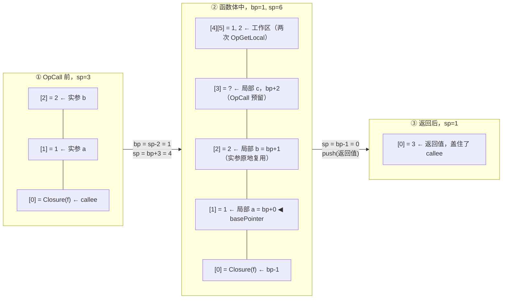
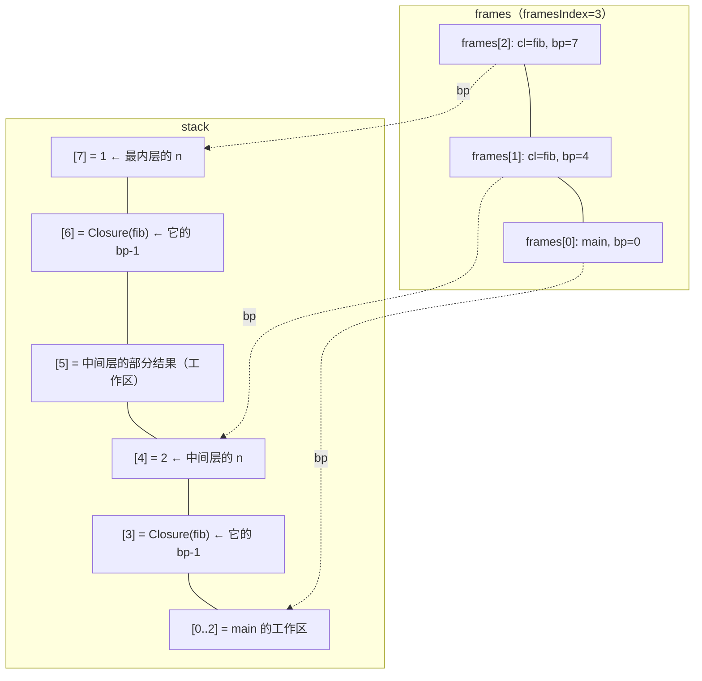

# 08 VM：栈式虚拟机 —— 取指-执行循环、栈不变量与调用协议

## 本章要回答的问题

一个字节 `0x03` 怎么变成一次加法？为什么 VM 最常见的 bug 不是算错数，而是**跳转跳偏一格**？函数调用在一台只有栈的机器上究竟发生了什么——实参放哪、局部变量放哪、返回时怎么把栈收干净？最后是那个必须成立的等式：**同一份源码，evaluator 和 VM 的输出一模一样**。

这一章你要写 `vm/` 包。06 章的指令集和 07 章的 compiler 是输入契约，本章是它们的消费方。

## 1. VM 是一台状态机

Evaluator 是递归的，Go 的调用栈就是它的执行栈。VM 是迭代的：一个循环、一组可变状态、没有递归。

> **状态 + 一条指令 → 新状态。** 执行程序 = 从初始状态出发反复应用这个函数，直到指令流耗尽。

所以第一步不是写循环，是**列状态**。问自己：执行到一半按下暂停，要保存哪些东西才能原地恢复？

| 状态 | 类型 | 谁改它 |
| --- | --- | --- |
| `constants` | `[]object.Object` | 没人（编译期固定，只读） |
| `stack` / `sp` | `[]object.Object` / `int` | 几乎每条指令 |
| `globals` | `[]object.Object` | `OpSetGlobal` |
| `frames` / `framesIndex` | `[]*Frame` / `int` | `OpCall`、`OpReturnValue`、`OpReturn` |

注意 `instructions` 和 `ip` **不在**表里。第一版会有它们（还没函数时只有一段指令流和一个指针）；等 frame 出现，它们被 frame 吸收——第 8 节推导这一步。

**每条指令是一个状态转换函数。** 06 章那张"栈效果"表就是这些函数的签名；写 VM 就是把它逐行翻译成 `case`。纪律：**先写清这条指令读什么、弹几个、压什么、动不动 ip，再写代码。** 跳过这一步，到第 20 条指令你会开始猜。

## 2. 栈：表示与不变量

### 为什么预分配数组而不是 append

```go
const StackSize = 2048

type VM struct {
    constants []object.Object
    stack     []object.Object
    sp        int              // 指向下一个空位。栈顶是 stack[sp-1]
    globals   []object.Object
    frames      []*Frame
    framesIndex int            // 同样指向下一个空位
}
```

`stack: make([]object.Object, StackSize)`，而不是 `append` + `stack[:len-1]`。三个理由：**① 显式溢出检测**——`append` 永不失败，会一路扩容到 OOM 被 OS 杀掉；固定大小让"栈溢出"变成**可报告的错误**。**② 性能**——`stack[sp] = x; sp++` 是两条机器指令，`append` 每次检查容量、可能重分配并拷贝，在内层循环里这个差别可测量。**③ `sp` 本身是信息**——"栈平衡"变成可断言的性质（`sp == 0`），且 `sp` 能**独立于底层数组移动**，这是下面 `pop` 不清槽位的前提。

### 核心约定：`sp` 指向下一个空位

```text
sp=0            sp=1                    sp=3
┌───┬───┬───┐   ┌───┬───┬───┐          ┌───┬───┬───┐
│   │   │   │   │ 1 │   │   │          │ 1 │ 2 │ 3 │
└───┴───┴───┘   └───┴───┴───┘          └───┴───┴───┘
  ↑ 空栈             ↑ 栈顶=stack[0]                 ↑ 栈顶=stack[2]
```

**栈顶是 `stack[sp-1]`。** 另一种约定（`sp` 指栈顶，空栈为 `-1`）也能用，但 `push` 要先自增后赋值，空栈还要特殊值。选一个，写进结构体注释，**永不违反**。`framesIndex` 用完全相同的约定——混用两套是自找麻烦。

### push 与 pop

```go
func (vm *VM) push(o object.Object) error {
    if vm.sp >= StackSize {
        return fmt.Errorf("stack overflow")
    }
    vm.stack[vm.sp] = o
    vm.sp++
    return nil
}

func (vm *VM) pop() object.Object {
    o := vm.stack[vm.sp-1]
    vm.sp--                      // 注意：没有 vm.stack[vm.sp] = nil
    return o
}
```

两处不对称，都是刻意的。

**`push` 返回 error，`pop` 不返回。** 溢出**真实可能**（用户写了无限递归）；下溢**只可能是 compiler 的 bug**——栈平衡契约成立时，`OpAdd` 执行前栈上必有两个值。给 `pop` 加检查只是把 compiler 的 bug 从 panic 变成 error，代价是每个调用点多一次错误处理。开发期想抓它用临时断言，别做成常驻错误路径。

**`pop` 不清空槽位。** 好处是**能看见"栈顶之上"**——弹出的值还在数组里，于是有了测试专用的访问器：

```go
// 表达式语句编译后以 OpPop 结尾，所以程序跑完，"上一个被弹出的值"
// 就是最后一个表达式的结果。测试断言它，而不是栈顶（栈顶是空的）。
func (vm *VM) LastPoppedStackElem() object.Object { return vm.stack[vm.sp] }
```

这让**测试不必破坏栈平衡**：程序正常执行到底（`sp` 回 0），结果仍可读。若 `pop` 清空槽位，测试就得要求"最后一个表达式不发 `OpPop`"，那会为了测试扭曲 compiler。调试同理——打印 `stack[sp:sp+3]` 能看到刚弹掉什么。

**代价是 GC 无法回收。** `stack` 是接口切片，残留槽位持有对象指针，GC 不知道 `sp` 以上是垃圾。`let big = fn() { [ 一百万个元素 ] }; big();` 之后那个数组被 pop 了，但 `stack[sp]` 还指着它。泄漏上限是 `StackSize` 个对象（不会无界增长），但**单个可能很大**。真实语言的做法：`pop` 里清空（放弃 `LastPoppedStackElem`），或在长循环边界显式 truncate。教学实现保留残留是值得的——**此时可观察性比内存占用重要**。但要知道自己在权衡什么，而不是"书上就这么写"。

## 3. 取指-执行循环：`ip` 与操作数的配合

第一版骨架（还没有 frame）：

```go
for ip = 0; ip < len(ins); ip++ {
    op := code.Opcode(ins[ip])
    switch op {
    case code.OpConstant:
        constIndex := code.ReadUint16(ins[ip+1:])    // 读操作数
        ip += 2                                      // 跳过操作数
        if err := vm.push(vm.constants[constIndex]); err != nil { return err }
    default:
        return fmt.Errorf("unknown opcode %d", op)
    }
}
```

指令是**变长**的：`OpPop` 1 字节，`OpConstant` 3 字节，`OpClosure` 4 字节。而循环末尾的 `ip++` 只前进 1。所以：

> **每个带操作数的 case 必须自己推进"操作数宽度"个字节。** 末尾的 `ip++` 负责跨过 opcode 那 1 字节，两者相加正好落到下一条指令。

拿 `1 + 2;` 手算。设 `OpConstant=0`、`OpPop=2`、`OpAdd=3`：

```text
偏移:   0     1  2      3     4  5      6      7          轮 进入ip  case后  ip++后
字节: [ 0 ] [0][0]   [ 0 ] [0][1]   [ 3 ]  [ 2 ]           1    0      2       3
含义: OpConstant 0    OpConstant 1   OpAdd  OpPop           2    3      5       6
                                                            3    6      6       7
                                                            4    7      7    8→退出
```

**不变量：每轮进入时 `ip` 指向一个 opcode 字节。** 漏了 `ip += 2`，第 2 轮会从 `ip=1` 开始，把操作数字节 `0x00` 当 opcode——而 `0x00` 恰好是 `OpConstant`，于是 VM 安静地执行一条你从未生成的指令。**症状是结果诡异而非报错**，这是最难查的一类 bug。防御：**`Run` 之前对整段指令跑一次反汇编**（06 章的 `code.String()`）。若它能从头走到尾、每条都落在合法边界，指令流本身自洽，剩下的错只可能在 `ip` 推进上。

操作数宽度写在 06 章的 `definitions` 表里。VM 里直接写 `ip += 2` 可以接受（快且清晰），但**必须有一个测试**遍历 `definitions` 断言每个 opcode 的宽度和 VM 的推进量一致。否则哪天 `OpGetLocal` 从 1 字节改成 2 字节，compiler 改了、VM 漏了。

## 4. 跳转：必须统一的 off-by-one 约定

跳转目标是**绝对字节偏移**（06 章的决定）。`OpJump 13` 意为"下一条执行的指令在偏移 13"。问题：循环末尾有 `ip++`，case 里写 `ip = 13`，自增后变成 14——**偏移 13 那条被跳过了**。

```go
// 方案 A：ip = target - 1，保留 for ip++
case code.OpJump:
    ip = int(code.ReadUint16(ins[ip+1:])) - 1     // 末尾 ip++ 把它补回 target

// 方案 B：ip = target 后 continue 跳过自增（循环头写 for ip = 0; ip < len(ins); ）
case code.OpJump:
    ip = int(code.ReadUint16(ins[ip+1:]))
    continue                         // 代价：每条顺序指令都要 ip += 完整长度
```

| | 方案 A | 方案 B |
| --- | --- | --- |
| 顺序指令 | 只推进操作数宽度 | 推进完整指令长度 |
| 跳转 | 写 `target - 1`，反直觉 | 写 `target`，直观 |
| 漏推进的症状 | 把操作数当 opcode（安静地错） | 死循环（立刻暴露） |
| 与书上一致 | 是 | 否 |

**选方案 A**，理由是与《Writing a Compiler in Go》一致（查资料时不用做心算转换），顺序指令的 case 也少写一个字节。代价是必须记住那个 `-1`：

> **约定：所有修改 `ip` 的 case 都写 `ip = 目标 - 1`。加入 frame 后写 `frame.ip = 目标 - 1`。**

漏 `-1` 的症状取决于目标指令长度：跳到一条 3 字节指令，会从它的第一个操作数字节开始解码（垃圾指令）；跳到 `OpJump` 自己身上（`while` 的回跳）就是**死循环**。两种症状看着毫不相干，根因同一个。受影响的位置只有 `OpJump` 和 `OpJumpNotTruthy` 两处——但 `if`、`while`、`&&`、`||` 全建立在它们之上，**一处错，四个语言特性同时坏**。所以第一个 `if` 测试通过前，先手算一遍跳转（第 11 节）。

### `OpJumpNotTruthy` 消费栈顶

```go
case code.OpJumpNotTruthy:
    pos := int(code.ReadUint16(ins[ip+1:]))
    ip += 2                              // 无论跳不跳都要跨过操作数
    if condition := vm.pop(); !isTruthy(condition) {   // ← 弹栈！
        ip = pos - 1
    }
```

三个细节，每个都出过 bug：

**① `ip += 2` 在判断之前。** 不跳的那条路径靠它落到下一条指令，写进 `if` 里面就只有一半正确。

**② 必须 `pop`。** condition 编译后在栈上留了一个值（表达式净增 1），`OpJumpNotTruthy` 是它的消费者。忘了弹，栈会随每个 `if` 增长 1——单个 `if` 看不出来，`while` 里套一个 `if` 循环几千次就溢出。

**③ truthy 来自语义契约**（00 章第 4 节）：只有 `false` 和 `null` 为假，`0`、`""`、`[]` 全为真。所以 `isTruthy` 是"`*object.Boolean` 返回 `.Value`、`*object.Null` 返回 false、其余一律 true"。**这个函数必须和 evaluator 里的逐字节相同**——最好的办法是**只写一次**，放在 `object` 包里导出，两边都调它。两份实现总会分叉，尤其在加了新类型之后（`Float`：`0.0` 按契约为真）。

### `while`、`&&`、`||` 在 VM 里没有新东西

`while` 编译成 condition → `OpJumpNotTruthy exit` → body → `OpJump start`。**VM 完全不知道这是循环，只是在跳。** 树形控制流消失了，只剩地址——这就是"编译降低抽象"的含义。但有一条由 compiler 保证、后果落在 VM 上的契约：

> **`while` body 里每个语句都必须栈平衡（净增 0）。**

body 里每个表达式语句以 `OpPop` 结尾。compiler 漏发一个，栈就每轮增长 1：循环 100 次没事，2048 次以后 `push` 返回 `stack overflow`。**症状在 VM 报出，根因在 compiler。** 遇到"循环次数多了就溢出"，别在 VM 里找，去看反汇编的 body 段落数 `OpPop`。

`&&` / `||` 用条件跳转短路，这里有一个必须钉死的语义决定：

> **`a && b` 的结果是 `Boolean`，不是 `a` 或 `b` 本身。**

因为指令集里没有 `OpDup`，也没有"不弹栈的条件跳转"——`OpJumpNotTruthy` 会吃掉 condition。要实现 Python/JS 那种"返回操作数本身"（`0 || "x"` 得 `"x"`）需要额外 opcode。指令集固定，所以**选布尔语义，且 evaluator 必须照做**。写进 00 章契约表，否则差分测试会在 `1 && 2` 上炸（VM 给 `true`，evaluator 给 `2`）。

## 5. 算术：运行时类型分派，与它揭示的东西

```go
func (vm *VM) executeBinaryOperation(op code.Opcode) error {
    right := vm.pop()
    left := vm.pop()                 // ← 顺序！先弹的是右操作数
    switch {
    case isNumber(left) && isNumber(right):
        return vm.executeBinaryNumberOperation(op, left, right)
    case left.Type() == object.STRING_OBJ && right.Type() == object.STRING_OBJ:
        return vm.executeBinaryStringOperation(op, left, right)   // 只支持 +
    default:
        return fmt.Errorf("unsupported types for binary operation: %s %s",
            left.Type(), right.Type())
    }
}
```

**弹栈顺序是第一个坑。** compiler 先编译左、再编译右，栈上是 `[left, right]`，`right` 在栈顶，**先 pop 得到右操作数**。写反了，`+` 和 `*` 看不出来（交换律），`-` 和 `/` 立刻错。**测试必须包含 `5 - 3` 和 `6 / 2`**，不能只测加法乘法。

### 你的扩展：int / float 混算

按契约（int 提升为 float，`int / int` 截断），数值分派要覆盖四种组合：

```go
func (vm *VM) executeBinaryNumberOperation(op code.Opcode, left, right object.Object) error {
    li, lIsInt := left.(*object.Integer)
    ri, rIsInt := right.(*object.Integer)

    if lIsInt && rIsInt {                     // int-int：结果仍是 int
        var result int64
        switch op {
        case code.OpAdd: result = li.Value + ri.Value
        case code.OpSub, code.OpMul: // TODO
        case code.OpDiv:
            if ri.Value == 0 { return fmt.Errorf("division by zero") }  // 或 Null，看契约
            result = li.Value / ri.Value      // 截断，契约要求
        default:
            return fmt.Errorf("unknown integer operator: %d", op)
        }
        return vm.push(&object.Integer{Value: result})
    }
    // 至少一边是 Float → toFloat 双方，按 op 计算，push &object.Float{...}
    // 注意 float 除以 0 得 ±Inf / NaN，不是错误。这也是一条契约。
    return nil  // TODO
}

func toFloat(obj object.Object) float64 { /* Integer 或 Float → float64。TODO */ return 0 }
```

`toFloat` 值得单独存在：它把"提升"规则收拢到一处。三处需要它（算术、比较、内置函数），三份实现会分叉。**字符串只支持 `+`**；`"a" - "b"` 报错，不是返回空串。

**一个精度陷阱**：你的 [ast.go:207-210](../ast/ast.go#L207-L210) 用 `float32` 存字面量，而 `object.Float` 是 `float64`。`float64(float32(0.1))` 是 `0.10000000149011612`。如果 evaluator 走 `float32` 而 compiler 直接 `strconv.ParseFloat(lit, 64)`，**两条路径的 `0.1` 是不同的数**，差分测试会在打印时暴露。要么把 AST 改成 `float64`（推荐），要么两边都走同一条转换。

### 这里藏着 12 章的动机

| 为 `a + b` 做的事 | Evaluator | VM |
| --- | --- | --- |
| 认出"这是加法" | 类型断言 `*ast.InfixExpression` + 字符串比较 `op == "+"` | 一次 `switch` 跳转表 |
| 取左右操作数 | 两次递归 `Eval` | 两次 `pop`（数组索引） |
| **判断值的类型** | 类型断言 Integer/Float/String | **完全一样的类型断言** |
| 遍历 AST | 每次执行都走 | 编译期走完，不再走 |

**编译消掉了"结构的解释"，没有消掉"值的解释"。** 那串 `case isNumber(left) && isNumber(right)` 每秒执行几百万次，每次得到同一个答案——因为真实程序里一个加法点的操作数类型基本是固定的。三条出路，难度递增：内联缓存（记住上次的类型，[13 章 §6](13-optimization.md)）、类型专用 opcode（`OpAddInt`，需要类型信息，[13 章 §7](13-optimization.md)）、静态类型（把检查整体移到编译期，12 章）。**现在你能亲手感受它要解决的具体开销**——不是抽象的"动态语言慢"，而是这里每一次 `left.(*object.Integer)`。如果这个开销不满足于"编译期一次性解决"而想在运行期动态观察热点后再决定，那是 [14 章](14-jit.md) 的话题。

## 6. 比较：两套相等性，与一处真实的语义差异

```go
func (vm *VM) executeComparison(op code.Opcode) error {
    right := vm.pop()
    left := vm.pop()

    if isNumber(left) && isNumber(right) {
        return vm.executeNumberComparison(op, left, right)   // 值比较，跨 int/float
    }
    switch op {
    case code.OpEqual:
        return vm.push(nativeBoolToBooleanObject(left == right))      // ← 指针比较
    case code.OpNotEqual:
        return vm.push(nativeBoolToBooleanObject(left != right))
    default:
        return fmt.Errorf("unknown operator: %d (%s %s)", op, left.Type(), right.Type())
    }
}

func nativeBoolToBooleanObject(b bool) *object.Boolean {
    if b { return object.True }
    return object.False
}
```

数值走值比较，其他走 `left == right`——Go 的接口相等，对指针类型就是**指针相等**。`true == true` 成立是因为两边都是同一个 `object.True` 指针。所以这**只在 Boolean/Null 是单例时正确**：任何地方 `&object.Boolean{Value: true}` 新建一个实例，这个比较立刻给出 `false`。单例不是优化，**是正确性前提**：

> **不变量：运行时 `*object.Boolean` 只有 `object.True` / `object.False` 两个实例，`*object.Null` 只有一个。任何地方都不允许 `&object.Boolean{...}`。**

`OpTrue` / `OpFalse` / `OpNull` 直接 push 这三个单例，既省分配又维持不变量。

**Integer 为什么不能这么干？** 它有无限多个值，`&Integer{1} == &Integer{1}` 是 `false`（不同指针），必须比较 `.Value`。（真实 VM 会缓存小整数，CPython 缓存 -5..256——所以 `a is b` 对小整数为真、对大整数为假。你现在能看懂那个著名的困惑了。）**字符串和数组**同理：`"a" == "a"` 走指针比较会得到 `false`，要么加字符串分支（值比较），要么接受"按引用比较"，**但必须和 evaluator 对齐并写进契约表**。原版 Monkey 的数组/哈希是引用比较（`[1] == [1]` 为 false），省事但反直觉。

**跨类型 `1 == 1.0`** 按契约是 `true`，所以数值比较要先归一化。**int-int 走 int64 路径**不只为性能：`float64` 只有 53 位尾数，超过 2^53 的两个不同 int64 转 float64 会变成同一个值，`==` 给出错误的 `true`。

### 为什么没有 `OpLessThan`，以及它带来的真实差异

compiler 编译 `a < b` 时**交换操作数**，发出 `b > a`；`a <= b` → `b >= a`。省掉两条 opcode，代价是：

> **`f() < g()` 的求值顺序，VM 和 evaluator 不同。**

```monkey
let log = 0;
let f = fn() { log = log * 10 + 1; 1 };   let g = fn() { log = log * 10 + 2; 2 };
f() < g();
log;          // evaluator: 12（左到右）    VM: 21（g 先执行）
```

evaluator 按 AST 顺序先求 `f()`；VM 执行的是 `g() > f()` 的指令，`g` 先跑。**这不是 bug，是真实的语义分歧，而且差分测试会抓到它。** 三个处理方式：① 加 `OpLessThan` / `OpLessEqual`（"正确"的解法，但指令集固定，现在不可选）；② 接受分歧并写进文档"比较运算符的操作数求值顺序未定义"——C/C++ 几十年就这么规定，差分测试排除带副作用的比较用例；③ compiler 保持顺序再发一条 `OpSwap`，多一条指令换语义对齐。

**推荐 ②**，零成本且诚实。但**必须显式记录**，否则半年后你会以为这是 bug，花两小时才想起是设计决定。00 章契约表加一行。

## 7. 全局变量与集合指令

```go
const GlobalsSize = 65536                            // = 2^16，来自 2 字节操作数

case code.OpSetGlobal:
    globalIndex := code.ReadUint16(ins[ip+1:])
    ip += 2
    vm.globals[globalIndex] = vm.pop()

case code.OpGetGlobal:
    globalIndex := code.ReadUint16(ins[ip+1:])
    ip += 2
    if err := vm.push(vm.globals[globalIndex]); err != nil { return err }
```

**六行，没有一次字符串比较、map 查找或作用域链遍历。** 对比 evaluator：`env.Lookup("x")` 要哈希字符串、查桶、比较键，找不到就递归 `outer` 再查一次——嵌套 5 层的闭包里访问全局变量是 5 次 map 查找。VM 是一次数组索引。差距的根源不是"map 慢"：

> **evaluator 每次执行都在回答"名字 `x` 指的是哪个绑定"。VM 从不回答这个问题——compiler 已经回答过一次，答案是常数 `3`，固化在指令里。**

这是 compiler + VM 相对 evaluator + Environment 的核心优势，比"少了 AST 遍历"更根本。它也解释了 07 章符号表的地位：**符号表就是那次"回答"的过程**。符号表出错，VM 会安静地读到错误槽位——不报错，因为槽位里确实有一个合法对象。

`GlobalsSize = 65536` 直接来自 `OpSetGlobal` 的 2 字节操作数。**操作数宽度决定地址空间**：同理 `OpGetLocal` 是 1 字节，**单个函数最多 256 个局部变量**。两个上限都该由 compiler 检查并报错，而不是让 VM 在越界索引上 panic。REPL 要跨行保持状态，所以需要 `NewWithGlobalsStore(bytecode, globals)`——**符号表（编译期）和 globals（运行期）必须同时持有**，只留一份索引会错位。

### 集合指令

```go
case code.OpArray:
    numElements := int(code.ReadUint16(ins[ip+1:]))
    ip += 2
    array := vm.buildArray(vm.sp-numElements, vm.sp)   // ← 区间，不是逐个 pop
    vm.sp = vm.sp - numElements
    if err := vm.push(array); err != nil { return err }

func (vm *VM) buildArray(startIndex, endIndex int) object.Object {
    elements := make([]object.Object, endIndex-startIndex)
    for i := startIndex; i < endIndex; i++ {
        elements[i-startIndex] = vm.stack[i]           // ← 正向拷贝，保持源顺序
    }
    return &object.Array{Elements: elements}
}
```

**顺序是唯一的坑。** compiler 按源码顺序压栈，`[1,2,3]` 在栈上就是 `[1,2,3]`（`3` 在栈顶）。**区间正向拷贝得到正确顺序；`pop` 循环得到反序。** 测出 `[3,2,1]` 就是这个原因。

`OpHash 2n` 的操作数是**栈上元素个数**（`2n`）而非键值对数，栈布局 `[k1,v1,k2,v2,...]` 两两成对：循环 `i += 2` 取 `stack[i]`/`stack[i+1]`，键必须断言成 `object.Hashable`（否则报 `unusable as hash key: %s`），然后填进 `map[object.HashKey]object.HashPair`。`Float` 能当键吗？契约要回答——技术上可以（`math.Float64bits`），但 `0.1+0.2` 作键取不出来；允许但警告，或直接禁止，两条路径一致即可。

（顺带一个历史坑：`ast.HashList.Pairs` 曾经是 `map[Expression]Expression`，Go 的 map 遍历顺序随机，会导致同一份源码每次编译出不同的指令序列，让反汇编测试不可重复、键表达式的副作用顺序不确定。11 章缺陷 9 已经把它改成有序的 `[]HashPair`（[ast.go:275](../ast/ast.go#L275)），这个坑不再存在。）

`OpIndex` 的类型分派：`Array[Integer]` 越界和负数都返回 Null（契约）；`Hash[Hashable]` 键不存在返回 Null；`Array[Float]` 报错还是截断、`String[Integer]` 支持不支持，都要契约回答（推荐都报错）；其余返回 `index operator not supported: %s`。**越界返回 Null 而不是报错**让 `xs[i]` 在循环里不会突然中断，代价是打错索引不会被发现。

## 8. Frame 的推导

先别看定义。问：执行 `f(1, 2)` 时 VM 要跳到 `f` 的指令去，**返回时需要恢复什么？** ① **回到哪里继续**——调用者的 `ip`，即返回地址；② **哪些槽位是我的局部变量**——那个区域的起点必须记下，否则 `OpGetLocal 0` 不知道读哪，这是 `basePointer`；③ **正在执行谁的指令**——`f` 的指令在它的 `CompiledFunction` 里，`ip` 是相对**当前函数**的偏移。把三样打包：

```go
type Frame struct {
    cl          *object.Closure   // ③ 当前闭包（含 Fn.Instructions）
    ip          int               // ① 当前函数内的指令指针
    basePointer int               // ② 本次调用的栈起点
}

func NewFrame(cl *object.Closure, basePointer int) *Frame {
    return &Frame{cl: cl, ip: -1, basePointer: basePointer}
}

func (f *Frame) Instructions() code.Instructions { return f.cl.Fn.Instructions }
```

`ip` 初始化为 `-1`，因为主循环要改成"先自增，再取指"（见下），第一次自增让它变成 0。

### 为什么 `ip` 在 Frame 里而不在 VM 里

这是本节最重要的一问。若 `ip` 是 `vm.ip`，调用 `f` 时要把它设成 0，返回时要改回来——**改回哪个值？** 你得把旧值存起来，存进一个栈；那个栈里还得存 `basePointer`。**于是你重新发明了 Frame。** 而 Frame 不只是更整齐：**它让"调用"和"返回"变成 frame 栈的 push / pop**，各两行；递归、深度嵌套、闭包全部自动正确，因为每次调用都有独立的一份 `ip`。

值得记住的设计模式：**发现要"保存-恢复"多个变量时，把它们打包成一个激活记录，用栈管理。** 真实 CPU 的调用约定（保存返回地址和帧指针到栈上）是同一想法的硬件版本。

### 主循环的最终形态

```go
const MaxFrames = 1024

func (vm *VM) currentFrame() *Frame { return vm.frames[vm.framesIndex-1] }
func (vm *VM) popFrame() *Frame     { vm.framesIndex--; return vm.frames[vm.framesIndex] }

func (vm *VM) pushFrame(f *Frame) error {
    if vm.framesIndex >= MaxFrames {
        return fmt.Errorf("frame overflow: recursion too deep")
    }
    vm.frames[vm.framesIndex] = f
    vm.framesIndex++
    return nil
}

func (vm *VM) Run() error {
    var ip int
    var ins code.Instructions
    var op code.Opcode

    for vm.currentFrame().ip < len(vm.currentFrame().Instructions())-1 {
        vm.currentFrame().ip++                // ← 自增移到循环开头
        ip = vm.currentFrame().ip
        ins = vm.currentFrame().Instructions()
        op = code.Opcode(ins[ip])
        switch op {
        // ... 每个修改 ip 的 case 都写 vm.currentFrame().ip = target - 1
        }
    }
    return nil
}
```

三处变化都是必要的：

**① 循环条件是 `ip < len(ins)-1`。** 自增在判断之后、取指之前，所以 `ip == len(ins)-1`（最后一条已执行）时退出。写 `ip < len(ins)` 会多走一轮，读 `ins[len(ins)]` → 越界 panic。

**② 每轮重新取 `ins` 和 `ip`。** 它们来自 `currentFrame()`，而当前 frame 会被 `OpCall` / `OpReturnValue` 换掉。**缓存在循环外面是致命 bug**——调用返回后你还在执行被调用者的指令。

**③ 主程序也是一个 frame。** `New` 里把 `bytecode.Instructions` 包成 `CompiledFunction` 再包成 `Closure`，作为 `frames[0]`，`basePointer = 0`。**统一表示消灭了特例**，不必到处判断"我在主程序还是函数里"。把顶层当成一个匿名零参函数，这个技巧在真实编译器里很常见。

## 9. basePointer：局部变量住在栈上

自然但错误的想法：给每个 Frame 一个 `locals []Object`。能用，但每次调用要分配一个切片。**正确做法：局部变量住在操作数栈上**，紧挨实参，`basePointer` 记住起点。

```go
case code.OpSetLocal:
    localIndex := code.ReadUint8(ins[ip+1:])
    vm.currentFrame().ip += 1                  // ← 1 字节操作数，不是 2
    frame := vm.currentFrame()
    vm.stack[frame.basePointer+int(localIndex)] = vm.pop()

case code.OpGetLocal:
    localIndex := code.ReadUint8(ins[ip+1:])
    vm.currentFrame().ip += 1
    frame := vm.currentFrame()
    if err := vm.push(vm.stack[frame.basePointer+int(localIndex)]); err != nil { return err }
```

> **`OpGetLocal i` 读 `stack[basePointer + i]`。索引永远是相对当前 frame 的。**

局部索引由符号表分配，从 0 开始，**每个函数独立**。写成 `stack[i]`（绝对）在主程序里"能跑"（主 frame 的 basePointer 是 0），一进函数全错——**典型的"测试通过但实现错误"**，因为最简单的用例恰好在 basePointer 为 0 的地方。**第一个局部变量测试必须在函数内部。**

### 参数就是前 N 个局部变量

编译 `f(1, 2)` 时 compiler 发出 `OpGetGlobal f`、`OpConstant 1`、`OpConstant 2`、`OpCall 2`。所以 `OpCall` 执行时栈上是 `[f, 1, 2]`（`sp=3`）。令 `bp = sp - numArgs = 1`，它正好指向第一个实参：

```text
      ┌───────┬──────┬──────┐
  ... │   f   │  1   │  2   │ sp=3        bp-1 = callee，bp+0 = a，bp+1 = b
      └───────┴──────┴──────┘
        bp-1    bp+0   bp+1
```

**`stack[bp+0]` 就是第一个参数，`stack[bp+1]` 是第二个。** 而符号表给参数分配的局部索引正是 0 和 1（07 章：参数先进符号表，然后才是函数体的 `let`）。

> **实参不需要拷贝到任何地方。它们被压在栈上的位置，恰好就是 `OpGetLocal 0`、`OpGetLocal 1` 要读的位置。**

于是 `OpCall` 只需为**函数体内的 `let`** 预留空间：`vm.sp = frame.basePointer + fn.NumLocals`。`NumLocals` 包含参数（符号表的 `numDefinitions` 统计了两者），所以这一句同时"跳过参数区"和"预留局部区"。预留的槽位里是**上次执行留下的垃圾**（`pop` 不清空）。正常情况没问题，compiler 保证 `OpSetLocal 2` 在 `OpGetLocal 2` 之前；但若 compiler 有 bug 让读先于写，**你会读到一个来自完全无关代码的对象**——不 panic、不报错，就是个错值。教学实现里可以在 `OpCall` 里循环填 `object.Null`，几个周期换掉一整类诡异 bug，值得。

## 10. 调用与返回协议

```go
case code.OpCall:
    numArgs := code.ReadUint8(ins[ip+1:])
    vm.currentFrame().ip += 1                // ← 关键：先推进调用者的 ip！
    if err := vm.executeCall(int(numArgs)); err != nil { return err }

func (vm *VM) executeCall(numArgs int) error {
    callee := vm.stack[vm.sp-1-numArgs]      // ← 不 pop！用索引定位
    switch callee := callee.(type) {
    case *object.Closure: return vm.callClosure(callee, numArgs)
    case *object.Builtin: return vm.callBuiltin(callee, numArgs)
    default:                return fmt.Errorf("calling non-function and non-built-in")
    }
}

func (vm *VM) callClosure(cl *object.Closure, numArgs int) error {
    if numArgs != cl.Fn.NumParameters {
        return fmt.Errorf("wrong number of arguments: want=%d, got=%d",
            cl.Fn.NumParameters, numArgs)
    }
    frame := NewFrame(cl, vm.sp-numArgs)     // basePointer = sp - numArgs
    if err := vm.pushFrame(frame); err != nil { return err }
    vm.sp = frame.basePointer + cl.Fn.NumLocals
    return nil
}
```

**① `currentFrame().ip += 1` 必须在 `pushFrame` 之前。** 此时 `currentFrame()` 还是调用者，推进它跨过 `OpCall` 的 1 字节操作数，返回时它的 `ip` 正好停在 `OpCall` 的最后一个字节，主循环的自增让它落到下一条。**漏了这一步，返回后会重新执行 `OpCall` → 无限递归 → frame overflow。** 症状像"递归写错了"，实际是这一行。

**② callee 用索引定位，不 pop。** 它必须留在 `basePointer - 1`，返回时靠 `sp = basePointer - 1` 一次性和参数区一起清掉。**pop 掉 callee 会让 basePointer 算错 1**，然后 `OpGetLocal 0` 读到 callee 自己。

### 调用前 / 调用中 / 返回后：本章最重要的图

以 `let f = fn(a, b) { let c = a + b; c }; f(1, 2);` 为例。`NumParameters = 2`，`NumLocals = 3`（a、b、c）。



每次调用都把栈切成同样的四个区：`bp-1` 是 callee（返回时被返回值覆盖）、`bp+0..bp+P-1` 是参数区（实参原地变成局部变量）、`bp+P..bp+L-1` 是局部变量区（`OpCall` 时预留）、`bp+L..sp-1` 是工作区（表达式求值用）。

### `OpReturnValue` 与 `OpReturn`

```go
case code.OpReturnValue:
    returnValue := vm.pop()              // 栈顶就是返回值
    frame := vm.popFrame()
    vm.sp = frame.basePointer - 1        // ← 这个 -1 是核心
    if err := vm.push(returnValue); err != nil { return err }

case code.OpReturn:                      // 空 body / 无返回值
    frame := vm.popFrame()
    vm.sp = frame.basePointer - 1
    if err := vm.push(object.Null); err != nil { return err }
```

**`sp = frame.basePointer - 1` 一句话做了三件事：** 丢弃工作区的残留、丢弃局部变量区和参数区、**丢弃 callee 本身**（那个 `-1`）。然后 `push(returnValue)` 把返回值写到原来 callee 的槽位——正是调用者期望的位置（调用表达式的栈效果是净增 1）。

**忘掉 `-1` 的后果**：callee 留在栈上，返回值压在它上面——正确是 `[3]`（sp=1），错误是 `[Closure(f), 3]`（sp=2）。单次调用的**结果仍然正确**（`LastPoppedStackElem` 拿到的还是 3），测试会通过。但每次调用泄漏一格，于是 `let f = fn(){1}; let i = 0; while (i < 3000) { f(); i = i + 1; }` 会在第 2048 次调用时 `stack overflow`。

**症状离根因很远**——你会怀疑循环、怀疑 `while` 的栈平衡，最后才想到返回协议。这正是第 14 节"元测试 ①"（程序结束时 `sp == 0`）的价值：它让任何一个含函数调用的用例立刻报 `sp = 1, want 0`。**这一个断言的价值超过十个功能测试。**

### 内置函数：另一条路径

```go
func (vm *VM) callBuiltin(builtin *object.Builtin, numArgs int) error {
    args := vm.stack[vm.sp-numArgs : vm.sp]
    result := builtin.Fn(args...)
    vm.sp = vm.sp - numArgs - 1            // ← 同样的 -1，清掉 callee
    if result != nil { return vm.push(result) }
    return vm.push(object.Null)
}
```

**没有 Frame**——内置函数是 Go 代码，用 Go 的调用栈。但 `-1` 的逻辑完全一样。一个契约问题：内置函数返回 `*object.Error` 怎么办？evaluator 把 `Error` 当值传播，VM 用 Go 的 `error`。选 (a) push 那个 `Error` 让它像普通值往上走（和 evaluator 一致，但错误会被静默忽略），或 (b) 转成 Go error 中止。**推荐 (b)**，并接受"错误的表示在两条路径上不同"——所以错误用例要单独测，不能进差分测试（第 14 节）。

### 递归为什么可行

因为每次调用 `pushFrame` 一个**新的** Frame，有独立的 `ip` 和独立的 `basePointer`。执行 `let fib = fn(n) { if (n < 2) { n } else { fib(n-1) + fib(n-2) } }; fib(3);` 到两层深处：



**同一个 `Closure` 对象，三个 Frame，三个不同的 `basePointer`。** `n` 在符号表里永远是"local 0"，运行时却是 `stack[4]` 或 `stack[7]`，取决于当前 frame。**递归不需要任何特殊代码**——实现完普通调用它就自动可用，这是"把调用状态打包成栈上记录"的直接回报。

唯一限制是 `MaxFrames = 1024`，超了返回 `frame overflow`。**这和 evaluator 不同**：evaluator 递归调用 Go 函数，深递归耗尽 Go 栈会 `fatal error: stack overflow`——**不可恢复，整个进程死掉**。VM 返回一个普通 error。所以"最大递归深度"是两条路径的又一个语义差异，而且 VM 这边明显更好。差分测试里别放深递归用例。

## 11. 手算三个 trace

写代码前先手算。**如果你算不出来，写出来的也是碰巧对的。**

### trace 1：`1 + 2;`

常量池 `[Integer(1), Integer(2)]`，指令 `0000 OpConstant 0` / `0003 OpConstant 1` / `0006 OpAdd` / `0007 OpPop`：

| 轮 | 自增后 ip | 指令 | 动作 | 出 case 时 ip | 栈（sp） |
| --- | --- | --- | --- | --- | --- |
| — | -1 | — | 初始 | -1 | `[]` (0) |
| 1 | 0 | `OpConstant 0` | push constants[0] | 2 | `[1]` (1) |
| 2 | 3 | `OpConstant 1` | push constants[1] | 5 | `[1,2]` (2) |
| 3 | 6 | `OpAdd` | pop→2, pop→1, push 3 | 6 | `[3]` (1) |
| 4 | 7 | `OpPop` | pop→3 | 7 | `[]` (0) |

`ip=7` 时 `7 < len(ins)-1 = 7` 为假 → 退出。**`sp` 回到 0（栈平衡 ✓），`LastPoppedStackElem() = stack[0] = 3`。**

### trace 2：`if (false) { 10 } else { 20 };`

常量池 `[Integer(10), Integer(20)]`：

```text
0000 OpFalse
0001 OpJumpNotTruthy 10
0004 OpConstant 0        ← consequence: 10
0007 OpJump 13
0010 OpConstant 1        ← alternative: 20
0013 OpPop
```

| 轮 | 自增后 ip | 指令 | 动作 | 出 case 时 ip | 栈 |
| --- | --- | --- | --- | --- | --- |
| 1 | 0 | `OpFalse` | push object.False | 0 | `[false]` |
| 2 | 1 | `OpJumpNotTruthy 10` | `ip += 2` → 3；`pop`→false；不 truthy → `ip = 10-1 = 9` | 9 | `[]` |
| 3 | 10 | `OpConstant 1` | push 20 | 12 | `[20]` |
| 4 | 13 | `OpPop` | pop→20 | 13 | `[]` |

三个观察。**第 2 轮 `pop` 掉了 condition**，所以第 3 轮栈是空的；忘了这个 `pop`，最后 `sp` 会是 1 而不是 0。**`ip = 9` 而不是 10**——末尾（下一轮开头）的自增把它补成 10；写 `ip = 10` 会让第 3 轮从 `ip=11` 开始，那是 `OpConstant 1` 的第一个操作数字节 `0x00`，被当成 `OpConstant`，然后读 `ins[12:14]` 越界 panic。**`ip += 2` 和 `ip = pos - 1` 的顺序有所谓**：反过来先 `ip = pos - 1` 再 `ip += 2` 会得到 11，落在操作数中间。**先推进操作数，再（可能）覆盖成跳转目标。**

条件为真时（`if (true) {10} else {20}`）：第 2 轮不跳，`ip` 停在 3，第 3 轮从 4 取指 → `OpConstant 0` push 10 → 第 4 轮 `OpJump 13` 设 `ip = 12` → 第 5 轮执行 `OpPop`。**`OpJump` 存在的唯一理由就是让 consequence 跳过 alternative。** 而没有 `else` 时 compiler 必须发 `OpNull` 作为 alternative（`if (false) {10};` 的值是 `null`）——**否则条件为假时栈上什么都没有，后面的 `OpPop` 会下溢**。这是 07/08 章之间栈平衡契约最直接的一处体现。

### trace 3：`let f = fn(a, b) { let c = a + b; c }; f(1, 2);`

常量池 `[CompiledFunction(f), Integer(1), Integer(2)]`（函数先被编译，所以索引 0）。

```text
main:                                      f 的 Instructions（NumParameters=2, NumLocals=3）:
0000 OpClosure 0 0   ← 4 字节             0000 OpGetLocal 0     ← a
0004 OpSetGlobal 0                        0002 OpGetLocal 1     ← b
0007 OpGetGlobal 0                        0004 OpAdd
0010 OpConstant 1    ← 实参 1             0005 OpSetLocal 2     ← let c
0013 OpConstant 2    ← 实参 2             0007 OpGetLocal 2     ← 隐式返回 c
0016 OpCall 2                             0009 OpReturnValue
0018 OpPop
```

| 步 | frame | ip | 指令 | 状态变化 | 栈（sp） |
| --- | --- | --- | --- | --- | --- |
| 1 | main | 0 | `OpClosure 0 0` | 用 constants[0] 建 Closure，ip→3 | `[cl]` (1) |
| 2 | main | 4 | `OpSetGlobal 0` | `globals[0]=cl`，pop | `[]` (0) |
| 3 | main | 7 | `OpGetGlobal 0` | push globals[0] | `[cl]` (1) |
| 4 | main | 10 | `OpConstant 1` | push 1 | `[cl,1]` (2) |
| 5 | main | 13 | `OpConstant 2` | push 2 | `[cl,1,2]` (3) |
| 6 | main | 16 | `OpCall 2` | main.ip→17；callee=`stack[3-1-2]`=`stack[0]`=cl；参数数 2==2 ✓；**bp = 3-2 = 1**；pushFrame；**sp = 1+3 = 4** | `[cl,1,2,?]` (4) |
| 7 | f | 0 | `OpGetLocal 0` | push `stack[1+0]`=1，ip→1 | `[cl,1,2,?,1]` (5) |
| 8 | f | 2 | `OpGetLocal 1` | push `stack[1+1]`=2，ip→3 | `[cl,1,2,?,1,2]` (6) |
| 9 | f | 4 | `OpAdd` | pop 2, pop 1, push 3 | `[cl,1,2,?,3]` (5) |
| 10 | f | 5 | `OpSetLocal 2` | pop→3 写入 `stack[1+2]=stack[3]`，ip→6 | `[cl,1,2,3]` (4) |
| 11 | f | 7 | `OpGetLocal 2` | push `stack[3]`=3，ip→8 | `[cl,1,2,3,3]` (5) |
| 12 | f | 9 | `OpReturnValue` | pop→3；popFrame（bp=1）；**sp = 1-1 = 0**；push 3 | `[3]` (1) |
| 13 | main | 18 | `OpPop` | pop→3 | `[]` (0) |

关键的四处。**步 6 的 `bp = sp - numArgs = 1`** 正好指向第一个实参，于是 `OpGetLocal 0` 读 `stack[1]` 就是 `a`——**实参零拷贝**。**步 6 的 `sp = bp + NumLocals = 4`** 让 `stack[3]` 成为给 `c` 预留的槽位（表里的 `?`），此刻是垃圾值。**步 10** 把 `c` 写进 `stack[3]`，正好是那个预留槽位，且 **`OpSetLocal` 不改 sp**（pop 减 1，写入不压栈）。**步 12 的 `sp = bp - 1 = 0`** 一次性丢掉 `stack[0..3]`（callee + a + b + c），然后 push 返回值到 `stack[0]`——**返回值精确覆盖了 callee 的槽位**；如果这里写 `sp = bp = 1`，返回值会落在 `stack[1]`，`stack[0]` 的 closure 永久留下，每次调用泄漏一格。

**建议自己再手算两个**：`let g = fn() { }; g();`（空 body → `OpReturn` → 返回 Null）和 `let h = fn(x) { x }; h(h(1));`（嵌套调用，内层返回后外层的实参才就位）。第二个能暴露"`sp` 恢复错误"的所有变体。

## 12. 错误处理：VM 用 Go 的 error

Evaluator 把错误做成 `*object.Error` 当值传播（因为它要穿过递归返回）。VM 不需要——它有一个循环，`return err` 直接中止。

| 情况 | 消息 | 谁的锅 |
| --- | --- | --- |
| 未知 opcode | `unknown opcode %d` | compiler 或指令流损坏 |
| 栈溢出 | `stack overflow` | 用户（深递归）或 compiler（漏 `OpPop`） |
| frame 溢出 | `frame overflow: recursion too deep` | 用户 |
| 类型不匹配 | `unsupported types for binary operation: INTEGER STRING` | 用户 |
| 调用非函数 | `calling non-function and non-built-in` | 用户 |
| 参数个数不符 | `wrong number of arguments: want=2, got=1` | 用户 |
| 哈希键不可哈希 | `unusable as hash key: ARRAY` | 用户 |
| 常量索引越界 | Go 的 panic（不检查） | compiler |

**"谁的锅"这一列决定要不要检查。** 用户的锅必须给出好消息；compiler 的锅只需要在开发期暴露——常量索引越界让它 panic 就好，加检查只是把 panic 变成 error，都是 bug。**VM 的错误不带位置信息**：字节码里没有行号，用户只知道"类型不匹配"，不知道在第几行。真实实现会在 `CompiledFunction` 里附一张 `ip → 源码行` 的表（Python 的 `co_lnotab`、Go 的 pcln 表都是这个），见第 15 节练习 11。

## 13. 边界与陷阱

| # | 陷阱 | 症状 | 怎么抓 |
| --- | --- | --- | --- |
| ① | `ip = target` 与 `target - 1` 混用 | 跳转后第一条指令被跳过（垃圾解码），或 `while` 回跳成死循环 | 手算第 11 节 trace 2 |
| ② | 读完 2 字节操作数忘 `ip += 2` | 操作数被当 opcode。`0x00` 恰好是 `OpConstant`，**不报错、结果错** | `Run` 前跑一次反汇编 |
| ③ | 返回时 `sp = basePointer` 漏 `-1` | callee 泄漏；单次调用正确，循环 2048 次后 `stack overflow` | **元测试 ①** |
| ④ | `OpCall` 忘记先推进调用者的 `ip` | 返回后重新执行 `OpCall` → 无限递归 → `frame overflow`，症状像递归写错 | 单次调用即报 |
| ⑤ | 栈溢出未检测 | 无限递归一路写到 `stack[2048]` → Go 越界 panic 而非可读错误 | 无限递归用例 |
| ⑥ | `pop` 后槽位残留 | GC 无法回收，上限 `StackSize` 个对象但单个可能很大 | 有意权衡，知道即可 |
| ⑦ | 破坏 Boolean 单例 | 任何 `&object.Boolean{...}` 都让 `true == true` 变 false | 断言 `object.True == object.True` |
| ⑧ | `OpAdd` 漏类型组合 | 五种组合漏一个（`int+float` 与 `float+int` 尤其常见） | 两个方向都测 |
| ⑨ | `OpArray` 顺序反了 | `pop` 循环的必然结果，`[1,2,3]` 得到 `[3,2,1]`；单元素测不出来 | 至少 3 个不同元素 |
| ⑩ | 局部索引相对/绝对搞混 | `stack[i]` 在主程序能跑（bp=0），进函数全错 | 第一个局部测试放函数内 |
| ⑪ | frame 数组越界 | 没有 `MaxFrames` 检查，深递归写到 `frames[1024]` → panic | 深递归用例 |
| ⑫ | `OpJumpNotTruthy` 忘弹栈 | 每个 `if` 泄漏一格，`while` 套 `if` 几千次就溢出 | **元测试 ①** |
| ⑬ | 主循环缓存 `ins` / `ip` | 调用返回后还在执行被调用者的指令 | frame 重构后跑全量测试 |

**③ 和 ⑫ 的症状完全一样（几千次循环后溢出），根因不同。** 所以调试它们的第一步不是读代码，而是**用元测试 ① 缩到最小复现**：`f();` 单独跑就报 `sp != 0` 说明是 ③，单个 `if` 报错说明是 ⑫。

## 14. 验收测试清单

### 表驱动骨架

```go
package vm

type vmTestCase struct {
    input    string
    expected interface{}      // int, float64, bool, string, nil, []int, map[...]...
}

func runVMTests(t *testing.T, tests []vmTestCase) {
    t.Helper()
    for _, tt := range tests {
        comp := compiler.New()
        if err := comp.Compile(parse(t, tt.input)); err != nil {
            t.Fatalf("compiler error: %s (input=%q)", err, tt.input)
        }
        vm := New(comp.Bytecode())
        if err := vm.Run(); err != nil {
            t.Fatalf("vm error: %s (input=%q)", err, tt.input)
        }
        if vm.sp != 0 {          // 元测试 ①：栈平衡。同包测试可直接读私有字段。
            t.Errorf("stack not balanced: sp=%d, want 0 (input=%q)", vm.sp, tt.input)
        }
        testExpectedObject(t, tt.input, tt.expected, vm.LastPoppedStackElem())
    }
}

// testExpectedObject 按 expected 的 Go 类型分派断言：nil → *object.Null；
// int → Integer；float64 → Float（容差比较）；bool → Boolean（同时断言是单例）；
// string → String；[]int → Array；map[int]int → Hash。
func testExpectedObject(t *testing.T, input string, expected interface{}, actual object.Object) {
    t.Helper()      // TODO
}
```

**元测试 ① 放在 `runVMTests` 里而不是单独一个测试**，这样每个用例都免费获得栈平衡检查。它能抓住陷阱 ③ ⑫ 和一整类 compiler 的漏 `OpPop`。

**元测试 ②：差分测试**

```go
func TestVMMatchesEvaluator(t *testing.T) {
    for _, input := range sharedPrograms {           // 与 evaluator 测试共用的语料
        program := parse(t, input)

        evalResult := evaluator.Eval(program, object.NewEnvironment())   // 路径 1

        comp := compiler.New()                                          // 路径 2
        if err := comp.Compile(program); err != nil { t.Fatalf(...) }
        vm := New(comp.Bytecode())
        if err := vm.Run(); err != nil { t.Fatalf(...) }

        if evalResult.Inspect() != vm.LastPoppedStackElem().Inspect() {
            t.Errorf("%q:\n  evaluator = %s\n  vm        = %s", input,
                evalResult.Inspect(), vm.LastPoppedStackElem().Inspect())
        }
    }
}
```

比较 `Inspect()` 而不是对象本身——两条路径的对象是不同实例，且 `CompiledFunction` 和 `Function` 是完全不同的类型。

**语料要求：每个程序的最后一个语句必须是表达式语句**（否则 `LastPoppedStackElem` 没有意义）。**必须排除四类输入**，它们是已知的、有意的语义差异：

| 排除 | 原因 | 出处 |
| --- | --- | --- |
| 比较运算符两侧有副作用 | `<` 交换操作数改变求值顺序 | 第 6 节 |
| 深递归 | VM 报 `frame overflow`，evaluator 崩进程 | 第 10 节 |
| 运行时错误 | VM 用 Go error，evaluator 用 `Error` 对象 | 第 12 节 |
| 哈希字面量含多个键 | AST 的 map 遍历顺序随机 | 第 7 节 |

**把这张表和 00 章的契约表放在一起。** 每次差分测试失败，第一个问题是"这是新 bug，还是一条我忘了记录的已知差异？"没有这张表你会反复重新发现同一件事。

### 功能用例（按实现顺序）

```text
整数算术  1→1  1+2→3  5-3→2  2*3→6  6/2→3  5/2→2（截断）  -5→-5  (1+2)*3→9
浮点/混合 1.5+2.5→4.0  3.0/2.0→1.5  1+2.5→3.5  2.5+1→3.5  1/2.0→0.5 ← 两向都测，抓 ⑧
布尔/比较 !true→false  !!5→true  !null→true  1<2  2<=2  1>2  2>=3  1==1  true==true
跨类型    1==1.0→true   1.0!=1→false   1<1.5→true
truthy    if(1){10}→10   if(""){1}→1   if(0){1}else{2}→1（0 为真！）
if        if(true){10}→10  if(false){10}else{20}→20  if(false){10}→null
          if(1<2){if(2<3){1}else{2}}else{3}→1
while     let i=0; let s=0; while(i<5){s=s+i; i=i+1;} s; →10
          while(false){1} 之后 sp 仍为 0；循环 3000 次不溢出   ← 抓陷阱 ③ ⑫
短路      true&&false→false   false&&true→false   true||false→true   1&&2→true
全局/赋值 let a=1; a; →1     let a=1; a=a+1; a; →2
字符串    "mon"+"key"→"monkey"      "a"=="a"→（按你的契约）
数组/哈希 []→[]  [1,2,3]→[1,2,3]  [1+1,2*2]→[2,4]  [1,2,3][2]→3 ← 3 元素抓 ⑨
          {}→{}   {1:2,3:4}[1]→2   {"a":1}["a"]→1
越界      [1,2,3][3]→null   [1,2,3][-1]→null   {1:2}[0]→null
函数      let f=fn(){24}; f(); →24        let f=fn(){}; f(); →null   ← OpReturn 路径
          let f=fn(){1;2;3}; f(); →3      ← 隐式返回最后一个表达式
          let f=fn(){return 1; 99}; f(); →1     ← 显式 return 提前退出
参数      let f=fn(a){a}; f(4); →4        let f=fn(a,b){a+b}; f(1,2); →3
          let f=fn(a,b){a-b}; f(5,3); →2        ← 抓弹栈顺序
局部变量  let f=fn(){let a=1; let b=2; a+b}; f(); →3
          let f=fn(a){let b=a+1; b}; f(1); →2   ← 局部与参数混用；再测同名遮蔽
嵌套/递归 let f=fn(){1}; let g=fn(){f()+1}; g(); →2      let h=fn(x){x}; h(h(1)); →1
          fib(10)→55     let cd=fn(n){if(n==0){0}else{cd(n-1)}}; cd(100); →0
调用错误  fn(){1}(1)→"wrong number of arguments: want=0, got=1"
          fn(a){a}()→"...want=1, got=0"   let a=1; a();→"calling non-function..."
          1+"a"→"unsupported types..."
```

**顺序建议**：整数算术 → 布尔比较 → `if` → 全局变量 → 字符串/数组/哈希/索引 → **函数（最大的一步）** → 递归 → `while` / 短路。每一段绿了再往下，**每次都先跑元测试 ①**。

## 15. 练习

**1. 最小 VM。** 只实现 `OpConstant`、`OpAdd`、`OpPop` 和 `push`/`pop`，跑通 `1 + 2;`。**在这一步就把元测试 ① 写进 `runVMTests`。**

**2. 补全算术与比较。** 五种 `OpAdd` 组合 + `OpSub/OpMul/OpDiv` + 四条比较 + `OpMinus/OpBang`。测 `5-3` 和 `6/2`（抓弹栈顺序），测 `1+2.5` 和 `2.5+1` 两个方向。

**3. 跳转。** `OpJump` / `OpJumpNotTruthy`，实现 `if`。**先手算第 11 节 trace 2 再写代码**，然后故意去掉那个 `-1`，观察症状——记住它，将来能省你一小时。

**4. 全局变量与集合。** `OpGetGlobal/OpSetGlobal`、`OpArray/OpHash/OpIndex`。数组用至少 3 个不同元素测顺序。

**5. Frame 重构。** 把 `instructions`/`ip` 搬进 `Frame`，主循环改成 `currentFrame()` 驱动，主程序包成 `frames[0]`。**这一步不加任何新功能，测试应该全绿。** 有用例变红说明你把 `ins` 缓存在循环外了（陷阱 ⑬）。

**6. 调用与返回。** `OpCall/OpReturnValue/OpReturn`、`basePointer`、局部变量。**手算 trace 3 之后再写。** 依次跑：无参 → 有参 → 局部变量 → 空 body → 递归。

**7. 闭包与内置函数。** `OpClosure/OpGetFree/OpCurrentClosure/OpGetBuiltin`（09 章详述 free 变量的顺序契约）。

**8. `while` 与短路。** 加"循环 3000 次"用例。如果溢出，去数反汇编里的 `OpPop`——**根因在 compiler，不在 VM。**

**9. 差分测试。** 建共享语料跑元测试 ②。**每一处不一致，先判断是 bug 还是已知差异**，是差异就写进 00 章契约表和第 14 节的排除表。

**10. 执行 trace 开关。** 加 `vm.trace bool`，每轮打印 `ip / opcode / sp / stack[max(0,sp-3):sp] / framesIndex`。这是本章最有价值的工具——**和手算表格逐行对照，第一处分歧就是 bug 所在**。10 章会用它。

**11.（进阶）源码位置表。** 在 `CompiledFunction` 里加 `Lines []int`（`ip → 行号`），让错误变成 `runtime error at line 7: unsupported types...`。这是"能用的 VM"和"好用的 VM"的分界。

**12.（进阶）测量类型分派开销。** 写一个跑 100 万次整数加法的 benchmark，再加一条"两边都是 `*object.Integer` 就走快速路径"的分支放在 `switch` 最前面，重测。**这个数字就是 12 章要消灭的东西**，亲手量出来比读多少遍都管用。

**13.（进阶）栈槽位清理。** 让 `pop` 写 `vm.stack[vm.sp] = nil`，找出所有依赖残留值的地方（至少 `LastPoppedStackElem`），设计替代方案让测试仍能拿到结果——这会迫使你想清楚"程序的结果"该由谁保存。

## 小结

- **VM 是状态机**：状态 = `constants/stack/sp/globals/frames/framesIndex`；每条指令是一个状态转换函数，06 章的栈效果表就是它们的签名
- **`sp` 指向下一个空位，栈顶是 `stack[sp-1]`**；预分配数组换来显式溢出检测和可断言的栈平衡。**`pop` 不清空槽位**换来 `LastPoppedStackElem`，代价是 GC 无法回收残留引用
- **`ip` 推进算法**：每个带操作数的 case 自己推进操作数宽度，末尾的 `ip++` 跨过 opcode 字节。漏了它会把操作数当 opcode——不报错，只是结果错
- **跳转统一写 `ip = target - 1`**，因为末尾有 `ip++`。这是 VM 最常见的 bug，一处错则 `if`/`while`/`&&`/`||` 同时坏
- **编译消掉了结构的解释，没消掉值的解释**：`OpAdd` 每次执行仍要做类型分派。这是 12 章静态版的动机
- **Boolean/Null 用单例做指针比较，Integer 用值比较**——单例不是优化，是正确性前提
- **没有 `OpLessThan`**（compiler 交换操作数），代价是 `f() < g()` 的求值顺序与 evaluator 不同。这是真实的语义差异，必须记录而不是"修"
- **globals 用索引数组而非 map**：名字解析从运行期搬到了编译期。这比"少了 AST 遍历"更根本
- **Frame = 返回地址 + basePointer + 当前闭包。`ip` 必须在 Frame 里**——否则你会为了保存/恢复它而重新发明 Frame
- **局部变量住在栈上，`OpGetLocal i` 读 `stack[basePointer+i]`。实参零拷贝**——它们被压栈的位置正是局部索引 0..N-1 要读的位置
- **返回时 `sp = basePointer - 1`**：那个 `-1` 同时清掉 callee。忘了它，单次调用仍然正确，循环几千次就溢出。**递归不需要任何特殊代码**，每次调用一个独立 Frame 就够了
- **`while` 在 VM 里只是跳转**，但 body 的栈平衡由 compiler 保证；漏一个 `OpPop`，循环几千次就溢出
- **两个元测试的价值超过一堆功能测试**：① 程序结束 `sp == 0`；② 与 evaluator 的 `Inspect()` 相同

下一章：闭包与 free 变量——唯一无法只靠当前栈定位的东西。

