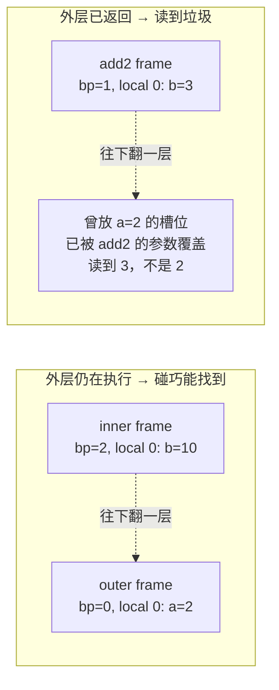
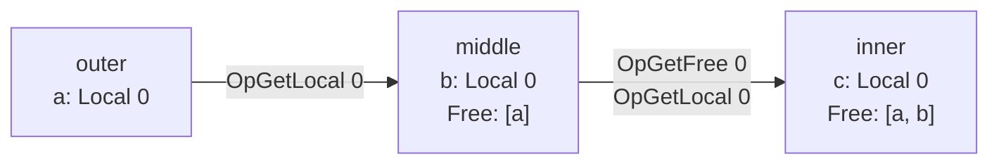
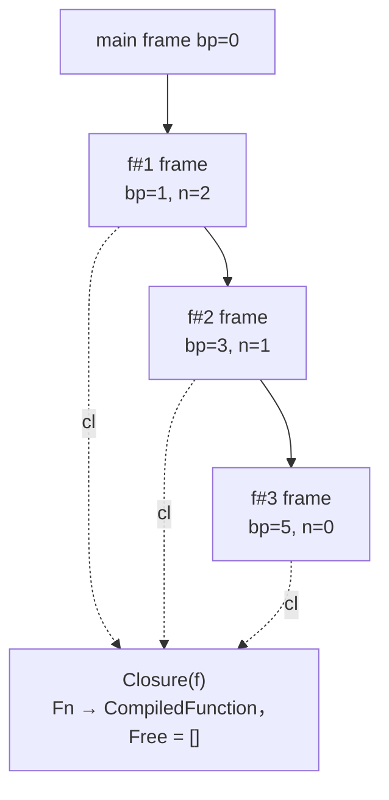

# 09 闭包、递归与集合扩展

## 本章要回答的问题

`fn(a) { fn(b) { a + b } }` 里内层函数用到了 `a`。但 `a` 不是内层的参数、不是内层的局部变量、也不是全局变量——它属于外层函数。这样的名字叫 **free variable**（自由变量）。

三个问题串在一起：VM 执行内层函数时 `a` 在哪，为什么不能"去外层栈帧里拿"？编译期怎么识别 free 变量，又怎么把信息传给 VM？以及 `let f = fn(n){ f(n-1) }` 里 `f` 引用自己，而编译函数体时 `f` 还不存在，递归怎么办？

前两个的答案是 `Closure` 对象和符号表的 `FreeScope`，第三个是一条专门的指令 `OpCurrentClosure`。最后补上数组、哈希、索引和 `while` 的编译——它们比闭包简单得多。

## 1. 为什么栈上找不到

先看一个造成错觉的例子。假设 VM 沿 `basePointer` 往下翻一层去读 `a`：`fn(a) { fn(b) { a + b }(10) }(2)` 里外层还没返回内层就被调用，栈上确实同时存在两个 frame，`a` 就在外层的 local 槽 0，往下翻一层能找到。换成真正的闭包用法，这个思路立刻崩掉：

```monkey
let newAdder = fn(a) { fn(b) { a + b } };
let add2 = newAdder(2);
add2(3);
```

`newAdder(2)` **已经返回了**。它的 frame 被弹出，`sp` 退回调用前的位置，那块栈空间随后被覆盖：



**free 变量的生命周期比它所在的 frame 长。** 栈的规则是"弹出即失效"，闭包要求某些值在创建它的调用返回之后继续存活。两者根本不兼容，所以 free 变量**必须在闭包创建时被复制到一个能独立存活的地方**——`Closure.Free`。

## 2. 闭包 = 代码 + 捕获的值

```go
type CompiledFunction struct {
    Instructions  code.Instructions
    NumLocals     int
    NumParameters int
}

type Closure struct {
    Fn   *CompiledFunction
    Free []Object
}
```

`CompiledFunction` 是**编译产物**，放在常量池里，运行期不变——同一个 `fn(b){a+b}` 无论被创建多少次，代码只有一份。`Closure` 是**运行时值**，每次执行 `OpClosure` 都新建一个，携带那一次捕获到的值：`newAdder(2)` 和 `newAdder(5)` 产生两个 `Closure`，`Fn` 指向同一个 `CompiledFunction`。**代码共享、环境独立**，这就是闭包。

对比 evaluator 的 `object.Function`（04 章），它持有 `Env *Environment`——**整条环境链的引用**，查找 `a` 时沿 `outer` 逐层做字符串 map 查询；VM 则在编译期就分析出"这个函数只用到 `a`"，运行时只复制一个值，用整数下标访问：

| | evaluator（`Function.Env`） | VM（`Closure.Free`） |
| --- | --- | --- |
| 捕获范围 | 整条环境链，含用不到的名字 | 只有真正引用的变量 |
| 访问方式 | 字符串 map 查找，逐层向外 | `Free[i]`，一次数组索引 |
| 捕获时机 | 保存引用，后续修改可见 | 复制值，创建时刻的快照 |
| 内存 | 外层环境整体无法回收 | 只留住被捕获的那几个值 |
| 分析在哪 | 无分析，全部推迟到运行期 | 编译期完成 |

**这是"编译期分析减少运行期开销"最干净的例子。** 名字到位置的映射本来每次执行都要重算，编译期算一次固化成索引，运行期只剩一次数组访问；compiler + VM 相对 evaluator 的性能优势基本都是这个模式的重复应用。最后一行的"复制值"是**语义差异**而非单纯性能差异，第 13 节陷阱 ⑦ 专门讨论。

## 3. 符号表的 free 变量解析

本章唯一给完整代码的地方——逻辑不长但极易写错，且错误症状出现在 VM（取到错误的值），排查路径很长。

```go
const (
    GlobalScope   SymbolScope = "GLOBAL"
    LocalScope    SymbolScope = "LOCAL"
    BuiltinScope  SymbolScope = "BUILTIN"
    FreeScope     SymbolScope = "FREE"
    FunctionScope SymbolScope = "FUNCTION"
)

type Symbol struct {
    Name  string
    Scope SymbolScope
    Index int
}

type SymbolTable struct {
    Outer          *SymbolTable
    FreeSymbols    []Symbol
    store          map[string]Symbol
    numDefinitions int
}
```

五种 scope 决定 compiler 发哪条 load 指令，`Index` 决定操作数：

| Scope | load 指令 | Index 的含义 |
| --- | --- | --- |
| `GlobalScope` | `OpGetGlobal`（2 字节） | globals 数组下标 |
| `LocalScope` | `OpGetLocal`（1 字节） | 相对 `basePointer` 的偏移 |
| `BuiltinScope` | `OpGetBuiltin`（1 字节） | 内置函数表下标 |
| `FreeScope` | `OpGetFree`（1 字节） | `Closure.Free` 下标 |
| `FunctionScope` | `OpCurrentClosure`（无操作数） | 不用 |

**符号表只回答"这个名字在哪种位置的第几号"，不生成指令。** 守住这个边界，它就能单独测试。`FreeSymbols` 导出因为 compiler 要读它；它记录的是**外层视角的原始符号**（`a` 在外层是 `LocalScope` 索引 0），不是本层的 free 符号。这个区分是理解下面代码的关键：`FreeSymbols[i]` 告诉外层"去哪儿取值"，`Resolve` 的返回值告诉本层"取回来后放在 `Free` 的第几格"。

```go
func (s *SymbolTable) defineFree(original Symbol) Symbol {
    s.FreeSymbols = append(s.FreeSymbols, original)

    symbol := Symbol{
        Name:  original.Name,
        Scope: FreeScope,
        Index: len(s.FreeSymbols) - 1,
    }
    s.store[original.Name] = symbol
    return symbol
}

func (s *SymbolTable) Resolve(name string) (Symbol, bool) {
    obj, ok := s.store[name]
    if ok {
        return obj, true                          // ① 本层命中，天然实现遮蔽
    }
    if s.Outer == nil {
        return obj, false                         // ② 全局层都没有 → 未定义变量
    }

    obj, ok = s.Outer.Resolve(name)               // ③ 递归查外层
    if !ok {
        return obj, false
    }

    if obj.Scope == GlobalScope || obj.Scope == BuiltinScope {
        return obj, true                          // ④ 不需要捕获，直接返回
    }

    return s.defineFree(obj), true                // ⑤ Local 或 Free → 捕获
}
```

**③ 是递归而不是循环**，这让"中间层也登记 free"自动发生，是第 4 节能正确工作的原因。

**④ 是最容易漏的一行。** 全局变量存在独立的 `globals` 数组里，跟栈无关，任何深度的函数都能用 `OpGetGlobal` 直接寻址；内置函数是编译期固定的表。**它们不需要捕获，捕获了反而是错的**——`OpClosure` 会多要几个 free 值，操作数个数和 compiler 发出的 load 指令数量对不上，栈就乱了。**⑤ 里 `obj.Scope == FreeScope` 就是多层嵌套的情况**：外层自己也是靠捕获拿到这个名字的，本层要再捕获一次。

`defineFree` 里 `s.store[original.Name] = symbol` 是**缓存**：同一个 free 变量被引用两次时第二次直接命中，不重复 append。少了这行，`fn(a){ fn(){ a + a } }` 会捕获 `a` 两次——不算错，但浪费，且让测试的期望值难写。

### 隐式契约：`FreeSymbols` 的顺序

**`FreeSymbols` 的下标就是运行时 `Closure.Free` 的下标**，`FreeSymbols[0] = {a,Local,0}` 对应 `Free[0]`，`OpGetFree 0` 取到 `a`。这是 compiler 与 VM 之间唯一没有类型系统保护的约定：`Index: len(s.FreeSymbols) - 1` 这个赋值，和第 5 节"按 `FreeSymbols` 顺序逐个发 load 指令"那个循环，必须严格同向。**顺序错了没有任何报错**，只是值调换——`fn(a){fn(b){a-b}}` 算出 `b-a`。用 `+` 测试还会通过，这是最坏的情况。

## 4. 多层嵌套：free 变量逐层传递

```monkey
fn(a) { fn(b) { fn(c) { a + b + c } } }
```

最内层用到 `a`，而 `a` 定义在两层之外。常见的错误直觉是"最内层直接从最外层捕获"——**做不到**。最内层的闭包是在中间层执行时创建的，那一刻最外层的 frame 可能早就没了。所以 `a` 必须**在中间层也被登记为 free**：中间层先捕获 `a`，才有能力在创建最内层闭包时把 `a` 压到栈上。`Resolve` 的递归让这自动发生：

```text
inner.Resolve("a")
  本层没有 → middle.Resolve("a")
      本层没有 → outer.Resolve("a") → 命中 {a, Local, 0}
      不是 Global/Builtin → middle.defineFree({a, Local, 0})
          middle.FreeSymbols += {a, Local, 0}，返回 {a, Free, 0}
  不是 Global/Builtin → inner.defineFree({a, Free, 0})
      inner.FreeSymbols += {a, Free, 0}，返回 {a, Free, 0}
```

**递归返回的路上，每一层都调用了自己的 `defineFree`**——中间层原本不需要 `a`，因为最内层要用，它也被迫捕获了一次。

| 层 | 参数 | `FreeSymbols` | 创建下层闭包时发的指令 |
| --- | --- | --- | --- |
| outer `fn(a)` | `a` → Local 0 | 空 | `OpGetLocal 0`，`OpClosure <middle> 1` |
| middle `fn(b)` | `b` → Local 0 | `[{a, Local, 0}]` | `OpGetFree 0`、`OpGetLocal 0`，`OpClosure <inner> 2` |
| inner `fn(c)` | `c` → Local 0 | `[{a, Free, 0}, {b, Local, 1}]` | 无嵌套函数 |



中间层加载 `a` 用的是 `OpGetFree 0` 而不是 `OpGetLocal`——因为对中间层来说 `a` 本身也是捕获来的，`FreeSymbols` 里存的**原始 scope** 就是用来决定这条指令的。值一层层往下搬，**每一层都是一次值拷贝**，没有任何指针链——和 evaluator 的 `Env.outer` 链条恰好相反。

## 5. Compiler 侧

你的节点是 [ast.go:335](../ast/ast.go#L335)，注意 `Parameters` 和 `Body` 都是**值**而非指针。编译步骤，**顺序不能动**：

```go
case *ast.FunctionExpression:
    c.enterScope()

    // TODO: 若这个函数是 let 的右值，先 DefineFunctionName(name)（第 7 节）
    // TODO: 按声明顺序 Define 每个 node.Parameters —— 索引 0..n-1 必须和调用方压栈顺序一致
    // TODO: 编译 &node.Body
    // TODO: 隐式返回 —— 末尾若是 OpPop 就替换成 OpReturnValue；空函数体补 OpReturn

    freeSymbols := c.symbolTable.FreeSymbols        // ← 必须在 leaveScope 之前
    numLocals := c.symbolTable.numDefinitions       // ← 同上
    instructions := c.leaveScope()

    for _, s := range freeSymbols {
        c.loadSymbol(s)          // 在外层作用域里加载它的当前值，压栈
    }

    fn := &object.CompiledFunction{
        Instructions:  instructions,
        NumLocals:     numLocals,
        NumParameters: len(node.Parameters),
    }
    c.emit(code.OpClosure, c.addConstant(fn), len(freeSymbols))

func (c *Compiler) loadSymbol(s Symbol) {
    switch s.Scope {
    case GlobalScope:   c.emit(code.OpGetGlobal, s.Index)
    case LocalScope:    c.emit(code.OpGetLocal, s.Index)
    case BuiltinScope:  c.emit(code.OpGetBuiltin, s.Index)
    case FreeScope:     c.emit(code.OpGetFree, s.Index)
    case FunctionScope: c.emit(code.OpCurrentClosure)
    }
}
```

**① `freeSymbols` 必须在 `leaveScope` 之前取出。** `leaveScope` 把 `c.symbolTable` 换回 `Outer`，之后读到的是**外层的** free 列表。症状是 `OpClosure` 的第二个操作数变成 0，而函数体里仍有 `OpGetFree`——VM 访问 `Free[0]` 越界 panic。`numDefinitions` 同理。**记法：`leaveScope()` 是一道门，门里的信息都要在跨过之前取走。**

**② `loadSymbol` 循环写在 `leaveScope()` 之后不是笔误。** 它发出的指令属于**外层**函数的指令流：`OpGetLocal 0` 加载外层的局部变量 `a`，压到外层执行时的栈上，紧接着被 `OpClosure` 消费掉。`loadSymbol` 同时服务两个场景——编译 `*ast.Identifier` 时加载变量，和这里加载要捕获的值——两者都是"把某个符号的值压栈"，共用一个函数是对的。

**③ 顺序是"先压 free 值，再发 `OpClosure`"**，和函数调用的约定一致：操作数先上栈，指令后执行。`OpClosure` 的两个操作数是常量索引（2 字节，常量池可能很大）和 free 变量个数（1 字节，255 个够用）。

## 6. VM 侧：三条指令

```go
case code.OpClosure:
    constIndex := code.ReadUint16(ins[ip+1:])
    numFree := code.ReadUint8(ins[ip+3:])
    vm.currentFrame().ip += 3                    // 2 + 1 字节操作数

    // TODO: 取 vm.constants[constIndex]，断言成 *object.CompiledFunction
    //       不是函数就返回错误（说明 compiler 发错了常量索引）

    free := make([]object.Object, numFree)
    for i := 0; i < int(numFree); i++ {
        free[i] = vm.stack[vm.sp-int(numFree)+i]
    }
    vm.sp = vm.sp - int(numFree)                 // ← 清理：free 值已复制走

    return vm.push(&object.Closure{Fn: fn, Free: free})

case code.OpGetFree:
    freeIndex := code.ReadUint8(ins[ip+1:])
    vm.currentFrame().ip += 1
    return vm.push(vm.currentFrame().cl.Free[freeIndex])

case code.OpCurrentClosure:
    return vm.push(vm.currentFrame().cl)
```

下标计算：`sp` 指向"下一个可写位置"，栈顶是 `stack[sp-1]`，N 个 free 值占据 `[sp-N, sp)`，第 `i` 个（按压栈顺序）在 `sp-N+i`。**先压的在低位，`Free[0]` 对应第一个被压入的值**——正是 `FreeSymbols[0]`。`vm.sp = vm.sp - numFree` 不能忘：free 值已被复制进 `Closure`，栈上的副本是垃圾，不清理会让栈缓慢增长、`OpPop` 的平衡被破坏，然后在某个完全无关的地方读到错误值——**现场离原因很远**。按 00 章第 5 节的不变量，每条指令前后 `sp` 的变化必须等于该 opcode 声明的栈效果；`OpClosure` 是 `[free_0..free_{N-1}] → [closure]`，净变化 `1-N`。

后两条要求 `Frame` 持有 closure 而不是 `CompiledFunction`：

```go
type Frame struct {
    cl          *object.Closure   // 原来是 fn *object.CompiledFunction
    ip          int
    basePointer int
}

// OpCall 里因此只需处理一种 callee：
cl, ok := vm.stack[vm.sp-1-numArgs].(*object.Closure)
if !ok {
    return fmt.Errorf("calling non-function")
}
```

`frame.Instructions()` 随之变成 `f.cl.Fn.Instructions`。这次改动机械但覆盖面广，牵动 `NewFrame`、`OpCall`、`OpReturnValue` 和 VM 初始化——**主程序也要包一层 closure**，因为主 frame 也是 frame。

**所有函数都是闭包**：即使没有 free 变量也发 `OpClosure <fnIdx> 0` 而不是 `OpConstant <fnIdx>`。代价是一条指令多两字节、多一个 `Free` 为空的包装对象；收益是上面那个类型断言只有一条路径。保留两种表示的话，`OpCall` 要分支，`OpGetFree` 要判断当前 frame 是闭包还是裸函数，`Frame.cl` 的类型还得是接口。**用统一表示换实现简单**——这个取舍在 VM 设计里反复出现，记住它的形状：**当两种情况中有一种是另一种的特例时，把特例也表示成一般情况，然后只写一条路径。**

## 7. 递归：为什么需要一条专门的指令

```monkey
let f = fn(n) { if (n < 1) { 0 } else { f(n - 1) } };
```

`let` 的自然编译顺序是"先编译右值，再 `Define` 名字"，这有道理：`let x = x + 1` 里右边的 `x` 应该指外层那个 `x`。但对递归来说，它意味着**编译函数体时 `f` 还没 `Define`**，`Resolve("f")` 失败，报 undefined variable。

### 为什么"先 Define 再编译右值"不是答案

**① 全局层碰巧能工作，局部层不行。** 全局的 `f` 解析成 `{f, Global, 0}`，函数体发 `OpGetGlobal 0`；这条指令在**调用时**执行，那时 `OpSetGlobal 0` 早跑完了，取到正确的值。换成局部递归函数：

```monkey
let wrapper = fn() {
    let inner = fn(n) { if (n < 1) { 0 } else { inner(n - 1) } };
    inner(5)
};
```

`inner` 在 `wrapper` 内是 `LocalScope`。函数体引用 `inner` → 跨了一层作用域 → `Resolve` 走到 `defineFree` → **`inner` 成了自己的 free 变量**。于是创建 `inner` 的闭包时要先 `OpGetLocal <inner的槽位>` 把它的当前值压栈——**而那一刻 `inner` 的 `OpSetLocal` 还没执行**，槽位里是 `Null`，调用时报 "calling non-function"。**这是时序问题，不是解析问题**：绑定在 `OpClosure` 之后才完成，而捕获发生在 `OpClosure` 之前，调整 Define 顺序改变不了这个先后关系。

**② `let x = x;` 会引用未初始化的自己。** 提升之后它能通过编译，运行时读到 `Null`——一个本该被拒绝的程序悄悄跑起来了。拒绝比返回 `Null` 好。

### `OpCurrentClosure` 的解法

换个角度：函数递归调用自己时，它需要的**就是当前正在执行的这个 closure**。VM 手里已经有它了——`vm.currentFrame().cl`。不需要查找，不需要捕获，不需要等任何绑定完成。

```go
func (s *SymbolTable) DefineFunctionName(name string) Symbol {
    symbol := Symbol{Name: name, Index: 0, Scope: FunctionScope}
    s.store[name] = symbol
    return symbol
}

// 编译 FunctionExpression 时，enterScope 之后立刻：
if name != "" {                          // name 由 let 传下来
    c.symbolTable.DefineFunctionName(name)
}
```

`Index` 永远是 0（`OpCurrentClosure` 没有操作数），也**不增加 `numDefinitions`**——它不占局部变量槽位。compiler 在 `LetStatement` 里改成先 `Define`，配合上面这段。

关键在于 `DefineFunctionName` 把 `f` 登记在**函数自己的作用域里**：函数体解析 `f` 时第一步就在本层 `store` 命中，**根本不会递归到 `Outer`**，所以永远不会被 `defineFree` 捕获。外层那个"先 Define"的 `f` 只在函数体之外用得到（比如 `f(2)` 这个调用点）。两件事各管一段，时序问题消失了——因为 `OpCurrentClosure` 不读任何绑定。`ast.FunctionExpression` 不带名字，所以名字要从 `LetStatement` 传下去；加一个内部辅助 `compileFunction(node, name string)` 比在 compiler 上放临时字段干净，AST 也不用改。

### 完整编译结果

`let f = fn(n){ if (n<1) {0} else { f(n-1) } }; f(2);` 常量池：`0:1`、`1:0`、`2:1`、`3:CompiledFunction f (NumLocals=1, NumParameters=1)`、`4:2`。

```text
函数 f：                                        主程序：
0000 OpGetLocal 0        n                     0000 OpClosure 3 0   ← 0 个 free 变量！
0002 OpConstant 0        1                     0004 OpSetGlobal 0     递归没有捕获
0005 OpGreaterThan       1 > n （见下）         0007 OpGetGlobal 0
0006 OpJumpNotTruthy 0015                      0010 OpConstant 4    2
0009 OpConstant 1        0                     0013 OpCall 1
0012 OpJump 0024                               0015 OpPop
0015 OpCurrentClosure    ← else：把自己压栈
0016 OpGetLocal 0        n
0018 OpConstant 2        1
0021 OpSub               n - 1
0022 OpCall 1            调用自己
0024 OpReturnValue
```

（`n < 1` 由 compiler 交换操作数、复用 `OpGreaterThan` 实现，见 07 章。）

**`OpClosure 3 0` 的第二个操作数是 0**，这是方案正确性的直接证据。如果你的实现输出 `OpClosure 3 1`，说明 `f` 被误判成了 free 变量，`DefineFunctionName` 没生效或调用位置不对。**这个断言值得写成测试**，它精确区分两种实现。（若你的 06 章保留了 `OpLessThan`，把 `OpGreaterThan` 那行按自己的约定改，跳转地址随之偏移。）

## 8. 手算 trace 一：`newAdder`

```monkey
let newAdder = fn(a) { fn(b) { a + b } };
let add2 = newAdder(2);
add2(3);
```

常量池：`0:CompiledFunction inner`、`1:CompiledFunction outer`（两者 `NumLocals=1, NumParameters=1`）、`2:2`、`3:3`。**inner 先进常量池**——编译 outer 的函数体时才遇到 inner，而 outer 的常量要等它整个编译完才能加。

```text
inner fn(b){a+b}，FreeSymbols = [{a, Local, 0}]：
0000 OpGetFree 0        a  ← 从 Closure.Free[0] 取
0002 OpGetLocal 0       b  ← 从栈上取（相对 basePointer）
0004 OpAdd
0005 OpReturnValue

outer，FreeSymbols 为空：
0000 OpGetLocal 0       压入 a（外层的局部变量）
0002 OpClosure 0 1      取常量 0(inner)，弹 1 个 free 值，压 Closure
0006 OpReturnValue

主程序：
0000 OpClosure 1 0      outer 自己没有 free 变量
0004 OpSetGlobal 0      newAdder
0007 OpGetGlobal 0
0010 OpConstant 2       2
0013 OpCall 1
0015 OpSetGlobal 1      add2
0018 OpGetGlobal 1
0021 OpConstant 3       3
0024 OpCall 1
0026 OpPop
```

inner 里**两种加载指令并存**，这是闭包编译的标志性形状。执行 trace，`[...]` 是栈（左为栈底）：

```text
步 指令              栈                                frame / 说明
 1-4 OpClosure 1 0 / OpSetGlobal 0 / OpGetGlobal 0 / OpConstant 2
                     [Cl(outer,[]), 2]                 globals[0]=Cl(outer,[])；
                     OpClosure 的 numFree=0，不从栈上取值，sp 不减
 5 OpCall 1          [Cl(outer,[]), 2]                 push frame(outer)；
                     bp = sp-1 = 1（指向实参 2）；sp = bp + NumLocals = 2
   ── 进入 outer，栈槽 1 就是参数 a，值 2 ──
 6 OpGetLocal 0      [Cl(outer,[]), 2, 2]              读 stack[bp+0] = 2
 7 OpClosure 0 1     [Cl(outer,[]), 2, Cl(inner,[2])]
                     ★ a 的值 2 在此刻被复制进 Free[0]：free[0]=stack[sp-1]=2；
                       sp -= 1；再 push closure
 8 OpReturnValue     [Cl(inner,[2])]                   pop frame(outer)；返回值先
                     取出，sp = bp-1 = 0，再 push 返回值
   ── ★ outer 的 frame 已消失，栈槽 1 不再属于任何人。
        但 Cl(inner).Free[0]=2 是独立的一份拷贝，安然无恙 ──
 9-11 OpSetGlobal 1 / OpGetGlobal 1 / OpConstant 3
                     [Cl(inner,[2]), 3]                globals[1]=Cl(inner,[2])
12 OpCall 1          [Cl(inner,[2]), 3]                push frame(inner)；bp=1, sp=2
   ── ★ 栈槽 1 现在放的是 add2 的参数 b=3，正是第 6 步 a 待过的位置。
        当初不复制，下一步就读到 3 ──
13 OpGetFree 0       [Cl, 3, 2]                        从 Free[0] 取 a=2
14 OpGetLocal 0      [Cl, 3, 2, 3]                     从 stack[bp+0] 取 b=3
15-17 OpAdd / OpReturnValue / OpPop
                     []                                pop frame(inner)；
                                                       LastPopped = 5
```

第 12 步与第 6 步的对照是整章的核心：**同一个栈槽，先放 `a=2`，后放 `b=3`。** 靠"沿 basePointer 往下找"实现 free 变量，第 13 步会读到 3，`add2(3)` 返回 6——**而且不会报错**。

## 9. 手算 trace 二：递归

`let f = fn(n) { if (n < 1) { 0 } else { f(n - 1) } }; f(2);` 指令见第 7 节，这里只跟踪 frame 栈：

```text
步 指令               栈                       frame 栈（栈顶在左）
 1-4 建立并加载 f      [Cl(f), 2]               main   globals[0]=Cl(f)；OpClosure 3 0
 5 OpCall 1           [Cl(f), 2]               f#1 / main   bp=1, n=2
 6 OpCurrentClosure   [Cl(f), 2, Cl(f)]        f#1 / main   f#1: 2<1 为假，走 else
                      ★ 直接 push vm.currentFrame().cl，不查 globals、不读 Free
 7-8 OpGetLocal/OpSub [Cl(f), 2, Cl(f), 1]     f#1 / main   n-1 = 1
 9 OpCall 1           [Cl(f), 2, Cl(f), 1]     f#2 / f#1 / main   bp=3, sp=4
   ── ★ 两层递归共存：同一个 Closure 对象，两个独立 frame。f#1 的 n=2 在栈槽 1，
        f#2 的 n=1 在栈槽 3，互不干扰 ──
10-11 f#2 同样走 else，再次 OpCurrentClosure + OpCall
                      […, 0]                   f#3 / f#2 / f#1 / main   bp=5, n=0
12 OpConstant 1       […, 0]                   f#3 / …   f#3: 0<1 为真，走 then
13-15 三次 OpReturnValue 逐层弹 frame            main      每层都返回 0
16 OpPop              []                                  LastPopped = 0
```



**三个 frame 指向同一个 `Closure`。** 递归可行是因为每次调用有独立的 frame（独立的 `basePointer` 和 `ip`），而代码和捕获的值是共享的。这也解释了 `OpCurrentClosure` 为什么安全：它 push 的是共享的那部分，不涉及任何 per-call 状态。

## 10. 集合：数组、哈希、索引

**数组**（[ast.go:246](../ast/ast.go#L246) 的 `ast.Array{Token, Elements}`）：按源码顺序编译每个元素，然后 `OpArray <len(Elements)>`。VM 从 `stack[sp-N:sp]` 构造 `*object.Array`，`sp -= N`，push 数组——**和 `OpClosure` 完全同构的"收集 N 个 + 清理栈"模式**。操作数 2 字节，因为元素个数可能超过 255。**哈希**（[ast.go:270](../ast/ast.go#L270) 的 `ast.HashList{Token, Pairs}`）：按顺序编译 key、value 交替压栈，然后 `OpHash <2*len(Pairs)>`；操作数是**栈上元素个数**而非键值对数，这样 VM 不用乘法，直接 `for i := sp-N; i < sp; i += 2` 两两取。

哈希曾经有个必须先解决的问题：`Pairs` 是 `map[Expression]Expression`，Go 故意随机化 map 迭代顺序（11 章缺陷 9），于是 `{"a":1, "b":2}` 第一次编译得到常量池 `["a",1,"b",2]`，第二次可能是 `["b",2,"a",1]`。**常量池内容和指令序列都随机变化，compiler 测试根本写不出来**——断言常量池会跑 10 次过 6 次。而 VM 测试倒是能过（哈希本身无序，最终的 `object.Hash` 一样），**所以症状只出现在 compiler 测试上，而且是间歇性的**，很容易被误当成"测试写错了"。**这个问题现在已经解决**：`Pairs` 已经是有序切片 `[]HashPair`（[ast.go:275](../ast/ast.go#L275)），`String()` 稳定、编译输出确定，本章不再有这条前置依赖。

**索引**不是独立节点，而是 `ast.PostfixExpression`（[ast.go:388](../ast/ast.go#L388)）的一种，靠 `Operator.Type` 区分：

```go
case *ast.PostfixExpression:
    switch node.Operator.Type {
    case token.LEFT_PAREN:      // 调用
        // TODO: 编译 node.Left、每个 ValueList 元素，emit OpCall len(ValueList)
    case token.LEFT_BRACKET:    // 索引
        // TODO: 编译 node.Left、ValueList[0]，emit OpIndex
    }
```

`ValueList` 是切片，索引场景下正常只有一个元素。**多下标 `xs[1,2]` 要明确拒绝**（`len(ValueList) != 1` 时报编译错误），别默默取第一个——那样 `xs[1,2]` 会静默变成 `xs[1]`。

`OpIndex` 无操作数，栈效果 `[left, index] → [result]`。VM 按类型分派：Array+Integer 取元素、Hash+Hashable 取值、String+Integer 取字符（若 evaluator 支持），其他类型报错。**越界和键不存在都返回 `Null`，不报错**——00 章第 4 节的契约定了这条，两条路径都要照办；负索引同样返回 `Null`。哈希的键必须是 `Hashable`，你扩展的 Float 作键要注意 `0.1+0.2` 那类浮点相等问题。

## 11. `while` 的编译

`ast.WhileStatement`（[ast.go:160](../ast/ast.go#L160)）是**语句**，不产生值。

```text
conditionPos := len(instructions)      ← 先记下条件的起始地址
编译 Condition
OpJumpNotTruthy <退出地址>              ← 占位，稍后回填
编译 Body（块里每个表达式语句后跟 OpPop）
OpJump conditionPos                    ← 回跳，地址已知，无需回填
回填 OpJumpNotTruthy 的操作数为当前位置
```

**回跳目标是 `conditionPos`，不是 body 的起始地址。** 跳到 body 起始，条件就再也不会被检查，`while` 变成死循环。症状很明确（CPU 100%），但如果测试里的循环恰好只该执行一次，可能侥幸通过。`OpJumpNotTruthy` 的回填和 `if` 用同一套 backpatching（07 章），区别是 `while` 多一条**向后**的 `OpJump`，它的目标在发出时已知。

**栈平衡**：`while` 编译完栈净增 0。条件的值被 `OpJumpNotTruthy` 消费掉（它弹栈），不用额外 `OpPop`；body 里每个表达式语句后要有 `OpPop`，否则每轮涨一格，循环一万次就留一万个残留值；`while` 整体不留值、也不 push `Null`。最后一条要和 evaluator 对齐：`Eval(WhileStatement)` 返回什么不重要（通常 `NULL`），但**调用方必须忽略它**，不能让它变成块的值，否则 `fn(){ while(...){}; }` 两条路径的返回值不一致。另一个容易忽略的交互：body 里的 `return` 要能穿透循环。VM 天然正确（`OpReturnValue` 直接弹 frame，不管嵌套多深），evaluator 需要 `ReturnValue` 包装器逐层传播。

## 12. 内置函数

内置函数表**用切片而不是 map**，因为索引必须稳定——`OpGetBuiltin 0` 在编译期和运行期必须指向同一个函数，map 没有顺序。符号表创建时预注册：`for i, v := range object.Builtins { symbolTable.DefineBuiltin(i, v.Name) }`，显式传索引，登记在**全局符号表**里。

**为什么 builtin 不需要捕获**：它们在编译期就是一张固定表，索引在整个程序生命周期不变，运行时 `object.Builtins[i]` 直接取。跟栈无关、跟 frame 无关、跟作用域深度无关——任何深度的嵌套函数都能用同一个 `OpGetBuiltin i` 拿到它。这正是第 3 节 `Resolve` 里 `BuiltinScope` 要提前返回的原因，和 `GlobalScope` 同理。

`OpCall` 要处理 `*object.Builtin`：不创建 frame，直接调用 Go 函数，结果 push 回栈。这是 `OpCall` 唯一必须分两支的地方（第 6 节说"只有一条路径"指的是函数那一支）。

## 13. 边界与陷阱

**① `FreeSymbols` 顺序与 `Closure.Free` 顺序不一致。** 本章最隐蔽的错误。compiler 按 `FreeSymbols` 顺序发 load 指令，VM 按压栈顺序填 `Free`，两者必须同向；若你在某处排序、去重或反向遍历，值就调换了。**用 `+` 测试发现不了**（加法交换律），必须用非交换运算：`fn(a){fn(b){a-b}}(10)(3)` 必须是 7 而不是 -7。这是这类错误的最短检测器。

**② `leaveScope` 之后才取 `FreeSymbols`。** 拿到的是外层的列表（通常为空）。症状：`OpClosure` 的 free 个数为 0 但函数体里有 `OpGetFree`，VM 访问 `Free[0]` 越界 panic。`numDefinitions` 同理。

**③ 多层嵌套忘记逐层传递。** 若 `Resolve` 用循环向外查找而非递归，中间层不会登记 free，`a` 从最外层"直接跳"到最内层——而创建最内层闭包时中间层根本没有 `a` 可加载。症状是 compiler 发出外层的 `OpGetLocal`，在中间层的 frame 里读到无关槽位。**测试必须覆盖三层**，两层的用例发现不了。

**④ 递归用捕获而非 `OpCurrentClosure`。** 局部递归函数捕获到 `Null`，报 "calling non-function"。诊断：反汇编看 `OpClosure` 的第二个操作数是不是 0。

**⑤ `OpClosure` 后忘记清理栈上的 free 值。** 栈缓慢增长，最终在无关的地方读到错误值或栈溢出。**防御**：VM 测试里断言每个顶层语句执行完 `vm.sp == 0`。这一条断言能抓住所有 opcode 的栈效果错误，不只 `OpClosure`。

**⑥ Global 被误判为 free。** `Resolve` 里漏了提前返回那一行。测试 `let g = 50; let f = fn(){ g }; f();`，断言 `OpClosure <idx> 0`（不是 1），且函数体里是 `OpGetGlobal 0`（不是 `OpGetFree 0`）。

**⑦ free 变量是值拷贝——语义差异。** 唯一一条不是 bug 而是**设计决定**的陷阱。经典的循环捕获：`while (i < 3) { fns = push(fns, fn(){ i }); i = i + 1; }`，然后取 `fns[0]()`。这里 `i` 是**全局变量**，三个闭包都发 `OpGetGlobal 0` 读同一个槽位，全部返回循环结束后的 `3`，跟 JavaScript 的 `var` 一致。把整段包进 `fn(){ ... }()` 让 `i` 变成 `LocalScope`，行为就分道扬镳：内层捕获它 → `OpClosure` 前发 `OpGetLocal`，**把 `i` 当时的值复制进 `Free[0]`**，三个闭包各自捕获 0、1、2，`fns[0]()` 返回 **0**。**而 evaluator 返回 3**，因为 `Function.Env` 持有环境的**引用**，`i = i + 1` 修改的是同一个绑定。

**两条路径不一致**，违反 00 章第 4 节的核心约束。三个选项：**接受差异**（写进契约表并注明"捕获局部变量按值"，差分测试排除这类程序）；**让 evaluator 也按值捕获**（创建 `Function` 时快照用到的自由变量，需要一次自由变量分析）；**让 VM 按引用捕获**（free 变量存 cell，`Closure.Free []*Cell`，加一条 `OpSetFree`——Lua upvalue 和 JS 引擎的做法）。**最省事的是第一种，最正确的是第三种。** 书上不讨论这个问题，因为原版 Monkey 没有赋值语句——不能修改变量，值拷贝和引用就没区别。**你加了 `ast.AssignmentStatement`（[ast.go:143](../ast/ast.go#L143)），所以这是你独有的问题。** 若选第一种，让"赋值给 free 变量"变成编译错误而非静默做错事。

**⑧ 哈希 map 顺序导致测试不稳定。** 见第 10 节，11 章缺陷 9 已修（`Pairs` 现为有序切片），这个坑不会再出现。识别特征（历史参考）：compiler 测试**间歇性**失败，重跑有时过。

**⑨ 主 frame 也要包 closure。** 改 `Frame.cl` 后 VM 初始化要 `&object.Closure{Fn: mainFn}`。忘了会在 `NewVM` 就 panic，好在立刻暴露。

**⑩ `while` 回跳目标错。** 死循环。**给 VM 测试加超时**（`go test -timeout 30s`），否则 CI 挂住而不是报错。

## 14. 验收测试清单

```go
// compiler/symbol_table_test.go —— 先把符号表测绿再写 compiler，
// free 解析的 bug 在这一层最容易定位
func TestResolveFree(t *testing.T) {
    global := NewSymbolTable(); global.Define("a")
    first := NewEnclosedSymbolTable(global); first.Define("c")
    second := NewEnclosedSymbolTable(first); second.Define("e")
    // first  层  a→{Global,0}（不捕获）、c→{Local,0}     FreeSymbols = []
    // second 层  a→{Global,0}、c→{Free,0}、e→{Local,0}  FreeSymbols = [{c,Local,0}]
    //            ← FreeSymbols 存原始 scope，供外层加载
    // TODO: 表驱动，Resolve 每个名字断言 Symbol 完全相等
    // TODO: 断言 FreeSymbols 的长度、逐个元素以及顺序
}
// 还必须覆盖：单层 fn(a){fn(){a}} → [{a,Local,0}]；三层 fn(a){fn(b){fn(){a+b}}} →
// 中间层 [{a,Local,0}]、最内层 [{a,Free,0},{b,Local,1}]；global（let g=1）与
// builtin（len）两层 FreeSymbols 都为空；遮蔽 fn(a){fn(a){a}} 内层是 Local；
// 重复引用 fn(a){fn(){a+a}} 长度为 1；顺序 fn(a){fn(b){fn(){b-a}}} 最内层按首次
// 引用为 [b,a]（这条确认 defineFree 的 append 时机）；DefineFunctionName("f") →
// {f,Function,0} 且不增加 numDefinitions
```

```go
// compiler/compiler_test.go —— 输入 `fn(a) { fn(b) { a + b } };` 的期望：
//   常量 0 (inner，先进池)  OpGetFree 0 / OpGetLocal 0 / OpAdd / OpReturnValue
//   常量 1 (outer)          OpGetLocal 0 / OpClosure 0 1 ← 1 个 free / OpReturnValue
//   主程序                  OpClosure 1 0 ← outer 0 个 free / OpPop
func TestClosureCompilation(t *testing.T) {
    tests := []compilerTestCase{{
        input:             `fn(a) { fn(b) { a + b } };`,
        expectedConstants: []interface{}{ /* 两个 []code.Instructions，见上 */ },
        expectedInstructions: []code.Instructions{
            code.Make(code.OpClosure, 1, 0), code.Make(code.OpPop),
        },
    }}
    // TODO: 三层嵌套 —— 中间层是 OpGetFree 0 + OpGetLocal 0 + OpClosure x 2
    // TODO: global 不捕获 —— let g=1; fn(){fn(){g}} 两个 OpClosure 都是 0 个 free
    // TODO: 递归 —— 断言 OpCurrentClosure 出现，且 OpClosure 的 free 个数为 0
}

// compiler 的其余骨架：
// TestArrayLiterals      [];  [1,2,3];  [1+2, 3*4]     断言 OpArray 的操作数
// TestHashLiterals       {};  {1:2, 3:4}
// TestIndexExpressions   [1,2][0];  {1:2}[1]           断言 OpIndex
// TestWhileStatements    OpJump 的目标 == 条件起始（不是 body 起始）；body 里每个
//                        表达式语句后有 OpPop；while 后栈上不留值
// TestBuiltins           len([]);  push([],1)          断言 OpGetBuiltin 的索引
// TestLetStatementScopes 全局 / 函数内 local / 嵌套     OpSetGlobal vs OpSetLocal

// vm/vm_test.go
func TestClosures(t *testing.T) {
    tests := []vmTestCase{
        {`let n = fn(a){ fn(b){ a + b } }; let a2 = n(2); a2(3);`, 5},
        {`fn(a){ fn(b){ a - b } }(10)(3);`, 7},         // ← 顺序检测器，非交换运算
        {`fn(a){ fn(b){ fn(c){ a + b + c } } }(1)(2)(3);`, 6},
        {`fn(a){ fn(b){ fn(){ b - a } } }(1)(10)();`, 9},
        {`let g = 50; fn(){ fn(){ g } }()();`, 50},     // global 不捕获
        {`let newCounter = fn(){ let c = 0; fn(){ c = c + 1; c } };
          let c1 = newCounter(); c1(); c1();`, 2},      // 计数器：独立状态
    }
}
// TestRecursion       fact(5)==120；fib(15)==610；局部递归
//                     fn(){ let inner = fn(n){...inner...}; inner(5) }()
//                     相互递归 isEven/isOdd 互调，isEven(10)==true ← 它靠 global
//                     解析而非 OpCurrentClosure，验证第 7 节"全局层碰巧能工作"成立
// TestArrays/Hashes   [1+2,3*4][1]==12；{1:2,3:4}[1]==2；{1:2}[0]==Null
// TestIndexBounds     [1,2,3][5]==Null；[1,2,3][-1]==Null；[][0]==Null
// TestWhile           计数循环、条件一开始就假（body 不执行）、body 里 return
// TestBuiltins        len/first/last/rest/push 的正常值与错误参数
// TestStackDiscipline 每个用例执行完断言 vm.sp == 0 ← 抓所有栈效果错误，
//                     加进 runVmTests 辅助函数，是陷阱 ⑤ 的通用防御
```

**计数器那个用例会暴露陷阱 ⑦。** `c` 是 `newCounter` 的 local，被内层捕获；如果 free 是值拷贝，`c = c + 1` 修改的是什么？`OpSetFree` 存在吗？**这个用例逼你面对那个设计决定**，建议先跑它。

**差分测试**——闭包和递归的结果 evaluator 与 VM 必须一致。**断言 `Inspect()` 而不是对象相等**：两条路径产生不同的对象实例，`==` 只对 `Integer` 这类碰巧有效，对 `Array` 会比较指针。**不要**把陷阱 ⑦ 的循环捕获用例放进来，除非你已经把两条路径对齐了。

```go
func TestEvaluatorAndVMAgree(t *testing.T) {
    inputs := []string{
        `let n = fn(a){ fn(b){ a + b } }; n(2)(3);`,
        `fn(a){ fn(b){ a - b } }(10)(3);`,
        `fn(a){ fn(b){ fn(c){ a - b - c } } }(10)(3)(2);`,
        `let f = fn(n){ if (n < 2) { n } else { f(n-1) + f(n-2) } }; f(15);`,
        `let g = 50; fn(){ fn(){ g } }()();`,
        `let xs = [1,2,3]; let s = 0; let i = 0;
         while (i < 3) { s = s + xs[i]; i = i + 1; } s;`,
        `len([1,2,3]) + len("ab");`, `{"a": 1, "b": 2}["b"];`,
        `[1,2,3][10];`,                                 // 两边都该是 null
    }
    // TODO: 同一份 AST 分别喂 evaluator 和 compiler+VM
    // TODO: 断言 Inspect() 相同；一边报错另一边成功也算失败
}
```

## 15. 练习

**1. 验证 11 章缺陷 9 已修复。** `ast.HashList.Pairs` 现在是 `[]HashPair`，跑 20 次哈希编译测试确认输出稳定（这条不再是本章的前置修复工作，而是一条验证性练习）。

**2. 只写符号表。** 不碰 compiler，把 `FreeSymbols`、`defineFree`、`Resolve` 写完并用第 14 节的用例测绿。**这一步单独做完再往下**——符号表的 bug 混在 compiler 里会难查十倍。

**3. `Frame` 改持有 `Closure`。** 牵动 `NewFrame`、`OpCall`、VM 初始化。改完先让**已有的**函数测试全绿，再动闭包。

**4. 实现 `OpClosure` 和 `OpGetFree`。** 跑通 `newAdder`，反汇编输出和第 8 节逐项对照：常量池顺序、`OpClosure` 的操作数、`OpGetFree` 与 `OpGetLocal` 的混用。

**5. 三层嵌套。** `fn(a){fn(b){fn(c){a+b+c}}}(1)(2)(3)` 应为 6，再用 `a-b-c` 测一遍顺序。

**6. 实现 `OpCurrentClosure`。** 加 `FunctionScope`、`DefineFunctionName`，改 `LetStatement` 的编译顺序，给 `FunctionExpression` 传名字，断言 `OpClosure <idx> 0`。

**7. 故意制造陷阱 ① 和 ⑥。** 先把 `for _, s := range freeSymbols` 改成反向遍历，跑 `fn(a){fn(b){a-b}}(10)(3)`——**看到 -7 而不是崩溃**，体会这类 bug 的隐蔽程度。再删掉 `Resolve` 里 Global 提前返回那行，跑 `let g=50; fn(){fn(){g}}()();`，观察是崩溃、返回 `Null` 还是错误的值。**理解为什么那行不可省**，然后都改回来。

**8. 补齐集合与 while。** 索引要处理越界返回 `Null`，多下标要明确拒绝。

**9. 差分测试。** **必然会发现至少一处不一致**——大概率是循环捕获（陷阱 ⑦）或 `while` 的返回值。然后从陷阱 ⑦ 的三个选项里选一个实现，写进 00 章第 4 节的契约表；选"接受差异"也要显式写下来。

**10.（进阶）实现 cell 捕获。** `Closure.Free []*Cell` 加 `OpSetFree`。做完，计数器模式在两条路径上给出同一答案，局部循环捕获也和 evaluator 一致。**改动比想象的小**——难点在赋值语句的符号解析要能生成 `OpSetFree`。

**11.（进阶）尾调用优化。** 识别"`OpCall` 紧跟 `OpReturnValue`"这个模式，改成复用当前 frame（重置 `ip`、覆盖参数）而不是 push 新 frame，做完 `f(100000,1)` 不会栈溢出。**这是最有价值的进阶练习**，它让你真正理解 frame 的生命周期。

**12.（进阶）闭包转换。** 另一条路：编译前做一次 AST 变换，把嵌套函数提升到顶层，free 变量变成显式的额外参数，VM 完全不需要闭包概念。**想清楚为什么这个方案对"函数作为返回值"仍然需要某种运行时结构**——它消除的是词法嵌套，不是环境捕获。

**13.（进阶）反汇编显示 free 变量名。** 让 compiler 输出一份调试表（常量索引 → free 变量名），反汇编时打印 `OpClosure 0 1  ; free: [a]`。第 7 号练习会让你确信这个功能价值极高。

## 小结

- free variable 的生命周期**比所在 frame 长**，栈上放不住，所以必须在创建闭包时复制出来
- 闭包 = `CompiledFunction`（共享的代码）+ `Free []Object`（每次创建独立的捕获值）：**代码共享，环境独立**
- 对比 evaluator 的 `Function.Env`：VM 只复制真正用到的变量，用整数索引访问。**编译期分析换运行期速度**，这是 VM 全部优势的来源
- `Resolve` 四步：本层 → 外层递归 → **Global/Builtin 提前返回（不捕获）** → Local/Free 走 `defineFree`
- **`FreeSymbols` 的顺序就是 `Closure.Free` 的顺序**，compiler 与 VM 之间唯一没有类型保护的契约。用 `a - b` 而不是 `a + b` 测它
- free 变量**逐层传递**，中间层也会捕获；`Resolve` 的递归结构让这自动发生。`leaveScope` 是一道门，`FreeSymbols` 和 `numDefinitions` 必须在跨过之前取走
- **所有函数都是闭包**，哪怕 0 个 free 变量——用统一表示换 `OpCall` 只有一条路径
- 递归的困难是**时序**而非解析。`OpCurrentClosure` 绕开时序（push VM 手里已有的东西），`DefineFunctionName` 登记在函数自己的作用域里，所以自引用永远不会被 `defineFree` 捕获
- `OpClosure`、`OpArray`、`OpHash` 是同一个模式：**收集栈顶 N 个、清理栈、push 聚合对象**，`sp -= N` 三处都不能忘
- `while` 的回跳目标是**条件起始**而非 body 起始；它是语句，栈净增 0
- **你的赋值语句让"free 是值拷贝"变成一个真实的语义问题**（原版 Monkey 没有）。现在就在三个选项里做决定，并写进 00 章的契约表

闭包做完，两条执行路径的功能就对齐了。下一章把这个"对齐"变成可验证的：差分测试、分层定位、每个特性的回归清单。


