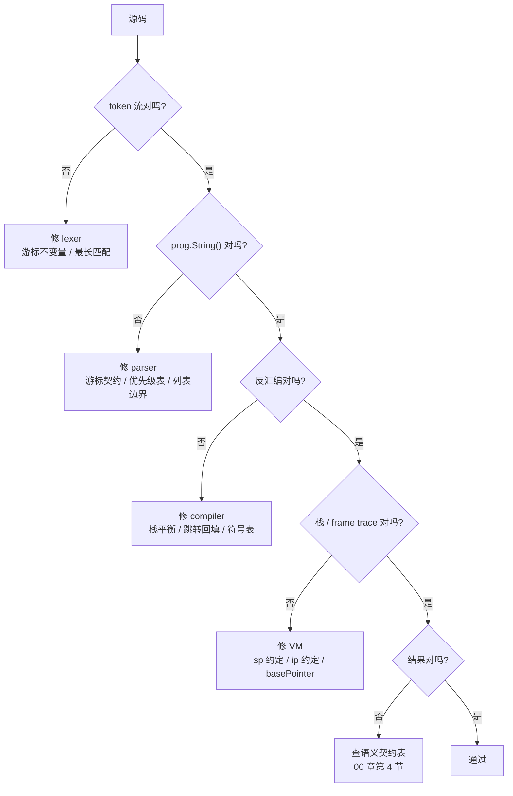

# 10 调试与验收：定位、差分与验证

## 本章要回答的问题

前面九章讲"怎么写"，这一章讲"写错了怎么找"——而这占据你实际时间的一半以上。

- 一个输入跑出错误结果，你有五层可以怀疑（token / AST / 指令 / 栈 / 结果）。**怎么在几分钟内确定是哪一层**，而不是来回猜？
- evaluator 已经跑通，VM 给出不同答案。你没有第三个实现当裁判。**怎么定位分叉点**？
- 12 个已知缺陷（11 章）里有 6 个是"parser 不报错，但 AST 是错的"。**这类静默错误怎么系统地发现**？

这一章不实现任何组件，它是**方法论 + 工具箱 + 检查清单**。11 章的 12 条缺陷是本章的素材库——那些缺陷不是靠读代码找到的，是靠本章的方法找到的。

## 1. 核心原则：第一个出错的层就是修复起点

管线是单向的，每层只吃上一层的输出。所以**一旦某层输出错了，它下游的所有层都会给出错误结果，而它们本身没有 bug**：



用法只有一个：**从上往下走，在第一个"否"处停下，修那一层。** 不跳步，不在下游修上游的问题。两条禁令，每次违反都会浪费一小时：

> **AST 错了不要去 VM 里修。** `xs[0]` 现在被解析成两个语句（[11 章缺陷 4](11-errata.md)）。不看 AST 就写 compiler，你会发现"索引编译不出来"，于是在 compiler 里特判"标识符后面跟着数组字面量"。特判让这个用例过了，但 `xs[0][1]`、`f(1)[0]` 依然坏，而且你种下了一段永远无法解释的代码。

> **跳转地址错了不要改 evaluator。** 两条路径不一致时，本能反应是"改一个让它们相等"。但 evaluator 是**参照实现**（00 章第 3 节）——更简单、更早写、被更多测试覆盖。默认假设 VM 错了；只有在契约表上确认 evaluator 违反了约定，才改它。

**症状消失不等于根因修好。** 这是在错误的层修 bug 的代价：你消掉了一个可观察症状，根因还在，等着以另一种形式出现在另一个用例上；而且此时你多了一段掩盖问题的代码，下次调试要先绕过它。判据很简单——**如果修复代码里出现了"如果上一层给我的是错的，我就……"这样的逻辑，你修错了层。**

## 2. 每层的观察工具

流程图要求你能回答"这一层的输出对吗"。回答不了，流程图就是废纸。**工具要在需要它之前就做好**——五层五个工具，每个几十行，一次投入全程受益：

### token 层：打印 token 流

格式 `类型/"字面量"/@位置`：

```text
LEX "ab"         -> [ident/"ab"/@0]
LEX "let a = 5"  -> [let/"let"/@0  ident/"a"/@0  =/"="/@6  int/"5"/@0]
```

三个字段都要打印，因为三类 bug 各自只体现在一个字段上：**字面量**错是游标不变量破了（[缺陷 1](11-errata.md) 让 `"ab"` 输出 `ident/"a"`）；**类型**错是关键字表或最长匹配错了；**位置**错是 `Pos` 赋值路径漏了（[附加观察 B](11-errata.md)：标识符和字面量的 `Pos` 恒为 0）。不打印位置，就永远不会注意到第三类。**工具的输出格式决定了你能看见哪些 bug。** REPL 是它最自然的宿主——[repl.go:29](../repl/repl.go#L29) 已经在打印 token，把 `%+v` 换成这个紧凑格式即可。

### AST 层：`prog.String()`

`String()` 是**规范化打印器**（02 章第 5 节）：显式加括号，消除空白和可选分号的差异。于是它把 AST 的形状压缩成一行可比较的字符串，一眼看出结合方式——`1 + 2 * 3;` 是 `(1+(2*3));`，`(1 + 2) * 3;` 是 `((1+2)*3);`。

**但它必须可信。现在它不可信**——三个缺陷同时坏在打印器上：

| 缺陷 | 症状 | 后果 |
| --- | --- | --- |
| [缺陷 7](11-errata.md) | `-5;` 打印成 `({- - %!s(int=0)}5);` | 前缀表达式完全没法读 |
| [缺陷 8](11-errata.md) | `if(a){1}else if(b){2}` 打印成 `if (a){1;}b){2;};` | 丢 `else if (`，像是 parser 丢了分支 |
| [缺陷 9](11-errata.md) | 同一份哈希输入，200 次跑出 3 种输出 | 断言 `String()` 的测试随机失败 |

**用一个坏掉的打印器调试，是本章最贵的陷阱。** 设想你在查 `else if` 的求值问题，`String()` 告诉你 AST 里少了 `else if`——你会去 parser 里找一个不存在的 bug。缺陷 8 实际上只是打印函数里 `i != len-1` 写错了，parser 建的树是对的。所以修复顺序是硬性的（[11 章建议的修复顺序](11-errata.md)第 3 步）：**先修 `String()`，再用它验证别的东西。** 验证 `String()` 自身只需三条手写断言（`{-5; → (-5);}`、`{1 + 2 * 3; → (1+(2*3));}`、`{if (a) { 1 } else if (b) { 2 }; → if (a){1;}else if (b){2;};}`），不依赖任何其他工具——**这是整个工具链的信任根。**

### parser 层：tracing

`String()` 告诉你结果错了，不告诉你**为什么**。优先级问题要看递归过程——`minBP` 怎么传下去、某个 token 在哪一轮被吸收。仓库里有现成实现可抄：[parser_tracing.go](../example/02/src/monkey/parser/parser_tracing.go) 三十行，一个缩进计数器加 `trace`/`untrace`，配 `defer` 用：

```go
defer untrace(trace(fmt.Sprintf("parseExpression(minBP=%d) cur=%s", minBP, p.curToken.Type)))
```

**关键是打印 `curToken` 和 `minBP`**——只打函数名的 trace 几乎没用。`a+b*c` 的输出：

```text
BEGIN parseExpression(minBP=0) cur=ident      → a
	BEGIN infix(+, rbp=51) cur=+
		BEGIN parseExpression(minBP=51) cur=ident  → b
			BEGIN infix(*, rbp=61) cur=*           ← 60 >= 51，被吸收
				BEGIN parseExpression(minBP=61)     → c
				END                                 ← ; 无 infix 角色，退出
		END parseExpression                        → (b*c)
END parseExpression                            → (a+(b*c))
```

缩进就是递归深度，`minBP` 的递增序列 `0 → 51 → 61` 就是 03 章第 2 节手算的那条链。**改一个 binding power 重跑，能立刻看到哪一层的判断翻转了。** tracing 默认关闭（包级 `bool` 或 build tag）。

### compiler 层：反汇编 + 常量池转储

反汇编不是附属品，是**验证 compiler 与 VM 契约的主要工具**（06 章）。偏移四位补齐，**必须带常量池转储**——否则 `OpConstant 2` 只是一个索引数字：

```text
=== Constants ===          === Instructions ===
0000  Integer(2)           0000  OpConstant 0        0007  OpConstant 2
0001  Integer(3)           0003  OpConstant 1        0010  OpAdd
0002  Integer(4)           0006  OpMul               0011  OpPop
```

三件事只能从这里看出来：**偏移的连续性**（`0000 → 0003` 说明 `OpConstant` 占 3 字节，跳转目标必须落在这些偏移上，落在 `0001` 就是指向操作数中间）；**`OpPop` 在不在**（表达式语句末尾必须有，07 章第 2 节的栈平衡不变量）；**常量池的内容和顺序**。跳转和全局变量最好带注释：`0003  OpJumpNotTruthy 0012` / `0000  OpGetGlobal 0  // a`。

### VM 层：每条指令前打印 ip / op / sp / 栈

VM 的状态是 `(ip, sp, stack, frames)`（08 章第 1 节）。取指-执行循环的**每一轮开头**打印一次：

```text
ip=0000  OpConstant 0     sp=0  stack=[]
ip=0003  OpConstant 1     sp=1  stack=[2]
ip=0006  OpMul            sp=2  stack=[2, 3]
ip=0007  OpConstant 2     sp=1  stack=[6]
ip=0010  OpAdd            sp=2  stack=[6, 4]
ip=0011  OpPop            sp=1  stack=[10]
```

**打印在执行之前**，于是每行的栈就是这条指令的输入，可以直接对照 opcode 声明的栈效果检查：`OpMul` 声明 `[left, right] → [result]`，所以下一行 `sp` 必须少 1。**任何一行不符，bug 就在那条指令的实现里。** 加入 frame 后再打 `bp` 和 `depth`——函数调用的 bug 几乎全部体现在这两个值上：

```text
ip=0000  OpCall 1       sp=3  bp=0  depth=1  stack=[fn, 5]
ip=0000  OpGetLocal 0   sp=2  bp=2  depth=2  stack=[fn, 5]      ← 新 frame，bp 指向参数区
ip=0009  OpReturnValue  sp=3  bp=2  depth=2  stack=[fn, 5, 25]
ip=0003  OpPop          sp=1  bp=0  depth=1  stack=[25]         ← fn 和参数都清掉了
```

最后一行是检查点。如果看到 `stack=[fn, 25]`，就是 08 章那个 `sp = basePointer - 1` 漏了 `-1`。

## 3. 手算优先于加日志

有了工具，很容易滑向一种低效模式：**到处加 print，然后盯着一屏输出找不对的地方。** 问题是"不对"需要一个参照——你盯着 `sp=2` 看不出它对不对，除非你知道它应该是几。

> **先在纸上写出期望的序列，再让程序输出同样的东西，逐行对比。第一处分叉就是 bug 位置。**

这不是"更严谨"，是**更快**——手算 `2 * 3 + 4` 只要两分钟，而它一次性给出四层的期望值：

```text
token   int/"2"/@0  */"*"/@2  int/"3"/@4  +/"+"/@6  int/"4"/@8  ;/";"/@9
AST     * 的 lbp=60 > + 的 lbp=50，所以 + 是树根 →  "((2*3)+4);"
指令    OpConstant 0 / OpConstant 1 / OpMul / OpConstant 2 / OpAdd / OpPop
栈      []  →  [2]  →  [2,3]  →  [6]  →  [6,4]  →  [10]  →  []
sp       0      1       2         1       2         1       0
```

现在跑一遍程序，四个工具各输出一次，逐行比。假设实际的栈序列最后一步是 `[10]` 而不是 `[]`——前六步全对，`sp` 没回到 0，**分叉点在 `OpPop`**。要么它没被发出（看反汇编，compiler 的问题），要么 VM 的 `OpPop` 没减 `sp`。两个候选，各看一眼就定。对比"到处加 print"：你会看到一长串栈状态，每一个看起来都合理，因为 `[10]` 单看没有任何问题。**只有和期望对比，才知道它多了一个值。**

这条纪律容易被违反，因为手算需要你**先想清楚正确行为是什么**，而加 print 不需要——加 print 有一种"在推进"的错觉。但如果你想不清楚正确行为，你也判断不了输出对不对，此时应该回去读 00 章第 4 节的契约表和 06 章的栈效果表。**手算不出来是一个信号：这不是 bug，是你还没设计完。**

## 4. 最小化复现

拿到失败的输入，第一件事不是读代码，是**把它缩小**：二分删减，还失败就继续删，不失败了就换另一半。目标是**最小的仍然失败的输入**。[缺陷 1](11-errata.md) 是最好的例子：原始症状是 `let a = 1`（无分号）解析失败，报 `parse integer literal failed`——错误消息指向 parser。直接去 `strconv.Atoi` 那行找会找很久，因为那行是对的。

```text
"let a = 1"   失败   →  错误提到 integer，试试只留数字
"1"           失败   →  跟 let 无关！
"12"          失败   →  跟 parser 无关，直接测 lexer
New("12")     Literal == "1"     ← 少一个字符
New("ab")     Literal == "a"     ← 跟数字也无关，是通用的截断
New("ab ")    Literal == "ab"    ← 加一个尾部空格就对了
```

从 9 个字符缩到 2 个字符，从"parser 的整数解析"缩到"lexer 在 EOF 处少读一个字符"。最后两行的对比几乎把答案写出来了：**有后续字符就对，没有就错 → EOF 分支的问题。** 打开 `readChar`，EOF 分支只设了 `l.ch = 0` 没推进 `l.position`，而 `readIdentifier` 靠 `l.position` 切片——三行代码看完，根因确定。**最小复现让根因显而易见。** 它的价值不是产出一个漂亮的用例，是让候选代码从"整个 parser"缩到"三行"。副产品是回归测试直接就有了：`{"ab", token.IDENT, "ab"}` 进 `lexer_test.go`，这个 bug 永远不会回来。缩小的方向是按层从下往上，每次去掉一层：完整程序 → 一条语句 → 一个表达式 → 最短的同类表达式（`f(1)` → `f()`）→ 绕过 parser 直接测 lexer。每一步都在问：**下一层还需要参与吗？** 一旦某层被排除，它的全部代码都从候选集里消失了。

## 5. 差分测试

这是本章最重要的技术，也是 00 章第 3 节说"先 evaluator 再 VM"的真正理由。**evaluator 和 VM 是同一门语言的两个独立实现，同一份输入必须给出相同结果。** 这个约束可以直接写成测试，而且**不需要你提供期望值**：

```go
func TestEvaluatorAndVMAgree(t *testing.T) {
	inputs := []string{
		`1 + 2 * 3;`, `(1 + 2) * 3;`, `-5 + 10;`,                        // 算术与优先级
		`1 + 2.5;`, `1 / 2;`, `1 == 1.0;`, `1.5 < 2;`,                   // int/float 混算
		`true;`, `1 >= 1;`, `"a" == "a";`, `!!5;`,                       // 布尔与比较
		`true || crash;`, `false && crash;`,                             // 短路
		`if (1) { 10 } else { 20 };`, `if (0) { 1 } else { 2 };`,         // truthy
		`if (a) { 1 } else if (b) { 2 } else { 3 };`,
		`let a = 5; a;`, `let a = 1; a = 2; a;`,                         // 绑定与赋值
		`let i = 0; while (i < 3) { i = i + 1; } i;`,                    // while
		`let f = fn(x) { x * 2 }; f(21);`,                               // 函数
		`let outer = fn(x) { fn(y) { x + y } }; outer(1)(2);`,           // 闭包
		`let fib = fn(n) { if (n < 2) { n } else { fib(n-1)+fib(n-2) } }; fib(10);`,
		`let f = fn() { 1; 2; 3 }; f();`, `let f = fn() { return 1; 2 }; f();`,
		`[[1,2],[3]][0][1];`, `{"a": 1}["a"];`, `[1,2,3][99];`,           // 索引与越界
		`let f = fn(){ puts("f"); 1 }; let g = fn(){ puts("g"); 2 }; f() < g();`,
	}
	for _, in := range inputs {
		t.Run(in, func(t *testing.T) {
			ev, vmr := runEvaluator(t, in), runVM(t, in)
			if ev.Inspect() != vmr.Inspect() {
				t.Errorf("divergence for %q:\n  evaluator = %s (%s)\n  vm        = %s (%s)",
					in, ev.Inspect(), ev.Type(), vmr.Inspect(), vmr.Type())
			}
		})
	}
}
```

三个辅助函数共享同一个前端（`parseOK` 顺手把 `String()` 调一次）：

```go
func parseOK(t *testing.T, in string) *ast.Program {
	t.Helper()
	p := parser.New(lexer.New(in), parser.Pratt)
	prog := p.ParseProgram()
	if prog == nil || len(p.Errors()) != 0 { t.Fatalf("parse(%q): %v", in, p.Errors()) }
	_ = prog.String()               // 顺手暴露 nil 元素类的延迟 panic
	return prog
}

func runEvaluator(t *testing.T, in string) object.Object {
	t.Helper()
	return evaluator.Eval(parseOK(t, in), object.NewEnvironment())
}

func runVM(t *testing.T, in string) object.Object {
	t.Helper()
	c := compiler.New()
	if err := c.Compile(parseOK(t, in)); err != nil { t.Fatalf("compile: %v", err) }
	m := vm.New(c.Bytecode())
	if err := m.Run(); err != nil { t.Fatalf("vm.Run: %v", err) }
	return m.LastPoppedStackElem()
}
```

用 `Inspect()` 而不是 `==` 比较：两条路径产生不同的对象实例（VM 可能用单例而 evaluator 不用），指针相等没有意义。**同时比 `Type()`**——`1` 和 `1.0` 的 `Inspect()` 可能都是 `1`，但类型不同（04 章的 `Integer` vs `Float`）。
### 为什么这个测试比单独测两边更强

**① 写期望值的成本限制了用例数量。** 上面近 30 个输入，如果每个都要手算期望值，你写 10 个就会停。差分测试的用例只是**一个字符串**，加一条的成本接近零，于是你会真的把所有语言特性列上。

**② 你的期望值和你的实现来自同一个大脑。** 如果你对"`1/2` 应该是什么"理解错了，你会写出错的期望值和错的实现，测试通过。差分测试不问对错，只问**一致**——不一致必然意味着至少有一处错。

**③ 它抓的是"语义契约漂移"。** 00 章第 4 节那张表里的每一项，都是散落在几十处代码里的决定。你在 evaluator 里决定 `0` 是 truthy，三周后写 VM 的 `OpJumpNotTruthy` 时决定 `0` 是 falsy——两处都"看起来对"，各自的单元测试都过。**只有把两条路径放在一起比较，这个漂移才会暴露。**

漂移不是假想的。07 章第 5 节那个 `<` 交换操作数的问题就是现成例子：compiler 为省两条 opcode 把 `a < b` 编译成 `b > a`，于是 `f() < g()` 在 VM 里先求值 `g()`。两条路径的**结果**相同，**可观察副作用的顺序**不同。上面用例表最后一行就是为它准备的。差分测试告诉你"哪个输入分叉了"，不告诉你"在哪一层"——接上第 1 节的流程图继续走。但有一个推论值得记住：**它永远抓不到 parser 的 bug**，因为两条路径共用同一个 parser。parser 的正确性必须靠 `String()` 断言和 03 章第 10 节那份清单单独保证。**差分测试是 AST 之下的工具。**

## 6. 语义契约检查清单

00 章第 4 节的契约表是**设计文档**，这一节把它变成**可执行的测试清单**：每一项两份测试，evaluator 一份、VM 一份，断言同一个值。差分测试保证两边一致，这份清单保证两边**一致地正确**——两者缺一不可（都错成同一样也能通过差分测试）。

| 契约项 | 输入 | 你的答案 | eval | VM |
| --- | --- | --- | --- | --- |
| truthy：`0` / `""` / `[]` | `if (0) { 1 } else { 2 }` 等三条 | 填 | ☐ | ☐ |
| truthy：`null` | `if (null) { 1 } else { 2 }` | false | ☐ | ☐ |
| 跨类型相等 / 引用相等 | `1 == 1.0`、`[1] == [1]` | 填 | ☐ | ☐ |
| int 除法截断 | `1 / 2`、`7 / 2`、`-7 / 2` | 填（负数向零还是向下） | ☐ | ☐ |
| int→float 提升 / 混合比较 | `1 + 2.5`、`1.5 < 2`、`2 == 2.0` | 填 | ☐ | ☐ |
| 除零 | `1 / 0`、`1.0 / 0.0` | 填（error 还是 Inf） | ☐ | ☐ |
| 索引越界 / 负索引 / 缺键 | `[1,2,3][99]`、`[1,2,3][-1]`、`{"a":1}["z"]` | 填（null 还是 error） | ☐ | ☐ |
| 未定义变量 | `foobar;` | 填（error） | ☐ | ☐ |
| 赋值未绑定 | `x = 1;`（无 let） | 填（error 还是隐式创建） | ☐ | ☐ |
| 隐式返回 | `let f = fn() { 1; 2 }; f();` | 2 | ☐ | ☐ |
| 空函数体 / 空块的值 | `let f = fn(){}; f();`、`if (true) { }` | 填（null） | ☐ | ☐ |
| `while` 无值 | 循环后续语句正常，栈净增 0 | 语句 | ☐ | ☐ |
| 函数比较 | `let f = fn(){1}; f == f;` | 填 | ☐ | ☐ |
| 求值顺序 | `f() < g()` 的 `puts` 顺序 | 见 07 章第 5 节 | ☐ | ☐ |

**"填"的意思是：现在就回答，写进 00 章第 4 节的表，然后两条路都照它实现。** 后补的规则一定会导致不一致。三项值得单独说明。**int 除法的负数行为**：`-7 / 2` 在 Go 里是 `-3`（向零截断），Python 里是 `-4`（向下取整）。你直接用 Go 的 `/`，两条路自然一致；但如果 VM 里为了优化改用位移（`>> 1`），行为会变成向下取整——**这类"等价优化"是漂移的经典来源。**

**哈希的 float 键**：`0.1 + 0.2 != 0.3` 是浮点的固有性质，所以 `{0.3: 1}[0.1 + 0.2]` 取不到。这不是 bug，但要写进文档，否则将来会被当成 bug 调半天。**`while` 的栈效果**：循环体里的表达式语句各自带 `OpPop`，条件求值弹在 `OpJumpNotTruthy` 里——**每一轮的栈都要精确回到起点**，否则循环 1000 次泄漏 1000 个值。单轮泄漏 1 个槽位，看不出来；所以测试要用 `while (i < 1000)` 这种跑很多轮的循环，断言结果正确且结束时 `sp == 0`。**跑 1000 轮，泄漏从"看不见"变成"栈溢出"**——放大是通用技巧。

## 7. 症状 → 根因映射表

用法：从左列找到你看到的症状，直接跳到第三列。**词法与语法层**：

| 症状 | 最可能的层 | 先查什么 |
| --- | --- | --- |
| token 字面量少一个字符 / 末尾 token 丢失 | lexer | 游标不变量：`position` 是否指向"已消费区域之后"，特别是 EOF 分支（[缺陷 1](11-errata.md)）。用 `New("ab")` 验证 |
| `==` 被读成两个 `=` | lexer | 最长匹配：`peekChar` 分支漏了，或匹配后忘了多 `readChar` 一次 |
| token 的 `Pos` 恒为 0 | lexer | 提前 `return` 的路径跳过了末尾的 `tok.Pos = l.position`（[附加观察 B](11-errata.md)） |
| **解析出的语句数比预期多** | parser | 某个中缀/后缀 token 没注册进优先级表，表达式在那里"截断"，剩余部分成了下一个语句（[缺陷 4](11-errata.md)：`xs[0]` → 2 个语句） |
| 输入合法却解析失败 | parser | prefix 分派表缺分支（[缺陷 2](11-errata.md) 布尔、[缺陷 6](11-errata.md) 括号），或 `nesting` 类的位置限制（[缺陷 3](11-errata.md)） |
| 空的 `[]` `{}` `fn(){}` 失败 | parser | do-while 结构解析可空列表——判空必须在循环**之前**（[缺陷 5](11-errata.md)、[缺陷 12](11-errata.md)） |
| **CPU 100% 不返回** | parser / VM | parser：某个 parse 函数没推进游标（游标契约，03 章第 4 节），或错误恢复路径没无条件 `readToken()`。VM：跳转回填地址错误形成死循环（回跳指向 `OpJump` 自己） |
| 只报第一个错误 | parser | `ParseProgram` 首错 `return nil`，缺同步点恢复（[缺陷 11](11-errata.md)） |
| 优先级 / 结合性错 | parser | `INFIX_BP` 的 `{n, n+1}`——`+1` 决定左结合；`PREFIX_BP` 必须 > 所有中缀，`POSTFIX_BP` 必须 > `PREFIX_BP` |

**打印器层（不是 parser！）**

| 症状 | 最可能的层 | 先查什么 |
| --- | --- | --- |
| `String()` 输出 `%!s(...)` 乱码 | ast | 格式化字符串类型不匹配（struct 传给了 `%s`）。跑 `go vet ./...`，它会精确指出行号（[缺陷 7](11-errata.md)） |
| `String()` 少一个语法片段 | ast | 打印逻辑的条件写错了，**AST 本身可能是对的**（[缺陷 8](11-errata.md)：`i != len-1` 应为 `Condition == nil`） |
| 测试有时过有时不过 | ast | map 遍历顺序。Go 故意随机化，跑一次很可能"通过"（[缺陷 9](11-errata.md)：200 次跑出 3 种输出） |
| nil pointer panic 在 `String()` 里 | parser | parser 把 nil 塞进了 AST，延迟到打印才崩。查列表解析的 nil 检查（[缺陷 5](11-errata.md)） |

**编译与执行层**

| 症状 | 最可能的层 | 先查什么 |
| --- | --- | --- |
| **栈溢出 / `sp` 单调增长** | compiler | 表达式语句漏发 `OpPop`（栈平衡不变量，07 章第 2 节）；或 while body 单轮栈不平衡 |
| **if 之后栈多一个/少一个值** | compiler | 无 else 分支忘发 `OpNull`——两个分支都必须留下恰好一个值 |
| **跳转后第一条指令被跳过** | VM | `ip = target` 与 `ip = target - 1` 约定不统一（08 章第 4 节）。**只有两处**：`OpJump`、`OpJumpNotTruthy` |
| 跳进指令中间，执行垃圾 opcode | compiler | 回填的目标偏移不是指令起始位置。对照反汇编的偏移列检查 |
| **循环只执行一次 / 条件只检查一次** | compiler | while 的回跳指向 body 而非 condition |
| **闭包读到 Null** | compiler | free 变量的捕获时机：`OpClosure` 发出前 free 变量必须已压栈。递归自引用应该用 `OpCurrentClosure` 而不是 `OpGetGlobal` |
| **闭包读到错误的值**（不是 Null） | compiler / VM | `FreeSymbols` 的顺序与 `Closure.Free` 的索引顺序不一致——两边都是数组，顺序就是契约 |
| **函数返回后栈上有残留** | VM | 返回时 `sp = basePointer` 漏了 `-1`（少清掉被调函数自己那个槽位） |
| 局部变量读到别的 frame 的值 | VM | `OpGetLocal` 用了错的 `basePointer`；或编译期作用域栈与运行时 frame 栈搞混了（07 章第 9 节） |

**跨路径**

| 症状 | 最可能的层 | 先查什么 |
| --- | --- | --- |
| **evaluator 对但 VM 错** | compiler 或 VM | 先看反汇编（指令序列对不对），**再**看栈 trace（执行对不对）。顺序别反 |
| **两条路径结果都"合理"但不同** | 设计 | 查语义契约表（第 6 节）哪一项没对齐。这不是代码 bug，是规范缺失 |
| **`f() < g()` 两条路径行为不同** | compiler | `<` 交换了操作数，求值顺序随之改变（07 章第 5 节）。已知偏差，写进契约表或加 `OpLessThan` |
| 两条路径的数字类型不同（`1` vs `1.0`） | 两条路的算术分派 | int/float 提升规则。**用 `Type()` 一起比较才能发现** |

## 8. 测试设计的教训

11 章的 12 条缺陷里有 8 条落在 `lexer` 和 `parser`——而这两个包的 `go test` 是**绿的**。这不是测试写得少，是**覆盖的形状不对**：

**① 缺陷 1 藏了下来，因为测试输入以 `\n` 结尾。** [lexer_test.go](../lexer/lexer_test.go) 用了一整段漂亮的完整程序，最后一个字符是换行。于是任何 token 后面都还有至少一个字符，`readChar` 永远不会在 token 内部撞到 EOF。**词法测试的第一批用例应该是最短最脏的输入**：`"ab"`、`"12"`、`"a"`、`""`。完整程序测的是"各种 token 都认识"，短输入测的是"边界不变量成立"——**后者才是 bug 藏身的地方。**

**② 缺陷 8 藏了下来，因为 if 的测试矩阵不完整。** [parser_test.go:17-19](../parser/parser_test.go#L17-L19) 测了 1 分支、2 分支带 else、3 分支带 else，漏掉的那一格是**2 分支不带 else**——而错误的索引条件 `i != len-1` 恰好只在这一格上翻转。三分支的情形侥幸正确（最后一个分支 `Condition == nil` 走了 else 路径），所以测试全绿。**而那个格子的缺失不是随机的**：人写测试时倾向于写"完整"的例子（带 else 的），不带 else 的 `else if` 看起来"不完整"，于是被跳过。

**③ 缺陷 4 没被抓住，因为测试只断言语句数量和类型。** `xs[0];` 被解析成 2 个语句（标识符 + 数组字面量），而期望正好是 2 个，测试**通过**——但这个 AST 在语义上完全是错的。**只断言数量和类型抓不住结构错误，必须断言 `prog.String()`。**

**④ 缺陷 5 是延迟 panic。** `a()` 会把 nil 塞进 `ValueList`，解析阶段**不报错**，只有调用 `String()` 时才 nil pointer panic。**所以每个解析测试都该无条件调一次 `String()`**，把延迟崩溃提前到解析阶段。这是一行 `_ = prog.String()`，放在公共辅助函数里（第 5 节的 `parseOK` 已经带上了）。

### 结论：覆盖的形状比覆盖率数字重要

这四条缺陷都在"已覆盖"的代码行上。行覆盖率不会提醒你少测了 `else if` 不带 else 的组合，也不会提醒你输入都以 `\n` 结尾。**覆盖率衡量代码行，bug 藏在输入的组合里。** 设计测试矩阵的方法是机械的，三步。**第一步，列出每个维度的取值**（以 if 为例）：

```text
A 分支数量：1 / 2 / 3      B 末尾有无 else：有 / 无
C 分支体：空 / 一句 / 多句  D condition：字面量 / 标识符 / 复合表达式
```

**第二步，取主维度的笛卡尔积，列成表格。** A×B 是 6 格，1 分支必然无 else，去掉 1 格剩 5 格：

| 分支数 | 末尾 else | 输入 | 当前状态 |
| --- | --- | --- | --- |
| 1 | 无 | `if (a) { 1 }` | ✓ 测了 |
| 2 | 有 | `if (a) { 1 } else { 2 }` | ✓ 测了 |
| 2 | 无 | `if (a) { 1 } else if (b) { 2 }` | **✗ 漏了 → 缺陷 8** |
| 3 | 有 | `if (a) { 1 } else if (b) { 2 } else { 3 }` | ✓ 测了 |
| 3 | 无 | `if (a) { 1 } else if (b) { 2 } else if (c) { 3 }` | **✗ 漏了** |

**第三步，把空格子补上。** 两个空格子，第一个就是缺陷 8。C 和 D 不必和 A×B 做完整笛卡尔积（5×3×3 = 45 格太多）。实践中的取舍是：**主维度取全组合，次要维度各取一次。** 空分支体单独测一次（那是缺陷 12），复合 condition 单独测一次。这个方法对每个特性都适用——列表类是"元素个数（0/1/2/多）× 元素类型（简单/复合）× 嵌套（0/1 层）"，函数是"参数个数（0/1/多）× 体内容（空/单句/多句）× 返回（隐式/显式/无）"，索引是"目标（标识符/字面量/调用结果）× 链长（1/2）× 与前缀运算符组合"。

**0 和空是最容易漏的取值**，而它们贡献了 12 条缺陷里的 2 条（缺陷 5、12 全是空列表和空块）。**写矩阵时先填 0 那一列。**

## 9. 工具链纪律

```bash
go build ./... && go vet ./... && go test ./...
```

**三条都绿才算一次有效迭代。** 用 `&&` 连起来，一条失败后面就不跑，这样你总是先修最靠前的问题。当前状态（实测）：

```text
$ go build ./...
repl/repl.go:29:47: undefined: lexer.EOF                              ← 缺陷 10

$ go vet ./...
ast/ast.go:371:23: fmt.Sprintf format %s has arg pe.Token of
                   wrong type token.Token                             ← 缺陷 7

$ go test ./...
FAIL  monkey  [build failed]   ok  monkey/lexer   ok  monkey/parser   FAIL  monkey/repl
```

**三条全红。** 而且注意那两个 `ok`——8 条缺陷就藏在这两个"绿"的包里（第 8 节讲了为什么）。`go build ./...` 单列的理由：`go test ./lexer/ ./parser/` 会绿，但整个模块编译不过。**只测你正在改的包，会漏掉这类问题。** 缺陷 10 是一行 import 错误，它能存在到现在，唯一的原因是 `repl` 包从来没被编译过。

`go vet` 是零成本的，它直接抓到了缺陷 7——`fmt.Sprintf("%s", pe.Token)` 把 struct 传给了 `%s`。**一个 vet 能抓的错误，让你的核心调试工具失效了。** 它还能抓无用赋值、错误的结构体标签、`Printf` 参数个数不匹配、循环变量捕获，全部零配置。

建议再加 `-race`。Monkey 是单线程的，看起来不需要，但两处会用到：测试并行（`t.Parallel()`）时共享的全局状态（比如 parser tracing 那个全局 `traceLevel`）会被抓到；以及第 11 节的死循环检测要开 goroutine。

### 一个方法论要点：勘误也需要复验

写这一章的过程本身提供了一个案例。用探针（一个临时的 `main.go`，跑一批输入打印结果）跑 11 章的缺陷列表时，缺陷 1（EOF 截断）和缺陷 2（布尔字面量）**已经不复现了**——工作区里有未提交的修复。一小时后再跑同一个探针，两条**又回来了**：那些改动被撤销了。

```text
第一次跑                                  第二次跑（同一份文档写作期间）
LEX "ab"       -> [ident/"ab"/@0]        LEX "ab"       -> [ident/"a"/@0]     ← 又坏了
PARSE "true;"  -> stmts=1  "true;"       PARSE "true;"  -> nil                ← 又坏了
PARSE "-5;"    -> "({- - %!s(int=0)}5);" PARSE "-5;"    -> 同上                ← 一直坏
```

如果我把第一次的观察写成结论（"缺陷 1 已修"），这份文档现在就是错的。**任何关于代码状态的结论都有时间戳**，而时间戳可能比你想象的短——不只是"几周前的勘误过期了"，而是"一小时前的观察已经失效了"。所以：**开始调一个 bug 之前，先花三十秒复现它。** 三种情况都值得那三十秒——它已被别的改动修掉（省下一小时）；它的症状变了（说明有第二个 bug 叠加在上面）；或者它和记录的一致（你获得了一个可信的起点）。

这也是探针比读代码可靠的原因：读代码得到的是"我认为它会怎样"，探针得到的是"它此刻实际怎样"——**注意后半句里的"此刻"。**

## 10. 回归测试的纪律

> **每修一个 bug，先写一个失败的测试，再修。**

顺序是硬性的，理由不是形式主义：**先写测试才能确认你复现的是同一个 bug**（一个失败的测试是你和 bug 之间的契约；如果它一开始就是绿的，你在调的东西根本不是你以为的东西）；**先写测试才能确认修复真的生效**（改完手动跑一遍看到"结果对了"，但你可能只是碰巧改变了某个无关行为——测试从红变绿是唯一可靠的信号）；**后写测试的人不会写测试**（修完、症状消失、注意力已经转移了，这是最普遍的失败模式）。11 章的 12 条缺陷每条都附了回归测试用例，直接抄进 `_test.go`——它们不是示例代码，是可以粘贴运行的。回归测试有个特点：**它们看起来毫无意义。** `{"ab", token.IDENT, "ab"}` 测一个两字符输入，任何 lexer 都该过——但正是这一行锁住了缺陷 1。**回归测试的价值不在它测了什么，在于它测的那个具体组合曾经错过。** 不要因为"这个用例太简单"而删掉它。

## 11. 模糊测试

单元测试测你想到的输入，模糊测试测你想不到的。Go 1.18+ 内置了它，成本很低。关键是**断言不变量，而不是具体结果**——你无法预测随机字符串该产生什么 token 流，但你知道 lexer 必须满足几条性质：

```go
func FuzzLexer(f *testing.F) {
	// 种子：把手写的测试输入喂进去，模糊器从它们变异
	for _, s := range []string{"ab", "12", "let a = 5;", `"str"`, "1.5", "==", "&&", ""} {
		f.Add(s)
	}
	f.Fuzz(func(t *testing.T, in string) {
		l := New(in)
		// 不变量：① 每次 NextToken 至少消费一个字符或已在 EOF
		//         ② 有限步内到达 EOF（上界 = 输入长度 + 1）  ③ 不 panic（自动检测）
		for i := 0; i <= len(in)+1; i++ {
			if l.NextToken().Type == token.EOF { return }
		}
		t.Fatalf("lexer did not reach EOF for %q within %d tokens", in, len(in)+1)
	})
}
```

三条不变量全部来自 00 章第 5 节的 Lexer 不变量清单——**那份清单本来是注释，这里变成了可执行断言。** 上界 `len(in)+1` 的推导：每个 token 至少消费一个字符，所以 token 数不超过字符数，加 1 给 EOF token。**超过这个上界就意味着某次 `NextToken` 没有推进游标**——正是缺陷 1 那一类问题的通用检测器。

```go
func FuzzParser(f *testing.F) {
	for _, s := range []string{"let a = 1;", "if (a) { 1 } else { 2 };", "[1,2][0];",
		"fn(x){x}(1);", "let", "+", ")", "}", "let a = ;"} {   // 非法输入也当种子
		f.Add(s)
	}
	f.Fuzz(func(t *testing.T, input string) {
		prog := New(lexer.New(input), Pratt).ParseProgram()   // 不变量：不 panic
		if prog == nil { return }                      // 解析失败是合法结果
		_ = prog.String()                              // 不变量：能解析就能打印
		// 不变量：String() 幂等——打印结果再解析一次应得到同一个字符串
		if p2 := New(lexer.New(prog.String()), Pratt).ParseProgram(); p2 != nil {
			if a, b := prog.String(), p2.String(); a != b {
				t.Errorf("String() not idempotent:\n  1st = %q\n  2nd = %q", a, b)
			}
		}
	})
}
```

**幂等性**这个不变量很强：`String()` 的输出是规范化形式（02 章第 5 节），所以重新解析再打印必须得到同一个字符串。它一次抓两类问题——打印器丢信息（缺陷 8 丢了 `else if (`，重新解析会失败或产生不同的树），以及打印器输出了无法重新解析的东西（[附加观察 D](11-errata.md) 的字符串转义：`"a\nb"` 打印成真正的换行，再解析就是未闭合字符串）。**死循环需要单独处理**——`f.Fuzz` 检测 panic，但检测不了挂住。用 goroutine 加 `select` / `time.After(2*time.Second)` 包一层，超时即 `t.Fatalf`（[11 章缺陷 11](11-errata.md) 的 `TestParserRecoveryTerminates` 就是这个骨架）。

跑法 `go test -fuzz=FuzzParser -fuzztime=60s ./parser/`。失败的输入会自动写进 `testdata/fuzz/`，之后每次 `go test` 都当普通用例重跑——**模糊测试发现的用例自动变成回归测试**，不需要手动搬。

> **把不变量写成可执行断言，比写在注释里有用。** 00 章第 5 节列了五层的不变量，每一条都可以变成一个模糊测试的断言。

## 12. 性能验证

06 章说"编译是为了性能"。这是一个可以证伪的主张，所以要测：

```go
func BenchmarkFib(b *testing.B) {
	input := `let fib = fn(n) { if (n < 2) { n } else { fib(n-1) + fib(n-2) } }; fib(25);`
	prog := parseOK(b, input)                    // 共享前端，不计入耗时

	b.Run("evaluator", func(b *testing.B) {
		for i := 0; i < b.N; i++ {
			evaluator.Eval(prog, object.NewEnvironment())
		}
	})
	b.Run("vm", func(b *testing.B) {
		c := compiler.New()
		if err := c.Compile(prog); err != nil { b.Fatal(err) }
		bytecode := c.Bytecode()                 // 编译一次，循环外
		for i := 0; i < b.N; i++ {
			if err := vm.New(bytecode).Run(); err != nil { b.Fatal(err) }
		}
	})
}
```

跑 `go test -bench=BenchmarkFib -benchmem ./...`。两个设计点：**解析和编译放在循环外**（你要比的是执行速度，把编译放进循环 VM 会白背一份编译开销）；**用 `fib(25)` 而不是 `fib(5)`**（约 24 万次递归调用，函数调用和条件跳转的开销被充分放大，太小的输入会被测量噪声淹没）。

`-benchmem` 一起看分配次数：VM 通常在**分配上**赢得更多——evaluator 每个中间值都是一个新 `object.Object`，而 VM 的栈是预分配数组（08 章第 2 节）。有时执行时间只快 2-3 倍，分配次数却少一个数量级。这个 benchmark 是 06 章那个主张的实证：**如果 VM 没有明显更快，说明某处实现有问题**——最常见的是 VM 里还留着字符串比较（比如用 `node.Token.Literal == "+"` 做分派），那正是编译本该消除的东西。

## 13. 提交节奏

**每个特性一个提交，提交前三条命令全绿。** 粒度的判断标准：一个提交应该对应一个**可以单独描述、单独测试、单独回滚**的语义变化：

```text
好的粒度                              太粗
feat: lexer 支持 float 字面量          feat: 实现 lexer
feat: evaluator 支持 int/float 混算    feat: 实现 evaluator
fix: readChar 在 EOF 推进 position     fix: 修 11 章的缺陷
```

右列的问题不是"不够详细"，是**回滚粒度太大**。"实现 evaluator"那个提交如果引入了 bug，你无法二分定位到是哪个特性引入的。左列的粒度让 `git bisect` 真正可用——每个提交都能编译、能跑测试，二分才有意义。

对照 00 章第 8 节的推荐路线，那 12 步大致对应 30-40 个提交，每步里面还要再切。比如第 7 步（整数算术 → 布尔比较 → 跳转 → 全局变量）就是四个提交，每个带上自己那批 opcode：`OpConstant/OpAdd/...`、`OpTrue/OpGreaterThan/...`、`OpJump/OpJumpNotTruthy/OpNull`、`OpSetGlobal/OpGetGlobal` + 符号表。

**compiler 和 VM 的同一个特性放在一个提交里**，因为它们之间有契约（栈效果、操作数宽度、跳转约定）。分开提交会留下一个编译得出但跑不了的中间状态。每个提交前的检查清单：

```text
☐ go build ./... && go vet ./... && go test ./...  三绿
☐ 新特性有 evaluator 和 VM 两份测试（如果两条路都涉及）
☐ 差分测试的输入列表加了这个特性的用例
☐ 语法变了就更新 README.md 的 BNF
☐ 语义决定变了就更新 00 章第 4 节的契约表
```

最后两条容易忘，而它们是 11 章那句话的预防措施——"文档描述的语言比实现的语言大"（[缺陷 6](11-errata.md)：BNF 里写了括号分组，实现里没有）。**BNF 和契约表不是文档，是你的规范；实现与它们的差距就是 bug 列表。**

## 14. 边界与陷阱

其他章的陷阱是实现的陷阱，这一章的是**调试方法的陷阱**——它们不会让代码崩，会让你的时间消失：

- **在错误的层修 bug。** 症状消失了，根因还在，而且你多了一段掩盖问题的代码。判据见第 1 节末尾
- **不最小化就开始猜。** 拿着 50 行的失败程序读代码，候选范围是整个项目；花两分钟缩小到 `New("ab")`，候选范围是三行。**最小化的投入产出比是本章最高的**
- **靠 print 而不靠手算对比。** 没有期望值，你盯着 `sp=2` 判断不了它对不对。**"加更多 print"永远不是下一步，"想清楚正确行为是什么"才是**
- **改代码前不写失败的测试。** 你不知道复现的是不是同一个 bug，也不知道修复是否真的生效，而且修完之后不会回来补
- **相信一个自己没验证过的工具。** 最贵的一条。`String()` 现在有三个 bug，用它调试会让你去 parser 里找不存在的问题。**工具链有信任顺序：先用最少依赖的手段验证工具本身，再用工具验证系统**
- **只测漂亮的输入。** 8 条缺陷藏在两个绿色的包里，全部因为这一条。**先测 `""`、`"a"`、`[]`、`fn(){}`，再测完整程序**
- **只跑正在改的包。** `go test ./parser/` 绿，模块编译不过（缺陷 10）。**始终 `./...`**
- **把随机失败当成偶发。** map 顺序导致的不稳定（缺陷 9）跑一次很可能通过。看到"有时过有时不过"就要当成确定的 bug——**加循环跑 20 次，把概率问题变成确定问题**（和第 6 节 while 跑 1000 轮是同一个放大技巧）
- **修多个 bug 时不隔离。** 缺陷 4 和 5 叠加时 `f(1,2)[0]` 直接 panic，你会以为是一个 bug。按 11 章的顺序一条条修，每条修完跑全量测试——**一次只改一个变量，否则无法归因**

## 15. 练习

**1. 用二分法最小化一个失败输入。** 从 `let matrix = [[1,2],[3,4]]; let sum = 0; let i = 0; while (i < 2) { sum = sum + matrix[i][0]; i = i + 1; } sum;` 开始，二分删减到最小仍失败的输入，记录每一步和判断依据。做完对照：你得到的最小输入对应哪一条缺陷？（至少有两条缺陷参与，先隔离出一条。）

**2. 给 parser 加 tracing，用它解释 binding power 的传递。** 照 [parser_tracing.go](../example/02/src/monkey/parser/parser_tracing.go) 实现，在 `parsePrattExpression`、`parsePrattPrefixExpression`、`parsePrattInfixExpression` 三处加 `defer untrace(trace(...))`，**必须打印 `curToken` 和 `minBP`**。跑 `a+b*c` 和 `a+b+c`，用输出解释：为什么第一个的 `*` 被吸进右侧递归，第二个的第二个 `+` 没有？然后把 `INFIX_BP[token.PLUS]` 从 `{50, 51}` 改成 `{50, 50}`，重跑，观察哪一层的判断翻转了。

**3. 写差分测试框架。** 实现第 5 节的 `TestEvaluatorAndVMAgree` 和三个辅助函数。**在写 evaluator 之前就把框架搭好**——`runVM` 先 `t.Skip()`，等 VM 能跑了再接上。做完想一想：为什么比较用 `Inspect()` 而不是 `==`？为什么要同时比 `Type()`？

**4. 为契约表的每一项写两份测试。** 把第 6 节那张表的每一行落成两个用例（evaluator 一个、VM 一个），断言同一个值。**先填"你的答案"那一列**，把答案同步进 00 章第 4 节的契约表。你会发现有几项自己也没想清楚——那正是这个练习的价值。

**5. 给 lexer 和 parser 各写一个模糊测试。** 实现第 11 节的两个函数：lexer 那个的核心是"有限步内到达 EOF"的上界断言，parser 那个的核心是 `String()` 的幂等性。跑 `-fuzztime=60s`，看它能不能找到 11 章还没记录的问题。**找到的输入会自动进 `testdata/fuzz/`，别删。**

**6. 写 evaluator vs VM 的 benchmark。** 实现第 12 节的 `BenchmarkFib`，跑 `fib(25)`。记录两个比值：ns/op 和 allocs/op。哪个差距更大？为什么？（提示：看 08 章第 2 节栈的表示，再看 04 章第 4 节的单例优化。）然后试 `fib(10)`，比值变了吗？

**7. 设计 if 表达式的完整测试矩阵。** 按第 8 节的三步法：列出维度（至少 4 个）和取值，取主维度的笛卡尔积画成表格，标出 [parser_test.go](../parser/parser_test.go) 当前测了哪些格子。你应该能找到至少两个空格子，其中一个是缺陷 8。补上所有格子，**用 `String()` 断言**（不是语句数量）。然后对数组字面量重做一遍这个流程。

**8. 实现一个 `--trace` 命令行开关，串联所有层的观察工具。** 五个可选值 `lex,parse,ast,code,vm` 分别开启第 2 节的五个工具，可组合（`--trace=lex,ast`、`--trace=code,vm`、`--trace=all`）。要求：默认全关且零开销（不要在热循环里比较 flag 字符串，先解析成 `bool` 字段或位掩码）；`vm` 那一档打印 `ip/op/sp/stack`，加了 frame 之后再加 `bp/depth`。做完你会拥有第 1 节那张流程图的完整可执行版本——**一条命令输出五层状态，从上往下找第一个"否"**。这是本章所有内容的落地形式。

**9.（进阶）给 VM 加一个不变量检查模式。** 让每条指令执行后自动验证 opcode 声明的栈效果（`sp` 的变化量是否等于声明值）。数据来源是 06 章那张栈效果表——把它变成 `code` 包里的一个 `map[Opcode]int`。开启时任何不符立刻 panic 并打印指令偏移。这把"栈平衡"从注释变成运行时断言，能自动定位到**第一条**违反契约的指令，而不是等到栈溢出。

**10.（进阶）自动缩小失败输入。** 写一个函数：输入一个失败的程序和一个"是否仍然失败"的判定函数，自动二分删减到最小失败输入。先按语句边界删，删不动了再按 token 删。这是练习 1 的自动化版本，也是模糊测试报告的标准配套工具——`f.Fuzz` 找到的输入常常很脏，缩小之后才能读。

## 小结

- **第一个出错的层就是修复起点。** AST 错了不要去 VM 里修，跳转地址错了不要改 evaluator。症状消失不等于根因修好
- 五层五个工具：token 流打印（带位置）、`prog.String()`、parser tracing（带 `curToken`/`minBP`）、反汇编 + 常量池转储、VM 的 `ip/op/sp/stack` trace。**在需要之前做好**
- **`String()` 必须先可信。** 它现在有三个 bug（乱码、丢 `else if`、顺序随机），用一个坏的打印器调试是本章最贵的陷阱
- **手算优先于加日志。** 先在纸上写期望的 token/AST/指令/栈序列，再对比，第一处分叉就是 bug 位置
- **最小化让根因显而易见。** `let a = 1` 失败 → 缩到 `New("ab")` 两个字符，三行代码看完就定位
- **差分测试是最强的工具**：不需要写期望值，只要两边一致；它抓的是散落在几十处代码里的语义契约漂移。但它抓不到 parser 的 bug（两条路共用 parser）
- 契约表要变成可执行清单，**每项两份测试**——差分保证一致，清单保证一致地正确
- **测试的覆盖形状比覆盖率数字重要。** 输入以 `\n` 结尾藏了缺陷 1，if 矩阵缺一格藏了缺陷 8，只断言语句数量放过了缺陷 4，不调 `String()` 让缺陷 5 延迟到运行时
- 矩阵设计三步：列维度取值 → 取主维度笛卡尔积 → 找空格子。**0 和空是最容易漏的取值**
- `go build ./... && go vet ./... && go test ./...` 三条全绿才算一次有效迭代。`go vet` 零成本，直接抓到了缺陷 7
- **先写失败的测试，再修 bug。** 11 章 12 条缺陷的回归测试可以直接抄
- 模糊测试断言**不变量**而非结果：不 panic、有限步到 EOF、`String()` 幂等
- 提交粒度是"加 float 支持"而不是"实现 evaluator"——这样 `git bisect` 才可用

下一章是勘误：12 条实测缺陷，本章的方法在真实代码上的完整应用。
