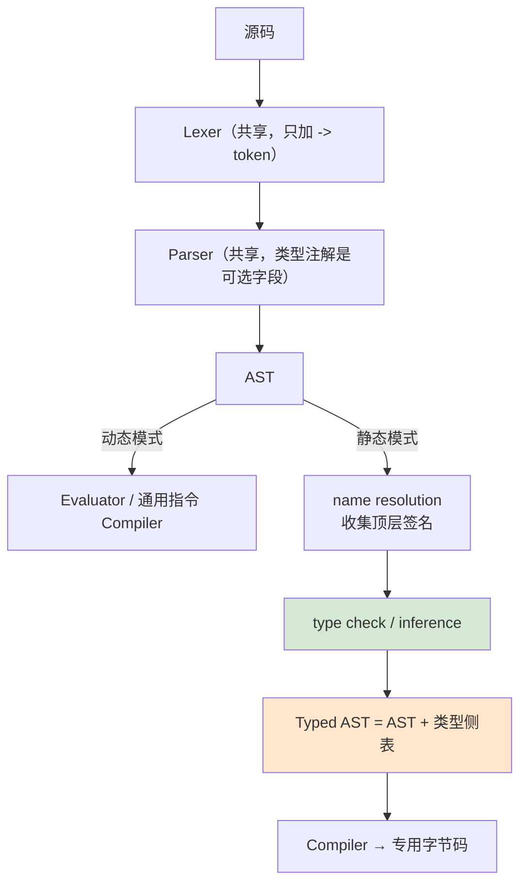

# 12 探索：给 Monkey 加静态类型系统

## 本章要回答的问题

前 11 章的产出是一门**动态**语言：`1 + "a"` 要等到 VM 弹出两个操作数、发现类型对不上，才产生 `Error`。类型信息只在运行时存在，代价是每条 `OpAdd` 都要重新判断一次"这两个东西是什么"。

这一章问：**如果在 compiler 之前插一个阶段，把类型算出来，能换到什么？**

- 静态类型除了"提前报错"，还买到了什么可以量化的东西？
- 你的语言里 int 和 float 并存、`null` 存在、truthy 宽松、`if` 是表达式——这些**在静态化时全部变成必须回答的问题**。
- 类型检查器维护什么状态？它和 evaluator 的 `Environment`、compiler 的 `SymbolTable` 是什么关系？
- 类型推断的代价曲线是怎样的？
- typed AST 怎么变成更快的字节码？

**这一章的性质和前面不同。** 前面各章有唯一正确答案（Pratt 的 `+1` 要么对要么错）。这一章是一张**路线图**：多数问题有几个都成立的答案。所以每个决定都给出候选、取舍和一个推荐，但推荐不是唯一解。推导要求和前面一样严格——**开放不等于随便**。

## 1. 静态类型买到了什么

三件事。分开看，因为收益和代价完全不同。

### 1.1 错误提前

```monkey
let f = fn(flag) { if (flag) { 1 + 2 } else { 1 + "a" } };
f(true);
```

动态版：这个程序**跑得通**，输出 3。`1 + "a"` 那条路径永远不执行，错误就永远不出现——直到某天有人调 `f(false)`，在生产环境拿到 `ERROR: type mismatch: INTEGER + STRING`。静态版：`Check` 遍历整棵 AST，不管哪条路径会不会执行，`1 + "a"` 在编译期就被拒绝。

错误时机的对比：动态版在"该路径第一次被执行"时报，依赖测试覆盖到那条分支，报错位置在运行时栈顶（源码位置要额外记录）；静态版在编译时报，与执行路径无关，手上就有 AST 节点和 `Token.Pos`。**动态版的类型安全等于测试覆盖率，静态版的等于检查器的完备性。** 前者是你努力的结果，后者是工具的性质。

代价也要说清：静态版会拒绝一些**其实能跑**的程序。`if (x) { 1 } else { "a" }` 在动态版里合法（只要下游不做算术），静态版必须给它一个类型，而 int 和 string 没有公共类型。**这就是类型系统的本质交易：用一部分表达力换全部路径的保证。**

### 1.2 消除运行时类型分派

08 章的 VM 里，`OpAdd` 要在运行时判断"两边都是 Integer / 都是 Float / int+float 混合两种 / 都是 String / 其他报错"，六个 case 加两次 `Type()` 调用。**这个 switch 每次执行都跑一遍，答案却永远不变。** 循环里的 `total = total + xs[i]` 跑一万轮，就判断一万次"这两个是不是整数"——而源码里那个 `+` 的操作数类型从编译那一刻起就固定了。

这是 06 章"编译把每次都一样的判断提前做掉"的延续，但动态版**做不到底**——06 章第 4.4 节已经把这笔账算清了：compiler 不知道 `a + b` 里 `a` 是什么类型，**这就是动态语言的定义**，所以不能造专用指令。静态版知道，于是可以把 `OpAdd` 换成 `OpAddInt`：VM 里 1 个 case，直接取值相加，**主循环少一次类型 switch**。第 9 节展开指令集设计和膨胀代价。

### 1.3 消除装箱

04 章埋的伏笔：`&object.Integer{Value: int64}` 是**堆上 8 字节结构体 + 16 字节接口值**（类型指针 + 数据指针）。类型已知后 `int` 可以直接放在栈槽里——动态版的 `stack []Object` 每槽 16 字节且指向堆上的 `Integer`（每次算术一次堆分配），静态版的 `stack []uint64` 每槽 8 字节、值就在里面、零分配。

**收益估算**（估算，不是实测——你实现完应该自己 benchmark）：一次动态整数加法约等于 2 次接口断言 + 1 次堆分配 + 1 次接口构造；非装箱版是 2 次数组读 + 1 条 `ADD` + 1 次数组写。算术密集的循环里一个量级左右的差距是合理预期。更重要的是**分配消失了**——`while (i < 100000) { i = i + 1 }` 在动态版里产生十万个垃圾 `Integer`，非装箱版产生零个。

**复杂度代价比收益大，先看清三条：** ① **GC 看不见栈里的指针**——`[]uint64` 里若某槽位存 `*object.String` 的地址，Go 的 GC 不知道那是指针，可能回收掉那个字符串。真实解法是**两条栈**（`[]uint64` 存标量，`[]Object` 存引用类型）或**影子位图**（bitset 记录每个槽位当前是不是指针），两者都要求 compiler 为每个栈槽发出"宽度和种类"信息，一份新的编译期产出。② **每条指令都要知道操作数宽度**——`OpGetLocal 3` 从"取第 3 个槽位"变成"取从偏移 X 开始的 N 字节"，调用的参数布局从"n 个槽"变成一张偏移表。③ **可观察性下降**——08 章的 `LastPoppedStackElem` 打印 `Object` 可读，`uint64` 打印出来是 `4614838538166547251`，要知道槽位类型才能解读。

**实施顺序**：1.1 先做，不需要动 compiler 和 VM 一行；1.2 第二，只改 case，栈表示不变；1.3 最后，而且**做之前先 benchmark 确认瓶颈真在这里**。收益递增，复杂度也递增。

## 2. 策略：静态版是方言，不是替代品

不要把动态版改成静态版。**新增一个可跳过的阶段。**



三个共享层一行不改（除了 lexer 加一个 token）。类型检查是**插入**不是**替换**——这让你随时能对比两条路，10 章的差分测试继续可用。

### "Typed AST" 到底是什么

最容易走错的一步是**往 AST 节点上加推断出的类型**。区分两种信息：**类型注解**是用户写的语法，放在 AST 节点的可选字段上（它是源码的一部分，`String()` 要能打印它，parser 必须产出它）；**推断的类型**是 checker 算的，放在 checker 的**侧表**里（它是分析结果不是源码，动态模式不该看见）。侧表让 AST 保持"忠实记录源码"这个单一职责（02 章的立场）。

```go
type Checker struct {
    types     map[ast.Node]Type       // 每个表达式节点的类型
    coercions map[ast.Node]Coercion   // 需要插入的隐式转换（第 9 节）
    errors    []TypeError
}
```

**但它有一个真实陷阱**，因为你的 `IfBranch.Body` 和 `FunctionExpression.Body` 是**值**而不是指针（[ast.go:299](../ast/ast.go#L299)、[ast.go:335](../ast/ast.go#L335)）：

```go
for _, branch := range node.Branches { c.types[&branch.Body] = t }        // ← 循环拷贝的地址，查不到
for i := range node.Branches { c.types[&node.Branches[i].Body] = t }      // ← 正确
```

07 章写 `c.Compile(&branch.Body)` 是安全的，因为编译只读；侧表**靠指针身份索引**，拷贝的地址就是另一个键。**这类 bug 不报错，只是查表返回零值。**

### 两种模式怎么共存

三个选项：**一个二进制 + flag**（`monkey run [--static] f.mk`）、两个二进制（`monkey` / `monkeyc`）、文件头声明（`#!static`）。**推荐第一个**：共享全部代码，差分测试就是同一进程跑两遍。两个二进制部署清晰但两边容易漂移；文件头声明增加了 lexer 的责任，不值得。

## 3. 类型的表示

```go
type Type interface { String() string; Equals(Type) bool }

type IntType struct{};    type FloatType struct{};  type BoolType struct{}
type StringType struct{}; type NullType struct{};   type UnitType struct{}

type ArrayType    struct { Elem Type }
type HashType     struct { Key, Value Type }
type FunctionType struct { Params []Type; Return Type }
```

### 为什么是接口而不是枚举

04 章选 `Object` 接口的理由是"加类型成本最低"。这里的理由更硬：**类型是递归的**。

`ArrayType{Elem: ArrayType{Elem: IntType{}}}` 表示 `[[int]]`。枚举 `type TypeKind int` 表示不了——它只有一个标签，没地方挂参数。你会被迫写成 `struct { Kind TypeKind; Elem *Type; Params []Type; ... }`，也就是 04 章讨论过的 tagged union：所有字段并存，`IntType` 也背着 `Params` 切片，且编译器不帮你检查"读 `Elem` 时 `Kind` 是不是 ARRAY"。**类型的形状本身是一棵树，用能表达树的结构表示它。**

单例照 04 章的 `TRUE`/`NULL` 做，但用**值**而非指针（零字节空结构体）：`var ( Int Type = IntType{}; Float Type = FloatType{}; ... )`。

### `UnitType` 为什么需要

`Check` 的签名统一成 `(Type, error)`，包括语句。但 `while` 没有类型。选择是返回 `nil` 还是引入"没有值"的类型——**选后者**，`nil` 会让每个调用点判空（04 章 `Null` 对象存在的同一个理由）。`UnitType` 让"不产生值"变成可传递、可比较、可打印在错误消息里的一等公民：`expected int, got unit`。返回 `nil` 的话这条消息就得特殊构造。

### 相等性：结构相等

**结构相等**是形状相同即相等（`ArrayType{Int}.Equals(ArrayType{Int})` 为 true）；**名义相等**是只有同一个声明才相等（Go 的 `type Meters int` 与 `int` 不相等）。**选结构相等**，因为你的语言**没有类型声明语法**——名义相等需要"这类型叫什么、在哪声明"的概念，而 `[int]` 只是一个形状。等你加了 `type Point = {...}` 才需要重新决定。

实现要点：**不要用 Go 的 `==` 代替 `Equals`。** `ArrayType.Equals(b)` 必须先断言 `b.(ArrayType)`，再**递归**比较 `a.Elem.Equals(bb.Elem)`——不是 `a.Elem == bb.Elem`。

两个独立构造的 `ArrayType{Int}` 用 `==` 恰好也相等（因为 `Int` 是单例、空结构体值相等）——**但这是巧合**，而 `FunctionType` 里有切片，`==` 直接 panic。**统一走 `Equals`，把 `==` 当成不存在。** 这和 04 章"分支顺序成了语义的一部分"是同一类纪律：靠巧合成立的正确性必须写成测试。

## 4. 语法扩展：类型注解

```monkey
let x: int = 1;
let add: fn(int, int) -> int = fn(a: int, b: int) -> int { a + b };
let xs: [int] = [1, 2, 3];
let h: {string: int} = {"a": 1};
```

注解写在名字**后面**（Rust/TS 风格，不是 C 的 `int x`——后者要求 parser 读完类型才知道这是声明）；用 `:` 分隔；函数类型用 `->`；数组和哈希**复用字面量的括号形状**，让 `[int]` 和 `[1,2,3]` 看起来是一家。

### 词法：只缺一个 token

`:` 已经有了（[token.go:40](../token/token.go#L40)，哈希在用），括号逗号都有。**只缺 `ARROW = "->"`。** 01 章的最长匹配在这里生效：读到 `-` 先看下一个字符是不是 `>`。**这和 `=`/`==`、`>`/`>=` 是同一段逻辑**——如果你按 01 章把最长匹配抽成了统一的辅助函数，加 `->` 是一行数据；如果是五个手写 if，这是第六个。

`int`/`float`/`bool`/`string` **不要加成关键字**。它们目前是普通 `IDENT`（`KeywardsType` 表里没有，[token.go:68](../token/token.go#L68)），保持这样：类型解析器遇到 IDENT 时查一张内置类型名表。好处是动态模式完全不受影响，且以后加类型别名时用户类型名和内置类型名走同一条路。（注意 `token.INT`/`FLOAT`/`STRING` 三个常量的值恰好是 `"int"`/`"float"`/`"string"`——它们是**字面量的 token 类型**，和类型名字符串撞了。不影响正确性，但值得在 token.go 加一行注释。）

### AST：语法层的类型和语义层的类型是两个东西

```go
type TypeExpr interface { Node; typeExprNode() }
type NamedType     struct { Token token.Token }                      // int / 用户类型名
type ArrayTypeExpr struct { Token token.Token; Elem TypeExpr }        // [int]
type HashTypeExpr  struct { Token token.Token; Key, Value TypeExpr }  // {string: int}
type FuncTypeExpr  struct { Token token.Token; Params []TypeExpr; Return TypeExpr }
```

**为什么不直接在 AST 里用 `types.Type`？** 因为 `let x: Foo = ...` 里的 `Foo` 可能不存在。parser 的职责是"记录用户写了什么"，判断类型名是否有意义是**语义检查**（00 章第 5 节：parser 不做语义判断）。parser 产出 `NamedType{Token: Foo}`，checker 负责 **resolve** 成 `types.Type` 或报 `unknown type: Foo`。跳过这一步，parser 里就会开始出现"这个类型名合法吗"的判断。

现有节点的改动，全部是**可选字段**（`nil` = 没写，动态模式下永远是 `nil`）：`LetStatement`（[ast.go:49](../ast/ast.go#L49)）加 `TypeAnnotation TypeExpr`；`Identifier`（[ast.go:181](../ast/ast.go#L181)）加 `TypeAnnotation TypeExpr`；`FunctionExpression`（[ast.go:335](../ast/ast.go#L335)）加 `ReturnType TypeExpr`。

**`Parameters []Identifier` 不用改**——`Identifier` 加了字段就够了，复用现有节点省下的一次改动。`String()` 要跟着改：02 章把它定为"规范化打印器"，`let x: int = 1;` 必须打印回原样，否则 round-trip 测试会漏掉注解。

### Parser 的改动点

核心是一个新函数 `parseTypeExpr() ast.TypeExpr`，游标契约和其他 `parseXxx` 完全一致（03 章第 4 节）：**进入时 `curToken` 指向类型的第一个 token，返回时指向类型之后的第一个 token**，失败返回 nil。四条分支：`IDENT` → `NamedType` 然后 `readToken()`；`[` → readToken → 递归 → 要求 `]` → readToken；`{` → 递归 → 要求 `:` → 递归 → 要求 `}` → readToken；`fn` → 要求 `(` → 类型列表 → 要求 `)` → 要求 `->` → 递归。

**每条分支都必须推进游标**，否则死循环（03 章陷阱 ①，这里再踩一次）。`fn` 分支的参数类型列表是"逗号分隔的列表"——做过 03 章练习 4 的话，把 `parseSeparatedList` 参数化就能复用，`fn() -> int` 这个空列表边界自动正确。**没抽的话，这是第六份列表解析代码。**

三个调用点。**① `parseLetStatement`（[parser.go:82](../parser/parser.go#L82)）**——检查 IDENT 之后、检查 `=` 之前：

```text
现在：readToken → 要求 IDENT → readToken → 要求 ASSIGN → readToken → parseExpression
改后：readToken → 要求 IDENT → readToken
      if curToken == COLON { readToken; stmt.TypeAnnotation = parseTypeExpr() }
      要求 ASSIGN → readToken → parseExpression
```

`parseTypeExpr` 返回时 `curToken` 已经指向 `=`（游标契约），所以后面那句"要求 ASSIGN"**不能再先 readToken**。这是最容易错的一处，因为原代码里那句前面正好有一次 `readToken`——改的时候要把它挪进两条路径里。

**② 形参循环（[parser.go:430](../parser/parser.go#L430)）**——"要求 IDENT → readToken"之后插入"若是 COLON 则 readToken 并 parseTypeExpr"。**③ 返回类型**——形参的 `)` 消费完后 `curToken` 指向 `{`，插入 `if curToken == ARROW { readToken; fnExpr.ReturnType = parseTypeExpr() }`，然后才 `parseBlockStatement`。

**三处改动都不影响动态模式。** 写一个测试锁死：同一份**无注解**源码，改动前后 `String()` 相同。

## 5. 三套作用域结构

`TypeEnv` 和 04 章的 `Environment` 形状**完全一样**：`store map[string]Type` + `outer *TypeEnv`，配 `NewTypeEnv`、`NewEnclosedTypeEnv`、`Define`、`Lookup`。**但不需要 `Assign`**——赋值不创建绑定也不改变类型，checker 只要 `Lookup` 出已声明的类型再比对。这是 04 章"三个方法是语义直接要求的"这个论点的反面验证：需求变了，方法数就变了。

到这里你的项目里有**三套形状相似的作用域结构**，很值得摆在一起：

| | `Environment`（04 章） | `SymbolTable`（07 章） | `TypeEnv`（本章） |
| --- | --- | --- | --- |
| 存什么 | `Object`（运行时值） | 槽位索引 + 作用域种类 | `Type` |
| 何时工作 | **运行时** | 编译期 | 编译期 |
| 同一函数被调 3 次 | 产生 3 个 | 只有 1 个 | 只检查 1 次 |
| 需要 Assign | 需要（`x = 1`） | 不需要 | 不需要 |
| 闭包相关 | 持有定义时环境的引用 | 记录 free 变量顺序 | 只需词法嵌套 |

**第三行是本质区别**：`Environment` 的数量与**执行次数**成正比，另两个与**源码大小**成正比。这也解释了为什么编译期分析可以"贵一点"——只做一次。

**三者的嵌套结构必须一致**，否则会出现"checker 认为 `x` 在外层、compiler 认为在内层"。具体地说：04 章第 9 节如果选了"块不是作用域边界"（方案 A），checker 也**不能**给块建新的 `TypeEnv`。**这个一致性没有编译器帮你检查，只能靠测试**（第 13 节陷阱 ⑫）。

## 6. 类型检查器：规则表

签名是 `Check(node ast.Node, env *TypeEnv) (Type, error)`，实现是一个大 type switch，每个 case 一行：`case *ast.IntegerLiteral: return c.record(node, Int), nil`。辅助函数 `record(n, t)` 存侧表并返回 `t`。

返回 `error` 还是累积到 `c.errors`？**两者都要**：返回值用于"这棵子树算不出类型，上层没法继续"，累积用于"报完所有错误再退出"（03 章第 6 节的同一论点）。做法是引入 `Invalid` 类型：报错时记入 `c.errors` 并返回 `Invalid`，而**任何涉及 `Invalid` 的检查直接返回 `Invalid` 且不再报错**。这样 `1 + "a" + "b"` 只报一个错。（这和 04 章 `Error` 对象的传播机制同构——错误伪装成值，走同一条通道。）

| 节点 | 规则 | 反例 |
| --- | --- | --- |
| 各字面量 | `: int` / `float` / `bool` / `string` | |
| `Identifier` | `env.Lookup(name)`，失败即错 | `x + 1` → `undefined: x` |
| `Prefix -` / `!` | `-`：操作数 `int`→`int`、`float`→`float`；`!`：必须 `bool`，结果 `bool` | `-"a"`、`!1` |
| `Infix + - * /` | 两边数值，见"混合运算"；`+` 也接受两边 `string` | `1 + true`、`"a" + 1` |
| `Infix < > <= >=` | 两边数值（可混合），结果 `bool`；`== !=` 要两边**兼容**（同类型或都是数值） | `"a" < 1`、`1 == "a"` |
| `Infix && \|\|` | 两边必须 `bool`，结果 `bool` | `1 && 2` |
| `IfExpression` | condition 必须 `bool`；分支类型一致；见下 | `if (1) {...}` |
| `WhileStatement` | condition 必须 `bool`，自身 `unit` | `while (1) {}` |
| `FunctionExpression` | 见"函数与 return" | |
| 调用（`Postfix`+`(`） | callee 必须 `FunctionType`；实参个数、类型逐一匹配；结果 `Return` | `1(2)`、`add(1)`、`add(1,"a")` |
| 索引（`Postfix`+`[`） | `[T]` 要 `int` 下标 → `T`；`{K:V}` 要 `K` → `V`；`string` 要 `int` → `string` | `xs["a"]`、`1[0]` |
| `Array` / `HashList` | 元素类型一致 → `[T]`；键、值各自一致 → `{K:V}`，键须可哈希 | `[1,"a"]`、`{"a":1, 2:3}` |
| `LetStatement` | 有注解：resolve 得 `T`，右值须可赋给 `T`；无注解：`T = Check(value)`。都 `Define(name,T)`，自身 `unit` | `let x: int = "a"` |
| `AssignmentStatement` | `Lookup(name)` 得 `T`（未声明即错，**不创建绑定**），右值须可赋给 `T`，自身 `unit` | `x = "a"`（x 是 int） |
| `ReturnStatement` | 值类型必须匹配**当前函数**的返回类型 | `fn() -> int { return "a"; }` |
| `BlockStatement` | 逐条检查；类型 = **最后一条 `ExpressionStatement` 的类型**，否则 `unit` | |

`PostfixExpression` 是调用和索引共用的节点（[ast.go:388](../ast/ast.go#L388)），**必须按 `node.Operator.Type` 分派**——和 evaluator（04 章第 11 节）、compiler（07 章第 12 节）的做法一样。三个阶段都要写这个分派，这是"统一后缀节点"这个设计选择的持续成本。

### 混合运算：本章最具体的一个决定

00 章的契约是"int 与 float 混算提升为 float，`int/int` 截断，`1 == 1.0` 为 true"。两个选择：**A 保留隐式提升**（`1 + 2.5` 合法、类型 float，与动态版契约一致，代价是大整数转 float 静默丢精度，实现上需要一个 coercion 表 + 一条转换指令）；**B 要求显式转换**（`1 + 2.5` 报错，须写 `toFloat(1) + 2.5`，零特殊逻辑，代价是一批动态版能跑的合法程序被拒）。

**推荐 A**，理由是差分测试：只要静态版和动态版在共享子集上语义相同，10 章的差分测试就能继续验证 checker 之后的整条链路。方案 B 会让"静态版拒绝了一个动态版能跑的程序"变得不可区分于"静态版有 bug"。

方案 A 有一个必须防的风险：**规则必须对称**。`1 + 2.5` 和 `2.5 + 1` 必须走同一条逻辑，`1 < 2.5` 和 `2.5 < 1` 也一样。收进一个函数，让所有算术和比较的 case 都调它：

```go
// unifyNumeric 决定两个数值类型的公共类型，并返回哪一边需要提升。
// 这是 int/float 混算规则的唯一实现处 —— 任何绕过它的代码都是 bug。
func unifyNumeric(l, r Type) (common Type, coerceLeft, coerceRight, ok bool)
```

四个组合手工枚举：`(int,int)→int`；`(float,float)→float`；`(int,float)→float,coerceLeft`；`(float,int)→float,coerceRight`。**四行代码，但它是 00 章契约表里那一格的唯一落点。** 分散实现正是 00 章开头警告过的"两条路不一致"的来源。

顺带定死方向：**只允许 int→float，绝不 float→int**。前者是加宽，后者丢整数部分。`let x: int = 2.5;` 必须报错。

### truthy：静态版应该收紧

动态版是"只有 `false` 和 `null` 为假"，所以 `if (0)` 和 `if ([])` 都走真分支。**静态版应该要求条件必须是 `bool`。** 理由不是"宽松 truthy 不好"，而是：`if (xs)` 在动态版里恒为真（数组永远 truthy），**这个表达式一定是写错了**——用户想写的是 `if (len(xs) > 0)`。宽松 truthy 的价值在于允许 `if (x)` 这类存在性检查，可这个价值在你的语言里**本来就不存在**（`0` 和 `""` 都是真）。**收紧不损失任何表达力，只把一类必然的笔误变成编译错误。**

范围是四处：`if` 和 `while` 的 condition、`&&`/`||` 的两边、`!` 的操作数。**这四处在动态版里共用一个 `isTruthy`（04 章的建议）**，静态版里共用一句"必须是 bool"，对称得很干净。代价是 `if (x != null)` 变成必须的写法。

### `if` 的类型：三个方案

`if` 是表达式（[ast.go:304](../ast/ast.go#L304)），必须有类型。`if (c) { 1 } else { "a" }` 怎么办？

三个方案：**① 严格一致**——分支类型不同就报错，最简单，代价是拒绝一些能跑的程序；**② 最小公共超类型**——得到 `int | string`，无 else 时是 `int | null`，需要 union 和子类型关系，复杂度陡增；**③ 分位置区分**——语句位置允许不一致（类型 `unit`），表达式位置要求一致，只需多传一个参数。

**推荐 ① + ③ 的组合**：分支类型必须一致；`if` 在**语句位置**（它是 `ExpressionStatement` 的全部内容，值会被 `OpPop` 丢掉）时不检查一致性、类型为 `unit`；在**表达式位置**时要求必须有 else。收益是 `if (c) { puts("a") } else { puts(1) }` 这种纯副作用的 `if` 不会被无意义拒绝，同时 `let x = if (c) { 1 };` 得到准确的错误"if used as an expression must have an else branch"。

**这和 07 章的编译逻辑呼应**：07 章说无 else 时必须补 `OpNull` 保证栈平衡。静态版里"表达式位置的 if 必须有 else"意味着**那条 `OpNull` 永远不会被生成**——类型系统消除了一条指令的存在理由。这是"类型检查为后端提供保证"的最小但真实的例子。

### 函数与 return

```text
Check(FunctionExpression, env):
  1. 解析形参注解 → paramTypes（缺注解见第 7 节第三层，第一版直接报错）
  2. 解析返回类型注解 → declaredReturn（缺注解见第 7 节第二层）
  3. ft := FunctionType{paramTypes, declaredReturn}
  4. inner := NewEnclosedTypeEnv(env)；逐个 inner.Define(p.Value, paramTypes[i])
  5. c.returnStack.push(declaredReturn)          ← 关键
  6. bodyType := Check(&node.Body, inner)；然后 c.returnStack.pop()
  7. bodyType 不可赋给 declaredReturn → 错误（隐式返回）；否则 return ft
```

**第 5 步是 `ReturnStatement` 能被检查的前提。** `return` 在语法上离函数很远（可能嵌在三层 `if` 里），checker 必须携带"当前函数期望返回什么"。用**栈**因为函数可以嵌套——`fn() -> int { let g = fn() -> string { return "a"; }; return 1; }` 里内层 `return "a"` 匹配 string、外层 `return 1` 匹配 int，**栈顶就是答案**。如果写成 `Checker` 的一个 `currentReturn Type` 字段而忘了保存恢复，内层函数会永久污染外层——经典错误。

第 7 步是"隐式返回"契约的静态版本。**注意 `unit`**：`fn() -> int { let x = 1; }` 的 body 类型是 `unit`（以 let 结尾），不匹配 int，报错——这正好抓住"声明返回 int 但什么都没返回"这个真实 bug，而动态版里它静默返回 null。

## 7. 类型推断：三层，代价递增

要求每处都写注解很快就烦人。推断分三层，**强烈建议按层实施**，因为第三层的复杂度和前两层不在一个量级。

**第一层：局部推断。** `let x = 1;` 推出 `x: int`。规则一句话：**没有注解时，右值的类型就是变量的类型。** 不需要类型变量，不需要 unification，就是把 `Check(value)` 的结果拿来 `Define`。**建议第一版只做这个**——它覆盖了实际代码里绝大多数注解，成本接近零。

**第二层：函数返回类型推断。** `fn(a: int) { a * 2 }` 推出返回 int。规则：**body 的类型就是返回类型**（body 的类型 = 最后一条 `ExpressionStatement` 的类型）。代价出现在两处：① body 里有 `return` 时，`returnStack` 栈顶还不知道该是什么——做法是压入一个"待定"标记，遇到第一个 `return` 就定下来，之后的 `return` 必须与它一致；② **递归函数没法推断**——检查 body 时需要函数自己的类型，而它正是要推的东西。所以规则是：**递归函数必须显式注解返回类型**（Haskell 之外多数语言都这么要求，包括 Rust 和 OCaml 的部分情形）。

**第三层：参数类型推断 / Hindley-Milner。** `fn(a) { a + 1 }` 推出 `a: int`。需要三样新东西：**① 类型变量** `type TypeVar struct { ID int; Ref Type }`（`Ref == nil` 表示未绑定），给每个未注解的参数分配一个 fresh 变量 `t0`；**② unification**，把"两个类型必须相等"这个约束解出来；**③ occurs check**，拒绝无限类型。

```text
unify(a, b):
  a, b = prune(a), prune(b)              // 顺着 Ref 链走到底
  if a 是未绑定 TypeVar:
      if a == b: return ok
      if occurs(a, b): error "infinite type"     ← occurs check
      a.Ref = b; return ok
  if b 是未绑定 TypeVar: return unify(b, a)
  // 两边都是具体类型：形状必须相同，参数逐个递归 unify
  ArrayType → unify(a.Elem, b.Elem)；HashType → unify(Key)、unify(Value)
  FunctionType → 长度相同 + 逐个 unify(Params) + unify(Return)
  其他       → a.Equals(b) ? ok : error "cannot unify T1 with T2"
```

手算 `fn(a) { a + 1 }`：参数 `a` 分配 `t0`，`inner.Define("a", t0)`；检查 `a + 1` 得到左 `t0`、右 `int`；算术规则要求两边数值，于是 `unify(t0, int)` → `t0.Ref = int`；body 类型 `int`；最终 `FunctionType{[int], int}`。

**这一层的复杂度代价**：类型变量是**可变状态**，所以错误消息会退化（用户看到 `cannot unify t3 with string` 而不是"第 2 个参数应该是 int"）；`prune` 忘了调用就会得到"已绑定的变量看起来还没绑定"这种幽灵 bug；而多态（`let id = fn(a) { a }` 能同时用在 int 和 string 上）还需要 **let 泛化 + 实例化**，又是一套机制。**建议放到最后，且先把前两层的测试写全**——有了它们，第三层的回归才有基准。

**中间还有一层值得知道：双向检查（bidirectional type checking）。** 把 `Check` 拆成两个方向：`Infer(node)` 自下而上算类型，`CheckAgainst(node, expected)` 自上而下把期望类型压下去。`let xs: [int] = [];` 里，`Infer([])` 无解，但 `CheckAgainst([], [int])` 立刻知道元素类型是 int。**这解决了空字面量和 lambda 参数的大部分情形，成本远低于 HM**，而且是 TypeScript 和 Rust 在局部真正采用的方式。如果你只想做一层"够用的推断"，做这个而不是 HM。

## 8. `null` 的处理：静态化最棘手的问题

`null` 在动态版里无处不在：索引越界返回它、无 else 的 `if` 返回它、未初始化的语义靠它。静态化必须回答"`null` 是什么类型"。

| 方案 | 做法 | 得到 | 失去 |
| --- | --- | --- | --- |
| **① 独立类型 + 万能可赋值** | `NullType`，且 `null` 可赋给任何类型（像 Java） | 实现最简单，动态版语义全部保留 | 类型系统**失去保证**，`null` 参与算术的错误依然是运行时错误 |
| **② option / nullable** | `int?`（= `int \| null`），用之前必须检查 | 真正的空安全 | 需要**类型收窄**（flow typing）：`if (x != null) { ... }` 里 `x` 的类型要从 `int?` 变成 `int` |
| **③ 干掉 null** | 索引越界报错或返回 option | 最干净 | **改变了 00 章的契约**（"索引越界返回 null"），差分测试立刻失效 |

**推荐 ②，但第一版先做 ①。** 理由是这两步是**兼容的**：方案 ① 里 `null` 的类型是 `NullType`，方案 ② 只是把"可赋给任何类型"收紧成"只可赋给 `T?`"。先做 ① 让整条管线跑通，再收紧规则——反过来（先做 ② 再放松）会让你在还没有测试基准时同时调试 checker 和收窄逻辑。方案 ③ 不推荐的理由值得强调：**它是唯一一个破坏 00 章契约的方案**。前两个方案下静态版接受的程序在动态版里跑出相同结果，差分测试有效；方案 ③ 下 `[1,2][5]` 两边行为不同，你失去了最有力的验证手段。

类型收窄的最小实现（做方案 ② 时）：只识别 `if (x != null)` 和 `if (x == null)` 这两个**语法形状**，在对应分支里给 `x` 建一个覆盖绑定（`NewEnclosedTypeEnv` + `Define(x, T)`）。不要试图做通用的流分析——`if (x != null && y != null)` 之后才需要，那是下一步。

## 9. typed AST 怎么降低成更快的字节码

### 专用指令

`1 + 2`（两边已知 int）编译成 `OpConstant 0; OpConstant 1; OpAddInt`；`1.5 + 2.5` 用 `OpAddFloat`；`"a" + "b"` 用 `OpConcat`。VM 里 `OpAddInt` 的实现是"弹两个、断言 Integer、相加、压回"，**没有 switch**。类型检查的结论"这两个一定是 int"从运行时的判断变成了 opcode 的选择。

### 混合运算：提升从运行期移到编译期

`1 + 2.5` 在动态版里由 VM 在运行时发现"左边 int 右边 float"然后提升；静态版在 checker 里就知道了，于是**编译期插入一条转换指令**：

```text
OpConstant 0      // 1（int）
OpIntToFloat      // ← checker 记在 coercions 表里，compiler 读出来发这条指令
OpConstant 1      // 2.5（float）
OpAddFloat
```

**这就是 `coercions map[ast.Node]Coercion` 侧表的用途。** checker 在 `unifyNumeric` 返回 `coerceLeft` 时记一笔，compiler 编译该子节点后立刻查表，有记录就补一条 `OpIntToFloat`。**注意插入位置**：必须在编译完那个操作数**之后**、编译另一个操作数**之前**，否则转换会作用在错误的栈顶值上。（07 章第 5 节 `<` 交换操作数的那个坑在这里加倍危险：如果 compiler 为 `<` 交换了左右，coercion 的插入顺序也必须跟着交换。**这是两个独立决定的交互，最容易漏测的一类 bug。**）

### 指令集膨胀的代价

按类型全展开的话：`OpAdd`/`Sub`/`Mul`/`Div` 各 2 个（int/float）+ `OpConcat`，比较 4 个各 2 个，`OpEqual`/`OpNotEqual` 各 3 个……**指令数从十几条涨到三四十条**，每条都要写 case、写编码测试、写反汇编测试。

一个折中：**保留通用 opcode，加一个类型 tag 作为操作数字节**——`OpAdd 0x01`（`0x01`=int，`0x02`=float，`0x03`=string）。VM 里读那个字节直接跳表，**既没有运行时类型判断，也没有指令膨胀**。代价是每条算术指令多 1 字节，且反汇编要解释 tag。**推荐这个方案**，因为它让"加一种数值类型"（比如以后加 `int64`）只是加一个 tag 值，不是加四条指令。

### 函数调用

动态版里参数布局和局部变量槽位**已经**在编译期确定（07 章的符号表干的）。静态版多知道的是**每个槽位的宽度和种类**——这正是第 1.3 节非装箱表示的前提。所以这一项收益不在"确定性"，而在"能用更窄的表示"。

## 10. 还需要 evaluator 吗

**需要，保留它。** 做一个 typed evaluator：读同一棵 AST，忽略类型信息，按动态语义执行。它的用途和 00 章第 3 节说的完全一样——**它是参照实现**。差分测试从两方变成三方：同一份（通过类型检查的）源码，喂给 evaluator、动态 compiler+VM、静态 compiler+VM，**三者结果必须相同**。第三条路是新的，前两条是 10 章已有的。**只要静态版选了第 6 节的方案 A（保留隐式提升）和第 8 节的方案 ①/②，这个等式就成立**——这是那两个推荐背后最实际的理由。

## 11. 明确不做什么

第一版**不做**：泛型、trait/interface、子类型、类型类、依赖类型、隐式转换的完整规则（除了 int→float 那一条）。理由不是它们不好，而是**每一个都能独立成一个和本章同等规模的项目**，而且没有它们语言依然可用——Go 在 1.18 之前没有泛型，用了十三年。

如果以后要做泛型，**最小可行方案是单态化（monomorphization）**：为每个实际用到的类型实参生成一份特化的函数体，`id(1)` 和 `id("a")` 编译成两个不同的 `CompiledFunction`。运行时完全没有泛型的概念，代价是代码膨胀和编译变慢——Rust 和 C++ 模板走的就是这条路。

## 12. 手算 trace

### Trace 1：函数定义与调用

输入：`let add = fn(a: int, b: int) -> int { a + b }; add(1, 2);`

| 步 | 节点 | 动作 | env / 状态 |
| --- | --- | --- | --- |
| 1 | `LetStatement` | 无注解 → 先 `Check(Value)` | global: {} |
| 2 | `FunctionExpression` | resolve 形参注解 `NamedType(int)` ×2、`ReturnType` | paramTypes=[int,int]，declaredReturn=int |
| 3 | | 构造 `ft = fn(int,int)->int`；`inner = NewEnclosedTypeEnv(global)`；`Define("a",int)`、`Define("b",int)` | inner: {a:int, b:int} → global |
| 4 | | `returnStack.push(int)` | returnStack: [int] |
| 5 | `InfixExpression +` | `Check(a)` → `inner.Lookup("a")` = int；`Check(b)` = int | |
| 6 | | `unifyNumeric(int,int)` → (int,f,f,ok)；`record(node,int)` | 无 coercion；types[+] = int |
| 7 | `BlockStatement` | 类型 = 最后一条 ExpressionStatement 的类型 = int | |
| 8 | `FunctionExpression` | `returnStack.pop()`；body int 可赋给 declared int ✓ | returnStack: [] |
| 9 | `LetStatement` | `global.Define("add", ft)` | global: {add: fn(int,int)->int} |
| 10 | 调用节点 | `Check(Left)` → `Lookup("add")` 是 FunctionType ✓ | |
| 11 | | 实参个数 2 == `len(Params)` 2 ✓；`Check(1)`、`Check(2)` 均 int，逐个可赋 ✓ | |
| 12 | | 结果类型 = `ft.Return` = int | types[调用节点] = int |

**第 4 步和第 8 步的配对是重点**：push/pop 必须严格配对，任何提前 `return`（比如第 5 步报错直接返回）都必须先 pop，否则外层函数会读到错误的期望返回类型。**用 `defer`**，不要靠"记得写 pop"。

### Trace 2：混合运算与指令生成

输入：`let x = 1; let y = 2.5; x + y;`。**checker：**

| 步 | 动作 | 结果 |
| --- | --- | --- |
| 1 | `let x = 1`：无注解，`Check(1)` = int → `Define("x", int)` | global: {x: int} |
| 2 | `let y = 2.5`：无注解，`Check(2.5)` = float → `Define("y", float)` | global: {x:int, y:float} |
| 3 | `x + y`：`Check(x)` = int，`Check(y)` = float | |
| 4 | `unifyNumeric(int, float)` → (float, **coerceLeft=true**, false, ok) | |
| 5 | `coercions[x 节点] = IntToFloat`；`record(+节点, float)` | 侧表记一笔；表达式类型 = float |

**compiler 读侧表生成指令，和动态版对比：**

```text
动态版（07/08 章）                静态版
OpGetGlobal 0    // x            OpGetGlobal 0     // x
OpGetGlobal 1    // y            OpIntToFloat      // ← 编译期决定的提升
OpAdd            // ← 运行时     OpGetGlobal 1     // y
                 //   判断类型   OpAddFloat        // ← 无类型判断
OpPop                            OpPop
```

**注意静态版里 `OpIntToFloat` 的位置**：在 `OpGetGlobal 0` 之后、`OpGetGlobal 1` 之前。此刻栈顶恰好是 x，转换作用在它身上。如果写在两个 `OpGetGlobal` 之后，转换会作用在 y（本来就是 float）上，而 x 保持 int——`OpAddFloat` 拿到一个 int 和一个 float，**静默算错或 panic**。

指令数从 4 条变成 4 条（`OpAdd` → `OpIntToFloat` + `OpAddFloat`，多一条但少一次运行时判断）。**收益不在指令数，在 VM 主循环的分支预测和省掉的 `Type()` 调用。** 循环里跑一万轮才看得出差别——这也说明为什么优化之前要先 benchmark。

## 13. 边界与陷阱

**① 混合提升规则不对称。** `1 + 2.5` 和 `2.5 + 1` 必须同样处理。防御：所有算术和比较**只能**通过 `unifyNumeric`，写一个测试遍历 `{int,float}²` 四种组合 × 所有算术和比较运算符，断言结果类型和 coercion 方向。

**② `if` 分支类型不一致 / 无 else。** 第 6 节的方案 ①+③。**测试必须覆盖"语句位置"和"表达式位置"两种**，因为它们走不同的规则。

**③ 空数组 `[]` 和空哈希 `{}`。** 无法从元素推断类型。三个出路：从注解推（需要双向检查，第 7 节）；报错 `cannot infer element type of empty array`；引入 `[never]` 这类底类型（复杂度不值得）。**推荐：第一版报错，做了双向检查之后改成从期望类型推。** **④ 异构数组 `[1, "a"]`** 在严格一致规则下直接报错，错误消息要指出**是第几个元素**和期望类型：`array element 1: expected int, got string`。

**⑤ 递归函数。** 拿 `let fact = fn(n: int) -> int { if (n == 0) { 1 } else { n * fact(n-1) } };` 说：检查 body 时函数自己的类型还没登记。**必须先登记签名再检查 body**——正确顺序是 resolve 形参和返回类型 → 构造 `ft` → `env.Define("fact", ft)` → **然后**检查 body。这和 09 章 `OpCurrentClosure` 解决的问题**同构**：都是"函数体里要引用还没建好的自己"，一个在类型层面，一个在值层面。**必然要求显式返回类型注解**，因为签名要在检查 body 之前就完整。

**⑥ 相互递归。** `let isEven = fn(n:int)->bool { ... isOdd(n-1) }; let isOdd = ...;` 里 `isEven` 的 body 引用了还没声明的 `isOdd`。单趟遍历解决不了。**解法：两趟**——第一趟只扫顶层 `let`，把所有带完整注解的函数签名登记进 env；第二趟才检查 body。**这就是流程图里 `name resolution` 是一个独立阶段的理由。**

**⑦ `null` 的可赋值性。** 方案 ① 下 `null` 可赋给一切，那 `let x: int = null;` 就是合法的，`x + 1` 通过检查但运行时崩。**这不是 bug，是方案 ① 已知的、写进文档的代价。** 别在方案 ① 里试图特殊处理某些位置，那会得到一套自己都说不清的规则。

**⑧ 注解与推断冲突。** `let x: int = 2.5;`——注解说 int，右值是 float，且 float→int 不允许 → 报错。反过来 `let x: float = 1;` 合法（int→float 加宽）。**这两个方向的测试都要有**，只测一个方向会漏掉"允许了反向转换"这个 bug。

**⑨ occurs check。** `unify(t0, [t0])` 会构造无限类型 `[[[...]]]`。缺了 occurs check，`prune` 会在这个环上**无限循环或栈溢出**。它只有几行，但**没有测试就一定会漏**：构造 `let f = fn(a) { [a] }; f(f);` 这类输入，断言得到 `infinite type` 而不是挂住。

**⑩ 侧表的键是指针。** 第 2 节那个 `&branch.Body` 陷阱。**测试方法**：检查完一个 `if` 之后断言 `c.types` 里能查到每个分支 body 的类型。

**⑪ `returnStack` 泄漏。** 第 12 节 Trace 1 的第 4/8 步。任何提前 `return` 都会跳过 pop，**用 `defer` 保证配对**。**⑫ 三套作用域不一致**（第 5 节）：同一份带遮蔽的源码，checker 说类型对，compiler 和 VM 跑出来的值也必须对。

## 14. 验收测试清单

**`types/types_test.go`** 三个测试：

```text
TestTypeString          Int→"int"  ArrayType{Int}→"[int]"  HashType{String,Int}→"{string: int}"
                        FunctionType{[Int,Int],Int}→"fn(int, int) -> int"
                        FunctionType{nil,Unit}→"fn() -> unit"        ← 空参数列表边界
TestEqualsIsStructural  相等：Int/Int；两个独立构造的 ArrayType{Int}；嵌套 [[int]]
                        不等：Int/Float；ArrayType{Int}/ArrayType{Float}；ArrayType{Int}/Int；
                              FunctionType 参数个数 / 参数类型 / 返回类型不同
                        对称性：对每一对 (a,b) 断言 a.Equals(b) == b.Equals(a)
TestUnifyNumeric        四种组合断言 (common, coerceLeft, coerceRight)；
                        非数值：(int,string)、(bool,bool) → ok=false
```

**`checker/checker_test.go`**——两个辅助函数先写好：`checkOK(t, input) (*Checker, Type)` 断言无错误并返回最后一个语句的类型，`checkErr(t, input, wantSubstring)` 断言有错误且消息包含期望片段。覆盖清单：

```text
字面量/标识符  1→int  2.5→float  true→bool  "a"→string   反例：x → "undefined: x"
前缀          -1→int  -2.5→float  !true→bool             反例：-"a"  !1
算术          1+2→int  1.5+2→float  2+1.5→float  "a"+"b"→string
              反例：1+true  "a"+1  true-false
比较/逻辑     1<2  1<2.5  1==1.0  true&&false → 全是 bool
              反例：1&&2  "a"<1  1=="a"
let           let x=1 → int    let x:int=1 → int    let x:float=1 → float（加宽）
              反例：let x:int="a"   let x:int=2.5   let x:Foo=1（unknown type）
赋值          let x=1; x=2 → ok   反例：let x=1; x="a"   y=1（未声明，不创建绑定）
if            if(c){1}else{2}→int      语句位置的 if(c){1}else{"a"}→unit
              反例：if(1){2}else{3}   let a=if(c){1};（无 else）
                    let a=if(c){1}else{"a"};（分支不一致）
while         while(true){1;}→unit     反例：while(1){}
函数          fn(a:int)->int{a}→fn(int)->int    fn()->unit{}→fn()->unit（零参边界）
              反例：body 类型不匹配 / return 类型不匹配 / fn(a:int)->int{let x=1;}
调用          let f=fn(a:int)->int{a}; f(1)→int   反例：f()  f(1,2)  f("a")  1(2)
集合/索引     [1,2]→[int]  [[1]]→[[int]]  {"a":1}→{string:int}  "abc"[0]→string
              [1,2][0]→int  {"a":1}["a"]→int
              反例：[1,"a"]  {"a":1,2:3}  xs["a"]  1[0]  []（空数组无法推断）
推断          let x=1; let y=x+1 → int      fn(a:int){a*2}→fn(int)->int
递归          let fact=fn(n:int)->int{if(n==0){1}else{n*fact(n-1)}} → ok
              反例：无返回类型注解的递归函数 → 明确的错误消息
相互递归      两个顶层 let 互相调用 → ok（需要两趟 name resolution）
作用域遮蔽    let x=1; let f=fn()->string{let x="a"; x}; f()→string
              且检查完之后外层 x 仍是 int
错误消息      每条断言含位置（行:列）、期望类型名、实际类型名
              一个表达式里多个错误 → 只报最内层那一个（Invalid 传播）
```

**最有价值的一组：静态版与动态版的行为对比。** 这个测试集本身就是"静态类型买到了什么"的清单：

```go
// 这些程序动态版能跑出结果，静态版拒绝。第三列是被拒绝的理由，也就是这一章的全部收益。
var staticRejectsDynamicAccepts = []struct{ input, dynamicResult, staticError string }{
    {`let f=fn(c){if(c){1}else{1+"a"}}; f(true);`, `3`, `type mismatch: int + string`},
    {`if (0) { 1 } else { 2 };`,                `1`, `condition must be bool, got int`},
    {`let xs=[1,2]; if (xs) { 1 } else { 2 };`, `1`, `condition must be bool, got [int]`},
    {`[1, "a"];`,                         `[1, a]`, `array element 1: expected int`},
    {`let x=1; x="a";`,                        `a`, `cannot assign string to int`},
    {`let f=fn(a){a}; f(1,2);`,     `ERROR（运行时）`, `wrong number of arguments`},
    {`let x: int = null;`,          `null`, `（方案 ② 下）cannot assign null to int`},
}
// 对偶的一组：通过类型检查的程序，两条路必须给出相同结果（10 章差分测试的延续）
var bothAgree = []string{
    `1 + 2;`, `1 + 2.5;`, `2.5 + 1;`, `7 / 2;`, `1 == 1.0;`,
    `let add = fn(a:int,b:int)->int{a+b}; add(1,2);`,
    `let i=0; let t=0; while (i<3) { t=t+i; i=i+1; } t;`,
}
```

第一组每加一行，就是类型系统多抓住的一类 bug。第二组每加一行，就是"静态版没有偷偷改变语义"的一份保证。**两组都要长。**

## 15. 练习

**1. `types` 包。** 实现全部类型 + `String()` + `Equals()`，跑通 `types_test.go` 的三个测试。注意 `FunctionType` 的 `Equals` 要处理参数个数不同和 nil 切片。

**2. `unifyNumeric`。** 四行代码 + 六个测试用例。做完想一想：如果以后加 `int64`，这个函数要改成什么形状？

**3. token 和 parser：`->` 与类型注解。** 加 `token.ARROW`（走 01 章的最长匹配路径）、四个 `TypeExpr` 节点、`parseTypeExpr`、三个调用点。**必须配一个测试锁死"无注解源码的 `String()` 不变"。**

**4. checker 第一版：字面量 + 标识符 + 前缀 + 算术 + let。** 只做这五类，把 `Invalid` 传播机制建好。此时 `let x: int = 1; x + 1;` 应该通过，`let x: int = "a";` 应该报一条（不是两条）错误。

**5. 补齐规则表。** 比较、逻辑、`if`、`while`、赋值、`return`（含 `returnStack`）、集合、索引、调用。每类一个正例一个反例。

**6. 错误消息带位置。** 结构化 `TypeError{Pos, Message, Want, Got}`。这依赖 11 章附加观察 B（`Token.Pos` 对标识符和字面量恒为 0）先被修掉——**否则你的类型错误全都指向第 1 列**。

**7. 第一层推断。** `let x = 1;` 免注解。做完统计一下：你自己写的测试代码里，有多少注解可以删掉？

**8. 第二层推断。** 函数返回类型免注解，处理好"body 里有 return"和"递归必须显式注解"两个情形，后者要有明确的错误消息。

**9. 两趟 name resolution。** 支持相互递归。做完想一想：这一趟还能顺便做什么？（提示：未使用变量警告、重复声明检测。）

**10. 双向检查。** 把 `Check` 拆成 `Infer` 和 `CheckAgainst`，让 `let xs: [int] = [];` 通过。这是性价比最高的一个推断增强。

**11. 专用指令 + coercion 插入。** 给 compiler 加静态模式：`OpAdd` 带类型 tag，读 `coercions` 侧表插入 `OpIntToFloat`。**用反汇编验证 Trace 2 的指令序列**，不要靠眼睛数。然后跑通"静态版与动态版结果相同"那组测试。

**12. Hindley-Milner。** 类型变量 + `unify` + `prune` + occurs check，让 `fn(a) { a + 1 }` 推出参数类型。**先写 occurs check 的测试。** 做完再想：`let id = fn(a) { a };` 能同时 `id(1)` 和 `id("a")` 吗？（不能，除非加 let 泛化。）

**13. 非装箱字节码。** 只做 int 和 bool 两种类型的非装箱路径，`stack []uint64` + 一条 `[]Object` 引用栈。**先 benchmark 动态版的 `while (i < 1000000) { i = i + 1 }`，做完再 benchmark 一次，把两个数字写进 README。** 如果加速比小于 2，说明瓶颈在别处，去 profile 找出来。

**14.（开放）读一门真实语言。** 选一个你在本章遇到的难题，研究一门真实语言怎么处理它，写一页对比：

- **TypeScript 的渐进类型**：`any` 如何让类型系统"可选"？它的 `strictNullChecks` 开关和第 8 节的方案 ①→② 是同一件事吗？
- **Go 的类型推断**：为什么 Go 只在 `:=` 处推断，坚持函数签名必须写全？（提示：和第 13 节陷阱 ⑥ 的两趟解析有关，也和错误消息质量有关。）
- **Rust 的生命周期**：它是"类型系统里多一个维度"的极端案例。看它怎么处理你在第 7 节第三层遇到的"错误消息退化"问题。
- **Kotlin 的智能转换（smart cast）**：第 8 节类型收窄的工业级版本。它在哪些情况下**拒绝**收窄，为什么？

## 小结

- 静态类型买到三样东西：**错误提前**（安全性从测试覆盖率变成检查器完备性）、**消除运行时类型分派**（`OpAdd` 的 switch 变成 opcode 的选择）、**消除装箱**（收益一个量级，但 GC 可见性和可观察性的代价更大）。按这个顺序实施
- 静态版是**方言**不是替代品：共享 lexer/AST/parser，只在 compiler 前插入一个阶段。**类型注解进 AST 字段（是语法），推断结果进侧表（是分析）**
- 类型用**接口**而非枚举，因为类型是递归的（`[[int]]`）；相等性用**结构相等**，因为你的语言没有类型声明；**永远用 `Equals` 不用 `==`**
- 只需要一个新 token（`->`）。`int`/`bool` 保持 IDENT，语法层的 `TypeExpr` 和语义层的 `types.Type` 中间有一步 **resolve**
- `TypeEnv` 和 `Environment` 形状相同但**不需要 `Assign`**。三套作用域结构里，只有 `Environment` 的数量随执行次数增长
- int/float 混合**保留隐式提升**，收进 `unifyNumeric` 这唯一一个实现处；truthy **收紧到必须是 bool**（不损失表达力）；`if` 分支要求一致，但语句位置放宽——这条同时消除了 07 章那条 `OpNull`
- 推断分三层，**先只做第一层**。双向检查的性价比高于 Hindley-Milner；类型变量带来的错误消息退化是真实代价
- `null` 先做"独立类型 + 万能可赋值"，再收紧成 option。**别选"干掉 null"**——它是唯一破坏 00 章契约、让差分测试失效的方案
- 递归必须**先登记签名再检查 body**，和 09 章 `OpCurrentClosure` 同构；相互递归需要独立的 name resolution 趟
- 保留 evaluator 作参照实现。**"静态版拒绝但动态版能跑"的测试集，就是这一章收益的清单**
- 泛型、trait、子类型第一版全部不做。要做泛型，最小方案是**单态化**

这是最后一章。前 11 章有唯一答案，这一章有取舍——**能说清取舍，比记住答案更接近真实的编译器工作。**

