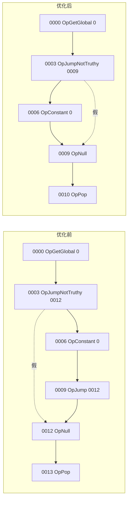

# 13 探索：编译期与运行期优化

## 本章要回答的问题

`1 + 2 * 3;` 编译出来是 `OpConstant OpConstant OpConstant OpMul OpAdd OpPop` 六条指令，但答案只有一个数字 `7`，编译期就能算完，VM 一条指令都不用跑。`if (a) { 1 };` 没有 `else`，07 章的回填规则会在最后一个分支后面多发一条`OpJump`，跳的目标恰好是它自己的下一条指令——这条跳转什么都没做。`OpAdd` 每次执行都要重新判断"两边是不是整数"，哪怕程序里这个加法点永远只加整数。这些都是**正确但不高效**的代码，本章问：**在不动 06 章 29 条指令集、不改语义契约的前提下，怎么把这些多余的工作去掉？**

具体要回答：

- 优化应该放在哪一层（AST、字节码、运行期）？各层能看到什么信息、看不到什么？
- 常量折叠、死代码消除这两种 AST 级变换，怎么保证"折叠之后程序的可观察行为不变"？
- 07 章练习 8 留下的"消除冗余 `OpJump`"要怎么做，尤其是删指令之后**所有跳转目标都要重算**这件事，算法是什么？
- 08 章那句"编译消掉了结构的解释，没有消掉值的解释"——inline cache 和类型特化 opcode 具体怎么落地？
- 怎么证明"优化前"和"优化后"的程序是同一个程序？

## 铁律：优化必须保持语义

整章只有一条判断标准：

> **对所有合法输入，优化前后两条执行路径（evaluator 和编译后的 VM）的可观察结果必须不变。**

"可观察"三个字很重要——内部产生的常量池大小、指令条数、执行的机器周期都可以变，只有**程序打印出来的东西、返回的值、抛出的错误**不能变。这直接继承 00 章的语义契约表和 10 章的差分测试：**优化后的程序必须还能通过差分测试**。任何一个变换只要改变了可观察行为，它就不是优化，而是一个 bug，或者是一次没有被记录的语义变更——后者比前者更危险,因为它会伪装成"性能提升"混进代码库。

本章后面每一节讲一种优化,都会先给这条铁律的具体推理,再给骨架。**推理比骨架重要**——骨架里大量是 TODO,推理决定你怎么填。

## 1. 优化在哪一层做,为什么

不是所有优化都能放在同一层。决定层次的问题只有一个:**这一层的表示形式里,还剩多少关于"程序在做什么"的信息?**

| 层 | 能看到 | 看不到 | 本章对应的优化 |
| --- | --- | --- | --- |
| AST 级 | 源码的完整结构:哪个节点是常量、哪个是变量引用、控制流的嵌套关系 | 运行时值的分布(同一个加法点历史上被喂过什么类型)、执行频率 | 常量折叠(§2)、死代码消除(§3) |
| 字节码级 | 线性指令流、跳转的绝对地址、指令边界 | 源码结构已经丢了(if/while 都变成了跳转),运行时才知道的东西还是不知道 | 窥孔优化(§4)、公共子表达式消除(§5) |
| 运行期 | 值的真实类型、真实分布、执行频率——这些只有跑起来才知道 | 每次都要重新观察,观察本身有开销;没有编译期那种"一次分析,处处生效"的便宜 | inline cache、类型专用 opcode 的运行时决策(§6) |
| 编译期类型系统 | 把"运行期能看到的值分布"提前算出来,变成编译期就确定的事实 | 需要额外一整套类型检查基础设施(12 章) | 类型特化 opcode 的编译期版本(§7) |

这张表是全章的骨架。**越往下,看到的信息越"真实"(是实际发生的值,不是猜的),但获取信息的时机越晚,代价也越高**——AST 级的分析只做一次,运行期的判断做几百万次。12 章的静态类型系统是这条谱系的终点:把"运行期才知道"的信息,通过分析提前挪到"编译期就知道",配合类型检查器把第三层的信息变成第一层可用的信息。本章讲的是**这条谱系上,不做完整静态类型系统时,中间地带能做的事**。

## 2. 常量折叠(AST 级)

### 2.1 定义与最简单的例子

`1 + 2;` 里 `1` 和 `2` 都是字面量,`+` 的两个操作数在编译期就完全确定,结果 `3` 也完全确定。**常量折叠**就是在编译期把这样的子表达式直接替换成它的值,编译器发出的不再是"算出 1、算出 2、把它们加起来"这三条指令,而是直接发一条 `OpConstant 3`。

对比 06 章第 74 行那句"编译把每次都一样的判断提前做掉"——常量折叠是这句话的极限情况:不仅"怎么算"提前了,"算的结果"本身也提前了,VM 连 `OpAdd` 都不用执行。

### 2.2 正确性论证

铁律要求"折叠前后可观察结果不变"。把这句话拆成两个可检查的条件:

1. **求值这个子表达式没有副作用。** 副作用包括:调用函数(可能 `puts`、可能修改全局状态)、赋值。纯粹的字面量算术没有副作用,函数调用有。
2. **编译期算出的结果与运行期算出的结果完全相同。** 这一条看起来是废话,但 §2.4 会给出它实际上会失败的例子。

**反例:除零。** `1 / 0;` 在你的语言里怎么处理是一个契约问题(08 章§5 提到:除法要么报错要么截断,契约必须回答)。假设契约是"整数除零在运行期报错"。如果常量折叠遇到 `1 / 0` 就在编译期直接报错并中止编译,而没有常量折叠时,`1 / 0` 是一个正常编译、运行期报错的程序——**两条"路径"（开启/关闭折叠的编译器）对同一份源码给出了不同的失败时机和失败信息**,这正是本章铁律要抓的漂移。更极端的是:`if (false) { 1 / 0 };`——如果折叠只对表面的整数字面量做,`1/0` 根本不会被求值(因为死代码消除会跳过它,见 §3),但如果你的常量折叠实现"贪心"地想一次把整棵子树都算完,可能会在不该报错的地方报错。

**结论:常量折叠遇到会导致运行期错误的操作(除零、目前语言里其他任何会报错的运算),必须选择不折叠,把这个子表达式原样留给运行期处理。** 折叠是一个只在"确定安全"时才做的变换,不确定就保守地不做——这是几乎所有编译器优化共享的原则:**宁可少优化,不可优化错**。

### 2.3 具体到你的类型系统:精度问题

`1 + 2.5;` 折叠成 `Float(3.5)` 看起来直接,但要经过 [`ast.FloatLiteral`](../ast/ast.go#L207) 的字段:

```go
type FloatLiteral struct {
	Token token.Token
	Value float32       // ← 注意,不是 float64
}
```

而 [08 章 §5](08-vm.md) 已经指出运行期的 `object.Float` 是 `float64`。折叠 `1.5 + 1.5` 时,如果编译器在 `foldConstants` 里直接用 Go 的 `float64` 做加法(`1.5 + 1.5 = 3.0`,这个例子凑巧没有精度损失),再包成 `object.Float{Value: 3.0}` 发进常量池——这条路径全程是 `float64`。但如果**没有**开启常量折叠,VM 在运行期执行 `OpAdd` 时,读到的两个操作数是从 `ast.FloatLiteral.Value`(`float32`)转换来的,转换路径是 `float64(float32(1.5))`,而 `object.Float` 内部存储又是 `float64`。07 章练习 11 已经点出这个坑:**编译期折叠用什么精度算,和运行期 VM 用什么精度算,必须是同一条转换路径,否则两个"数字上看起来一样"的浮点数在二进制上是不同的值**。

具体会怎么错:假设某个字面量在源码里写的是 `0.1`,parser 把它存成 `float32(0.1)`,值是 `0.100000001490116119384765625`(float32 能精确表示的最近值)。

- **不开折叠**:编译器把这个 `float32` 转成 `float64` 存进常量池,得到 `0.10000000149011612`(float32 精度损失被保留下来,只是用更宽的类型装它)。
- **开折叠且用双精度重新计算**:如果折叠逻辑是 `foldedValue := float64(leftLit.Value) + float64(rightLit.Value)`(这里 `leftLit.Value` 是 `float32`),结果和不开折叠时是一致的,因为转换路径相同。
- **真正会分裂的场景**是:如果你的折叠函数为了"图方便"直接对源码文本重新 `strconv.ParseFloat(lit, 64)`,跳过了 `float32` 这一步,那就绕开了字面量本该经过的精度截断,得到一个**从未在这门语言的任何地方出现过的**第三个值。

**建议:常量折叠对数值的处理,必须复用 evaluator/VM 已经在用的那条"字面量 → object.Float"转换函数,不能自己重新解析源码文本或者选用不同的浮点宽度。** 如果你在 04-05 章已经写了 `func floatFromLiteral(fl *ast.FloatLiteral) float64`,折叠时就调用它,不要重新发明。这本质上是"折叠只能对已经存在的值做运算,不能引入新的转换路径"这条原则的具体应用。更彻底的修法是把 `ast.FloatLiteral.Value` 本身改成 `float64`(00 章契约表已经把这类"两条路径精度不一致"列为需要提前解决的问题),这样从 AST 到常量折叠到 VM 全程只有一种浮点宽度,不存在"该转几次"的问题。

### 2.4 实现骨架:AST 重写

常量折叠的接口形状是**一个把 `Expression` 变成一个"更简单"的 `Expression` 的函数**——输入输出都是 `ast.Expression`,不改变类型,只改变结构:

```go
// foldConstants 尝试把 expr 折叠成一个等价的字面量表达式。
// 折叠不了就原样返回 expr——这是"保守"策略的直接体现:
// 调用方永远拿到一个合法的表达式,不需要判断"折叠成功了吗"。
func foldConstants(expr ast.Expression) ast.Expression {
	switch node := expr.(type) {
	case *ast.InfixExpression:
		left := foldConstants(node.Left)   // 先递归折叠子节点
		right := foldConstants(node.Right) // 자식折叠完,才可能发现自己也能折叠

		leftLit, leftOK := asNumericLiteral(left)
		rightLit, rightOK := asNumericLiteral(right)
		if !leftOK || !rightOK {
			// 至少一边不是编译期已知的数字字面量,不能折叠。
			// 常见原因:标识符引用、函数调用、数组/哈希字面量。
			node.Left, node.Right = left, right // 但子节点的折叠成果要保留
			return node
		}

		// TODO: 按 node.Token.Literal(注意没有 Operator 字段,取 Token.Literal,
		// 见 07 章§5 和 11 章的字段说明)选择 + - * /,
		// 复用 §2.3 强调的那条统一转换路径计算结果,
		// 包成新的 *ast.IntegerLiteral 或 *ast.FloatLiteral 返回。
		// 除零等会报错的运算:不折叠,回退到"原样返回 node"分支。

	case *ast.PrefixExpression:
		// TODO: 处理 -5、!true 这类一元。
		// 同样递归折叠 node.Right,再判断能不能收尾。

	default:
		return expr // 标识符、调用表达式等:不是本节的折叠对象,原样返回
	}
}

// asNumericLiteral 判断一个表达式在"折叠"意义上是不是数字常量。
// TODO: *ast.IntegerLiteral / *ast.FloatLiteral 命中,返回 (值, true);
// 其他情况返回 (nil, false)。
func asNumericLiteral(expr ast.Expression) (ast.Expression, bool) {
	switch expr.(type) {
	case *ast.IntegerLiteral, *ast.FloatLiteral:
		return expr, true
	default:
		return nil, false
	}
}
```

**两种架构,选哪个**:

1. **预处理 pass**:在 `Compile()` 之前,对整棵 AST 跑一遍 `foldConstants`,产出一棵新的(或原地改写的)AST,再喂给未改动的 `Compile()`。优点是折叠逻辑和编译逻辑完全解耦,folder 可以单独测试(输入一个表达式字符串,断言折叠后的 `String()`);compiler 完全不需要知道"折叠"这件事存在。缺点是要多走一遍树。
2. **编译时机会性折叠**:在 `Compile()` 遇到 `*ast.InfixExpression` 的分支里,编译完左右子节点之前先检查"两边都是字面量吗",如果是就不发子节点的指令,直接算好发一条 `OpConstant`。优点是不用多一次遍历。缺点是折叠逻辑和编译逻辑混在一起,`Compile` 的 `case` 分支变复杂,而且**这时候"编译子节点"已经开始了**,如果编译过程本身有副作用(比如递增了某个计数器、往符号表里加了临时项),要小心撤销。

**推荐预处理 pass**:AST 重写和字节码生成是两个不同的关注点,拆开之后 07 章已经写好的 `Compile()` 不用改一行——这符合 12 章"新增一个可跳过的阶段,不替换现有实现"的同一个原则(方言而不是替代品)。给 `foldConstants` 单独写测试,比在 `compiler_test.go` 里断言字节码更直接:输入 `"1 + 2 * 3;"`,断言 `foldConstants` 返回的表达式 `String()` 是 `"7"`。

### 2.5 什么时候不能折叠

- **操作数含变量引用。** `x + 2`——`x` 的值只有运行期才知道(除非做常量传播,见陷阱一节)。
- **操作数含函数调用。** `f() + 2`——即使能证明 `f` 是纯函数,当前语言没有"纯函数"标注,必须假设所有调用都可能有副作用(打印、修改全局变量)或者不终止(死循环),折叠等于提前执行了它,改变了执行时机这个可观察属性。
- **操作数是数组或哈希字面量。** `[1,2] + [3]`——即使当前指令集里数组不支持 `+`(会在 VM 报错),折叠也不该去猜"这应该是拼接",那是给语言加新语义,不是优化。更现实的问题是:**如果将来给数组加了原地修改的内置函数(比如 `push!`),数组字面量就不再是"纯值"**,某个数组字面量在程序其他地方可能被修改,折叠成常量池里的单例会让多次求值共享同一个底层数组,产生别名(aliasing)问题。当前语言没有这类操作,但设计折叠逻辑时应该显式地把"可变集合"排除在折叠对象之外,而不是"现在没有所以不用管"。

### 2.6 字符串常量折叠

`"a" + "b"` 折叠成 `"ab"` 用的是完全不同的运算(字符串拼接),但可以复用同一个 AST 重写框架——`foldConstants` 的 `*ast.InfixExpression` 分支里多一条判断分支:两边都是 `*ast.StringLiteral` 且操作符是 `+`([08 章 §5](08-vm.md) 提过"字符串只支持 `+`"),就折叠成新的 `*ast.StringLiteral`。

```go
// 在 foldConstants 的 InfixExpression 分支里追加:
if leftStr, ok := left.(*ast.StringLiteral); ok {
	if rightStr, ok := right.(*ast.StringLiteral); ok && node.Token.Literal == "+" {
		return &ast.StringLiteral{
			Token: token.Token{Type: token.STRING, Literal: leftStr.Value + rightStr.Value},
			Value: leftStr.Value + rightStr.Value,
		}
	}
	// 两边是字符串但操作符不是 +:不折叠,交给 VM 在运行期报错
}
```

注意力放在**这是同一个决策框架的另一个分支,不是另一套机制**:判断"两个子节点是不是编译期已知的同类型常量" → "这个操作在这两个常量上有没有定义" → "算出来"。数字折叠和字符串折叠的差别只在第三步怎么算。

## 3. 死代码消除(AST 级/字节码级都可以做)

### 3.1 你的语言里死代码能出现在哪

死代码消除(dead code elimination, DCE)要先回答一个前置问题:**这门语言里,"确定不会执行的代码"具体长什么样?** 不同语言的答案差很多——有 `break`/`continue`/`goto` 的语言,不可达代码到处都是(`return` 之后的语句、`break` 之后的语句)。Monkey 目前没有 `break`/`continue`,`return` 只出现在函数体里且不会导致"后面的语句不可达"这种结构性问题(07 章的隐式返回机制已经处理了函数体的末尾)。所以死代码的来源被限制成了两种:

1. **`if` 的某个分支,当 condition 是编译期已知的常量时。** `if (true) { A } else { B }` 里,`B` 永远不会执行——但只有在 `foldConstants` 已经把 condition 折成 `*ast.BooleanLiteral` 之后,你才"确定已知"它是 true 还是 false。**这就是死代码消除依赖常量折叠的原因:折叠先跑,DCE 才有活干**——两者是流水线上的相邻两步,folder 产出的字面量正是 DCE 判断"可达性"用的信息源。
2. **`while (false) { ... }`。** 循环条件恒为假,整条循环语句等价于什么都没做,可以整条删除。

### 3.2 正确性论证:副作用陷阱

这是本节最容易踩的坑,值得单独拿出来讲清楚。

反例:

```monkey
if (someExprThatIsAlwaysFalse()) {
	1 + 1;
}
```

假设你有某种分析(哪怕只是常量折叠没能证明的,你手动确认的)能断定 `someExprThatIsAlwaysFalse()` 恒为假。**即使如此,也不能把整个 `if` 删掉**——因为 `someExprThatIsAlwaysFalse()` 是一次函数调用,调用本身可能有副作用(修改全局变量、打印、抛错)。删掉整个 `if` 语句,等于把这次调用也删了,这就违反了铁律:程序的可观察行为(那次调用带来的副作用)变了。

**这个陷阱和 §2.2 的除零陷阱是同一类问题的两个面孔**:常量折叠不能对"有副作用的操作数"动手,死代码消除同样不能对"有副作用的 condition"动手——只是死代码消除这里更容易出错,因为直觉上"这个分支反正不会走"听起来像是"这段代码可以随便处理"。

正确的处理只有两种:

- **方案 A:condition 的求值留下,只删 branch 的编译。** 编译器仍然发出 condition 的求值指令(它的副作用必须发生),然后**不发**对应分支的 body 指令,也不发跳转——因为编译期已经知道走哪条路,直接把它降级成一条无条件路径,加一条 `OpPop` 把 condition 的值扔掉(这个值不需要留在栈上,`if` 分支被静态确定之后,不需要运行期根据它做判断了)。
- **方案 B:只对"condition 本身是常量字面量"这种最简单情况做优化,不做常量传播、不做副作用分析。** 也就是说,`if (true) { A }` 和 `if (false) { A }` 可以做(此时 condition **就是**一个 `*ast.BooleanLiteral`,压根不涉及调用),但 `if (someExprThatIsAlwaysFalse())` 这种"经过分析才能确定值"的 condition,一律**不消除**,原样编译,把判断留给运行期的 `OpJumpNotTruthy`。

**推荐方案 B 作为教学起点。** 理由是:方案 A 需要区分"删 branch"和"删 condition 求值"两件事,一旦有 bug(比如手滑把 condition 的求值也删了),就会静默产生方案 A 本该避免的那种 bug——而这类 bug 恰恰是 DCE 存在的意义要去防止的,自己给自己埋雷没有意义。方案 B 简单、边界清晰(只要判断 `ast.IfBranch.Condition` 的**动态类型**是不是 `*ast.BooleanLiteral`,不需要任何求值或分析),而且覆盖了实践中最常见的情况——手写 `if (true)`/`if (false)` 通常是调试时留下的开关,或者宏展开/代码生成的产物,很少是"看起来复杂但编译期能证明"的表达式。常量传播(把 `let flag = true; if (flag) {...}` 这样间接的常量也纳入折叠范围)作为练习留给读者,那是方案 A/B 之外的第三条路,复杂度和收益都更高。

### 3.3 实现骨架

```go
// eliminateDeadBranches 假定 ifExpr 已经跑过 foldConstants
// (即每个 Condition 如果本身是常量表达式,已经被折成了字面量)。
// 只处理 §3.2 方案 B 覆盖的情况:Condition 直接是 *ast.BooleanLiteral。
func eliminateDeadBranches(ifExpr *ast.IfExpression) ast.Expression {
	for i, branch := range ifExpr.Branches {
		lit, ok := branch.Condition.(*ast.BooleanLiteral)
		if branch.Condition != nil && !ok {
			continue // condition 不是编译期已知的字面量,这个分支及之后都保留原样,整体不优化
		}
		if branch.Condition == nil {
			continue // else 分支,没有 condition,不用判断
		}
		if lit.Value {
			// TODO: condition 恒为 true。
			// 这个分支之前的所有分支已经被证明走不到(它们的 condition 全是
			// false 字面量,否则上面的 continue 会在遇到第一个"不是字面量"
			// 的分支时提前退出整个函数——想清楚为什么这个前提成立)。
			// 把 ifExpr 整体替换成 branch.Body 内联出的表达式;
			// 需要处理"block 的最后一条 OpPop 被去掉实现隐式返回"那套逻辑
			// (07 章§6"块的栈效果"),这里在 AST 层面等价的做法是
			// 直接返回一个能代表"求值这个 block 并留下最后一个值"的节点。
			_ = i
			return nil // 占位
		}
		// lit.Value == false:这个分支整体是死代码,从 Branches 里跳过它,
		// 继续检查下一个分支。TODO。
	}
	return ifExpr // 没有任何分支能被静态确定,原样返回
}

// eliminateDeadWhile 处理 while (false) { ... } 整条语句消除。
// TODO: 判断 ws.Condition 是不是 *ast.BooleanLiteral{Value: false},
// 是则返回 nil 或者一个空的 *ast.BlockStatement(取决于调用方怎么处理"删除一条语句"),
// 否则原样返回 ws。
func eliminateDeadWhile(ws *ast.WhileStatement) ast.Statement {
	return ws // 占位
}
```

**为什么"整体不优化"是安全的退路:** 一旦遇到某个分支的 condition 不是字面量,这个 `if` 表达式的可达性就无法在编译期确定,函数直接放弃对整个 `IfExpression` 的优化,把判断完全留给运行期——这不会引入错误,只是少赚一点性能,呼应本章后面 §8 的"过早优化"讨论。

### 3.4 字节码级的 DCE 有必要吗

理论上,死代码消除也可以在字节码层面做:一段永远不会被跳转到、也不会顺序执行到的指令区间可以整体删除,是一种更通用的"可达性分析"。但对当前的指令生成方式,**AST 级的处理已经覆盖了全部已知的死代码来源**,字节码级的可达性分析要解决一个更难的问题——识别"没有任何跳转指令的目标落在这个区间,也没有顺序执行路径能到达这里"——这在没有 `goto`、没有间接跳转的这套指令集里,收益和复杂度不成比例,本章不展开,列在陷阱清单里提醒"过早优化"的边界在哪。

## 4. 窥孔优化(字节码级)

### 4.1 冗余从哪来

窥孔优化(peephole optimization)的名字来自它的工作方式:**用一个很小的滑动窗口(通常 2-3 条指令)扫过指令流,匹配已知的"低效模式",就地替换或删除**。它不需要理解整个程序的结构,只看局部——这正是它便宜、安全、容易验证的原因,也是它的局限:看不到窗口之外的冗余。

07 章练习 8 已经指出一个具体案例:[07 章 §6](07-compiler.md) 编译 `if` 的 else-if 链时,规则统一成"每个带 condition 的分支都发 `OpJump`",**代价是最后一个分支也会发一条 `OpJump`,跳的目标就是它自己的下一条指令**——因为它是最后一个分支,循环结束后 `end` 恰好等于这条 `OpJump` 之后的地址。这条跳转执行了(占用了一次指令分派和一次 `ip` 赋值),但什么都没改变。

再列两个同类模式,建立"窥孔优化在找什么"的直觉:

- **跳到紧邻下一条指令的 `OpJump`。** 上面这个案例的一般形式:`OpJump X`,而 `X` 恰好等于这条指令自身的结束地址(下一条指置的起始地址)。可以整条删除。
- **`OpConstant N` 后面紧跟着另一条把同一个值重新压栈的 `OpConstant N`,中间夹着一条会把栈顶弹走又还原回同一个值的操作。** 这种模式在当前的编译方式下比较少见(compiler 不会主动重复编译同一个常量),但如果你后续实现了某种"内联"或者"复制传播",可能会人为制造出这类冗余,提前认识这个模式对以后调试有帮助。
- **`OpTrue`(或 `OpFalse`)紧跟 `OpJumpNotTruthy X`。** 如果常量折叠+死代码消除没有覆盖到某个 condition(比如某个中间生成阶段产出了这样的字节码,而不是来自源码直接的 `if (true)`),窥孔优化可以在字节码层面兜底:`OpTrue` 压栈、`OpJumpNotTruthy` 弹栈判断——已知栈顶是 `true`,判断结果恒为"不跳",这两条指令可以合并成"什么都不做"(如果 `OpTrue` 之外没有别的东西依赖这个值被压栈)。这个模式说明窥孔优化和 AST 级优化不是互斥关系,而是**同一类保证在不同层面的兜底**:AST 级漏掉的,字节码级有机会再抓一次。

### 4.2 完整框架:模式表驱动的滑动窗口

```go
// PeepholePattern 描述一种可识别、可替换的局部指令模式。
type PeepholePattern struct {
	Name    string
	Match   func(ins code.Instructions, at int) (matchLen int, ok bool)
	// Match 从 at 位置开始尝试匹配,匹配成功返回匹配到的字节长度(matchLen)
	// 和 ok=true;不匹配返回 ok=false,matchLen 的值被忽略。
	Rewrite func(ins code.Instructions, at, matchLen int) code.Instructions
	// Rewrite 返回替换后的指令(可能更短,也可能等长——但不会更长,
	// 窥孔优化的定义就是"用更少或等量的指令做同样的事")。
}

// RunPeephole 对整段指令跑一遍所有模式,返回优化后的指令
// 以及一份"旧地址 → 新地址"的映射,供调用方回填跳转目标(见 §4.3)。
func RunPeephole(ins code.Instructions, patterns []PeepholePattern) (code.Instructions, map[int]int) {
	// TODO: 从 at=0 开始扫描,ins[at] 是当前指令的 opcode。
	// 对每个 at,依次尝试 patterns 里的每个 Pattern.Match;
	// 命中就调用 Rewrite,把结果写进输出缓冲区,at 前进 matchLen;
	// 不命中就把当前这条指令(用 Definition 查出它的完整长度)原样拷贝到
	// 输出缓冲区,at 前进这条指令的长度。
	// 全程维护 oldToNew map[int]int:记录每一条"旧指令流起始地址"
	// 对应到"新指令流里的起始地址"——见 §4.3,这是回填跳转目标的关键数据。
	return nil, nil
}
```

**滑动窗口的模式匹配,和字符串匹配算法本质上是一回事**——`Match` 函数就是一个"从某个位置开始,能不能识别出一个固定或半固定的字节序列"的判断,唯一的区别是这里匹配的是解码后的指令(opcode + 操作数),不是裸字节。

### 4.3 难点:删除指令后,所有跳转目标都要重新计算

这是 07 章练习 8 点出的核心问题,也是窥孔优化真正的复杂度所在。**指令流是一个连续的字节数组,跳转目标是绝对字节偏移**([06 章 §2](06-bytecode.md)已经定死这一点)。删掉中间的 N 字节,它后面的每一个地址都要减 N——包括常量池里那些指向指令流的地址(当前指令集没有这类常量,但如果以后加了函数内嵌的调试信息表,要记住这条)、包括每一条跳转指令自己的操作数。

算法分三步,顺序不能换:

**第一步:扫描并重写指令流,同时记录"旧地址 → 新地址"的映射。** 扫描是从头到尾单向的,每处理完一条指令(无论是原样保留还是被模式替换/删除),就知道它在**新**指令流里的起始地址。用一个 `map[int]int`(键是旧地址,值是新地址)记录下来——只需要记录每条指令的起始地址,不需要记录指令内部每个字节,因为跳转目标永远落在指令边界上(06 章 §12 的校验器保证了这一点)。

**第二步:统一回填所有跳转指令的操作数。** 再扫一遍新指令流,找到每一条 `OpJump` 和 `OpJumpNotTruthy`,读出它当前的操作数(这是**旧**地址,因为指令内容在第一步"原样拷贝"时还没被改过),用第一步建好的映射查出对应的新地址,写回去。

**第三步(可选,用于验证):对新指令流跑一次 06 章 §12 的 `CheckJumps()`。** 确认每个跳转目标都落在合法指令边界上——这是回归测试的免费副产品,也是抓住"漏了某条跳转没回填"这类 bug 的最后一道防线。

```go
// backpatchJumps 用 oldToNew 重写 ins 里所有跳转指令的操作数。
// 前提:ins 已经是"删除/替换完成后"的新指令流,
// 且跳转指令里当前存的操作数还是旧地址(第一步只搬指令,不改操作数)。
func backpatchJumps(ins code.Instructions, oldToNew map[int]int) error {
	// TODO: 遍历 ins,对每个 OpJump / OpJumpNotTruthy,
	// oldTarget := 读出当前 2 字节操作数
	// newTarget, ok := oldToNew[oldTarget]
	// !ok 是一个应该 panic 或返回 error 的情况——它意味着某条跳转
	// 指向了一个"凭空消失"的地址,说明窥孔优化的某个 Pattern 删掉了
	// 一个仍然被引用的跳转目标,这是 Pattern 设计错误,不是运行时可以
	// 容忍的情况。
	// 用 code.ReplaceInstruction / 等宽写回 newTarget(和 07 章的
	// changeOperand 同一个操作,只是这里批量做)。
	return nil
}
```

**为什么这三步不能合并成"边扫描边回填"一次搞定:** 处理第 K 条指令时,它后面还有多少字节会被删除是**未知的**——第 K+5 条指令可能匹配了一个会被删除 3 字节的模式,这会影响第 K 条指令之后所有跳转目标的新地址,但你在处理第 K 条指令时还没扫描到第 K+5 条。**必须先完整跑完一遍变换,才能确定最终的地址映射,再统一回填。** 这也是为什么第 3 步的 `CheckJumps()` 必须在两步都做完之后才跑——中间状态的指令流,跳转目标注定是错的,校验会产生大量假警报。

### 4.4 顺序问题:窥孔优化该在哪个阶段跑

07 章的编译过程本身也有"发占位地址,回填"这个动作(跳转回填,[07 章 §6](07-compiler.md))。窥孔优化如果和它交织在一起,会出现"两套回填机制同时活跃"的复杂度——编译时的回填改的是"这条跳转应该跳到哪个语义位置(比如 else 分支的起始地址)",窥孔优化的回填改的是"这条跳转的目标因为前面删了字节而发生的地址平移"。两件事的性质不同,混在一起做很容易漏掉一处。

**推荐顺序:先完成正常编译流程,包括 07 章的全部回填,拿到一份地址完全正确、可以直接送进 VM 跑的字节码;再把窥孔优化作为一个独立的 post-pass,输入是这份"完整且正确"的字节码,输出是另一份"更短但可观察行为相同"的字节码。**

这样做的好处是**关注点彻底分离**:`Compiler` 完全不知道窥孔优化存在,它只管产出正确(哪怕不是最优)的字节码;`Peephole` 只处理"给定一段合法的字节码,找出局部冗余"这一个问题,不需要关心这段字节码是怎么来的、里面的跳转原来指向什么语义结构。写测试也因此更简单:`Peephole` 的测试可以直接手工构造字节码(就像 06 章练习 6 教的那样),不需要经过 parser 和 compiler。

这正是 07 章小结提到的"为什么真实编译器用 label 而不是裸地址"背后的同一个道理的延伸:**把"这个位置的语义身份"和"这个位置的具体字节偏移"分开处理,任何一层需要挪动指令时,都只用重新计算偏移,不用重新理解语义。**

### 4.5 手算 trace:消除冗余 `OpJump`

以 `if (a) { 1 };`(无 `else`)为例。假设 `a` 编译成 `OpGetGlobal 0`(3 字节,`a` 是全局变量,已提前 `let`)。按 07 章 §6 的规则:唯一分支的 condition 是 `a`,不是常量字面量,§3 的死代码消除不介入,整条 `if` 正常编译。

**窥孔优化之前的字节码:**

```text
0000 OpGetGlobal 0        ; 求值 condition a
0003 OpJumpNotTruthy 0010 ; 假就跳过 body,到 0010(OpNull 的位置)
0006 OpConstant 0         ; body: 字面量 1(假设常量池索引 0)
0009 OpJump 0010          ; ← 冗余:跳到紧邻的下一条指令,即自己结束的位置
0010 OpNull               ; 无 else,补 OpNull 保证栈效果一致
0011 OpPop                ; ExpressionStatement 的收尾
```

上一段字节码的地址是先草拟的示意,实际按 [07 章 §6](07-compiler.md) 的回填规则重新推一遍:`jumpNotTruthyPos` 在编译 body **之前**记录;body 编译完、对应的 `OpJump` 也发完之后,才回填 `jumpNotTruthyPos` 为"当前位置"——此时的当前位置在 `OpJump` **之后**,也就是 `0006(OpConstant 起点) + 3(OpConstant 长度) + 3(OpJump 长度) = 0012`。所以 `OpJumpNotTruthy` 真正的回填目标是 `0012`,不是草稿里写的 `0010`。而 `OpJump` 的目标是 END——由于没有 `else`,`hasElse=false`,循环结束后立即 `c.emit(code.OpNull)`,而 `end := len(instructions)` 是在 `OpNull` **发完之后**才取的,所以 END 包含了 `OpNull`,即 END = 0012。

重新写一遍完整、地址正确的字节码:

```text
0000 OpGetGlobal 0        ; 3 字节:求值 condition a
0003 OpJumpNotTruthy 0012 ; 3 字节:假就跳到 0012(OpNull),回填目标 = 编译完 body+OpJump 后的位置
0006 OpConstant 0         ; 3 字节:body,字面量 1
0009 OpJump 0012          ; 3 字节:跳到 END = 0012 —— 恰好是它自己的下一条指令!
0012 OpNull               ; 1 字节:无 else 补的占位值,也是 END
0013 OpPop                ; 1 字节:ExpressionStatement 收尾
```

现在 `0009 OpJump 0012`:这条指令自身起始地址 `0009`,长度 3 字节,结束地址(下一条指令起始地址)是 `0009+3=0012`。它的跳转目标也是 `0012`。**两者相等,这就是"跳到紧邻下一条指令"的冗余跳转**——它执行的效果和"什么都不做,顺序往下走"完全一样。

**窥孔优化:删除这条指令,重算后续地址。**

第一步,记录旧地址到新地址的映射(删除 `0009` 这条 3 字节指令,它之后的一切地址减 3):

| 旧地址 | 内容 | 新地址 |
| --- | --- | --- |
| 0000 | `OpGetGlobal 0` | 0000 |
| 0003 | `OpJumpNotTruthy 0012` | 0003 |
| 0006 | `OpConstant 0` | 0006 |
| 0009 | `OpJump 0012`(被删除) | — |
| 0012 | `OpNull` | 0009 |
| 0013 | `OpPop` | 0010 |

第二步,回填:`OpJumpNotTruthy` 的操作数原来是 `0012`,查表 `oldToNew[0012] = 0009`,写回 `0009`。

**窥孔优化之后的字节码:**

```text
0000 OpGetGlobal 0
0003 OpJumpNotTruthy 0009   ; 目标从 0012 重算为 0009
0006 OpConstant 0
0009 OpNull                 ; 原来在 0012,现在紧跟 body 之后
0010 OpPop
```

指令数从 6 条减到 5 条,字节数从 14 减到 11。**跳转目标的数字变了(`0012` → `0009`),但它指向的"语义位置"(OpNull 所在的位置,也就是 falsy 路径的落点)没有变**——这正是铁律的具体验证:优化前后,condition 为真走 `OpConstant`,condition 为假走 `OpNull`,两条路径最终都执行 `OpPop`,可观察结果完全相同,只是少执行了一条什么都不做的跳转。



## 5. 公共子表达式消除 CSE(简要提及,定位为进阶)

**公共子表达式消除**(common subexpression elimination, CSE)要解决的问题:`a * b + a * b` 里 `a * b` 被算了两次,而它的两次求值理应得到同一个结果(前提是 `a`、`b` 在两次求值之间没有变化)。理想情况下,应该只算一次,把结果存起来,第二次直接用存好的值。

**为什么这个优化在 AST 层面做,比在字节码层面做更难。** AST 层面要先解决一个判断问题:**两个子树是不是"等价"的?** `a * b` 和 `a * b` 看起来一样,但要证明它们等价,需要做结构比较——递归比较两棵树的每个节点,`InfixExpression` 的 operator 相同、左右子树递归相同。写一个通用的 `ast.Equal(a, b Expression) bool` 不难,但**难的是知道什么时候可以安全地复用**:如果 `a * b` 出现两次,中间隔着一次函数调用,而这个函数可能修改了 `a` 或 `b`(如果它们是全局变量,函数体里有 `a = ...` 这样的赋值),那么两次 `a * b` 的值可能不同,结构相同不代表值相同。AST 层面做这个判断,需要对"两次求值之间,变量有没有可能被改变"做分析——这是一种简化版的别名分析(alias analysis)。

**字节码层面的天然做法反而更直接:引入一个临时局部变量,把第一次求值的结果存进去,第二次直接读。** 这是因为栈式字节码里"复用一个已经算好的值"就是"再读一次某个存储位置"这么简单——不需要比较两棵树是不是相等,因为**决定要不要复用的判断是在生成指令的时候一次性做完的**,不是在执行时反复判断。

具体到实现,大致形状是:

```go
// TODO: 在编译期维护一张"已经编译过的子表达式 → 存放它结果的局部变量槛位"表,
// 键需要用某种能反映 AST 结构而不是指针的表示(比如子表达式的规范化字符串,
// 或者 ast.Equal 的结构比较),值是 SymbolTable 分配的一个临时局部变量。
// 编译到某个 InfixExpression 时,先查表:命中且能证明中途没有可能的修改,
// 就发 OpGetLocal 读缓存;不命中就正常编译并把结果存一份到新分配的局部变量,
// 同时更新表。
type cseCache struct {
	entries map[string]int // 规范化的子表达式文本 -> 局部变量槛位
}
```

**这个优化的代价,比前面几节都更高,值得明确列出来:**

- **需要引入额外的局部变量槛位**——这意味着 `SymbolTable`(07 章 §9)要配合分配"编译器自己用的、源码里不存在名字的"局部变量,函数的 `NumLocals` 会增加,栈帧变大。
- **必须证明两次求值之间,子表达式用到的变量没有被改变**——对 Monkey 这种没有指针别名的语言,这个判断相对简单:只要子表达式只引用局部变量和全局变量(不是数组/哈希的某个元素),而两次求值之间没有对这些变量的赋值语句,复用就是安全的。但**一旦语言有了数组/字符串的原地修改操作**(比如内置函数 `push!` 真的原地追加,而不是返回新数组),问题就变复杂了:`xs[0] + xs[0]` 中间如果调用了会修改 `xs` 的函数,两次 `xs[0]` 的值可能不同,而"会不会修改 `xs`"这个判断在动态语言里往往需要运行期才能确定,编译期只能保守地假设"任何函数调用都可能修改任何全局可达的数据"。
- **收益本身依赖于源码里到底有多少重复的子表达式**——手写代码里 `a * b + a * b` 这种直白的重复并不常见,CSE 更大的价值出现在**编译器自己生成的代码里**(比如某些语法糖展开后引入的重复求值),或者高级语言特性(泛型实例化、宏展开)产出的代码。

**明确的定位:CSE 是进阶内容,本章不要求实现,只要求理解它的代价来自哪里,以及为什么字节码层面的"临时变量"思路比 AST 层面的"结构比较"思路更适合这套系统。** 如果想动手试,建议先只处理"两次出现的子表达式在同一个 `BlockStatement` 内,且中间没有任何函数调用、没有任何赋值语句"这个最简单、最容易证明安全的子集。

## 6. 运行期优化:内联缓存 Inline Cache

### 6.1 [08 章 §5](08-vm.md) 那句话展开讲

[08 章 §5](08-vm.md) 在讲完 `executeBinaryOperation` 的类型分派之后,写了这句话:

> 编译消掉了"结构的解释",没有消掉"值的解释"。那串 `case isNumber(left) && isNumber(right)` 每秒执行几百万次,每次得到同一个答案——因为真实程序里一个加法点的操作数类型基本是固定的。三条出路,难度递增:内联缓存(记住上次的类型)、类型专用 opcode(`OpAddInt`,需要类型信息)、静态类型(把检查整体移到编译期)。

这句话里"每次得到同一个答案"是整节的关键观察,值得拆开来看它到底在说什么。考虑:

```monkey
let total = fn(xs) {
	let sum = 0;
	let i = 0;
	while (i < len(xs)) { sum = sum + xs[i]; i = i + 1; }
	sum
};
total([1, 2, 3, ..., 100000]);
```

字节码里 `sum + xs[i]` 对应的那条 `OpAdd`,在整个程序的生命周期里**只有一个地址**(比如 `ip=42`)。这个程序跑起来,VM 会执行到 `ip=42` 十万次——每次都重新做一遍"`left` 是不是 `*object.Integer`,`right` 是不是"的类型断言。但如果 `xs` 全是整数,这十万次判断的**答案永远相同**:两边都是整数。**类型分派的"结构"(要不要判断、按什么顺序判断)是编译期就确定的,但"这一次判断的结果"要运行期才知道——而运行期知道一次之后,后面的很多次其实不需要再重新知道一遍。**

### 6.2 核心思想:记住上次看到的类型组合

**inline cache 的核心思想是:在调用点/操作点记住"上次看到的类型组合",下次先猜相同,猜对就走快路径直接执行,猜错才回退到慢路径重新判断,并且更新缓存为最新猜到的类型组合。**

给 `OpAdd` 设计一个具体的缓存结构:

```go
// AddSite 记录一个 OpAdd 指令位置(以 ip 为身份)上一次见到的操作数类型组合。
// "site"这个名字来自"调用点/操作点"(call site / operation site)的说法——
// 这是 08 章说的"每个加法点"里"点"的准确含义:字节码里的一个固定 ip。
type AddSite struct {
	lastLeftType, lastRightType object.ObjectType
	// 也可以换成一个"已特化处理器"的函数指针/枚举,
	// 命中缓存时直接调用它,不需要重新判断类型再选分支。
}

func (s *AddSite) TryFastPath(left, right object.Object) (object.Object, bool) {
	if left.Type() != s.lastLeftType || right.Type() != s.lastRightType {
		return nil, false // 猜错(或者第一次访问,缓存是零值),走慢路径
	}
	// TODO: 命中缓存,直接按 lastLeftType/lastRightType 做对应的运算,
	// 不需要再做一次类型断言或 switch——这正是省下来的那部分开销。
	return nil, false
}

func (s *AddSite) Update(left, right object.Object) {
	s.lastLeftType, s.lastRightType = left.Type(), right.Type()
}
```

VM 执行 `OpAdd` 的逻辑变成:

```go
// 伪代码,展示整体结构,不是可直接编译的完整实现
case code.OpAdd:
	right, left := vm.pop(), vm.pop() // 注意顺序,见 08 章§5
	site := vm.addSiteFor(vm.currentFrame().ip) // 见 §6.3,缓存存在哪里
	if result, ok := site.TryFastPath(left, right); ok {
		vm.push(result) // 命中:跳过了原来那一串 case isNumber(...) 的判断
		break
	}
	result, err := vm.executeBinaryOperation(code.OpAdd, left, right) // 慢路径,08 章已有的逻辑
	if err != nil { return err }
	site.Update(left, right) // 记住这次看到的类型,供下次猜测
	vm.push(result)
```

### 6.3 缓存存在哪里:两种选择

**字节码里每一条 `OpAdd` 指令在指令流里的位置是固定的**——编译完成之后,某个具体的 `OpAdd` 永远待在同一个 `ip`。这意味着可以给每个字节码位置关联一个缓存槛,类似 JS 引擎给每个属性访问点(property access site)关联一个 inline cache。两种落地方式:

1. **VM 里维护一张 `map[int]*AddSite`,按 `ip` 索引。** 实现简单,不需要改动指令编码或指令流本身。代价是每次执行 `OpAdd` 都要做一次 map 查找——如果 map 查找本身的开销接近甚至超过原来"判断两次类型"的开销,这个优化就白做了(§8 会展开讨论"测量优先"的原则)。改进办法是把这张表从 map 换成一个和指令流等长的**并行数组**(下标就是 `ip`,不用的位置留空),用数组下标代替 map 查找。
2. **更彻底地把 opcode 在运行时"自我修改"成特化版本。** 猜对一次之后,直接把指令流里这个位置的字节从 `OpAdd` **改写**成一个新的、专门处理"两个整数相加"的 opcode(比如 `OpAddIntSpecialized`),下次执行到这个 `ip`,VM 的取指-分派循环会直接分派到这个特化 case,连"查缓存"这一步都省了。这正是**monomorphic inline cache**(只记一种类型组合的内联缓存)的经典实现方式——真实的做法是直接改写指令流。如果后来类型组合变了(比如同一个 `ip` 后来遇到了字符串),就要把 `OpAddIntSpecialized` **改写回** `OpAdd`,重新走一般路径——这个"改写回通用版本"的动作,是下一步会遇到的"去优化(deoptimization)"思想的雏形,也是为 JIT 铺路的关键一步:JIT 编译出的机器码,遇到类型假设被打破时,也需要一条退回到解释执行的路径。

**方式 2 需要指令流本身是可写的**(在这套实现里,`code.Instructions` 是 `[]byte`,本来就是可写的,改写没有额外的技术障碍),但它引入了一个新的复杂度:指令流现在不再是"编译器产出、VM 只读"的东西,VM 会在执行过程中修改它——这打破了 06 章 §1 图里"Bytecode(只读,compiler 生成)"的假设,需要重新审视"同一份编译产物能不能被多次独立执行/能不能被多个 VM 实例共享"这类问题(如果你的 VM 设计里编译一次、运行多次,自修改的字节码必须在每次运行前重置,否则第二次运行会带着上一次运行学到的"猜测"开始,这本身不是错误,但是一个需要想清楚的行为)。

**推荐方式 1 作为学习起点**:它把"缓存"和"指令流"清晰地分开,不涉及自修改代码,复杂度可控,而且已经能完整体会 inline cache 的核心收益。方式 2 作为进阶练习,更接近真实 JS/Lua 引擎的实现方式。

### 6.4 多态退化:megamorphic

同一个 `OpAdd` 位置,如果**有时候**操作数是 `int+int`,**有时候**是 `float+float`(比如同一个加法出现在一个多态函数体内,被不同类型的参数调用),`AddSite` 会不断地"猜错、更新、再猜错、再更新",缓存命中率趋近于零,还额外付出了"记录和比对类型"的开销——这种情况叫**megamorphic**(相对于只有一种类型组合的 monomorphic,和有少数几种、可以用一个小型分支表覆盖的 polymorphic)。

真实的处理方式:

- **monomorphic**(只见过一种类型组合):直接用缓存的结果,收益最大。
- **polymorphic**(见过少数几种,比如 2-4 种):用一个小的线性表(而不是单个 `lastLeftType/lastRightType`)记录"最近见过的几种组合各自对应的处理方式",逐个比对,命中任何一个都算命中。
- **megamorphic**(种类太多,或者反复切换):放弃缓存,退回到最初的通用类型分派逻辑,不再更新缓存(避免无谓的写入开销)。

**这不是这套 Monkey 实现独有的边缘情况,而是真实 JS/Python 引擎里的核心概念**——V8 对每一个属性访问、每一个函数调用点都维护类似的 monomorphic/polymorphic/megamorphic 分级缓存;PyPy 的 JIT 用同样的思想识别"热点代码的类型稳定性"来决定要不要生成特化的机器码。理解这一节,就理解了"动态语言的解释器/JIT 为什么要花大量精力在类型上做投机"这件事的根本原因:**投机(先猜)比每次都严谨判断更快,前提是猜得准的比例足够高**,而"猜得准的比例"这件事本身,只有在运行期观察值的真实分布才能知道——这正是 §1 那张表里"运行期能看到值的真实分布,代价是每次都要重新判断"这一行的具体展开。

## 7. 类型特化 opcode——连接到 12 章

### 7.1 终极形态:编译期知道类型,直接生成专用指令

如果类型检查在编译期完成([12 章](12-static-monkey.md)的静态版),情况完全不同:某个 `+` 在编译期就已经知道两边一定是 `int`(类型检查器已经证明过),compiler 可以直接生成 `OpAddInt`,不需要 `OpAdd` 那种运行期分派,也不需要 inline cache 那种运行期猜测——**因为不再有什么需要猜的,编译期已经是确定的事实**。[12 章 §9](12-static-monkey.md) 详细讲了 typed AST 怎么降低成这类非装箱字节码,是"用编译期信息消除运行期分支"的终极形态。

对比三种方案在同一个问题上的位置:

| 方案 | 判断"两边是不是 int"这件事发生在哪 | 判断次数 |
| --- | --- | --- |
| 运行期类型分派(08 章现状) | 每次执行 `OpAdd` | 执行次数 |
| inline cache(§6) | 每次执行,但大多数时候是"查缓存"而不是"判断类型" | 执行次数,但单次判断更便宜;猜错时退化回原来的判断 |
| 类型专用 opcode + 静态类型(12 章) | 编译期,一次 | 0(运行期不再判断) |

### 7.2 中间地带:局部类型推断/特化

即使不做 12 章那套完整的静态类型系统,也可以做**局部的**类型推断,只在编译器有把握的地方生成特化指令,其余地方保持通用的 `OpAdd`。

具体场景:编译一个函数体时,如果编译器能在**编译期**证明"某个值在这一小段字节码范围内一定是 int"——最直接的例子是**刚从 `OpConstant` 压栈、还没被任何可能改变类型的操作覆盖**的值:

```monkey
fn(x) {
	let y = 1;      // y 刚被 OpConstant 压栈再 OpSetLocal,编译器知道它此刻是 int
	y + x           // 这里的 y 是不是一定是 int?要看 y 有没有被重新赋值过
}
```

如果编译器在编译 `y + x` 时,能追踪到"从 `let y = 1` 到这里,`y` 没有被任何 `y = ...` 重新赋值",就可以确定"这个加法的左操作数一定是 int"——不管 `x` 是什么类型,至少可以把这次 `OpAdd` 换成一个"左边保证是 int"的特化版本,少做一次类型断言。这种分析是**编译期的、局部的**(只在一段没有重新赋值的代码范围内有效,一旦遇到 `y = someOtherThing()`,这条"y 是 int"的事实就要立即失效)。

**这正是 JIT 里"类型守卫"(type guard)思想的静态版本。** 真实的 JIT(比如 V8 的 TurboFan、PyPy 的 tracing JIT)在生成优化后的机器码时,会插入一条运行期检查("守卫"):"如果 `y` 真的是 int,就走这段快速机器码;否则退出优化代码,回退到解释执行"。这里讲的编译期局部类型推断,做的是同一件事的**静态**版本——不需要运行期检查,因为编译期已经用数据流分析(跟踪"最近一次给这个变量赋值的地方,值是什么类型")证明了这件事。

给读者一个从"完全动态"到"完全静态"之间的连续谱系,把本章和 12 章串起来:


从左到右,**编译器需要做的分析越来越多,运行期需要做的判断越来越少**。选在哪个点停下,取决于收益(性能)和代价(实现复杂度、类型系统本身对语言表达力的限制,见 [12 章 §1.1](12-static-monkey.md))的权衡——这是一个工程判断,不是"越右边越好"的单向进步。

## 8. 优化的正确性验证方法论——呼应 10 章

### 8.1 每加一个优化,配一组差分测试

铁律说"优化前后可观察结果不变",这句话必须变成可以自动运行的测试,否则它只是一句希望。做法直接继承 [10 章 §5](10-debugging.md) 的 `TestEvaluatorAndVMAgree`,但比较的两边换掉:**不是 evaluator vs VM,是"关闭优化的 compiler+VM" vs "开启优化的 compiler+VM"**。

```go
// TestOptimizationsPreserveSemantics 是本章最重要的测试模式。
// 对同一组测试程序,分别用"全部优化关闭"和"全部优化开启"两种方式
// 编译执行,断言最终结果一致——不要求字节码相同,只要求可观察结果相同。
func TestOptimizationsPreserveSemantics(t *testing.T) {
	inputs := []string{
		`1 + 2 * 3;`,
		`"a" + "b" + "c";`,
		`if (true) { 1 } else { 2 };`,
		`if (false) { 1 } else { 2 };`,
		`let i = 0; while (false) { i = i + 1; } i;`,
		`if (a) { 1 };`, // a 是运行期才知道的值,窥孔优化在字节码层面起作用
		`let x = 5; x + 1;`,          // 含变量引用,不应被误折叠
		`let f = fn(){ 1 }; f() + 1;`, // 含调用,不应被误折叠
		// TODO: 补全你自己实现的每一种优化对应的用例,
		// 覆盖"能优化的情况"和"看起来能优化但因为陷阱不能优化的情况"两类。
	}
	for _, in := range inputs {
		t.Run(in, func(t *testing.T) {
			unopt := runWithOptions(t, in, CompilerOptions{}) // 全关,见 §8.2
			opt := runWithOptions(t, in, CompilerOptions{
				EnableConstantFolding: true,
				EnableDeadCodeElim:    true,
				EnablePeephole:        true,
			})
			if unopt.Inspect() != opt.Inspect() || unopt.Type() != opt.Type() {
				t.Errorf("optimization changed behavior for %q:\n  unopt = %s (%s)\n  opt   = %s (%s)",
					in, unopt.Inspect(), unopt.Type(), opt.Inspect(), opt.Type())
			}
		})
	}
}

// TODO: runWithOptions 用给定的 CompilerOptions 跑一遍 parse -> fold(可选) ->
// eliminateDeadBranches(可选) -> Compile -> RunPeephole(可选) -> vm.Run,
// 返回 LastPoppedStackElem()。形状和 10 章的 runVM 类似,多了一个 options 参数。
```

### 8.2 开关设计:`CompilerOptions`

为了让"全关"和"全开"两种编译方式并存、方便 A/B 测试,给编译流程加一层显式的开关:

```go
// CompilerOptions 控制本章各项优化是否启用。
// 零值(全部 false)必须始终是"最保守、最少变换"的配置——
// 这是差分测试的参照基准,不能有任何一项优化默认开启却没有开关。
type CompilerOptions struct {
	EnableConstantFolding bool
	EnableDeadCodeElim    bool
	EnablePeephole         bool
	// 未来加新优化,在这里加一个字段,同时在 TestOptimizationsPreserveSemantics
	// 里补上覆盖它的用例——两件事永远一起做,缺一个另一个就失去意义。
}
```

`CompilerOptions` 的作用不只是方便测试,它还让你能单独隔离某一项优化做 benchmark(`go test -bench`,呼应 [10 章](10-debugging.md)"用 `fib(25)` 而不是 `fib(5)`,把编译放在循环外"那套方法论):打开 `EnableConstantFolding` 单独测,再打开 `EnablePeephole` 单独测,能看清每一项优化各自的贡献,而不是只有一个"全开 vs 全关"的笼统数字。

### 8.3 未优化的 compiler 是唯一的语义真相来源

这里有一个值得点破的类比。[00 章 §3](00-overview.md) 确立了"evaluator 是参照实现"——VM 的每个行为都要能对照 evaluator 验证。现在优化引入了第三个和第四个实现(开启各种优化组合的 compiler),**继续沿用同一个方法论**:

> **优化关闭时的 compiler,是判断"优化版 compiler 对不对"的参照实现。**

这不是碰巧用了类似的说法,而是**同一个原则的递归应用**:每当你往系统里引入一个"更复杂但应该等价"的新实现,就需要一个"更简单但已经确认正确"的旧实现作参照,而差分测试是连接两者的桥。evaluator 参照 VM、未优化 compiler 参照优化 compiler,本质上是同一个"用简单版本验证复杂版本"的结构,在两个不同的层级上各出现了一次。理解了这个类比,以后引入任何新的"应该产生相同结果的不同实现路径"(比如 12 章的静态版 vs 动态版),都知道第一件事是搭好这套差分测试骨架,而不是先写实现。

## 9. 边界与陷阱

**① 常量折叠对有副作用的表达式误折叠。** §2.2/§2.5 已经详细论证:折叠前必须确认操作数不含函数调用、不含赋值。最容易漏的情况不是明显的 `f() + 1`,而是**嵌套很深之后才发现某个叶子节点是调用**——递归实现 `foldConstants` 时,`asNumericLiteral` 的判断必须严格限制在"字面量节点",不能因为"看起来像是常量"就放宽条件(比如误把已经过一次折叠、但折叠失败原样返回的 `*ast.InfixExpression` 当成可以再折叠的对象)。

**② 编译期与运行期数值精度不一致。** §2.3 的核心陷阱:折叠计算用的浮点转换路径,必须和运行期 evaluator/VM 用的转换路径完全一致(同一个函数、同一个精度),否则会产生"源码上看起来一样的数字,内部比特不同"的第三个值,这类 bug 只有在打印小数点后很多位或者做位级比较时才会暴露,非常隐蔽。

**③ 死代码消除误删有副作用的表达式。** §3.2 的核心陷阱:`if` 的 condition 即使被证明恒为假,也不能把 condition 本身的求值一起删掉。方案 B(只对字面量 condition 优化)从设计上直接规避了这个陷阱——它从不会遇到"看起来能算出来,但需要求值一个有副作用的表达式"的情况,因为字面量恒定没有副作用。选方案 A 的读者要格外小心,写测试时要有一条专门断言"被消除分支之外的、condition 里的调用仍然发生了"。

**④ 窥孔优化忘记更新跳转目标,导致跳到错误位置。** §4.3 是本章篇幅最长的一节,原因就是这个陷阱代价最高、最难调试——跳错的位置通常落在另一条指令的操作数字节中间,VM 会把这些字节错误地解释成一条全新的、随机的指令,表现为"跑出一个完全不合理的结果"或者直接 panic("unknown opcode"),报错位置和真正的 bug(某处漏了回填)相距很远。防御手段是 §4.3 第三步提到的 `CheckJumps()`——每次窥孔优化之后都跑一次,把这类 bug 从"运行时的诡异行为"变成"优化跑完立刻报错"。

**⑤ 窥孔优化的模式匹配窗口滑动时漏检边界。** 如果 `Match` 函数的窗口大小是固定的(比如恰好 2 条指令),而某个可优化的模式**恰好跨越了两次扫描窗口的边界**——比如扫描器每次前进"当前指令的完整长度",而某个模式需要"从当前指令回头看前一条指令"才能识别,如果扫描器只往前看不往后看,这类模式永远不会被匹配到。§4.2 骨架里的 `Match(ins, at)` 设计成"从 `at` 开始向前看",这天然避免了"跨越两次独立扫描"的问题(因为不存在多次独立扫描,只有一次单向扫描,每次 `Match` 都能看到从当前位置开始的完整后续窗口)。但如果之后扩展成"多轮扫描,每轮处理不同的模式集合",要重新确认:**上一轮删除的指令,会不会导致下一轮扫描时,原本不相邻的两条指令现在相邻了,形成了一个新的可优化模式?** 这种"优化产生新的优化机会"的情况,通常靠"反复跑窥孔优化直到不动点(某一轮没有任何模式命中)"来处理,但要小心不动点收敛的性能开销和无限循环的风险(理论上,只要每一轮都严格减少指令数或者严格不增加,就一定会终止)。

**⑥ inline cache 在多态场景退化,但没有正确处理导致返回错误结果。** 这不是"性能退化"这么简单——如果 `AddSite.TryFastPath` 在类型不匹配时没有正确返回 `ok=false`,而是错误地假设"缓存的类型组合就是当前的类型组合"直接按缓存路径计算,会产生**错误的值**,不是错误的性能。§6.2 骨架里 `TryFastPath` 的第一件事就是显式比较 `left.Type() != s.lastLeftType`,这个比较绝对不能省略或者出错——inline cache 的正确性完全建立在"猜错时必须能可靠识别出猜错了"这一个前提上,这个前提一旦被破坏,inline cache 就从"性能优化"变成了"类型系统的漏洞"。

**⑦ `HashList` 的 map 遍历顺序曾经不确定,导致"优化前后常量池不同"这种测试噪音——现在已经不是问题。** [11 章缺陷 9](11-errata.md) 记录的 `ast.HashList.Pairs` 曾经是 `map[Expression]Expression`,遍历顺序不确定,给哈希字面量做常量折叠或 CSE 之类需要"确定性输出"的优化时,**同一份源码两次编译产生的常量池顺序可能不同**,会让差分测试(§8.1)产生误报。**这个前置条件现在已经满足**:`ast.HashList.Pairs`(ast.go:275)已经是有序切片 `[]HashPair`,遍历顺序等于源码顺序,常量池和编译输出都是确定的,实现涉及 `HashList` 的优化不需要再顾虑这一条。

**⑧ 过早优化导致代码复杂度上升但收益极小。** 这是工程纪律问题,不是正确性问题,但同样重要。§5(CSE)已经明确定位为"进阶,不要求实现";§3.4 明确指出字节码级 DCE 在当前指令集下收益不成比例。**先测量,再优化**——用 [10 章](10-debugging.md)教的 `go test -bench=... -benchmem` 方法,量出一段具体程序在"开启/关闭某项优化"下的实际耗时和内存分配差异,再决定值不值得为这项优化付出额外的代码复杂度(更多的 `case` 分支、更多需要维护的不变量、更难阅读的 compiler 代码)。一个反面例子:如果一个程序里 `OpAdd` 加起来总共只执行了几十次,给它加 inline cache 省下的那几十次类型判断,远远抵不过 inline cache 本身引入的复杂度和潜在 bug 面。**没有 benchmark 数据支撑的"优化",是给未来的自己埋一颗不知道值不值得排的雷。**

## 10. 验收测试清单

落成 `compiler/optimization_test.go` 的骨架,覆盖以下几组:

```go
package compiler

import "testing"

// 第一组:常量折叠正例——纯字面量运算应该被折叠成单个 OpConstant。
func TestConstantFoldingPositive(t *testing.T) {
	tests := []struct{ input, wantConstantAsString string }{
		{`1 + 2 * 3;`, `7`},
		{`(1 + 2) * 3;`, `9`},
		{`"a" + "b";`, `ab`},
		{`1.5 + 1.5;`, `3`}, // 注意精度:按 §2.3 的统一转换路径计算
	}
	for _, tt := range tests {
		// TODO: 编译 tt.input(开启常量折叠),断言指令序列恰好是
		// [OpConstant idx, OpPop],且常量池 [idx] 的 Inspect() == tt.wantConstantAsString。
		_ = tt
	}
}

// 第二组:常量折叠反例——含变量引用、含调用的表达式不应被折叠。
func TestConstantFoldingNegative(t *testing.T) {
	tests := []string{
		`let x = 1; x + 2;`,               // 含变量引用
		`let f = fn(){ 1 }; f() + 2;`,     // 含调用
	}
	for _, in := range tests {
		// TODO: 编译 in,断言指令序列里仍然包含 OpAdd
		// (证明"+"这一步被留到了运行期,没有被提前算掉)。
		_ = in
	}
}

// 第三组:死代码消除。
func TestDeadCodeElimination(t *testing.T) {
	// TODO:
	// `if (true) { 1 } else { 2 };`  → 编译结果只有 else 分支对应的指令消失,
	//                                   反汇编里不应出现常量池里 2 对应的 OpConstant。
	// `if (false) { 1 } else { 2 };` → 反之,1 对应的 OpConstant 消失。
	// `let i = 0; while (false) { i = i + 1; } i;` → while 整条消失,
	//   指令序列里不应出现循环体对应的 OpSetLocal/OpGetLocal(视变量存储位置而定)。
}

// 第四组:窥孔优化前后指令数减少,但跳转目标依然正确。
func TestPeepholeReducesInstructionsButKeepsJumpsValid(t *testing.T) {
	// TODO: 编译 `if (a) { 1 };`(a 是未知的全局变量,保证不会被 DCE 处理),
	// 分别在 EnablePeephole=false/true 下拿到两份指令,断言:
	// 1. len(optimized) < len(unoptimized)
	// 2. 对 optimized 跑 06 章§12 的 CheckJumps(optimized),无错误
	// 3. 两份指令分别送进 VM 执行,LastPoppedStackElem() 结果相同
}

// 第五组(全章最重要):差分测试骨架——优化开关全关 vs 全开,结果必须一致。
func TestOptimizationsPreserveSemantics(t *testing.T) {
	// 见 §8.1 的完整实现,这里只是清单占位,实际内容以 §8.1 为准。
}
```

**第五组是本章最重要的测试模式**,前四组各自验证"某项优化确实做了它该做的事",第五组验证"所有优化加在一起没有破坏铁律"——两个层次缺一不可:只有前四组,可能出现"每项优化单独看都对,组合起来才暴露冲突"的情况(比如常量折叠和窥孔优化的执行顺序问题);只有第五组,某项优化即使完全没生效(比如 `foldConstants` 被误写成直接返回原表达式,什么都没做),测试也会通过,因为"没有优化"当然不会破坏语义,但这样就失去了这项优化本身的意义,所以两层测试都要有。

## 11. 练习

1. **最简单的常量折叠。** 只处理数字字面量之间的 `+ - * /`,不处理字符串、不处理一元运算。写 `foldConstants` 和它的单元测试,输入表达式字符串,断言折叠后 `String()` 的输出。
2. **扩展到字符串常量折叠。** 加上 `"a" + "b"` → `"ab"`,注意 §2.6 强调的"复用同一个决策框架,只是判断和计算逻辑不同"。
3. **一元运算折叠。** `-5`、`!true`、`-(-5)`(嵌套)。想清楚 `-(-5)` 要递归折叠两层才能收尾成一个字面量。
4. **实现 `if(true)`/`if(false)` 的死代码消除,处理好副作用陷阱。** 先写一条测试专门断言"被消除分支之外的调用仍然发生"(§3.2/§9②),再写实现。选方案 B,只处理 condition 直接是字面量的情况。
5. **实现 `while(false)` 整条语句消除。**
6. **实现窥孔优化的跳转目标重算算法。** 按 §4.3 的三步走:重写指令流并记录地址映射、统一回填、跑 `CheckJumps()` 验证。先只做"消除跳到紧邻下一条指令的 `OpJump`"这一种模式,通过 §4.5 的手算 trace 之后再扩展模式表。
7. **给 `foldConstants`/DCE/窥孔优化接上 §8.2 的 `CompilerOptions` 开关**,并实现 §8.1 的 `TestOptimizationsPreserveSemantics`——这是贯穿全部前几题的验收标准,前六题的实现只有通过这个测试才算真正完成。
8. **设计 inline cache 的数据结构,在 `OpAdd` 上做出 monomorphic 版本。** 按 §6.2/§6.3 的骨架,先用 `map[int]*AddSite`(方式 1)实现,写一个只喂整数的 benchmark 和一个先整数后浮点的 benchmark,量出命中率和耗时差异。
9. **让 inline cache 支持 polymorphic(2-4 种类型组合)退化,并验证 megamorphic 场景不会返回错误结果。** 构造一个反复在 `int+int` 和 `float+float` 之间切换的程序,断言无论缓存命中与否,结果永远正确——这条测试的价值高于任何性能数字,呼应 §9⑥ 的陷阱。
10. **(进阶)把 inline cache 换成自修改字节码(方式 2)。** 把命中之后的 `OpAdd` 改写成一个新 opcode `OpAddIntSpecialized`,猜错时改写回 `OpAdd`。想清楚:如果同一份编译产物要被多个 VM 实例并发执行,自修改字节码会出什么问题,怎么规避(提示:复制指令流,不要共享)。
11. **(进阶)局部类型推断的最小实现。** 在 compiler 里维护一个"当前局部变量在这一段代码里的已知类型"的表,`let y = 1;` 之后到下一次 `y = ...` 之前,标记 `y` 为已知 `int`,编译 `y + x` 时如果能确认左操作数已知为 `int`,生成一个只判断右操作数类型的特化 `OpAdd` 变体。这一题连接到 12 章,做完再读一遍 [12 章 §9](12-static-monkey.md) 体会两者的关系。
12. **(进阶,综合)把本章所有优化串成一条流水线,跑一次真实的 benchmark。** 写一个包含循环、条件、函数调用的中等长度的 Monkey 程序,分别测"全关优化"和"全开优化"两种配置下的执行耗时(`go test -bench`,呼应 [10 章](10-debugging.md)的方法论),把结果和你的预期对比——如果差距远小于预期,回去看 §9⑧,想清楚瓶颈在哪。

## 12. 小结

- **铁律:优化前后,两条执行路径的可观察结果必须不变。** 除零、副作用、精度这些边界情况的处理方式,都是这条铁律的直接推论,不是额外的规则
- **优化分层,层次决定能看到什么信息**:AST 级看得到源码结构、看不到值分布;字节码级看得到线性指令流;运行期看得到真实值分布但每次都要重新观察;12 章的类型系统把运行期的信息提前挪到编译期,一次性解决
- **常量折叠**是 AST 重写,推荐做成可跳过的预处理 pass,和 `Compile()` 解耦;精度问题的解法是折叠计算和运行期计算复用同一条转换路径,不能各算各的
- **死代码消除**必须绕开副作用陷阱:只对"condition 本身是字面量"这种最简单情况动手(方案 B),常量传播和更激进的分析是练习,不是起点
- **窥孔优化**是模式表驱动的滑动窗口扫描,核心难点是删除指令后重算所有跳转目标——**先完整编译+回填,再把窥孔优化当独立 post-pass**,`CheckJumps()` 是免费的回归验证
- **CSE** 的代价来自"证明两次求值之间变量没被改变",定位为进阶,不要求实现
- **inline cache** 是运行期投机:记住上次的类型组合,猜对省一次判断,猜错退回慢路径并更新缓存;monomorphic/polymorphic/megamorphic 是同一个思想在不同稳定度下的分级,猜错时的正确性判断(§9⑥)比性能收益更重要
- **类型专用 opcode**(12 章)是把运行期投机变成编译期事实的终极形态;局部类型推断是完全动态和完全静态之间的连续谱系上的中间点,收益和分析成本同步增长
- **每加一个优化,配一组差分测试**:优化开关全关(参照实现)vs 全开,结果必须一致——这是 00 章"evaluator 作参照"同一个方法论的递归应用
- **先测量,再优化。** 没有 benchmark 数据支撑的优化,只是给未来的自己留一个不知道值不值得排的雷

这一章和 12 章一样,是路线图不是标准答案——大多数决定给出了推荐,但推荐不是唯一解。**能说清"为什么在这里停下"，比堆更多优化更接近真实编译器工程师的日常判断。**

## 13. AOT 原生代码优化：字节码/VM 做不到的那一层

前 12 节的优化,不管是常量折叠、窥孔优化还是 inline cache,都有一个共同的边界:**它们发生在字节码这一层,产出仍然是一份要靠 VM 一条一条取指执行的程序**。这一节问一个不同的问题:如果不满足于"更快的字节码",而是真的把 Monkey 程序编译成 CPU 能直接执行的机器码(AOT,ahead-of-time,提前编译,和 JIT 相对——JIT 在运行期编译,AOT 在运行期之前、通常是构建阶段就编译完成),还能拿到哪些字节码 VM 原则上拿不到的优化?这些优化的前提是什么?和 14 章的 JIT 是什么关系?

### 13.1 先纠正一个误解:JIT 不是字节码 VM 的专属技术

读完 14 章容易留下一个印象:JIT 是"给字节码 VM 提速的技术",C 这种编译到机器码的语言不需要它,所以"JIT 是解释型/半解释型语言才需要的东西"。**这个印象抓错了因果关系。**

准确的说法是:**JIT 是"用运行期才能获得的信息,弥补编译期信息不足"这件事的统称**。14 章第 8 节的架构骨架里,VM 只是"观察运行期信息""在失败时退回慢路径"这两件事的现成载体——因为它本来就是一个正在跑的执行引擎,加一个 profile 计数器、加一段 guard 检查,都是在已有的取指循环上顺手做的事。但这个载体不是必需品。**只要一个系统里存在"运行时收集信息 → 生成更专用的代码 → 换入换出"这个循环,它就是 JIT 精神的实例**,不管底层是字节码解释器、还是本身已经是机器码的进程(第 13.5 节会看到,连"已经是机器码"的系统里也能做 JIT)。

那么问题变成:**C 为什么不需要 JIT?** 常见的错误答案是"因为 C 是编译型语言,提前编译成了机器码"。这个答案把因果倒过来了——静态类型的 Monkey(12 章)编译到机器码之后,如果编译器在每个加法点仍然不知道操作数类型,一样需要在运行期判断类型、一样有 JIT 存在的理由,只是"生成的专用代码"从字节码换成了机器码而已。**C 不需要 JIT 的真正原因,是它在编译期已经掌握了几乎所有 JIT 想要弥补的信息**:

| 维度 | Monkey(本教程当前版本) | C |
| --- | --- | --- |
| 类型 | 动态:`a + b` 的操作数类型要运行期才知道 | 静态:`int a, b;` 声明那一刻类型已确定,编译期全程可见 |
| 数值表示 | 装箱(04 章):`*object.Integer`,值在堆上,通过接口访问 | 值直接是机器字,栈上或寄存器里,没有中间层 |
| 分派方式 | `OpAdd` 靠运行时类型判断选择加法路径([08 章 §5](08-vm.md)) | 编译期按类型直接选定一条 `ADD` 指令,没有运行时分支 |
| 函数调用 | 可能是任意闭包(09 章),调用目标可能运行期才确定 | 直接调用在编译期就是确定的地址(除非显式用函数指针) |
| 内存布局 | GC 管理,对象大小和生命周期运行期才最终确定 | 布局在编译期完全确定,`sizeof` 是编译期常量 |

**这张表的每一行,都是 JIT 存在的理由在别的语言里"提前被回答掉"的例子。** JIT 弥补的从来不是"这门语言是不是先编译成机器码",而是"编译器在编译的那一刻,到底知道多少关于这段代码将怎么被使用的信息"。C 的答案是"几乎全知道",所以没有弥补的空间;Monkey 动态版的答案是"几乎不知道",所以 14 章的运行期特化才有意义。这也解释了为什么 12 章一旦给 Monkey 加上静态类型,§7 的"类型特化 opcode"就不再需要运行期猜测——**类型系统本身就是把 JIT 要解决的问题在编译期直接消灭掉的一种方式**,和 JIT 是解决同一个问题的两条不同路线,不是互不相关的两件事。

### 13.2 PGO:一个把"运行期信息"和"运行期生成代码"拆开的例子

上一节说"JIT 弥补编译期信息不足",但没有说"弥补的方式一定是在运行期生成代码"。这两件事看起来总是绑在一起,但**它们是可以拆开的两个独立决定**——真实世界里存在一种技术,只做前者不做后者:**PGO(profile-guided optimization,画像引导优化)**。

PGO 的工作流程分两次编译,中间插入一次真实运行:


关键在于:**这个流程里的两次代码生成(A 和 D)都发生在编译期,运行期(B)只产出数据,不产出代码**。第二次编译看到的 profile 数据来自"真的跑过一次"这个事实,这正是运行期信息;但把这份信息变成机器码指令的动作,和程序真正运行时的执行完全是两件事、隔着一次重新编译。**这就是为什么 PGO 不是 JIT——它用了运行期信息,但代码生成始终在编译期发生,不是"边运行边生成代码"。**

可以把 PGO 理解成"JIT 精神的 AOT 版本":JIT 说"我在这一次运行里观察,在这一次运行里就用上观察到的信息";PGO 说"我在一次训练运行里观察,把结论沉淀下来,下一次编译(不是下一次运行)再用上"。两者解决的是同一类问题——**编译期证明不了的事,靠实际跑一遍来确认**——但把"观察"和"生成代码"这两个动作在时间轴上摆在了不同的位置。第 13.5 节会说明这个时间差本身就是一种权衡,不是纯粹的劣势。

### 13.3 VM 原则上做不到、原生编译能做的六件事

字节码 VM 不是"没做好优化",而是它的执行模型本身排除了一整类优化——因为这些优化需要**触碰真实的 CPU**(寄存器、缓存行、指令流水线),而字节码 VM 的一层间接(取指、查表、跳 case)恰恰是为了**脱离**具体 CPU 细节而存在的抽象层,两者的目标互相冲突。

| 优化 | VM 里的情况 | 原生编译能做的事 | 为什么 VM 做不到 |
| --- | --- | --- | --- |
| **寄存器分配**(register allocation) | 所有值都在一个模拟的栈上(08 章 `stack []Object`),读写都是数组下标操作 | 编译器把频繁使用的值直接映射到真实 CPU 寄存器,读写变成寄存器间的单周期操作 | VM 的"栈"是 Go 里的一个切片,不是真实寄存器;字节码指令集(`OpGetLocal` 等)从设计上就是面向"一块统一寻址的内存",没有"这个值该分配到哪个寄存器"这个概念的容身之处 |
| **逃逸分析**(escape analysis) | 04 章的装箱对象一律进堆(`&object.Integer{...}`),GC 统一回收 | 编译器证明某个对象的生命周期不超出当前函数,直接在栈上分配,函数返回时随栈帧一起消失,不进 GC 的管辖范围 | 判断"这个对象会不会被外部引用"需要对整个调用图做数据流分析,字节码执行时这些信息已经被打散成一条条独立指令,VM 运行时没有"这个 `OpConstant` 生成的对象后续会不会逃逸"这种全局视野 |
| **SIMD 向量化** | `OpAdd` 一次弹出两个值、算一次、压回一个,不管数组有多长都是循环里一次一个元素 | 编译器识别出"对一个数组的每个元素做同样的算术",生成一条指令同时处理多个数据(比如一条指令同时算 4 个 `int32` 的加法) | SIMD 要求数据在内存里连续排列、宽度对齐,而装箱表示(每个元素是一个独立的堆对象加一层接口)天然不连续;即使数据连续,字节码指令集里没有对应的向量操作码,VM 逐条派发的模型也和"一条指令处理多个数据"的思路相悖 |
| **跨函数内联**(cross-function inlining) | `OpCall`/`OpReturnValue` 遵循固定的调用协议(09 章),每次调用都建一个新 `Frame` | 编译器把被调函数的函数体直接展开进调用者,消除调用本身的开销,并让调用前后的代码可以互相重排、共享优化 | 内联要求编译器能把两段代码的指令混合排列、共享寄存器分配的结果,这在"函数是字节码里一段独立指令序列,靠 `OpCall` 跳转过去"的模型下做不到——调用协议本身就是为了"保持函数边界清晰"设计的,和内联的目标正好相反 |
| **指令调度**(instruction scheduling) | 指令按源码顺序线性排列,VM 严格按 `ip` 递增执行,不重排 | 编译器了解目标 CPU 的具体流水线结构,把没有依赖关系的指令重新排列顺序,让 CPU 的多个执行单元并行工作,减少流水线停顿 | 字节码格式本身是"和具体 CPU 无关"的抽象,VM 的可移植性(同一份字节码,换一台机器的 Go 程序照样跑)恰恰要求它不能针对某一种具体的 CPU 微架构做排列——这是抽象层的代价,不是没做到位 |
| **LTO**(link-time optimization,链接时优化) | 没有对应概念——Monkey 的"链接"是运行期按需查符号,编译单元之间没有一次统一的、跨文件的优化步骤 | 把多个编译单元(文件、模块)在链接阶段当成一个整体看待,做跨文件的内联、跨文件的死代码消除、跨文件的常量传播 | 字节码 VM 里每个 `CompiledFunction` 是独立编译产物,VM 加载后按 `OpCall` 的目标动态查找,没有一个"把所有编译单元合并成一份、整体重新优化"的阶段——这需要一个原生编译器才有的、贯穿整个构建流程的全局视角 |

这六项优化有一个共同点:**它们都要求编译器对"代码最终会怎么被执行"有比字节码指令集能表达的更丰富的信息**——真实寄存器数量、真实内存布局、真实 CPU 流水线宽度、真实的跨文件符号关系。字节码 VM 的抽象层价值恰恰在于"不需要关心这些",但代价就是这些优化的机会随着这层抽象一起被让渡出去了。

### 13.4 前提条件:这一切建立在静态类型信息之上

13.3 节列的六项优化,没有一项能直接套用在动态类型的 Monkey 上——不是"还没实现",是**动态类型这个前提本身就排除了它们**。回头看 [12 章 §1.3](12-static-monkey.md) 已经算过的账:非装箱表示的代价是"GC 看不见栈里的指针"和"每条指令要知道操作数宽度"。这两条代价在原生代码这一层会被放大,而不是消失:

- **寄存器分配**要求编译器确切知道"这个值有多宽、是不是指针"——寄存器分配算法本身要区分"通用寄存器"和"需要 GC 根扫描的指针寄存器",这个区分只有静态类型信息才能在编译期给出。动态类型下,一个变量在不同分支可能是 `int` 也可能是指向堆对象的指针,同一个寄存器槛位在不同执行路径上语义完全不同,寄存器分配算法无法给出一份对所有路径都正确的分配方案。
- **逃逸分析**要求编译器能追踪"这个值会不会被存进一个生命周期更长的结构里"——如果值的类型运行期才知道,连"这是不是一个需要追踪逃逸的对象"这个最基本的判断都做不了(标量不需要逃逸分析,只有引用类型需要)。
- **SIMD** 要求数组元素宽度一致、内存连续排列——12 章 §1.3 已经指出装箱表示"每槽 16 字节且指向堆上的对象",这和 SIMD 要求的"紧密排列的同宽度数据"正相反。

**换句话说:[12 章](12-static-monkey.md) 的类型检查器不是给 Monkey 锦上添花的可选项,而是走到原生代码这一步的必经门槛。** 没有静态类型信息,编译器面对"这个加法的操作数类型"这个问题时,答案永远是"不知道,得运行期才能确定"——而 13.3 节列的每一项优化,起点都是编译器**确切知道**某件事,不确切知道就无法安全地做。动态类型的 Monkey 即使勉强编译成机器码,如果每个加法点仍然要在生成的机器码里插入运行时类型判断,那和字节码 VM 里 `OpAdd` 的 `switch` 在本质上是同一件事,只是换了一层更麻烦的皮——**编译到机器码这个动作本身,并不会自动带来这些优化,静态类型信息才是这些优化的通行证**。

### 13.5 一个反直觉的点:JIT 有时能超过"AOT + PGO"

13.2 节把 PGO 说成"JIT 精神的 AOT 版本",容易让人觉得"那 AOT + PGO 肯定比 JIT 更好,因为代码生成在编译期,没有运行期编译的额外开销"。**这个直觉不总是对的**,原因回到两者观察信息的时间点不同:

- **PGO 看到的是训练集(或线上流量镜像)的行为**,这份数据在第二次编译时被"冻结"进机器码,之后不管程序实际怎么跑,机器码里的分支布局、内联决策都不会再变——如果线上真实的负载分布和训练集不一样(季节性流量、A/B 测试切流、用户行为随时间变化),PGO 优化的方向可能和实际需要的方向出现偏差,而且没有办法在运行时纠正,只能等下一次重新做 PGO 训练+编译。
- **JIT 看到的是这一次运行、这一个进程里正在发生的真实情况**——不需要提前猜"典型负载是什么样",观察到什么就针对什么特化,而且能在运行中途改变判断(14 章第 6 节的 deopt:发现猜错了,退回去,换个特化方向重来)。这份"贴合当下"的信息,有时比训练集更准。

但这不是说 JIT 天然更快——**JIT 有它自己明确的代价**:一是 warmup(热身)代价,程序刚启动的那段时间只能用没有优化过的路径(或者一边解释一边编译,编译本身也要花 CPU 时间),而 AOT 编译好的机器码从第一条指令开始就是最终形态;二是编译本身占用运行时的 CPU 和内存,和用户程序抢资源,这份开销 PGO 在构建阶段就已经付过,不会出现在生产环境里。**这是一个真实的权衡,不是"运行期信息天然更准所以 JIT 必然更快"这种单向结论**——具体到某个系统该选哪条路,要看它的运行模式:如果同一份代码要跑很久、负载分布经常变化,JIT 的"实时贴合"更有价值;如果负载分布长期稳定、启动时间本身是硬指标(比如命令行工具、短生命周期的函数计算),AOT + PGO 的"零 warmup、无运行期编译开销"更划算。真实的生产系统甚至会把两者结合(比如给 AOT 编译好的二进制再叠加一层轻量 JIT,只处理 PGO 训练集完全没覆盖到的新模式)——这不是本教程要展开的话题,但值得知道这条路存在。

### 13.6 往下走:第 15 章

这一节讨论的六项优化(寄存器分配、逃逸分析、SIMD、跨函数内联、指令调度、LTO),没有一项是"改几行 compiler 代码"能做到的——它们都要求一个真正的原生代码生成后端,这是一个独立的、规模远超前 13 节任何一项优化的工程。如果你想让 Monkey 真正编译到机器码,亲手体会这一节讲的每一项优化到底怎么落地,[15 章](15-native-codegen.md) 给出了几条可行的路线,覆盖从"直接生成机器码"到"借道现成的原生编译器后端"的不同投入产出比选择。

这一节的位置也提醒一件事:**这一章(13 章)全程站在"字节码 VM 是终点"的假设上讨论优化,14 章把这个假设换成"运行期能不能生成更快的代码",这一节再把假设换成"编译期能不能直接生成机器码"**——三个假设对应三条不同的技术路线,不是递进关系,而是并列的选择,选哪条取决于你的语言最终要跑在什么场景下。
