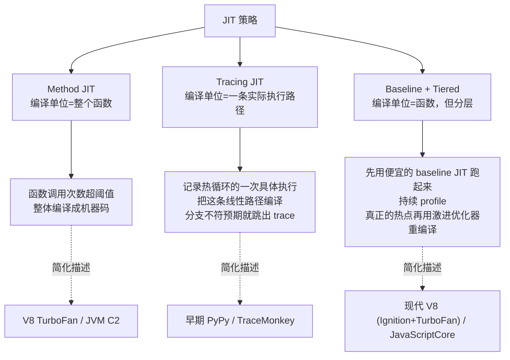
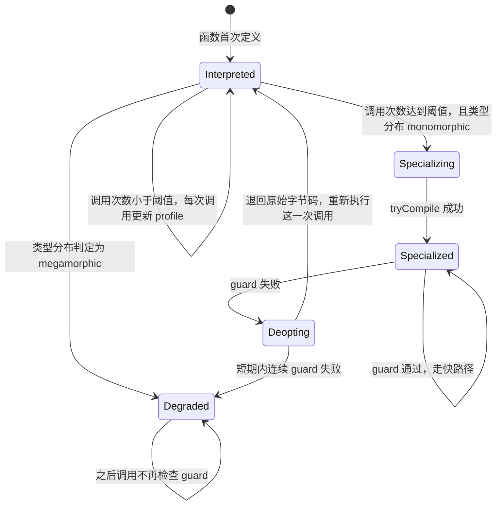
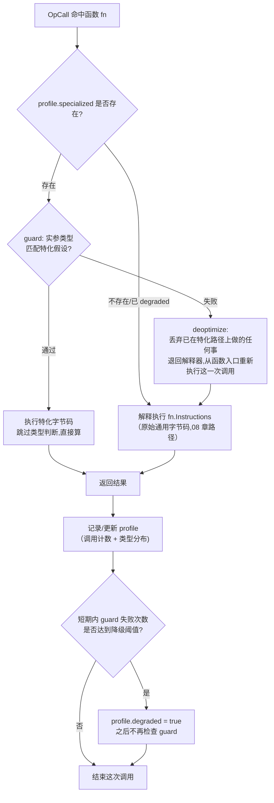

# 14 探索：给 Monkey 加一个 JIT

## 本章要回答的问题

[08 章](08-vm.md) 把 evaluator 换成了字节码 VM，理由是"树遍历每次都要重新判断节点类型、运算符类型"，而这些判断编译一次就够了。但 VM 本身也不是免费的：每条指令要取字节、查 opcode、跳进对应的 `case`、执行、再回到循环头取下一条。这一圈叫**解释开销**（dispatch overhead），它不随程序逻辑变化，只随指令条数变化——`OpAdd` 真正做的事是一次机器加法，取指令、跳转、回到循环头的成本可能比这次加法本身还高。

如果一段字节码被同一个函数反复执行几千次，这份"重复劳动"是不是也可以像 [06 章](06-bytecode.md) 那样**提前做掉**？这正是本章要问的问题：**能不能观察到"这里跑得很热"之后，跳过解释循环本身，直接执行更快的东西？**

这是 [13 章](13-optimization.md)（运行期/编译期优化：inline cache、类型特化 opcode、常量折叠、窥孔优化）的直接延伸，延伸方向是一条时间轴：13 章问"运行期发现类型稳定后，能不能换一条更快的指令"；本章问"能不能连指令本身都跳过，直接生成可执行的东西"。两章共享同一个前提——**运行期的类型分布往往比编译期能证明的更稳定**——但 13 章还在"解释一份数据"的范式里（还是取指令、还是过一遍 VM 循环，只是指令更快），本章要打破这个范式，讨论把一段代码变成"直接跑"的东西，无论那个"直接跑"是一份特化过的字节码，还是真正的机器码。

这也是全套 Monkey 教程的最后一章。和 [12 章](12-static-monkey.md)（静态类型）一样，**这是一个探索性章节**：JIT 是编译原理里最难的一层，真正的生产级实现（V8、LuaJIT、PyPy）动辄几十万行代码，涉及寄存器分配、机器码生成、GC 协作等一整个子领域。本章的目标不是让你写出一个能用的 JIT，而是让你理解它在解决什么问题、有哪些绕不开的设计决策、以及如果你真的想往下走，下一步该看什么方向。**给推导、给骨架、给练习，不给可以直接抄的完整实现**——这次连"完整实现"本身都不现实。

读完本章你应该能回答：JIT 和 [13 章](13-optimization.md) 的优化差在哪一层？为什么"编译哪一段代码"本身就是一个难题？guard 和 deoptimization 是什么，为什么它们比看起来更难？如果只有一个周末，往这个方向走能做到哪一步是合理的？

## 1. 解释开销：字节码 VM 还剩下什么成本

回顾 [06 章第 1 节](06-bytecode.md) 的账：evaluator 执行 `2 * 3` 要做类型断言（`node` 是不是 `*ast.InfixExpression`）、操作符字符串比较（`"*"` 还是 `"+"`）、操作数类型判断，真正的乘法只是最后一行。编译成字节码后，这些"每次答案都一样"的判断被挪到了编译期，VM 只剩：

```text
ip=0  取字节 → 查表得知 OpConstant 需要 2 字节操作数 → 读操作数 → constants[0] 压栈 → ip += 3
ip=3  同上                                                                    → ip += 3
ip=6  取字节 → 查表得知 OpMul 无操作数 → 弹两个、按运行时类型分派、相乘、压回     → ip += 1
```

"取字节 → 查表 → 跳进 case → 执行 → 回到循环头"这五步里，只有"执行"那一步是程序真正要做的事，前后四步是**解释器为了通用而付出的税**。这份税对每条指令都要交一次，`OpAdd` 这种执行体极短的指令，交税的成本可能接近甚至超过执行体本身——这不是猜测，[08 章练习 12](08-vm.md) 已经让你亲手量过"运行时类型分派"这一项的开销；dispatch 本身的开销是同一类问题的另一半，只是更底层，普通 profiling 工具不容易单独把它切出来。

JIT（Just-In-Time compilation，即时编译）的核心想法只有一句话：**如果一段字节码被反复执行（这段代码叫 hot code，热点代码），把它翻译成一次性执行更快的东西，之后每次命中都不再走解释循环**。"翻译成什么"是第 4 节要展开的问题；"怎么知道该翻译哪段"是第 3 节的问题。这两个问题独立可答，但都不简单，这正是 JIT 工程量的来源。

## 2. JIT 的分类：建立地图

在深入任何一个方向之前，先看清整片地图，否则容易把三种完全不同的思路混在一起。三种主流策略的核心区别是**编译的单位是什么**。



**Method JIT（方法级 JIT）**：以函数为单位。一个函数被调用次数超过阈值，就把整个函数体编译成机器码，之后每次调用直接跑机器码版本。优点是"编译单位"和源码里"函数"这个概念直接对应，好理解、好实现；缺点是如果热点在函数内部的一个循环，而函数本身调用次数不多（比如 `main` 里一个跑几百万次的 `while`），method JIT 完全捕捉不到——这正是下一种策略存在的理由。

**Tracing JIT（追踪级 JIT）**：不编译整个函数，而是记录"实际执行的一条路径"。热循环第一次被判定为热点时，解释器进入"记录模式"，把接下来这一轮循环体里**实际发生**的每一步操作和每一次分支选择原样记下来，拼成一条线性的 trace（因为运行时只有一种具体的执行顺序，没有"如果走另一个分支"的枝杈）。这条 trace 被编译成机器码。之后每次进入这个循环，先假设"还会走上次那条路"，直接跑编译后的 trace；如果某次分支选择不一样（trace 里假设 `i < 10` 为真，某次实际为假），就从 trace 中**跳出**（trace exit），退回解释器按正常逻辑执行这一次。

**Baseline + Tiered（分层编译）**：不是"编不编译"的二选一，而是**编译质量分层**。函数第一次变热，先用一个简单快速、不做激进优化的编译器（baseline JIT）迅速把它变成"还行"的机器码，避免长时间困在解释器里；同时持续收集这个函数的运行数据（profile）。如果它被反复调用到"非常热"的程度，再用一个更慢但生成代码质量更高的优化编译器（optimizing tier）重新编译一次，用生成质量换编译时间。这是"编译本身也有成本，值不值得多花时间编译得更好"这个权衡的直接产物。

给一个推荐：**对 Monkey 这种教学项目，method JIT 是最容易理解和起步的方向**，因为编译单位和"函数"这个已有概念完全重合，`CompiledFunction`/`Closure` 已经是现成的载体，不需要引入 trace 记录、trace 合并、trace 退出这一整套额外机制。Tracing JIT 更适合作为进阶方向去研究——Monkey 的 `while` 循环是天然的热点候选，一个函数体本身可能只调用几次,但循环体跑几十万轮——但它的实现复杂度是陡增的，本章不会给它的骨架，只在练习里留一道设计题（练习 7）。分层编译是真实引擎为了解决"阈值两难"（第 3 节）而演化出的方案,原型阶段不必模仿。

## 3. 触发时机：怎么知道"热"

选定 method JIT 的方向后，第一个具体问题是：**怎么判断一个函数值得编译？**

### 调用计数器

最直接的信号是"这个函数被调用了多少次"。给每个函数对象加一个计数器，每次 `OpCall` 命中它就自增，超过阈值就触发编译：

```go
type CompiledFunction struct {
    Instructions  code.Instructions
    NumLocals     int
    NumParameters int
    callCount     int              // 新增：命中 OpCall 的次数
    nativeCode    *NativeFunc      // 新增：编译完成后非 nil，见第 8 节
}
```

`Closure`（[09 章](09-closures.md)）包着 `CompiledFunction`，多个 `Closure` 可能共享同一个 `CompiledFunction`（`newAdder(2)` 和 `newAdder(5)` 是两个 `Closure`，但代码只有一份）。计数器应该挂在 `CompiledFunction` 上而不是 `Closure` 上——这是"编译单位是代码，不是某一次调用现场"的直接体现，呼应 [09 章](09-closures.md)"代码共享、环境独立"那条设计原则。

### 循环计数器与它揭示的更深问题

调用计数器解决不了"热循环藏在一个只调用一次的函数里"这种情况——比如 Monkey 程序里常见的写法：

```monkey
let sum = 0;
let i = 0;
while (i < 1000000) {
    sum = sum + i;
    i = i + 1;
}
```

这段代码所在的"函数"就是主程序本身，只执行一次，调用计数器永远是 1，永远不会触发。但循环体跑了一百万轮，是全程序最热的地方。要捕捉这类热点，需要给循环本身也挂一个计数器——`while` 每完成一轮循环体就自增，超过阈值就认为这个循环是热点。

但这里出现一个 method JIT 处理不了的问题：**循环可能在函数的中间，而这个函数本身还在执行**。调用计数器触发编译的时机是"下一次调用这个函数时",可以干净地在函数入口切换到编译后的版本。循环计数器触发编译的时机是"这次循环正在跑到第 5000 轮的时候",此时**当前这次函数调用还没结束**——解释器已经执行到循环体内部的某条指令,栈上有当前的局部变量、当前的 `ip`，要切换到编译后的代码,必须在**执行中途**把这些状态迁移过去。这就是 **OSR（On-Stack Replacement，栈上替换）**：把解释器执行到某一点时的状态（局部变量的值、当前在循环的第几轮），重建成编译后代码期望的输入状态，然后跳进编译后的代码从对应位置继续跑。

OSR 比"函数入口处切换"难得多，原因是函数入口处的状态非常简单（只有参数,且刚刚从调用方传入,布局是确定的),而循环中途的状态包含"目前为止已经执行了多少局部变量赋值""当前 ip 对应到编译后代码的哪个位置"这类需要一一对应的映射。真实引擎（V8、HotSpot）都实现了 OSR，但它属于 JIT 工程里最容易出隐蔽 bug 的部分之一——第 6 节会继续展开这个话题的另一半：**deoptimization**，即 OSR 的逆过程。

### 阈值怎么定：一个真实的两难

阈值定太低：编译本身要花时间（哪怕是"生成特化字节码"这种轻量形式，也要遍历指令、分析 profile、写出新指令流），如果函数总共只被调用几十次,编译开销可能超过它能省下来的解释开销,净收益为负。阈值定太高：函数已经跑了很久还在用慢速解释器,错过了本可以拿到的加速。

这个两难没有一个"正确"的阈值——它取决于编译本身的成本、解释执行的成本、程序的调用分布,三者都因实现而异。真实引擎绕开"选一个数"这个难题的方式正是第 2 节提到的**分层编译**：先用几乎不花时间的 baseline JIT 兜底（哪怕生成的代码不够快,至少比解释器快,亏损很小),再用一个更高的阈值筛出"真正值得投入昂贵优化"的那一小部分函数。本章的原型只做一层（第 4 节的"运行期特化重编译"),阈值就选一个固定数字,不追求最优,但要在第 9 节诚实地讨论这个简化的代价。

### 用数字感受这个两难

假设(纯粹为了建立直觉,不是实测数据):解释执行一次 `OpAdd` 平均耗时 50 纳秒,特化后的 `OpAddIntFast` 耗时 10 纳秒(省下 40 纳秒),而 `tryCompile` 遍历一次函数指令流、生成特化版本平均耗时 5000 纳秒(5 微秒)。

- 函数总共只被调用 100 次:不特化,总耗时 `100 × 50ns = 5000ns`；特化后(假设第 50 次触发编译),总耗时 `50×50ns(解释) + 5000ns(编译) + 50×10ns(特化) = 2500+5000+500 = 8000ns`。**特化反而更慢**,因为省下来的 `50×40ns=2000ns` 覆盖不了 5000ns 的编译成本。
- 函数被调用 100000 次:同样第 50 次触发编译,总耗时 `50×50ns + 5000ns + 99950×10ns ≈ 2500+5000+999500 = 1007000ns`；不特化的总耗时是 `100000×50ns = 5000000ns`。**特化后快了近 5 倍**,因为省下来的时间摊在了近 10 万次调用上。

这两个数字算出的分界点大致在"调用次数是否远超编译成本 ÷ 单次节省"这个比值附近——具体到这里,`5000ns ÷ 40ns ≈ 125` 次,超过这个次数,特化才开始有净收益;调用次数越往上,收益越明显。**这就是阈值存在的意义**:阈值本质上是在猜"这个函数接下来还会被调用多少次",猜得越准,阈值定得越合理。真实引擎的分层编译不猜一次就定终身,而是持续观察、动态调整——这也是为什么"选一个固定阈值"始终是一种简化,不是真正的解法。

## 4. 编译目标：JIT 编译到什么

这是全章最关键的设计决策。"JIT"这个词容易让人直接联想到"生成机器码",但机器码只是三个可选目标里最难的一个。三个选项按现实程度从高到低排列。

### 选项 A：编译到更好的字节码

不生成真正的 native code,而是把热点函数**重新编译成一份特化过的字节码**。特化的依据是运行期观察到的类型分布：如果一个加法点 1000 次调用全是 `Integer`,就把通用的 `OpAdd`（[08 章第 5 节](08-vm.md),运行时判断 int/float/string）换成 [13 章](13-optimization.md) 引入的类型特化 opcode `OpAddInt`（跳过判断,直接做整数加法）。

这严格来说**不是传统意义上的"即时编译"**——它没有生成任何 CPU 能直接执行的东西,产物依然是一份要喂给 VM 主循环解释执行的字节码,只是这份字节码更"瘦"。更准确的说法是**运行期驱动的重编译**（runtime-guided recompilation）。但对教学项目来说,这是最现实的起点：不需要处理目标平台的机器码格式、寄存器分配、调用约定这些工业级复杂度,同时**完整体验了 JIT 的核心问题结构**——profiling、speculation、guard、deoptimization 一个不少（第 5、6 节展开）。

### 选项 B：编译到真正的机器码

用 Go 生成 x86-64 或 ARM64 的机器码字节,写入一块可执行内存,让 CPU 直接跳过去执行。这是"JIT"这个词通常暗示的画面,但要跨过极高的门槛：

- **寄存器分配**：Monkey 的值住在解释器的栈上,机器码执行时要决定哪些值放进 CPU 寄存器、哪些留在内存,这是一个本身就足够写一整本书的子领域。
- **调用约定**：生成的机器码要能被 Go 代码调用、也要能调用回 Go 代码（比如遇到内置函数）,必须遵守平台的调用约定（参数怎么传、返回值怎么传、哪些寄存器调用者保存哪些被调用者保存）。
- **与 Go runtime 的边界**：这是最深的坑。Go 的 GC 需要知道每个时刻哪些内存位置存着指针,才能正确地标记和移动对象。手写的机器码里,如果一个寄存器或栈槽存的是 `*object.String` 的地址,GC 完全不知道——它可能在你还在用这个指针的时候把对象回收掉,或者在移动式 GC 场景下把对象挪走而不更新你手里的地址。真实 JIT（V8、HotSpot）都要生成额外的**栈映射**（stack map）元数据告诉 GC "这个栈帧的第几个槽位是指针",这部分工程量往往超过代码生成本身。
- **可执行内存**：机器码字节要写进一块标记为可执行的内存页（通常通过 `mmap` 加 `PROT_EXEC`),Go 标准库不直接提供这个能力,`plugin` 包也不适用（它是加载完整的 `.so` 文件,不是运行期拼字节)。

**这明确超出了教学项目的合理范围**。本章不给这个方向的代码,只给方向性参考:搜索 "writing a JIT compiler in Go"、"how to JIT compile in Go" 一类的关键词,能找到一些手写 x86-64 字节 + `mmap` 的最小示例,适合"体验一次生成机器码是什么感觉",但不要指望能接到 Monkey 现有的 VM 上——GC 交互这一项就足够让这条路线在业余时间里不现实。

### 选项 C：编译到另一种可执行中间层

把热点函数翻译成一段 Go 源码字符串,再调用 `go build` 编译成 `.so` 用 `plugin` 加载执行;或者接入现成的字节码 JIT 库。前者的问题是 `go build` 的编译延迟是几百毫秒到几秒量级——远超过它想要节省的解释开销,只适合"理解生成代码这个概念"的实验,不适合真实的 JIT 场景（JIT 的前提就是编译本身必须足够快,否则不如一直解释执行)。

### 推荐：选项 A

教学项目应该做**运行期特化重编译**。它把 [12 章](12-static-monkey.md)（静态类型可以消除装箱和运行期类型判断）和 [13 章](13-optimization.md)（运行期观察到的类型稳定性可以驱动类型特化 opcode）已经建立的认识,和"这种观察只能在运行期做,编译期看不到实际的调用数据"这个事实结合起来,构成一个最小闭环:

```text
观察类型分布 → 达到阈值 → 生成特化字节码 → 用特化版本替换原指令流的入口
```

这比真正的机器码 JIT 现实得多——不用碰机器码格式、不用碰 GC 边界——但正因为"目标还是字节码",很容易让人误以为它"不算真正的 JIT",这个误会需要提前澄清:**JIT 的本质不是"生成机器码",是"运行期观察执行情况,动态生成更快的可执行形式"**。是否生成机器码只是"更快"这个目标下的一个实现选择,选项 A 生成的特化字节码依然完整具备 speculation（推测类型稳定）、guard（验证推测）、deoptimization（推测失败时退回)这三个 JIT 的核心机制——这三者才是 JIT 真正难的地方,第 5、6 节展开。

### 三个选项的横向对比

| | 选项 A：特化字节码 | 选项 B：真机器码 | 选项 C：生成源码再编译 |
| --- | --- | --- | --- |
| 产物 | 更瘦的 `code.Instructions` | CPU 可直接执行的字节序列 | `.go` 源码 → `.so` |
| 需要处理 GC 边界 | 否——依然是 `object.Object`,GC 全程可见 | 是——栈映射、指针标记全要自己做 | 否 |
| 需要寄存器分配 | 否 | 是 | 否(交给 `go build`) |
| 编译延迟 | 微秒到毫秒级(遍历一份指令流) | 微秒级(生成字节)但前期工程量巨大 | 几百毫秒到秒级(`go build` 本身) |
| 是否适合 Monkey 原型 | 适合 | 不适合(GC 边界工程量超出范围) | 不适合(延迟超过它想节省的开销) |
| 能否体验完整的 JIT 核心问题(guard/deopt/speculation) | 能,完整体验 | 能,但被工程细节淹没 | 不能——延迟太高,反复编译本身就不成立 |

这张表把"现实程度"翻译成了具体维度:选项 A 唯一牺牲的是"生成物本身不是机器码",但它换来的是**每一个 JIT 真正难的问题(第 5~7 节)都还在,而工程门槛降到了一个假期能碰的范围**。这是它作为教学项目起点的完整理由。

### 分层执行策略的状态转换

第 2 节的图画的是"三种策略是什么",这里画一张更具体的图,对应本章选定的方向——一个函数从"从未执行"到"被特化"经历的状态转换:



这张图里 `Specialized` 不是一个"永久"状态——它随时可能因为一次 guard 失败退回 `Interpreted`,也可能在退回之后的下一次调用里重新回到 `Specialized`(如果那只是偶发的类型波动)。只有连续失败、被判定为 megamorphic 时,才会进入 `Degraded`——一个几乎"永久"的状态(第 7 节继续展开这个判断的依据)。这个转换图和真实分层引擎的"interpreter → baseline → optimizing"状态机是同构的,只是本章的原型只有两层(解释执行、特化执行),没有第三层"更激进的优化"。

## 5. Speculation 与 Guard：JIT 的核心机制

**Speculation（推测）** 是 JIT 生成特化代码时做的一个赌注:"这个加法点的操作数,过去 1000 次全是 Integer,我赌接下来也是"。这个赌注**不保证永远成立**——Monkey 是动态类型语言,同一个加法点理论上随时可能收到不同类型的操作数（比如上层调用方传了一个 `Float`)。

如果只生成 `OpAddIntFast`（假设它跳过类型判断直接做 `int64` 加法)而不做任何检查,一旦赌注落空,程序会拿到一个错误结果甚至 panic（把 `Float` 的位模式硬解释成 `int64` 是未定义行为)。**这就是为什么特化代码前面必须有 guard（守卫检查)**:执行特化路径之前,先用一条廉价的检查确认这次的操作数确实是预期的类型,确认通过才走快路径,不通过就退回慢路径重新执行。

具体到 Monkey:一个函数 `fn(a, b) { a + b }` 被观察到调用 1000 次,操作数全是 `Integer`。JIT 生成的特化版本大致是:

```text
[guard: a is Integer]     ← 检查失败就跳到 fallback
[guard: b is Integer]     ← 检查失败就跳到 fallback
OpAddIntFast              ← 两个 guard 都通过才会执行到这里
                             跳过 08 章 OpAdd 里的类型 switch,直接做 int64 加法
```

如果某次调用传了 `Float`,第二条 guard 失败,JIT **不会**尝试"硬着头皮跑下去",而是**deoptimize**：放弃这条特化路径,退回到原始的通用字节码（还是那条会做类型判断的 `OpAdd`),重新执行这一次调用。这次调用不享受加速,但结果依然正确——这正是下一节要讲的"退回"具体要做什么。

### 正确性论证：guard 失败必须无损退回

这里有一条不能退让的要求,直接继承自 [13 章](13-optimization.md)"优化必须保持语义"的铁律,并且更进一步：**guard 失败时,程序必须能够在执行中途切换回慢速路径,而不改变任何可观察的结果**。这要求 JIT 生成的特化路径和原始路径在语义上**完全等价**,唯一的区别是速度。换句话说,特化路径不是"另一种做法",它只是"原始做法在类型已知时的一个快捷方式",guard 就是那句"如果类型真的如我所料"的显式条件。

这条要求听起来是常识,但它对实现提出了一个很具体的约束:**任何时候都不能只生成快路径,必须同时保留一份可以退回的慢路径**,而且两条路径要能在任意一次调用里无缝切换——这正是第 6 节要讨论的 deoptimization 为什么难。

## 6. Deoptimization：最容易被低估的难点

"deopt"这个词容易被简化理解成"改用慢一点的代码",但它真正要解决的问题是:**在任意一个执行点上,安全地把状态从"特化路径的表示"转换回"解释器能理解的表示",然后从那个点继续跑,不丢失任何已经完成的计算,不重复任何已经产生的副作用**。

复杂度取决于 guard 检查放在哪。

**如果 guard 只放在函数入口**（method JIT 最简单的形式):函数调用的那一刻,先检查这次的实参类型是否匹配特化时的假设,匹配就跳进特化版本,不匹配就直接走原始版本——**两条路径在同一个"干净"的时间点二选一,没有中间状态要迁移**。这是 deopt 能做到的最简单形式,本章的原型会限定在这里(第 8 节)。

**如果 guard 在函数中间**（比如循环体内每轮迭代都检查一次类型稳定性,为将来支持 OSR 铺路):deopt 需要重建"如果用解释器执行到这里,栈上、局部变量里应该是什么状态"。这是第 3 节提到的 OSR 的逆过程——OSR 是"解释器状态 → 编译后代码期望的状态",这里的 deopt 是反方向"编译后代码执行到一半的状态 → 解释器能接手的状态"。

### 一个具体场景,感受它的复杂度

一个特化过的循环体,前 500 次迭代操作数全是 `Integer`,享受了特化路径的加速。第 501 次迭代,某个中间结果变成了 `Float`（比如上一轮的除法产生了非整数结果),guard 失败。此时必须能回答:

- 这是循环的第几轮?（决定接下来该跳回原始字节码的哪个跳转目标)
- 循环变量当前的值是多少?（如果特化路径把循环变量放在了和解释器不同的表示里——比如拆箱成裸 `int64`,而解释器期望装箱的 `*object.Integer`——这里需要一次转换)
- 其他局部变量此刻的值是多少?（同上,可能需要逐个转换表示)

三个问题的答案共同构成"重建的解释器状态",缺一个都会导致退回后的执行从错误的地方、用错误的值继续——这类 bug 的可怕之处在第 7 节详细展开。

如果特化路径把循环变量 `i` 和累加器 `sum` 都拆箱成裸 `int64`(呼应 [12 章第 1.3 节](12-static-monkey.md) 讨论过的非装箱收益),状态重建要做的转换大致是这样一张对照表:

| 状态项 | 特化路径里的表示 | 解释器期望的表示 | 转换动作 |
| --- | --- | --- | --- |
| 循环轮数 | 特化代码内部的一个计数器变量 | 原始字节码里"回跳到条件判断"这条指令的地址 | 不需要转换值,但要能定位跳转目标 |
| `i` | 裸 `int64`,可能就放在一个 Go 局部变量里 | `stack[basePointer+i]` 里的 `*object.Integer` | 装箱:`&object.Integer{Value: i}`,写回栈槽 |
| `sum` | 裸 `int64` 或 `float64`(取决于是否已经因为某次运算提升成了浮点) | `stack[basePointer+j]` 里对应类型的 `Object` | 按当前实际类型装箱,写回栈槽 |

这张表的核心教训是:**拆箱换来的性能收益,在 deopt 的那一刻要连本带利还回去**——每一次退回都要把所有拆箱的值重新装箱。如果 deopt 发生得足够频繁(比如一个 megamorphic 的循环反复在特化和退回之间震荡),这份"还债"的成本可能反而让整体变慢,这是本章原型刻意回避循环内 OSR 的另一层理由:函数入口的 guard 不涉及任何拆箱状态的中途转换,状态重建的问题域直接被消除,不是被解决。

### 教学项目的简化方案

本章的原型**只支持函数入口的 guard**,不支持循环内 OSR。代价是：如果热点是"函数调用次数不多,但函数内有一个跑几十万轮的循环",这种情况完全捕捉不到——只在函数入口检查,而这个函数本身可能只被调用一次。这恰好是第 2 节里 tracing JIT 存在的理由之一：它专门针对"循环本身很热,而不是函数调用很频繁"这种场景。

这是一个**刻意的简化**,用来把 deopt 的实现复杂度从"任意执行点重建状态"降到"函数入口二选一",工程量差了一个数量级。付出的代价是明确的、有名字的（"错过循环内热点"),不是稀里糊涂地丢掉一部分正确性。真实引擎不这么简化,是因为生产环境里大量真实的热点恰恰长在长循环里,放弃 OSR 意味着放弃这类程序的大部分收益——但那是生产级引擎的取舍,不是教学原型的取舍。

## 7. 多态：从 inline cache 到 JIT 的桥接

[13 章](13-optimization.md) 的 inline cache（内联缓存)已经引入了一个分类,本章直接继承它,因为它是决定"要不要特化"的判断依据:

| 分类 | 含义 | 特化策略 |
| --- | --- | --- |
| **monomorphic**（单态） | 这个调用点/操作点观察到的类型**始终是同一种** | 特化收益最大——一个 guard,一条快路径,几乎不会失败 |
| **polymorphic**（多态） | 观察到 2~4 种不同类型,但种类有限、相对稳定 | 生成一张"类型分派表":依次尝试几个 guard,命中哪个就走哪个特化路径,都不中才落到通用路径 |
| **megamorphic**（超多态） | 类型种类太多、或者一直在变 | 放弃特化,退回通用路径——此时特化的记录、检查、维护成本已经超过它能省下的时间 |

这张表解释了为什么"该不该编译"不是一个只看调用次数的判断:一个函数被调用了 10000 次,但每次操作数类型都不一样(megamorphic),这个函数的调用计数器早就超过阈值,但**特化对它没有意义**——guard 几乎总是失败,退回慢路径的开销反而比原来的通用路径更贵(多了一次失败的类型检查)。第 8 节的 profile 数据结构需要同时记录"调用次数"和"类型分布",两者缺一个都做不出正确的编译决策。

这也解释了本章第 6 节手算 trace 2 里"guard 失败后不立即重试"的设计:一次 guard 失败可能只是偶然(1000 次里 1 次意外传了 `Float`),但连续失败、或者短期内出现第三种类型,就是 polymorphic 甚至 megamorphic 的信号,应该降级到"暂停尝试特化"而不是每次都重新赌一把。

## 8. 一个最小可行原型的架构骨架

把前几节的结论拼起来。这是一个**示意骨架**,不要求可编译,目的是让"运行期特化重编译"这个闭环在你脑子里有一个完整的、可以指着说"这一步对应哪一节"的样子。

```go
// ProfileData 记录一个函数的调用次数和观察到的操作数类型分布。
// 类型组合用固定长度数组做 key——本章的原型只处理二元算术,
// 真实实现要按调用点(不是按函数)记录,一个函数体内可能有多个加法。
type ProfileData struct {
    callCount    int
    typeObserved map[[2]object.ObjectType]int // 操作数类型组合 → 出现次数
    specialized  code.Instructions            // 编译完成后非 nil：特化过的字节码
    degraded     bool                         // 观察到 megamorphic 后置位,不再尝试特化
}

type VM struct {
    // ... 08 章已有字段：stack/sp/globals/frames/framesIndex
    profiles map[*object.CompiledFunction]*ProfileData
}
```

`OpCall` 执行时的伪代码,分三段看:

```text
① 记录 profile（每次调用都做,开销必须极小）
    fn := 被调用的 CompiledFunction
    profile := vm.profiles[fn]        // 不存在就新建
    profile.callCount++
    profile.typeObserved[操作数类型组合]++

② 判断是否要触发编译（只在跨过阈值的那一次做,之后不再判断）
    if !profile.degraded && profile.specialized == nil && profile.callCount == Threshold {
        if isMonomorphic(profile.typeObserved) {     // 呼应第 7 节的分类
            profile.specialized = tryCompile(fn, profile)  // 生成特化字节码
        } else if isMegamorphic(profile.typeObserved) {
            profile.degraded = true                   // 放弃,不再检查
        }
        // polymorphic 情形：本章原型不处理,留给练习
    }

③ 决定走哪条路径
    if profile.specialized != nil {
        ok := runWithGuard(profile.specialized, 实参)   // 特化路径,内含 guard
        if !ok {
            runInterpreted(fn.Instructions, 实参)         // guard 失败,退回原始字节码
        }
    } else {
        runInterpreted(fn.Instructions, 实参)             // 还没特化或已放弃,走原始字节码
    }
```

`tryCompile` 的职责是"看着原始的 `fn.Instructions`,把已确认稳定的类型点上的通用 opcode 换成特化 opcode,并在换掉的地方前面插入对应的 guard"——这一步的具体算法本章不展开(它本质是 [13 章](13-optimization.md)"类型特化 opcode"那节要解决的编译问题,只是触发时机从"编译期能证明"变成了"运行期观察到"),练习 2、3 会带你把这一步走一遍最小版本。

`runWithGuard` 的返回值(布尔值,是否命中)是"guard 失败要不要 fallback"这件事在代码里唯一需要新增的判断——**其余所有正确性都来自"两条路径的原始字节码/特化字节码在语义上等价"这条不变量**,这是第 5 节正确性论证的直接体现,也是第 12 节测试清单里差分测试要验证的核心。

明确一点:这个骨架里出现的"编译"始终是**生成一份新的 `code.Instructions`**,不是任何形式的机器码。`nativeCode` 这个名字如果让人联想到 native code,这里改用 `specialized` 更准确——它强调产物依然是字节码,只是"更瘦"的字节码,呼应第 4 节选项 A 的结论。

### `tryCompile` 具体在改写什么

用 [06 章第 13 节](06-bytecode.md)的反汇编格式,看一个具体例子。`fn(a, b) { a + b }` 原始编译产物(08 章路径,通用 `OpAdd`)大致是:

```text
0000 OpGetLocal 0        ; a
0002 OpGetLocal 1        ; b
0004 OpAdd               ; 运行时判断 int/float/string,2 → 1
0005 OpReturnValue
```

观察到 1000 次调用全是 `(Integer, Integer)` 之后,`tryCompile` 生成的特化版本:

```text
0000 OpGetLocal 0        ; a
0002 OpGetLocal 1        ; b
0004 OpGuardInt   0009   ; 若栈顶第二个值(a)不是 Integer,跳到 0009(deopt 出口)
0007 OpGuardInt   0009   ; 若栈顶值(b)不是 Integer,跳到 0009
0009 OpAddIntFast        ; 两个 guard 都过,直接 int64 加法，2 → 1
000a OpReturnValue
```

（`OpGuardInt` 是本章虚构的新 opcode,不是 06 章已定义的 29 条之一——真要实现,需要按 06 章第 2 节的方法把它正式加入指令集：确定操作数宽度、栈效果、写进 `Definition` 表,这一步留给练习 3。）这里的关键结构是:**guard 检查失败时跳转的目标不是"继续走特化路径的下一条",而是一个专门的 deopt 出口**,那个出口负责调用 `runInterpreted(fn.Instructions, ...)`——也就是说,特化版本本身携带着"失败了去哪"这条信息,不需要 VM 主循环额外判断。

### `runWithGuard` 的骨架

```go
// runWithGuard 尝试执行特化字节码。返回 (结果, 是否命中特化路径)。
// 命中失败时,结果值无意义,调用方必须转去 runInterpreted。
func (vm *VM) runWithGuard(specialized code.Instructions, args []object.Object) (object.Object, bool) {
    // 把 args 按特化版本期望的布局压栈（布局必须和原始版本一致，
    // 否则 basePointer 的语义会错——见 08 章第 9 节）
    for _, a := range args {
        if err := vm.push(a); err != nil {
            return nil, false
        }
    }
    // 执行特化指令流，遇到 OpGuardInt 失败就在这里直接返回 false，
    // 不需要真的跳转到某个"出口地址"——教学实现里，
    // guard 失败直接从这个函数 return 比模拟一次跳转更简单。
    result, guardOK := vm.runSpecializedLoop(specialized)
    if !guardOK {
        vm.sp -= len(args) // 撤销刚才为特化路径压的栈，还原成调用前的状态
        return nil, false
    }
    return result, true
}
```

这个骨架里最容易漏的一步是`vm.sp -= len(args)`那一行:**guard 失败之后,栈必须恢复到"就像刚才什么都没执行过"的样子**,因为接下来 `runInterpreted` 要重新压栈、重新执行一次完整的调用协议(08 章第 9 节的 `basePointer` 计算)。如果不撤销,重复的栈内容会让 `runInterpreted` 算出错误的 `basePointer`——这正是第 12 节陷阱③要警告的那类"deopt 路径本身的 bug"的一个具体例子。

## 9. 什么时候不值得做 JIT：工程判断

前八节铺开了完整的设计空间,这一节要往回拉一步,诚实地评估:**这套机制对 Monkey 值不值得?**

Monkey 是一门教学语言,典型程序很短——几十行、跑几毫秒到几秒。JIT 的收益模型是"编译一次,之后每次命中都省一点",这个模型只有在**同一段代码被反复执行足够多次**时才成立。第 3 节已经点出这个两难:编译本身要花时间,如果程序总运行时间本身就短,编译开销占比可能远远超过它能省下的解释开销——花 1 毫秒"编译"一个只会再被调用 10 次、每次省 10 微秒的函数,净收益是负的。

这不是 Monkey 独有的问题,是 JIT 这项技术本身的适用范围问题:**JIT 主要在长时间运行的服务里有意义**——浏览器要反复执行同一段 JS 直到用户关闭标签页,数据库要反复执行同一条查询逻辑,应用服务器要反复处理同一种请求。这些场景里"同一段代码执行几十万次"是常态,编译开销分摊下来微不足道。一次性脚本、命令行工具、教学语言的示例程序,这个前提通常不成立。

**如果目标是"让 Monkey 变快",按投入产出比排序,JIT 大概率不是最优先的一步。** [12 章](12-static-monkey.md) 的静态类型系统在编译期一次性消除装箱和运行期类型判断,不需要运行期观察、不需要 guard、不需要 deopt,复杂度低一个数量级,收益却覆盖每一次执行(不需要先热身)。[13 章](13-optimization.md) 的窥孔优化和 inline cache 甚至更轻——很多是几行代码的局部改写。这两者投入的工程量,换回的收益都比本章讨论的运行期特化更确定。

这条评估不是要否定本章的内容,而是要**诚实地摆正它的位置**:本章存在的意义是**理解概念、看清全貌**——JIT 是几乎所有高性能动态语言运行时(V8、PyPy、LuaJIT、JVM 的 HotSpot)共享的核心技术,理解它的设计决策(编译什么、什么时候编译、怎么保证正确性)是理解这些系统的必经之路。但这不等于"你现在就应该去把它实现完"。如果你只有有限的时间,先把 [12](12-static-monkey.md)、[13](13-optimization.md) 章的内容做扎实,回报会更快兑现。

## 10. 手算 trace

真实机器码超出本章范围,这里的两个 trace 都是概念性推演——推的是"走哪条路径、状态怎么变",不是真实字节码的逐条模拟。

### Trace 1：调用计数器触发编译

假设阈值 `Threshold = 1000`,函数 `add := fn(a, b) { a + b }` 被调用 1500 次,操作数全是 `Integer`(monomorphic)。

| 调用序号 | `callCount` | 走哪条路径 | 说明 |
| --- | --- | --- | --- |
| 1 | 1 | 解释执行 `fn.Instructions` | `profile.specialized == nil` |
| … | … | 解释执行 | 每次都记录类型,`typeObserved[{INT,INT}]++` |
| 999 | 999 | 解释执行 | 还没到阈值 |
| 1000 | 1000 | 解释执行**这一次**,调用结束后触发编译 | `callCount == Threshold`,检测到 monomorphic,`tryCompile` 生成 `profile.specialized` |
| 1001 | 1000(不再增,或继续增仅用于统计) | **特化路径**,guard 检查 `a,b` 是否为 `Integer`,通过 | 第一次享受加速 |
| 1002–1500 | — | 特化路径,guard 全部通过 | 499 次全部命中快路径 |

关键点:第 1000 次调用本身**依然走的是解释路径**——编译发生在这次调用**执行完之后**,不是"提前预判要到 1000 次了就在第 999 次编译"。这避免了一种时序错误:如果编译发生在阈值判断的同一次调用**之内**,`tryCompile` 用来做决策的 `typeObserved` 数据就少了这一次的样本,可能在数据不完整时就做出编译决策。

### Trace 2:guard 失败触发 deopt,以及后续降级

同一个 `add` 函数,继续从第 1001 次调用算起,前 500 次(第 1001~1500 次)操作数都是 `Integer`,特化生效。第 1501 次调用传入了一个 `Float`:

| 调用序号 | 操作数类型 | 走哪条路径 | 结果 |
| --- | --- | --- | --- |
| 1001–1500 | `(Integer, Integer)` | 特化路径,两个 guard 都通过 | 直接 `int64` 加法,正确 |
| 1501 | `(Integer, Float)` | 特化路径的 guard 检查第二个操作数失败 → deopt | **退回 `fn.Instructions` 重新执行这一次调用**,通用 `OpAdd` 判断类型、做 int→float 提升、返回正确的 `Float` 结果 |
| 1502 | `(Integer, Integer)` | 特化路径,guard 通过 | 恢复走快路径,正确 |
| … | 假设第 1501~1510 次里连续出现 3 次非 `Integer` 组合 | 每次都 deopt 退回 | `profile.typeObserved` 里 `Float` 相关组合的计数上升 |
| 1511 | — | `isMegamorphic` 判定成立(类型分布不再稳定) | `profile.degraded = true`,**放弃继续尝试特化**,之后调用直接走解释路径,不再检查 guard |

这张表体现了两层决策:**单次 guard 失败只触发这一次的 deopt**,不代表放弃整条特化路径(第 1502 次立刻恢复走快路径);但**短期内反复失败**是"这个调用点其实是 polymorphic/megamorphic,不是稳定的 monomorphic"的信号,此时应该停止继续赌,退回纯解释执行,避免"guard 检查的开销 + 反复 deopt 的开销"比一直老老实实解释执行还贵。这正是第 7 节那张分类表在时间维度上的体现。

## 11. 图示：guard 失败与 deopt 的控制流

第 2 节的图画的是三种 JIT 策略的分类,这里补第二张图,画清一次具体调用在"正常路径"和"guard 失败退回解释器"这两条分支上分别发生了什么。



这张图里最容易被忽略的一条边是 `Deopt → Interp`:它意味着**特化路径和解释路径最终汇合到同一段代码**——退回之后走的不是"另一份专门为 deopt 场景写的逻辑",而是**原本就存在、从第 0 次调用就在用的那份通用字节码**。这是第 5 节正确性论证的直接后果:如果 deopt 之后走的是第三条路径,就相当于引入了第三种语义,差分测试的复杂度会从"两条路径对齐"变成"三条路径两两对齐",没有必要。

## 12. 边界与陷阱

**① 编译阈值设置不当。** 第 3 节已经展开过两难:阈值太低,编译开销压过收益,一个只会再调用几次的函数被白白编译一次;阈值太高,长时间困在慢速路径上,错过大部分本可以拿到的加速窗口。没有万能答案,真实引擎用分层编译规避这个选择,教学原型只能承认"这是一个凭经验设的数字"。

**② guard 检查本身的开销被低估。** guard 不是免费的——它至少是一次类型检查(接口断言或 `Type()` 调用)。如果特化路径的执行体本身很短(比如就是一次加法),而 guard 有两三个(检查每个操作数),guard 的总开销可能侵蚀掉特化省下来的时间,净收益趋近于零甚至为负。这正是真实 JIT 工程里"把 guard 提到循环外"这类优化的动机:如果能证明循环体内每轮的操作数类型不会变(比如循环变量的类型在循环开始前就已确定,循环体内没有可能改变它类型的赋值),就可以把 guard 挪到循环外只检查一次,循环内部直接跑快路径——本章的原型没有做这一步,只在函数入口检查一次,天然没有这个问题,但如果你按练习 6/7 往 OSR 方向扩展,这条优化会很快变得必要。

**③ deopt 路径本身的 bug 是最难调的一类。** 如果状态重建有错——比如第 6 节场景里,重建局部变量值的逻辑漏看了一个变量,或者把循环轮数算错了一格——症状不是"deopt 立刻崩溃",而是**deopt 之后继续跑,产生一个看起来合理但是错误的结果**。这类 bug 极难复现:特化路径本身可能跑得完全正常(测试覆盖的输入恰好没有触发 guard 失败),直到某天线上数据的类型分布变了,第一次真正触发 deopt,结果悄悄错了却没有任何报错信号。这是本章要专门警告的一类问题——**guard 失败的路径和 guard 通过的路径同等重要,测试覆盖必须显式包含"故意让 guard 失败"的用例**,不能只测"特化生效"这一半。第 13 节的差分测试清单把这条落成了具体的测试项。

**④ 闭包与 JIT 的交互。** [09 章](09-closures.md) 的自由变量(free variable)在特化字节码里怎么处理?一个闭包 `fn(b) { a + b }` 的 `a` 来自 `Closure.Free`,和参数 `b` 一样,理论上也可能观察到"稳定的类型"。如果要为这类函数做特化,`profile.typeObserved` 除了记录参数类型,也要记录 free 变量的类型,guard 也要覆盖它们——否则会出现"函数体内看起来只检查了参数类型,但实际读取的 `a` 类型已经变了"的漏洞。这个问题在教学原型里可以先只处理"没有 free 变量的函数"(顶层函数、非闭包),把闭包场景留给练习。

**⑤ 递归函数的自我调用要不要也走特化路径。** 一个递归函数(比如 `fib`)被特化之后,函数体内如果有 `OpCurrentClosure` 加 `OpCall` 这样的自调用([09 章](09-closures.md)),这个调用点默认还是走原来的调用协议,跳进未特化的入口重新判断。如果想让递归调用也直接跳进特化版本,需要在生成特化字节码时把自调用的目标也替换掉——这已经是**内联**(inlining)的范畴:把被调用者的代码直接嵌入调用者,消除调用本身的开销。内联是比本章讨论的一切都更进一步的优化,真实 JIT 里内联决策本身就是一整套独立的启发式规则(候选函数多大、调用多频繁、内联后代码膨胀多少),本章只提及,不展开。

**⑥ 并发场景下的原子性(简单提及)。** Monkey 目前是单线程,本章的所有讨论都假设"运行期改写指令流指针"这个操作不会和别的线程冲突。如果未来给 Monkey 加并发,"用特化字节码替换 `profile.specialized`"和"读取 `profile.specialized` 决定走哪条路径"这两步就需要考虑原子性——一个线程正在读取旧指针执行,另一个线程完成了编译要写入新指针,如果不加保护可能读到一个"写了一半"的状态。真实引擎在这里会用原子指针替换或者更细粒度的同步机制。这不是本章要解决的问题,但值得知道它存在。

**⑦ 忘记 13 章的教训:优化必须能被差分测试覆盖。** [13 章](13-optimization.md) 反复强调"优化不能改变可观察结果"。JIT 是这条原则的极限考验,因为它引入了一个新的分叉维度——**同一个程序,开启运行期特化和关闭运行期特化,必须产生完全相同的可观察结果**。这不只是"结果值相同",还包括错误信息、副作用发生的顺序(如果 guard 检查涉及有副作用的操作,虽然本章的场景里 guard 只检查类型,不触发副作用)。第 13 节把这条要求落成本章最重要的测试项。

## 13. 验收测试清单

下面是一份可以落成 `vm/jit_test.go` 的骨架。**强调一遍:这是概念验证级别,不是生产级测试**——它验证"闭环的逻辑是对的",不追求覆盖所有边界情况,也不测量真实的性能提升(性能验证属于 [09](09-closures.md)/[13](13-optimization.md) 章已经建立的 benchmark 方法论,不是本章重点)。

```go
package vm

import "testing"

// ① 调用计数器正确递增,并在阈值触发编译
func TestCallCounterTriggersCompilation(t *testing.T) {
    // 编译一个简单函数 fn(a,b){a+b},运行 Threshold 次,
    // 每次传 Integer 操作数。
    // 断言:第 Threshold-1 次之前 profile.specialized == nil,
    //      第 Threshold 次调用之后 profile.specialized != nil。
}

// ② guard 检查在类型匹配时走快路径
func TestGuardPassesTakesFastPath(t *testing.T) {
    // 用一个可观测的标记验证走了特化路径而不是通用路径——
    // 比如给 runWithGuard 加一个只在测试里启用的计数器 fastPathHits,
    // 不要用真实耗时判断"走了哪条路径"(耗时波动大,容易测出假阳性/假阴性)。
    // 先跑够 Threshold 次触发编译,再跑几次 Integer 操作数,
    // 断言 fastPathHits 增加,且结果值正确。
}

// ③ guard 检查失败时正确 fallback,且结果依然正确
func TestGuardFailsFallsBackCorrectly(t *testing.T) {
    // 先跑够 Threshold 次 Integer 操作数触发编译,
    // 再传一次 (Integer, Float),断言:
    //   - 结果等于"不做任何特化,直接跑原始字节码"应得的结果
    //   - deopt 计数器(测试专用)增加了 1
    //   - 之后再传 Integer 操作数,又能恢复走快路径(除非已被判定 degraded)
}

// ④ 差分测试:开启/关闭运行期特化,结果必须相同 —— 全章最重要的测试
func TestSpecializationDoesNotChangeObservableResults(t *testing.T) {
    programs := []string{
        `let add = fn(a,b){a+b}; let s=0; let i=0; while(i<2000){s=add(s,i); i=i+1;} s;`,
        `let add = fn(a,b){a+b}; let s=0.0; let i=0; while(i<1500){s=add(s,i); i=i+1;} add(s, 1.5);`,
        // 至少覆盖:纯 Integer、Integer 转 Float 中途混入、递归函数、闭包捕获的函数
    }
    for _, src := range programs {
        withJIT := runVM(t, src, true /* 开启运行期特化 */)
        withoutJIT := runVM(t, src, false /* 关闭,始终走 08 章原始路径 */)
        if withJIT.Inspect() != withoutJIT.Inspect() {
            t.Errorf("%q: 开 JIT=%s 关 JIT=%s,可观察结果不一致",
                src, withJIT.Inspect(), withoutJIT.Inspect())
        }
    }
}

// ⑤ 多态场景不会导致错误结果,即使性能上没有取得预期收益
func TestPolymorphicCallSiteStaysCorrect(t *testing.T) {
    // 交替传 Integer/Float(2~3 种类型轮换)调用同一个函数 Threshold*2 次。
    // 断言:
    //   - 每一次调用的结果都正确(不管走的是特化路径还是 fallback)
    //   - isMegamorphic 或类似判断最终生效,profile.degraded 变为 true
    //     (性能上没有取得预期收益,但正确性不受影响——这才是测试的重点)
}
```

`TestSpecializationDoesNotChangeObservableResults` 是这份清单里最重要的一条,理由和 [10 章](10-debugging.md) 的差分测试完全同源:**它不问"这个优化对不对",只问"开关是否一致"**——一致而且都错,测试仍然通过,但至少排除了"JIT 单独引入新错误"这一类问题,这也是它力所能及的全部。真正的正确性还是要靠③④⑤这类针对 guard/deopt/多态的专项测试来兜底。

## 14. 练习

递进式,难度从基础到进阶,部分标注"仅设计"表示不要求写出可运行代码,只要求给出设计文档级别的方案。

**1.(基础)实现调用计数器,做纯 profiling。** 不做任何编译,只统计一个程序里每个函数被调用了多少次,程序结束后打印一份报告(函数名或定义位置 → 调用次数,按次数排序)。这是 JIT 的地基,也是完全独立于"要不要真的做 JIT"的有价值工具——很多语言的性能分析器就是从这一步开始的。

**2.(基础)手工验证特化的可行性,不做自动化。** 挑一个你确定是 monomorphic Integer 加法的调用点(可以是练习 1 报告里最热的一个),手动写出它对应的、用 `OpAddInt`([13 章](13-optimization.md))替换 `OpAdd` 之后的字节码,用反汇编工具([06 章](06-bytecode.md))确认它和原始版本除了这一条指令之外完全一样,手工验证执行结果不变。

**3.(进阶)自动化上一题:实现最简单的"运行期特化重编译"闭环。** 参照第 8 节的骨架,给 `CompiledFunction` 加计数器和 profile,阈值触发时自动生成特化字节码。先只支持"函数体只有一条顶层加法,且操作数是参数"这种最简单的形状,不追求通用。

**4.(进阶)实现 guard 失败的 fallback 逻辑,并证明结果正确。** 给练习 3 的特化路径加上 guard,guard 失败时退回 `fn.Instructions` 重新执行。写测试确认:混合传入 Integer 和 Float 的调用序列,每一次的返回值都和"从不特化,始终解释执行"时完全一致。

**5.(进阶)实现差分测试:JIT 开关不影响可观察结果。** 落成第 13 节的 `TestSpecializationDoesNotChangeObservableResults`,语料至少覆盖纯 Integer 循环、Integer/Float 混合、递归函数三类程序。

**6.(仅设计)如果要支持循环内 OSR,`Frame` 结构([08 章](08-vm.md))需要增加什么字段?** 提示:至少要能回答"当前在循环体的第几轮""如果编译后代码用了和解释器不同的局部变量表示,怎么做双向转换"。写出你设想的 `Frame` 新增字段和它们各自的用途,不需要实现。

**7.(仅设计,进阶)画出 tracing JIT 处理 Monkey `while` 循环的完整流程图。** 覆盖:什么时候进入"记录模式"、trace 里记录的是什么(每一步实际执行的指令还是更高层的操作)、trace 编译成什么、执行 trace 时遇到和记录时不同的分支怎么处理(trace exit)。用 mermaid 画出状态转换,呼应本章第 2 节和第 11 节的图示风格。

**8.(仅设计,进阶)如果要生成真正的机器码而不是特化字节码,列出至少 5 个具体的工程问题。** 参照第 4 节选项 B 提到的方向(寄存器分配、调用约定、GC 交互、栈映射、平台可移植性只是起点),对每一个问题写一两句话说明"为什么难",不需要给出解决方案。

**9.(实测,进阶)做一次三方对比 benchmark。** 写一个递归 fibonacci(或其他计算密集的小程序),分别测量:纯解释执行([08 章](08-vm.md) VM)、加了 [13 章](13-optimization.md) 窥孔优化+inline cache 之后的执行、本章运行期特化闭环(练习 3/4 的产物)的实际耗时。把三个数字放在一起,验证或反驳第 9 节"JIT 投入产出比不如 12/13 章"这个说法——用你自己的数据说话,可能会得到和本章不完全一致的结论,这也是有价值的发现。

**10.(开放,进阶)阅读一篇真实 JIT 的设计文档或论文,写一段总结。** 可以选 PyPy 的 tracing JIT 论文,或 V8 blog 关于 Sparkplug(baseline JIT)/TurboFan(optimizing JIT)的介绍。总结这个真实系统解决了本章提到的哪些问题(触发时机、guard、deopt、多态处理……),又用了哪些本章完全没提到的技术(比如 V8 的隐藏类/hidden class、逃逸分析、SSA 形式的中间表示)。这一题的目的是让你确认:本章给的地图是不是真的对应到了真实系统,还缺了哪些你现在能叫出名字但还不理解细节的部分。

## 小结

- **JIT 是 [13 章](13-optimization.md) 的延伸,不是替代**:13 章问"运行期发现类型稳定后,能不能换一条更快的指令"(还在解释循环范式里);本章问"能不能连解释循环本身都跳过"。两者共享同一个前提——运行期的类型分布往往比编译期能证明的更稳定
- 字节码 VM 已经消除了 evaluator 的结构解释开销([06 章](06-bytecode.md)),但**解释开销本身**(取字节、查表、跳 case、回循环头)依然是成本,对执行体很短的指令(如 `OpAdd`)尤其明显
- 三种 JIT 策略——**method JIT**(编译单位=函数)、**tracing JIT**(编译单位=一条实际执行路径)、**分层编译**(baseline 先跑起来,真正的热点再优化)——对 Monkey 这种教学项目,method JIT 最容易起步,因为它和"函数"这个已有概念直接对应
- 触发时机靠**调用计数器**;循环内的热点需要**循环计数器**,但这引出了 **OSR**(在函数执行中途切换到编译后代码)——比函数入口切换难得多,本章的原型选择放弃它
- 编译目标有三个层次:特化字节码(选项 A,现实)、真正机器码(选项 B,涉及寄存器分配/调用约定/GC 交互,明确超出教学范围)、生成源码再编译(选项 C,延迟太高不现实)。**推荐选项 A:运行期特化重编译**——观察类型分布,生成特化字节码,guard 失败时退回原始路径
- **speculation + guard + deoptimization** 是 JIT 真正的核心机制,和"生成机器码"与否无关:先赌一个类型假设,用 guard 在执行前验证,失败就无损退回慢路径重新执行——这条"无损退回"的要求直接继承 [13 章](13-optimization.md)"优化必须保持语义"的铁律
- **monomorphic → polymorphic → megamorphic** 的演变决定了该不该特化、特化到什么程度——[13 章](13-optimization.md) 的 inline cache 分类在这里被直接复用为编译决策的依据
- deopt 路径本身的 bug 是 JIT 工程里最痛苦的一类:特化路径可能长期表现正常,直到某天真正触发 deopt 才暴露状态重建的错误,且难以复现
- **本章最重要的测试是差分测试**:开启和关闭运行期特化,必须产生完全相同的可观察结果——这是 [10 章](10-debugging.md) 方法论在新维度上的应用
- **诚实的工程判断**:JIT 只在同一段代码被反复执行足够多次时才有净收益,这是它主要活跃在长时间运行的服务里而不是一次性脚本里的原因。对 Monkey 而言,[12 章](12-static-monkey.md) 的静态类型和 [13 章](13-optimization.md) 的窥孔优化投入产出比更高,JIT 的价值在于理解概念而不是理所当然的下一步

### 如果你真的想做完它,下一步走哪条路

本章给的是最小闭环的骨架,如果你想继续往深处走,几条现实的路线,按投入产出比从高到低排:

1. **把本章的骨架做完整**:练习 1~5 走完,你会得到一个能跑、能测、能验证正确性的最小 JIT 原型,覆盖 profiling、特化编译、guard、deopt、差分测试五个环节——这已经是完整体验了 JIT 工程结构的全部核心问题,只是规模和真实系统差几个数量级。
2. **深入某一个真实系统的公开资料,而不是泛读多个**:PyPy 的 tracing JIT 论文("Tracing the Meta-Level: PyPy's Tracing JIT Compiler")把 tracing JIT 的设计动机讲得很清楚,适合练习 7 之后接着读;V8 团队的 blog(搜索 "Ignition and TurboFan"、"Sparkplug")偏工程叙述,适合理解分层编译在生产系统里具体怎么落地；LuaJIT 的作者 Mike Pall 在邮件列表和论坛上有大量关于 trace 编译细节的讨论,适合对"trace 到底记录了什么"有更细的好奇心之后再看。
3. **如果你的目标是真的生成机器码**:先在 Monkey 之外找一个更小的练习场——比如只 JIT 编译"一段纯整数算术表达式,没有函数调用、没有 GC 敏感的数据",用 Go 手写 x86-64 字节 + `mmap`,把"生成机器码"这个动作单独跑通,再考虑要不要接回 Monkey 的 VM。直接在 Monkey 上跳到机器码这一步,大概率会卡在 GC 边界(第 4 节选项 B)上,消耗大量时间却得不到能展示的成果。
4. **如果你更想理解"这套机制到底值不值得"**:去做练习 9 的三方 benchmark,用你自己写的 Monkey 程序做实测。这条路线投入最小,但给你的判断力是最直接的——真实工程决策往往就是靠这类实测数据做出来的,不是靠"JIT 听起来很厉害"这种直觉。

无论走哪条路,记住本章反复强调的那条线:**JIT 不是"让代码变快的魔法",是"用运行期观察到的信息,换一份可以更快执行、但必须能安全退回原始行为的等价代码"**。这句话拆开就是本章的全部内容——把它拆开的能力,比记住任何一个具体机制都更接近"理解了 JIT"。

前 13 章的产出让你拥有了两条从源码到结果的完整路径(evaluator 和 VM),外加一个可选的静态类型方言。这一章没有再增加第三条执行路径——它讨论的是**如何让已有的路径在运行时变得更快,同时不改变它的答案**。这也是全套 Monkey 教程的终点:从字符流到字节码,从树遍历到栈式虚拟机,从动态类型到静态类型的可能性,再到运行期优化的边界——每一层都在问同一个问题的不同版本:**这一步换来了什么,又付出了什么**。剩下的路,交给你自己继续走。

## 延伸阅读:JIT 不是唯一答案,它只是一种答案

**JIT 和"是否用字节码 VM"不是绑定关系。** 本章讨论的 JIT 全部建立在字节码 VM 之上——因为 VM 恰好是一个正在跑的执行引擎,天然适合拿来观察热点(调用计数器)、做 guard 检查(在取指循环里插一次类型比较)、失败时退回慢路径(切回原始 `Instructions` 继续解释)。但这只是**实现上的方便**,不是 JIT 概念本身的要求。往大了看,JIT 说的是一件更抽象的事:**运行时收集信息 → 生成更专用的代码 → 换入换出**,这个循环不管底层是字节码解释器,还是别的执行模型,都能套用。[13 章 §13](13-optimization.md) 从这个角度重新梳理了 JIT 和"是否是字节码 VM 专属"这件事的关系,如果这里的说法让你意外,建议跳过去看完整展开。

### JIT vs AOT+PGO:核心区别一句话

[13 章 §13.2](13-optimization.md) 引入了 PGO(profile-guided optimization,画像引导优化)作为对照——这里不重复那张完整的流程图,只提炼两者的核心差异:

| | 何时观察运行期信息 | 何时生成代码 | 生成代码的动作发生在 |
| --- | --- | --- | --- |
| **JIT**(本章) | 这一次运行,实时 | 这一次运行,实时 | 运行期 |
| **AOT + PGO**([13 章 §13.2](13-optimization.md)) | 训练/线上镜像跑一遍 | 下一次重新编译时 | 编译期 |

两者都在用运行期信息弥补编译期证明不了的事,区别只在于**代码生成这个动作站在时间轴的哪一侧**。JIT 生成代码站在运行期,所以能在同一次运行里随时调整(deopt 之后换个方向重来);PGO 生成代码始终站在编译期,运行期只是数据来源,一旦编译完成,这次运行不管观察到什么都不会再改变已经生成的机器码。完整的流程图、以及"JIT 有时反而比 AOT+PGO 更准但有 warmup 代价"这个权衡,见 [13 章 §13.2 和 §13.5](13-optimization.md)。

### 如果不做 JIT,走原生编译这条路,JIT 想解决的问题还存在吗

JIT 的"运行期特化"解决的根本问题是:**动态语言里,一个操作点的操作数类型运行期才能确定**。第 6 节的 speculation/guard、第 7 节的 monomorphic/polymorphic 分类,全部围绕这一个事实展开。

如果换一条路走——先用 [12 章](12-static-monkey.md) 的静态类型系统在**编译期**就把类型确定下来,再走 [15 章](15-native-codegen.md) 讨论的原生编译——那么"这个加法的操作数是什么类型"在源头上就有了确定答案,不需要运行期猜测,自然也不需要 guard 和 deopt 来处理猜错的情况。**这不是"用另一种方式实现同样的运行期特化",而是把问题在编译期直接消灭掉,运行期特化这个环节整体不再需要存在。** [13 章 §13.4](13-optimization.md) 已经说明,原生编译能做的那些优化(寄存器分配、逃逸分析等)恰恰要求这份静态类型信息作为前提。

但**两条路线不是互斥选择,不是"选了静态类型就永远不需要 JIT"**。如果一门语言在加上静态类型和原生编译之后,仍然保留了某些故意设计成动态的角落——比如可选的 duck typing、反射、`any`/`unknown` 这类逃生舱——那些角落的操作数类型依然是运行期才能确定的,本章讨论的 speculation/guard/deopt 这套机制在那里仍然有意义,只是应用范围从"全部代码"缩小到了"仍然动态的那一小部分"。而对已经被类型系统钉死的那部分代码,原生编译能直接给出确定的机器码,不需要绕这一圈——**用哪条路线,取决于具体这一段代码在编译期到底能确定多少,不是语言整体的单选题。**
