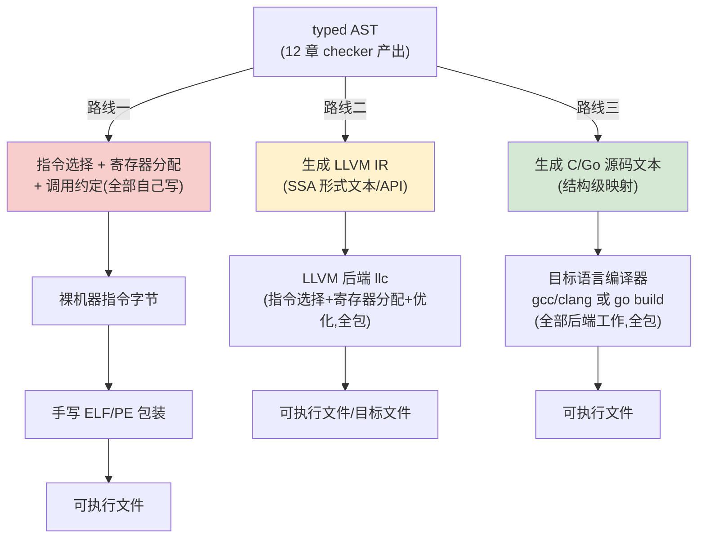
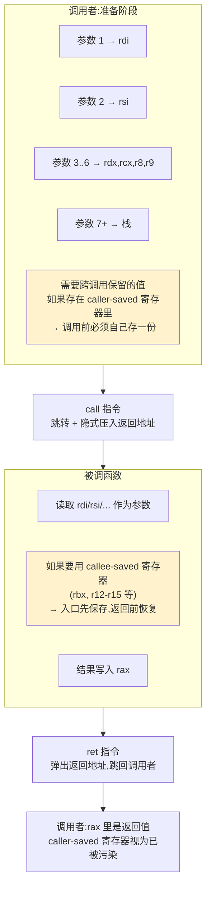
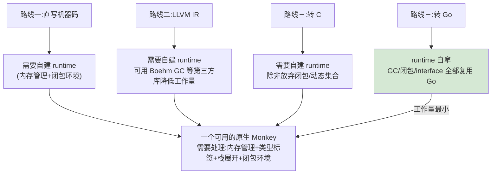

# 15 探索：把 Monkey 编译到原生机器码

## 本章要回答的问题

[13 章](13-optimization.md)最后一节把话说到了尽头：寄存器分配、escape analysis（逃逸分析）、SIMD 向量化、跨函数内联、指令调度、LTO（link-time optimization,链接时优化）——六件字节码 VM 原则上做不到的事,前提是有静态类型信息([12 章](12-static-monkey.md)),而且都要求一个**真正的原生代码生成后端**。那一章只列出"做不到"和"为什么",没有说"怎么做到"。本章接着往下问:**如果真要走到那一步,具体路径是什么?**

先把期待校准清楚。[12 章](12-static-monkey.md)和[14 章](14-jit.md)已经示范过"探索性章节"的写法——给推导和骨架,不给能直接抄的完整实现。本章比那两章更极端:一个哪怕只支持整数运算和函数调用的原生代码后端,都是**数月量级**的工程,真实的产品级实现(GCC、LLVM、Go 的编译器)是几十人年的积累。**本章的目标不是让你写出一个能用的原生后端**,而是让你理解通往机器码的三条现实路径各自的复杂度和取舍,能对着自己的项目做出选择,并且知道选完之后第一步该看什么、写什么。

读完本章你应该能回答:字节码 VM 和机器码之间,多了什么、少了什么?直接手写机器码、对接 LLVM、transpile(转译)到 C 或 Go,这三条路线的复杂度、掌控力、工程量分别是什么量级?调用约定(calling convention)、目标文件格式(object file)这些概念在解决什么问题?一门语言"要不要 runtime(运行时支持库)"是怎么被语言特性本身决定的?如果只有一个周末,该往哪条路线迈第一步?

## 1. 从字节码到机器码:多了什么,少了什么

[08 章 §3](08-vm.md)描述过 VM 的取指-执行循环:"取字节 → 查表 → 跳进 case → 执行 → 回到循环头"。[14 章 §1](14-jit.md)把这五步里的前四步叫作**解释开销**——它们不是程序逻辑本身要做的事,是解释器为了"通用"付出的税。机器码没有这层税:CPU 直接执行一条 `ADD` 指令,没有"这条指令是什么、该跳到哪个 case"这个间接层。这是机器码相对字节码 VM 最直接的收益,本章不重复展开,只提一句作为起点:**机器码消灭的是解释开销本身,不是解释开销的某一种优化**。

但这个收益不是免费的。VM 白送的几件东西,到了机器码这一层,**责任转移**了,不是自动消失了:

- **栈溢出检查。** [08 章](08-vm.md)的 `stack []Object` 是 Go 的切片,越界访问会被 Go runtime 检测并 panic。机器码直接操作物理内存地址,栈溢出(比如递归太深)在没有保护的情况下是**未定义行为**——可能悄悄踩坏别的内存,可能立刻 segfault,取决于操作系统有没有设置 guard page。这件事变成"必须自己在生成的代码里插入检查,或者依赖操作系统/runtime 提供"。
- **类型标签。** 04 章的 `object.Object` 接口自带类型信息(`Type()` 方法)。裸机器码里,一段内存就是一段字节,CPU 不知道也不关心这 8 个字节是 `int64` 还是指针。类型信息如果还需要(比如为了 GC、为了错误消息),必须自己在生成的代码里维护,或者在编译期用静态类型([12 章](12-static-monkey.md))把它完全消灭掉。
- **垂直的错误处理。** VM 里 `Error` 对象([08 章 §12](08-vm.md))沿着 Go 的 `error` 返回值一路往上传,到 REPL 层被捕获打印。机器码里没有这条现成的路——要么用调用约定里约定好的错误码返回值,要么用平台的异常/栈展开机制(stack unwinding,发生错误时沿调用栈向上查找处理者的机制,C++ 的 exception 依赖它),要么最简单粗暴地直接 `abort()`。
- **便宜的调试信息。** [08 章](08-vm.md)的 `LastPoppedStackElem` 之类的观察点,是因为 VM 本身知道栈上每个值的类型和含义。机器码执行时,调试器要知道"这个寄存器里的值是什么意思"依赖单独生成的调试信息(DWARF 之类的格式),这是**额外的工程**,不是白来的。

这四件事不是"机器码就是比字节码差",而是**VM 这层抽象本身在替你买了这些保障**,换取的代价正是解释开销。走向机器码时,要对每一件事明确回答:这件事对我的项目是"必须有"还是"nice to have"?"必须有"的东西,得自己在生成代码里插入等价逻辑,或者依赖一个 runtime 库;"nice to have"的可以直接放弃——教学原型阶段,放弃调试信息、放弃精细的栈溢出检查是完全合理的选择,但放弃"程序不会读到未初始化的内存"这种正确性底线就不是优化,是 bug。

## 2. 三条路线:建立地图

在深入任何一条路线之前,先看清整片地图,避免把三种完全不同量级的工程混在一起讨论。

| 路线 | 输出 | 依赖 | 难度 | 你掌控的东西 | 适合的目标 |
| --- | --- | --- | --- | --- | --- |
| **路线一:直写机器码** | 裸机器指令 + 手写 ELF/PE | 几乎无(自己写指令编码、链接、加载) | 极高 | 全部:指令选择、寄存器分配、调用约定、文件格式 | 理解 CPU/OS 底层加载机制,教学价值最高但工程量最大 |
| **路线二:对接 LLVM IR** | LLVM IR 文本/位码 | LLVM 工具链(`llc`、`clang`/`opt`) | 高,但比路线一低一个量级 | 前端(生成 IR),后端交给 LLVM(寄存器分配、指令选择、优化全包) | 真实语言常用做法(Swift、Rust、Julia、Kotlin/Native),工业级优化质量 |
| **路线三:transpile 到 C/Go** | C 或 Go 源码文本 | 目标语言的编译器(`gcc`/`cc`、`go build`) | 中低 | 最少:源码级映射,后端优化完全交给目标编译器 | 最快验证、最省工作量,教学与原型阶段最现实的选择 |

这不是一张"选哪个更好"的表,是**复杂度、掌控力、工程量三个维度的权衡**,而且三者可以组合:一个现实的项目路径是先用路线三快速验证"类型检查器 + typed AST"这套设计走不走得通,再挑真正的性能关键部分用路线一或二重写。不需要在还没验证语言设计之前,就把工作量最大的路线当成唯一目标。



三条路线的差异,在这张图里体现为**"自己写的框"离 typed AST 有多远**:路线一整块流水线都在自己手上;路线二只留了生成 IR 这一步给自己,后面全部交给 LLVM;路线三交出去的比例最大,自己只做一次结构映射。这和第 2 节表格"你掌控的东西"那一列是同一件事的两种表达。

### 横向对比:同一个函数走三条路线

用贯穿全章的例子建立直觉,`let add = fn(a: int, b: int) -> int { a + b };`([12 章 §4](12-static-monkey.md)的类型注解语法)分别走三条路线,产物大致是:

```text
路线一(x86-64 机器码字节,示意):
  48 89 f8            ; mov rax, rdi      (第一个参数 a → rax)
  48 01 f0            ; add rax, rsi      (加上第二个参数 b)
  c3                  ; ret               (结果留在 rax,返回)

路线二(LLVM IR 文本):
  define i64 @add(i64 %a, i64 %b) {
  entry:
    %1 = add i64 %a, %b
    ret i64 %1
  }

路线三(转 C):
  int64_t add(int64_t a, int64_t b) {
      return a + b;
  }

路线三(转 Go):
  func add(a int64, b int64) int64 {
      return a + b
  }
```

四份产物做的是同一件事,信息密度递减:机器码字节完全没有"变量叫 a 还是 b"这种概念,只有寄存器和指令;LLVM IR 保留了变量名和类型,但已经是 SSA 形式(下一节解释);C/Go 源码几乎和 typed AST 结构一一对应。**越往下走,你要亲手操心的细节越少,但也越依赖下游工具做对事情。** 第 3、4、5 节分别展开这三条路线。

## 3. 路线一:直接生成机器码 + ELF

### 需要哪些组件

一个哪怕只支持整数加减和函数调用的最小原生后端,都要处理下面五个组件,**任何一个疏漏都会导致 segfault,而且难以调试**——机器码层面没有 Go 的 panic 帮你在出错的那一行停下来,程序可能在完全不相关的地方崩掉,或者更糟,悄悄给出错误结果。

**① 指令选择(instruction selection)。** 把 typed AST(或者[12 章](12-static-monkey.md)降低后的 typed IR)的每一个操作,映射成具体 CPU 的一条或几条指令。同一个 `a + b`(两个 int64,已经分别在寄存器里),在 x86-64 上是一条 `add` 指令,在 ARM64 上是一条编码完全不同的 `add` 指令——**指令的语义可能相同,但二进制编码是平台特定的**,查的是各自架构的指令编码手册(x86-64 用 Intel/AMD 的手册,ARM 用 ARM 的手册)。假设 `a` 在 `rdi`(x86-64 调用约定的第一个整数参数寄存器,见下),`b` 在 `rsi`,结果要放进 `rax`(返回值寄存器):

```text
mov rax, rdi     ; 48 89 f8   把 a 移进 rax
add rax, rsi     ; 48 01 f0   rax += b
ret              ; c3         返回,结果在 rax
```

右边的十六进制字节不需要你现在精确核实——这里要体会的是"这一步在做什么":每条汇编指令背后是一串具体的字节,查表得到,不是凭直觉编的。`48` 这类前缀字节(REX prefix)在 x86-64 里用来表示"这是 64 位操作",这类细节正是指令编码手册要回答的问题。

**② 寄存器分配(register allocation)。** typed AST 里的变量是无限多个的抽象名字(`a`、`b`、`total`、`i`……),但机器只有有限个寄存器——x86-64 通用寄存器约 16 个。两种方案:

- **全部走栈**:每个变量固定分配一个栈槛位,不使用寄存器缓存中间结果,读写变量就是"从内存加载/存储"。这等价于把[08 章](08-vm.md)栈式 VM 里"每个局部变量有一个位置"这套思路,原样搬到真实内存地址上。慢(每次访问都是内存操作,不是寄存器操作),但**简单到不需要额外的分析阶段**。
- **图着色寄存器分配(graph coloring register allocation)**:构造一张"哪些变量同时活跃"的冲突图,尝试用有限颜色(=有限寄存器)给图着色,活跃区间(liveness,变量从被赋值到最后一次被使用之间的区间)不重叠的变量可以共用一个寄存器。快,但需要先做**活跃变量分析(liveness analysis)**,是一整块独立的编译理论内容。

**推荐教学项目从"全部走栈"开始,不要一开始就上图着色。** 图着色的正确性依赖精确的活跃区间计算,一旦算错,后果是"某个变量的值被另一个变量悄悄覆盖",这类 bug 极难定位,而且发生的时机往往和源码逻辑毫无关系。先用最简单、最容易验证正确性的方案把整条流水线跑通,再考虑要不要为性能引入寄存器分配。

**③ 调用约定(calling convention / ABI)。** ABI (application binary interface,应用二进制接口)规定了函数之间怎么交换数据、怎么共享寄存器。以 x86-64 Linux/macOS 上通行的 System V ABI 为例:前 6 个整数/指针参数依次放进 `rdi, rsi, rdx, rcx, r8, r9`,超出的走栈;返回值放在 `rax`;寄存器分为 caller-saved(调用者负责保存,被调函数可以随意覆写,比如 `rax`、`rcx`)和 callee-saved(被调函数如果要用,必须先保存原值、返回前恢复,比如 `rbx`、`r12`-`r15`)。**这一步不能自己随便定**——如果你生成的代码要和系统的其他代码(libc、操作系统提供的函数)互操作,就必须严格遵守目标平台的标准 ABI,否则表现为"看起来能跑,直到某次寄存器冲突,数据被莫名其妙覆盖"。



这张图是"责任划分"的可视化:caller-saved 寄存器,污染的责任在**调用者**(用之前如果还要活着就自己先存);callee-saved 寄存器,保护的责任在**被调函数**(要用就必须先存后恢复)。这条分工完全是约定出来的,CPU 本身不强制——正因为不被硬件强制,才必须双方都严格遵守同一份文档,任何一方按自己的理解"优化"一下,就是第 8 节陷阱①②的来源。这和[08 章 §8](08-vm.md)`Frame` 打包 `ip`/`basePointer` 做"保存-恢复"的思路是同一个模式的硬件版本——[08 章](08-vm.md)那句"真实 CPU 的调用约定是同一想法的硬件版本",这里就是那句话具体展开后的样子。

**④ 目标文件格式(object file)与链接。** 生成的机器码字节,要包装进特定格式才能被操作系统加载执行:Linux 用 ELF(Executable and Linkable Format),macOS 用 Mach-O,Windows 用 PE。以 ELF 为例,最简结构大致是:

```text
ELF header          (标识这是 ELF 文件、目标架构、入口地址在哪)
Program headers     (告诉加载器"把文件的哪一段映射到内存的哪个地址,权限是什么")
.text 段            (你生成的机器码字节,实际存放在这里)
.data / .rodata 段  (全局变量、字符串常量等)
```

一个关键的粒度选择:**直接生成完整的可执行文件**,还是**只生成 `.o` 目标文件,交给系统的链接器(`ld`)完成最后一步**?推荐后者——生成 `.o` 文件的工作量小得多(不需要自己处理动态库依赖、符号解析、地址布局这些链接器已经做好的事),复用系统链接器处理"和 libc 之类外部代码互操作"这类复杂问题,这正是路线一里少数几处可以"偷懒"又不牺牲正确性的地方。

**⑤ 重定位(relocation)。** 如果生成的代码里调用了外部函数(比如 libc 的 `malloc`),生成这条调用指令的时候还不知道 `malloc` 最终会被加载到内存的哪个地址。解决方式是在目标文件里留一个**重定位表项**——"这个位置的 4 字节,等链接完成之后,要填上 `malloc` 的实际地址"——链接器最后统一处理。这是让"分别编译、最后拼起来"这套模型能工作的关键机制,本章不深入,知道它存在、知道它是链接器要解决的问题即可。

### 骨架级示意

不给可运行代码,只给"这里应该做什么"的函数签名和累积字节的骨架,体会指令选择这一步的形状:

```go
type Register int

const (
    RAX Register = iota // 返回值 / 累加器
    RDI                  // 第 1 个整数参数(System V ABI)
    RSI                  // 第 2 个整数参数
    // ... 其余寄存器
)

// Emitter 累积生成的机器码字节,最终产物是一段 []byte,
// 会被塞进 ELF 的 .text 段。
type Emitter struct {
    code []byte
}

// emitMovRegReg 生成 "mov dst, src" 的机器码编码。
// 这里应该按 x86-64 的指令编码规则,把 dst/src 两个寄存器
// 编号拼进对应的字节序列(REX 前缀 + opcode + ModRM 字节)。
func (e *Emitter) emitMovRegReg(dst, src Register) {
    // TODO: 查 x86-64 指令编码手册,写入 mov 指令的字节序列
}

// emitAdd 生成 "add dst, src" 的机器码编码,把 src 加到 dst 上。
func (e *Emitter) emitAdd(dst, src Register) {
    // TODO: 同上,写入 add 指令的字节序列
}

// emitRet 生成函数返回指令,x86-64 上是单字节 0xC3。
func (e *Emitter) emitRet() {
    e.code = append(e.code, 0xC3)
}

// compileFunc 编译一个 typed AST 的函数节点,按调用约定把参数
// 从固定寄存器读出,编译函数体,把结果放进 RAX,发出 ret。
func compileFunc(fn *ast.FunctionExpression /* 或 12 章的 typed 版本 */) []byte {
    e := &Emitter{}
    // TODO: 按 §3③ 的调用约定,参数已经在 RDI/RSI/... 里
    // TODO: 遍历函数体,对每个操作调用对应的 emitXxx
    // TODO: 把最终结果 mov 进 RAX
    e.emitRet()
    return e.code
}
```

### 手算 trace:`main` 函数的字节怎么变成一个能跑的进程

上面五个组件讲的都是"要做什么",这里手算一遍"字节最终怎么被操作系统认出来并跑起来",建立一个具体的直觉。假设已经生成好了 `main` 函数的机器码——为了让例子能独立跑,不依赖参数传递,取一个比 `add` 更简单的例子:`let main = fn() -> int { 42 };`,约定"进程退出码 = `main` 的返回值"。

**第一步,指令选择的产物是一串字节。** `42` 要放进 `rax`(返回值/退出码寄存器),然后 `ret`:

```text
mov rax, 42      ; b8 2a 00 00 00   (立即数 42 = 0x2a,填进 4 字节小端序)
ret              ; c3
```

一共 6 个字节:`b8 2a 00 00 00 c3`。

**第二步,这 6 个字节要被塞进 ELF 的 `.text` 段,`.text` 段要被塞进整个文件的某个偏移。** 一个最简单的 ELF 可执行文件,只需要一个 ELF header 加一个 program header(不需要 section header,那是给链接器和调试器用的,加载器只看 program header):

```text
偏移 0x00 ~ 0x3F   ELF header(64 字节,标识"这是 64 位 ELF,入口地址是 0x400078")
偏移 0x40 ~ 0x77   Program header(56 字节,说"把文件偏移 0 开始的一段,映射到内存地址 0x400000,可读可执行")
偏移 0x78 ~ 0x7D   .text 段的 6 个字节:b8 2a 00 00 00 c3   ← 这正是入口地址 0x400078 指向的位置
```

**第三步,操作系统加载器读这个文件时做的事,和第二步的结构完全对应:** 读 ELF header 拿到入口地址 `0x400078`;读 program header,把文件从偏移 0 开始的一段内容映射进内存地址 `0x400000`(这样文件偏移 `0x78` 处的字节,就出现在内存地址 `0x400078`);把 CPU 的指令指针设到 `0x400078`,开始执行。CPU 从这里开始执行到的第一条指令,正是 `mov rax, 42`。

**第四步,`ret` 之后发生的事,取决于这是不是整个进程的第一条指令流。** 如果这段代码是被 `call` 调过来的(比如它是被别的函数调用的普通函数),`ret` 会弹出调用者放在栈上的返回地址,跳回调用者。但如果这是进程的入口点(`_start`,不是 C 语言意义上的 `main`),`ret` 没有调用者可以返回——真实的可执行文件需要在这里换成一次 `exit` 系统调用(把 `rax` 的值挪进系统调用要求的参数寄存器,触发 `syscall`),让操作系统正式终止进程并把这个值设成退出码。这是一个容易漏掉的细节:**"函数返回"和"进程退出"是两件不同的事,只有进程的入口点需要显式调用退出,普通函数只需要 `ret`**——如果生成器对所有函数一概而论,在入口点也只发一条 `ret`,行为是未定义的(可能继续执行入口点之后的随机内存内容,大概率立刻 segfault)。

跑起来之后 `echo $?` 应该打印 `42`——这正是第 9 节验收清单里"退出码是否符合预期"这一项在具体检查什么,以及为什么它是路线一少数几个"结果对不对一目了然"的验证点。

### 明确定位

这条路线的教学价值是"理解 CPU 和 OS 到底在干什么,没有任何魔法"——你亲手决定每一个字节。但**不建议作为第一个尝试的路线**。上面五个组件里的每一个,单独学起来都不难,难的是**同时把五个都做对**,而且做错任何一个的症状往往是同一个:程序 crash,或者更隐蔽——运行了、给出了错误结果、你却不知道错在哪一层。如果确实想体验这条路线,参考方向是找一个极简的教学级 x86-64 汇编器实现思路作为起点(练习部分会给出具体建议),先脱离 Monkey,单独把"生成机器码、包成可执行文件、跑起来"这条链路跑通,再考虑接回 Monkey 的类型系统。

## 4. 路线二:对接 LLVM IR

### LLVM 解决了什么问题

LLVM 的核心思路是:把"指令选择 + 寄存器分配 + 目标文件格式"这些活全部委托出去。你只需要生成**LLVM IR**——一种平台无关的中间表示,LLVM 自己的后端(`llc`)负责把 IR 变成任意目标平台(x86、ARM、RISC-V,甚至 WebAssembly)的机器码,还带一整套现成的优化 pass:常量折叠、死代码消除、循环优化、向量化——这些正是[13 章](13-optimization.md)讲过的优化,LLVM 已经实现好了,直接调用即可享受。

LLVM IR 是**SSA(static single assignment,静态单赋值)形式**:每个变量只被赋值一次。这是理解 LLVM IR 的关键前提,值得先建立直觉。普通命令式代码里 `x = 1; x = x + 1;` 给同一个名字赋值了两次;SSA 形式要求每次"赋值"都产生一个**新名字**:

```text
%x0 = 1
%x1 = add i64 %x0, 1
```

**为什么优化算法喜欢 SSA?** 因为"一个名字只被赋值一次"意味着"这个名字的定义在哪里"是唯一确定的——不需要做数据流分析去追踪"这个变量在这一点的值来自哪次赋值",直接看名字本身就知道。常量折叠、死代码消除这类分析在 SSA 形式下大幅简化,这也是为什么几乎所有现代编译器后端(LLVM、Go 的 `cmd/compile`、JVM 的 HotSpot C2)内部都用某种 SSA 表示。

### 一个具体映射:typed AST → LLVM IR

延续第 2 节的例子,`let add = fn(a: int, b: int) -> int { a + b };`,大致的 LLVM IR 文本(不要求 100% 语法精确,体现结构和 SSA 特征即可):

```llvm
define i64 @add(i64 %a, i64 %b) {
entry:
  %1 = add i64 %a, %b
  ret i64 %1
}
```

`i64` 是 LLVM IR 里 64 位整数类型的写法,对应[12 章](12-static-monkey.md)的 `IntType`。`entry:` 是**基本块(basic block)**的标签——一段没有分支、顺序执行的指令序列,LLVM IR 的函数体由若干基本块组成,块之间靠跳转指令连接,这个结构本身已经很接近字节码里"用跳转表示控制流"的思路([06 章 §2](06-bytecode.md))。`%1` 是一个 SSA 临时值,存住 `%a + %b` 的结果,再被 `ret` 用掉。

带控制流的例子,比如 `if (a > 0) { a } else { 0 - a }`(简化版绝对值),体现分支怎么变成基本块 + `br`(branch)指令:

```llvm
define i64 @abs(i64 %a) {
entry:
  %cond = icmp sgt i64 %a, 0
  br i1 %cond, label %then, label %else

then:
  br label %merge

else:
  %neg = sub i64 0, %a
  br label %merge

merge:
  %result = phi i64 [ %a, %then ], [ %neg, %else ]
  ret i64 %result
}
```

**这里出现了 SSA 形式最需要专门解释的部分:`phi` 节点。** `if` 表达式的结果值([12 章 §6](12-static-monkey.md)已经把 Monkey 的 `if` 定为表达式,两个分支类型必须一致)在两条不同的分支里被计算成两个不同的 SSA 名字(`%a` 和 `%neg`),但 `merge` 基本块里需要用到"不管走了哪条分支,那个结果值"——SSA 规则不允许一个名字被赋值两次,所以需要一个特殊指令`phi`来表达"这个值,如果是从 `%then` 走过来的就是 `%a`,如果是从 `%else` 走过来的就是 `%neg`"。这正是 Monkey `if` 表达式(而不是 `if` 语句)在 SSA 世界里的直接对应物——[12 章 §6](12-static-monkey.md)"if 分支要求类型一致"这条规则,恰好也是 `phi` 节点能够类型检查通过的前提。

**`if`/`else` 的 `phi` 只需要合并两条路径,`while` 循环的 `phi` 更绕一点,值得单独看一遍。** `let sum = fn() -> int { let total = 0; let i = 0; while (i < 3) { total = total + i; i = i + 1; } total };` 里,`total` 每一轮循环都被重新赋值,SSA 形式必须给每一轮的 `total` 一个新名字:

```llvm
define i64 @sum() {
entry:
  br label %loop

loop:
  %total = phi i64 [ 0, %entry ], [ %total.next, %loop ]
  %i     = phi i64 [ 0, %entry ], [ %i.next, %loop ]
  %cond  = icmp slt i64 %i, 3
  br i1 %cond, label %body, label %exit

body:
  %total.next = add i64 %total, %i
  %i.next     = add i64 %i, 1
  br label %loop

exit:
  ret i64 %total
}
```

**这里 `phi` 出现在循环头(`loop` 基本块),不是循环体里**,而且它引用了一个"还没被定义"的名字`%total.next`——`%total.next` 是在 `body` 块里算出来的,但 `body` 在源码顺序上排在 `loop` **之后**。这是 SSA 形式里第一次让人真正困惑的地方:`phi` 节点的语义是"我的值取决于是从哪个前驱基本块跳过来的",不是"取决于代码书写的先后顺序"——第一次进入 `loop`(从 `entry` 跳过来)时 `%total` 取 `0`;之后每次进入 `loop`(从 `body` 跳回来)时 `%total` 取上一轮算出的 `%total.next`。**这正是命令式代码里"变量会被重新赋值"这件事,在 SSA 世界里唯一的表达方式**——[06 章](06-bytecode.md)的字节码用 `OpSetLocal`/`OpGetLocal` 加跳转指令表达同一件事,SSA 用"新名字 + `phi` 节点记录来源"表达它,两者是同一个语义在不同表示层面的两种编码。

### 整合方式:两条子路径

Go 项目对接 LLVM,有两条现实的路:

- **① 用 `tinygo.org/x/go-llvm`**(LLVM 官方 C++ API 的 Go binding),直接在 Go 代码里用 API 构造 IR 对象(相当于用 Go 代码"编程式"地拼 IR,而不是拼文本字符串)。
- **② 生成 LLVM IR 文本**(`.ll` 文件),再调用系统已安装的 `llc`/`clang` 命令行工具编译成机器码或可执行文件。

**推荐后者作为教学起点。** 不需要处理 cgo 绑定的编译环境问题(`go-llvm` 依赖本机安装的特定版本 LLVM 头文件和库,配置本身就是一项工程);生成文本比调 API 直观,写一个 `emitLLVMIR(fn) string` 函数,拼字符串,比学一整套 API 的调用方式简单得多;更重要的是**生成的 `.ll` 文件本身是可读、可独立验证的**——写错了,直接用 `llc` 单独跑一下这个文件,报错信息会直接指出 IR 哪里不对,不需要先怀疑是不是 Go 那边的绑定用错了。

TinyGo(一个面向嵌入式和 WebAssembly 的 Go 实现)、Rust、Swift、Julia 都用 LLVM 作后端,这不是"学术玩具"式的选择,是工业界验证过的常见路径。

### Runtime 问题留给第 6 节

LLVM IR 本身不带 runtime。如果 Monkey 的类型系统保留了 GC、动态类型 tag、闭包环境这些概念,LLVM 不会替你实现——需要自己生成对应的运行时支持代码(用 C 或 LLVM IR 写一个最小 runtime library,和生成的代码一起链接)。这是路线二绕不开的额外工作量,第 6 节统一讨论。

## 5. 路线三:transpile 到 C 或 Go

### 核心思路

typed AST 直接转换成目标语言的**源码字符串**,再调用目标语言自己的编译器(`gcc`/`clang`/`go build`)完成剩下的所有工作——指令选择、寄存器分配、优化、链接,全部白拿。这是三条路线里**掌控力最少、但工作量也最少**的一条。

### 转换示例:带控制流的函数

同样是 `add`,C 和 Go 的产物已经在第 2 节给过。看一个带 `if`/`while` 的稍复杂例子,体现 typed AST 的控制流节点怎么映射:

```monkey
let clamp = fn(x: int, lo: int, hi: int) -> int {
    if (x < lo) {
        lo
    } else if (x > hi) {
        hi
    } else {
        x
    }
};
```

转 C(`if` 表达式变成 C 里没有的东西——C 的 `if` 是语句不是表达式,需要转换成"先声明一个结果变量,每个分支里赋值":

```c
int64_t clamp(int64_t x, int64_t lo, int64_t hi) {
    int64_t result;
    if (x < lo) {
        result = lo;
    } else if (x > hi) {
        result = hi;
    } else {
        result = x;
    }
    return result;
}
```

转 Go(同样需要做这个转换,因为 Go 的 `if` 也是语句):

```go
func clamp(x int64, lo int64, hi int64) int64 {
    var result int64
    if x < lo {
        result = lo
    } else if x > hi {
        result = hi
    } else {
        result = x
    }
    return result
}
```

这一步基本是**结构对应**,比路线一、二都直接——C/Go 本身就有 `if`/`while`/函数,不需要像[06 章](06-bytecode.md)那样把它们降低成更底层的跳转指令,也不需要像路线二那样把 `if` 表达式转成 `phi` 节点。唯一需要处理的转换,是"Monkey 里 `if` 是表达式,目标语言里 `if` 是语句"这一层语法差异——[12 章 §6](12-static-monkey.md)已经讨论过这个设计决定本身,这里只是把同一个决定在两种目标语言里都实现一次。

`while` 循环几乎是直译,`fn(){...}` 复杂在闭包,下面单独展开。

### 转 C vs 转 Go:一张对比表

| 维度 | 转 C | 转 Go |
| --- | --- | --- |
| runtime 依赖 | 无,产物可以是完全静态链接的原生二进制 | 依赖 Go runtime(GC、goroutine 调度器等随二进制一起打包) |
| 内存管理 | 需要自己实现(或放弃动态大小的数组/哈希) | Go 自带 GC,直接用 |
| 闭包 | C 没有原生闭包语法,需要手动生成"环境结构体 + 函数指针"模拟 | Go 有原生闭包语法,类型映射得当可以直接生成 |
| 动态数组/哈希 | 需要自己实现一个迷你版本(内存管理、扩容逻辑) | 可以映射到 Go 的 `slice`/`map`,基本白拿 |
| 产物体积与启动速度 | 小,启动快(没有 runtime 初始化) | 更大,启动要初始化 Go runtime |
| 语法验证速度 | 需要 `gcc`/`clang` 编译才能发现语法错误 | `go vet`/`go build` 极快,且 Go 语法本身更接近直接的结构映射 |

### 闭包:两条路线实现难度的具体差异

用[09 章](09-closures.md)的经典例子 `newAdder`:

```monkey
let newAdder = fn(a) { fn(b) { a + b } };
let add2 = newAdder(2);
add2(3); // 5
```

**转 C 的做法。** C 函数指针不能"携带"额外的状态,必须手动模拟——生成一个包含被捕获变量的 struct,和一个接受这个 struct 作为额外隐藏参数的函数指针:

```c
// 捕获的环境:newAdder 的参数 a
typedef struct {
    int64_t a;
} AdderEnv;

// inner 函数,env 作为隐藏的第一个参数
int64_t adder_inner(AdderEnv *env, int64_t b) {
    return env->a + b;
}

// 闭包 = 函数指针 + 环境指针 的组合,需要一个额外的结构体表示"一个闭包值"
typedef struct {
    int64_t (*fn)(AdderEnv *, int64_t);
    AdderEnv *env;
} Closure;

Closure new_adder(int64_t a) {
    AdderEnv *env = malloc(sizeof(AdderEnv)); // ← 必须堆分配,见下
    env->a = a;
    Closure c = { adder_inner, env };
    return c;
}
```

调用 `add2(3)` 变成 `add2.fn(add2.env, 3)`——这和[09 章](09-closures.md)讲的 free variable(自由变量)机制是**同一个概念**,只是从字节码的 `OpGetFree` 换成了 C 结构体字段访问:`OpGetFree 0` 在字节码 VM 里是"从 `Closure.Free[0]` 读一个值",在这里是"从 `env->a` 读一个值",两者做的是同一件事——把定义时捕获的值,在调用时重新取出来。

**关键细节:`env` 必须堆分配(`malloc`),不能是栈上的局部变量。** 因为 `new_adder` 返回之后,它的栈帧会被后续调用覆盖([09 章](09-closures.md)"闭包为什么能在外层函数返回之后还读到外层参数"这个问题,在字节码 VM 里靠"值被拷贝进 `Closure.Free`,不依赖任何指针链"解决;在 C 里,如果 `env` 指向栈上的地址,函数返回后这个地址失效,后续通过 `env->a` 读到的是垃圾数据或者被覆盖的其他数据)。边界与陷阱一节会展开这个具体的 bug 模式。

**转 Go 的做法。** Go 原生支持闭包语法,类型映射得当可以直接生成地道的 Go 闭包,不需要手动模拟环境结构体:

```go
func newAdder(a int64) func(int64) int64 {
    return func(b int64) int64 {
        return a + b
    }
}
```

`add2 := newAdder(2)` 之后 `add2(3)` 直接是一次普通的 Go 函数调用。**Go 编译器自己决定要不要把 `a` 分配到堆上**(这正是 Go 编译器内部做逃逸分析的地方——[13 章 §13.3](13-optimization.md)提到的 escape analysis,这里是它在真实系统里被直接复用的例子,你完全不需要自己实现)。这是转 Go 相比转 C 最大的优势:闭包捕获、生命周期管理、要不要堆分配这些决定,全部交给了 Go 编译器,几乎不需要自己写一行 runtime 代码。代价是产物依赖 Go runtime,不是"零依赖"的原生代码,而且引入了 Go 自己的 GC 停顿特性。

### 推荐:先做"转 Go"

**作为验证三条路线里最现实的起点,建议先做转 Go。** 理由是工程账,不是语言偏好:Go 的 GC、closure、interface 恰好能对应 Monkey 大部分运行期需求(堆分配、闭包捕获、如果保留动态特性还可以用 interface 表示),工作量最小,能最快验证"类型检查器 + typed AST"这套[12 章](12-static-monkey.md)建立起来的设计到底走不走得通——这是最想优先确认的事。把宝贵的精力留给前端(类型系统设计、AST 降低是否正确),而不是后端(内存管理、调用约定这些和"这门语言的语义对不对"关系不大的工程细节)。等验证完,再考虑要不要往路线一、二迁移以摆脱 Go runtime 依赖——这时候已经有一个可信的参照实现([00 章](00-overview.md)"evaluator 作为参照实现"同一个方法论的延伸),差分测试的基准都齐备了。

## 6. Runtime 的问题:贯穿三条路线的关键决策

### 先定义清楚"runtime"指什么

"runtime(运行时支持)"这个词在这里不是泛指"程序运行的时候",是具体的几块能力,每一块都要问"由谁提供":

- **内存管理**:手动(C 风格,`malloc`/`free`,程序员负责,或者干脆不释放——对短生命周期脚本可以接受)?引用计数?追踪式 GC(需要一个持续运行的运行时组件,扫描堆、识别可达对象、回收不可达对象)?
- **动态类型标签**:如果语言保留了任何动态特性(数组存放异构元素、条件分支依赖运行期才能确定的类型),需要一个 tagged union 或接口表示,这本身是一种运行时开销——需要有代码在判断"当前这个值到底是什么类型"。
- **栈展开/异常处理**:出错时(数组越界、除零)怎么处理?依赖不依赖平台的异常处理机制(C++ 风格的 exception,或者 x86-64 的 unwind tables)?还是走约定的错误码返回?
- **闭包环境**:自由变量捕获需要在堆上分配环境对象——这依赖内存管理策略,是不是 GC 的一部分。

### 光谱两端

| | 无 runtime(类似 C) | 有 runtime(类似 Go/Java) |
| --- | --- | --- |
| 内存管理 | 手动管理,或者干脆不管理(leaking 在教学原型里可以接受) | 自动 GC,闭包捕获的环境可以安全地在函数返回后继续存在 |
| 类型信息 | 编译期完全确定,没有运行期类型 tag | 可以支持保留部分动态特性(interface、反射) |
| 产物 | 完全静态链接的二进制,启动快、没有额外内存开销 | 二进制更大,启动要初始化 runtime,GC 引入不可预测停顿 |
| 语言表达力 | 受限:不能有"完全动态的数组元素类型"这类东西,必须在编译期确定所有类型 | 更宽:动态特性有地方落地 |
| 实现代价 | 语言实现者要么自己写一个 GC(极其复杂的工程),要么放弃相应特性 | 依赖宿主语言的 GC(路线三转 Go 正是这种情况) |

### 落到 Monkey 的具体决策点

Monkey 当前(动态版)有闭包、有数组/哈希这些需要堆分配的结构。如果坚持要做"无 runtime 原生编译",这些特性怎么办?

- **闭包**:如果坚持无 GC,需要靠**静态生命周期分析**证明捕获的环境可以安全地栈分配——这正是[13 章 §13.3](13-optimization.md)提到的 escape analysis 在这里的直接应用场景:证明"这个闭包不会比定义它的函数活得更久",就能栈分配,证明不了就必须堆分配。或者更简单粗暴:干脆**限制闭包不能超过定义它的函数的生命周期**(比如禁止把闭包作为返回值向外传递),用限制表达力换取不需要 GC——这条路会让 `newAdder` 这种模式直接不合法,是一个真实的语言设计取舍,不是实现细节。
- **数组/哈希**:如果大小编译期已知(比如[12 章](12-static-monkey.md)的类型系统扩展出定长数组类型,类似 Rust 的 `[int; 3]`),可以栈分配或静态分配;如果大小运行期才确定(Monkey 现在的 `Array` 就是这样,长度是运行期算出来的),几乎绕不开某种形式的堆分配和管理策略。
- **结论**:一门语言"要不要 runtime"不是纯粹的实现选择,而是**从语言设计阶段就决定了的**。保留闭包和动态大小集合类型的语言,几乎必然需要某种形式的内存管理(GC 或手动)——这是语言特性和实现代价的直接映射,回指[00 章](00-overview.md)"语义契约"的方法论:这也是一类需要提前用表格写清楚的设计决定,不能拖到实现阶段才发现绕不过去。

### Monkey 特性 × runtime 需求映射表

| 特性 | 是否需要堆分配/动态内存 | 例外情况 |
| --- | --- | --- |
| 闭包(自由变量捕获) | 需要,除非能证明捕获环境的生命周期不超过定义它的函数(栈安全) | 静态分析证明安全,或限制表达力(禁止闭包逃逸) |
| 数组/哈希 | 如果大小运行期才确定,需要堆分配和动态扩容逻辑 | 大小编译期已知(定长数组类型)可以栈分配/静态分配 |
| 字符串 | 如果长度可变(拼接、切片),需要动态内存 | 如果字符串不可变且编译期已知全部内容,可以放进只读段 |
| 递归函数调用 | 需要调用栈,但这是"栈"不是"堆"——大多数平台原生支持,不需要额外 runtime | 尾递归优化是另一个独立话题,这里不展开 |
| 错误处理/panic | 需要某种展开机制:C 的 `setjmp`/`longjmp`,或约定的错误码返回 | 如果只用 abort 直接终止,不需要额外机制,但错误信息会很粗糙 |

## 7. 三条路线接哪种 runtime 策略

把第 5、6 节串起来:**路线一**(直写机器码)如果要支持闭包/GC,几乎等于要**自己写一个迷你 runtime library**(用 C 写好,和生成的机器码一起链接)——这是这条路线复杂度爆炸的主因之一,前面五个组件之外,又多了一整块独立的工程。**路线二**(LLVM)同理,LLVM 本身不带 runtime,一样需要自己提供,但可以用现成的第三方保守式 GC 库(比如 Boehm GC,一个可以直接链接进任意 C/C++/LLVM 项目、不需要配合编译器做精确类型标注的垂直 GC 实现)降低工作量——这是路线二相对路线一在 runtime 这一项上唯一的优势,其余四个组件(指令选择、寄存器分配、调用约定、目标文件格式)LLVM 已经全包了,只有 runtime 需要你自己补。**路线三转 Go 是三条里唯一"runtime 白拿"的**,这是它作为教学起点被推荐的核心原因;**转 C 则和路线一、二一样需要自建迷你 runtime**,除非明确放弃闭包和动态集合(限制语言表达力,换取真正的零依赖静态二进制)。



## 8. 边界与陷阱

**① ABI 不匹配导致 segfault(路线一/二)。** 如果生成的代码假设参数在 `rdi/rsi`,但链接的外部函数(比如 libc)期望别的寄存器分布,或者字节序/结构体对齐规则不一致,表现是**在完全无关的代码位置崩溃**,因为错误的数据被当成了地址去解引用。这是路线一、二里最难调试的一类问题,唯一的防御是严格照抄目标平台标准 ABI 文档,不自己发明。

**② 忘记 caller-saved/callee-saved 寄存器保存规则。** 如果被调函数覆写了一个 caller-saved 寄存器,但没有告知调用者(调用者以为这个寄存器的值还在),调用者后续读到的是被污染的值。症状是"这段代码单独跑没问题,加一次函数调用之后结果变了"——很容易被误诊断成逻辑 bug,实际是 ABI 违反。

**③ SSA 的 phi 节点是接触 LLVM 最先卡住的地方。** 普通命令式代码里循环里累加一个变量(`total = total + xs[i]`),在 SSA 形式下每次赋值都要产生新名字,循环体每一轮的"新值"要和"上一轮的值"通过 `phi` 节点在循环头合并。第一次看到 `phi` 通常会觉得反直觉,因为它看起来像是在"提前知道自己会从哪个分支跳过来"——多写几个例子(先写只有 `if`/`else` 的,再写带循环的)是唯一的建立直觉的方式。

**④ transpile 到 C 时,字符串/数组生命周期偷懒用"永不释放"策略。** 教学原型阶段完全可以接受(短生命周期脚本,进程退出时操作系统统一回收),但如果这份生成的 C 代码要跑在一个长时间运行的程序里(比如一个常驻服务),内存会随时间线性增长直到耗尽——这不是"暂时的简化",是一个必须在文档里明确写清楚的已知限制。

**⑤ transpile 到 Go 时类型映射不当。** 如果把 Monkey 的动态数组直接映射成 Go 的固定元素类型 `slice`(比如 `[]int64`),遇到 Monkey 语义里"数组元素运行期可能是不同类型"的地方(如果保留了这种动态特性)就会露馅——Go 的类型系统在编译期就会拒绝往 `[]int64` 里塞一个字符串。这不是 bug,是类型映射本身选错了粒度,解法是用 `[]interface{}` 或自定义的 tagged union 类型,但这样就损失了 Go slice 本身的类型安全和性能优势——这是 transpile 路线一个必须提前想清楚的映射粒度问题。

**⑥ 闭包捕获栈上局部变量的地址,函数返回后地址失效。** 第 5 节转 C 的例子已经强调过:`env` 必须堆分配。如果偷懒直接用一个指向调用者栈帧里局部变量的指针作为捕获环境,函数返回后这块栈内存会被后续调用覆盖——**经典的"逃逸捕获"bug**,而且往往不会立刻崩溃,可能在后续某次不相关的调用覆盖了那块内存之后才表现出错误的值,现场和原因隔着好几层调用,是这一类 bug 最难排查的地方。C 里必须显式堆分配来避免它;转 Go 完全不需要操心,因为 Go 编译器的逃逸分析会自动判断并处理。

## 9. 验收测试清单

三条路线本身不是 Go 代码,产物是外部工具链的输入,验证方式也是外部命令,不是 `_test.go`。

**路线一(生成的 ELF):**

- [ ] `file <输出文件>` 能否正确识别为"ELF 64-bit LSB executable"(或对应架构描述)
- [ ] `objdump -d <输出文件>` 反汇编,能否看到期望的指令序列(比如确认 `add` 指令确实出现在预期位置)
- [ ] 直接运行,退出码(`echo $?`)是否符合预期(比如约定"main 函数返回值就是进程退出码")
- [ ] 用 `readelf -h`/`readelf -l` 检查 ELF header 和 program header 是否符合手写时的设计

**路线二(生成的 `.ll` 文件):**

- [ ] `llc <文件>.ll -o <文件>.s` 编译成汇编,是否报错(报错说明生成的 IR 本身不合法,比如 SSA 名字重复赋值、类型不匹配)
- [ ] `opt -O2 <文件>.ll -o optimized.ll` 加优化 pass 前后,产物用同样输入跑,行为是否一致(验证优化没有破坏语义,呼应[13 章](13-optimization.md)的铁律)
- [ ] 用[10 章](10-debugging.md)的差分测试方法论,同一批 Monkey 源码分别跑 evaluator 和"生成 IR → `llc` 编译 → 运行"两条路径,结果是否一致

**路线三(转换后的 C/Go 源码):**

- [ ] `gcc`/`clang`(转 C)或 `go build`(转 Go)能否成功编译,不报错
- [ ] 编译产物运行后的输出,和原 evaluator 对同一份源码的求值结果做差分测试,是否一致
- [ ] 转 Go 额外优势:`go vet` 和 `go build` 本身就是一层立即可用的语法/类型正确性验证,不需要额外搭建校验流程——这是转 Go 在"快速反馈"这一项上明确优于转 C 和路线一、二的地方

## 10. 练习

**路线三,从这里开始,工作量最小:**

**1. 最小转 Go 转换器。** 手写一个只支持整数字面量和加法的 Monkey 子集到 Go 的转换器。输入 `1 + 2 + 3`,输出一段能编译运行、打印 `6` 的 Go 源码。跑起来验证结果。

**2. 扩展到 let 绑定。** 支持 `let` 绑定和多个语句。`let a = 1; let b = 2; a + b;` 应该转换成一个打印 `3` 的 Go 程序。

**3. 扩展到 if/else。** 支持表达式形式的 `if`/`else`,参照第 5 节"声明 result 变量,每个分支赋值"的转换方式。

**4. 支持函数定义和调用。** 非闭包场景,函数不捕获外层变量。

**5. 闭包的转 Go 与转 C 对比。** 实现 `newAdder` 这个闭包例子的转 Go 版本,验证 `add2(3)` 输出 `5`,再挑战转 C 版本(手动模拟环境 struct),体会两者实现难度的差距。

**路线二:**

**6. 安装 LLVM 工具链。** `brew install llvm` 或对应平台的包管理器,确认 `llc --version`、`opt --version` 能正常运行。

**7. 手写 `.ll` 文件实现 `add`。** 实现第 3 节 `add` 函数的 LLVM IR,用 `llc add.ll -o add.s` 编译成汇编,读一遍生成的汇编,找出寄存器分配的结果和你预期的是否一致。

**8. 手写带 phi 节点的 `.ll` 文件。** 参照第 4 节的 `abs` 例子,用 `llc` 编译,验证生成的汇编包含分支跳转指令。

**9. 用 `opt -O2` 观察优化效果。** 对练习 7 的 IR 跑一次优化,对比优化前后的 `.ll` 文本,找出 LLVM 具体做了什么变换(常量传播?死代码消除?)。

**路线一:**

**10. 查出一条指令的机器码字节。** 用在线 x86-64 指令编码工具(搜索"x86-64 instruction encoder"或查阅 Intel 指令手册的编码章节),查出 `add rax, rbx` 对应的机器码字节序列。

**11. 手动拼出一个最简 ELF 可执行文件。** 基于练习 10 查到的字节,加上一条 `ret`(`0xC3`),手动拼出一个只包含"这一条 `add` 加一条 `ret`"的最简 ELF 可执行文件——查阅 ELF 格式规范,理解 ELF header 和 program header 各个字段的含义,用二进制编辑工具或写一段脚本拼出文件,`chmod +x` 之后尝试运行,用 `echo $?` 验证退出码。

**概念性练习:**

**12.(仅设计)给 Monkey 的闭包设计一个逃逸分析规则。** 写出判断条件,回答"在什么情况下,一个闭包捕获的变量可以安全地栈分配,而不需要堆分配"。至少覆盖:闭包是否被作为返回值传出当前函数、闭包是否被存进一个生命周期更长的结构(比如全局变量、数组)、闭包是否只在定义它的函数内部被立即调用后丢弃这三种情况。

**13.(仅设计)为 Monkey 选一个 runtime 立场并写清代价。** 对比第 6 节"无 runtime"和"有 runtime"两条光谱,选一个你认为 Monkey 应该采用的立场,写清楚这个选择会让哪些当前已有的语言特性(闭包、动态数组)需要被限制或者需要额外的实现工作,以及为什么这个取舍对你的项目目标是合理的。

## 小结

### 三条路线的核心取舍,一句话版本

**路线一(直写机器码):你掌控一切,代价是你要重新发明编译器后端的每一个部件。** 指令选择、寄存器分配、调用约定、目标文件格式、重定位——五个组件,每一个单独学都不难,难的是同时做对全部五个,而且做错的症状几乎总是同一个:程序 crash 在一个和错误原因毫无关系的地方。这条路线的价值是理解,不是产出。

**路线二(对接 LLVM):你交出后端,换来工业级优化质量。** 指令选择、寄存器分配、目标文件格式、大部分优化,全部由 LLVM 代劳,你只要学会生成 SSA 形式的 IR。这是 Swift、Rust、Julia、Kotlin/Native 的真实选择,不是学术玩具,但学习曲线仍然不低——SSA 本身、`phi` 节点、LLVM 工具链的安装和调试,都是新增的概念负担。

**路线三(transpile 到 C 或 Go):你交出的最多,换来的验证速度最快。** 只做一次结构级映射,剩下的全部工作丢给目标语言的编译器。转 Go 尤其现实,因为闭包、GC、动态特性的运行期支持全部白拿——这也是本章反复强调"先转 Go"的根本原因:它把"这门语言的类型系统设计对不对"这个最想优先回答的问题,和"怎么生成机器码"这个可以推迟的问题彻底分开了。

三条路线不是三个互斥的终点,是**同一张地图上,自己动手的比例从高到低排列的三个点**。工程实践里,一个常见的真实路径是组合使用:先用路线三验证设计,再挑性能关键的少数函数用路线一或二重写,把宝贵的手写机器码工作量,只花在真正值得花的地方。

### 给读者的行动建议:如果只有有限时间

按投入产出比从高到低排列,这是本章给出的具体行动顺序:

**第一步,几乎总是转 Go。** 花最少的时间,验证[12 章](12-static-monkey.md)的类型检查器和 typed AST 这套设计本身站不站得住——这是整条链路里唯一"输了会推翻之前所有工作"的环节,理应最先验证。如果转 Go 都跑不通(比如类型映射处处出问题,或者差分测试老是不一致),说明问题出在类型系统设计而不是后端选择,回头修 12 章的产出,而不是急着换一条更难的路线。

**第二步,如果设计已经验证,且还想继续投入,评估要不要挑战 LLVM。** 这一步的价值在于"亲手体验一个真实的工业级编译器后端接口",以及拿到比转 Go 更好的性能和更少的 runtime 依赖。用第 4 节推荐的路径:生成 `.ll` 文本,调 `llc` 命令行,不碰 cgo 绑定。先脱离 Monkey,只为一个不带函数调用、不带 GC 敏感数据的纯算术表达式生成 IR,把"生成 IR、编译、跑起来"这条链路单独跑通,再考虑接回完整的 Monkey 类型系统。

**第三步,只有在你明确想要"理解 CPU 和 OS 到底在干什么,没有任何魔法"这个目标本身时,才去碰路线一。** 不要因为"这才是真正的编译器"这种想法被驱动去做路线一——路线二对着真实工业界的选择(Swift、Rust)已经足够真实,路线一的边际教学收益,和它的边际工作量相比,性价比是三条路线里最低的。如果决定要做,先在 Monkey 之外找一个更小的练习场(呼应[14 章](14-jit.md)"如果你的目标是真的生成机器码"给出的同一条建议),把"生成机器码、包成可执行文件、跑起来"这条链路单独验证一遍,再考虑要不要接回来。

**不管走哪条路线,runtime 的决策(第 6、7 节)必须在动手写代码之前想清楚,不是写到一半才发现绕不过去。** 一门语言"要不要 GC"不是实现阶段的技术选型,是语言设计阶段就已经拍板的事——保留闭包和动态大小集合的语言,几乎必然需要某种形式的内存管理,这条结论本身比任何具体的实现技巧都更值得记住。

### 继续深入的资料方向

如果本章的地图让你确认了方向,想往下走,几个具体的资料方向,按照你选择的路线分类:

**如果选择路线二(LLVM)继续深入:** LLVM 官方的 Kaleidoscope 教程是绕不开的第一站——这是"用 LLVM 写一个语言前端"的经典教程,从一个极简的表达式语言开始,逐步加上函数、控制流、优化 pass,和本章第 4 节的推导思路高度重合,读完能补全本章因为篇幅限制没有展开的细节(比如怎么处理变量的可变绑定、怎么调用 LLVM 自带的优化 pass)。

**如果选择路线一继续深入:** 系统性的编译原理教材里,《Engineering a Compiler》(或同类教材)的寄存器分配和指令选择章节,是本章第 3 节"图着色寄存器分配"一句话带过的内容真正展开的地方——活跃变量分析(liveness analysis)、图着色算法本身、指令选择的树覆盖(tree covering)算法,都是可以独立成章的内容。想读真实系统的参考实现,Go 自己的编译器后端 `cmd/compile/internal/ssa` 是一份公开、可读、工业级但规模可控的代码,它把 Go 源码降低成 SSA 形式再生成多平台机器码,走的正是"自己做后端"这条路线,只是比路线一的骨架完整得多——适合在啃完教材的理论之后,对照一份真实代码建立"理论怎么落地"的直觉。

**如果选择路线三继续深入,或者想理解 transpile 路线在工业界的地位:** 值得研究几个真实存在的"transpile 到宿主语言"的语言实现——CoffeeScript(转 JavaScript)、TypeScript(转 JavaScript)是最广为人知的例子,虽然目标语言本身也是解释执行的,但转换逻辑(尤其是控制流、闭包的映射规则)和本章第 5 节讨论的问题是同一类。如果对"转 Go 这条路能做到多深"感兴趣,可以研究一下把某种脚本语言编译到 Go 的实际项目,看它们怎么处理动态类型到 Go 静态类型系统之间的映射(本章第 8 节陷阱⑤提到的问题,真实项目里怎么解决)。

**不限路线,理解 runtime/GC 本身:** 如果决定路线一或路线二都要自己写迷你 runtime,Boehm GC(第 7 节提到的现成保守式 GC 库)的文档和设计说明,是"不改编译器、不要求精确类型信息,也能有一个可用 GC"这条思路的具体范例,适合作为"自己实现一个追踪式 GC"之前的过渡方案研究。

### 收尾:这也是全套教程的收尾

这是探索执行模型本身的最后一章——[16 章](16-debugger.md)会把前面所有章节积累的可观测性（token 流、`String()`、反汇编、VM 栈 trace）收拢成一套用户能交互的调试器：断点、单步、查看变量，跨 evaluator/VM/native 三条路径统一协议。回顾整条路径:[00 章](00-overview.md)从一个表达式 `2 * 3 + 4` 出发,建立起字符流 → token 流 → AST 的分层视角;[01-03 章](01-lexer.md)把这条链路走通;[04-05 章](04-runtime.md)给出第一条执行路径——树遍历的 evaluator;[06-09 章](06-bytecode.md)给出第二条执行路径——编译到字节码,再用栈式 VM 执行,顺带解决了闭包这个真正的难点;[10 章](10-debugging.md)把两条路径用差分测试绑在一起,确立了"两条路径必须给出同一个结果"这条贯穿全书的约束;[11 章](11-errata.md)回头修正了实现里的具体缺陷。

[12 章](12-static-monkey.md)之后,风格变了——不再是"唯一正确答案",而是"路线图"。[12 章](12-static-monkey.md)问"如果给动态语言加静态类型,能换到什么";[13 章](13-optimization.md)问"不改变字节码 VM 的语义,能省掉哪些多余的工作,VM 这个执行模型本身的边界又在哪里";[14 章](14-jit.md)问"能不能连解释循环本身都跳过";本章问"如果要把地基本身换掉,换成真正的机器码,应该怎么走"。这四章没有给出四个独立的答案,给出的是**同一个问题在不同层面的重复**:这一步换来了什么,又付出了什么。字节码比树遍历快,因为把"每次都一样的判断"提前做掉了,代价是失去了 AST 的直观;静态类型比动态类型的信息更多,代价是拒绝了一部分"其实能跑"的程序;JIT 比纯解释更快,代价是引入了 guard 和 deoptimization 这类"必须无损退回"的复杂机制;机器码比字节码更快,代价是失去了 VM 白送的一整套安全网,责任转移到你自己身上。

**如果这套教程留给你一个方法论,而不是一份可以直接照抄的实现,那应该是这句话:每一层抽象都是一次真实的交易,不是免费的进步。** 分层不是"更高级就更好",是"每往下(或往上)走一层,明确回答一次这次交易划不划算"。这句话在 00 章第一次出现,在 12/13/14 章的每一次推导里反复被验证,本章的三条路线,依然是它的又一次应用——路线一到路线三,不是难度递减的阶梯,是"自己掌控多少、依赖别人做对多少"这条轴上,三个不同的位置,选哪个,取决于你的项目此刻真正需要回答的问题是什么。

前 14 章加上这一章,构成了从一段字符到一个可执行文件的完整地图。剩下的路,交给你自己继续走。
